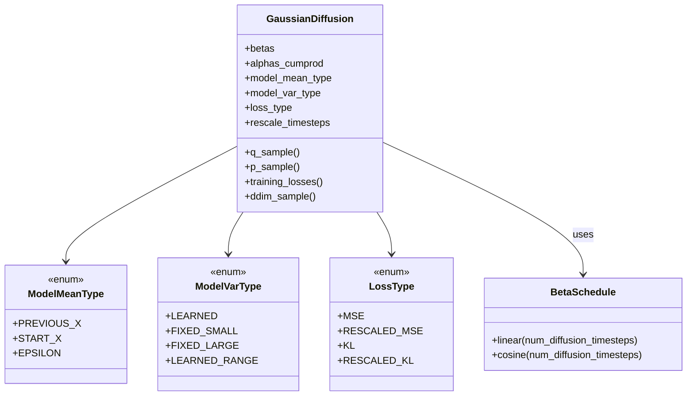
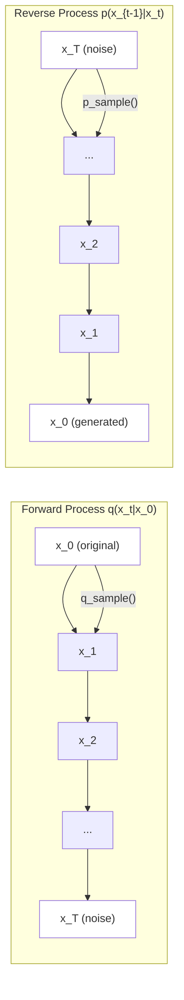
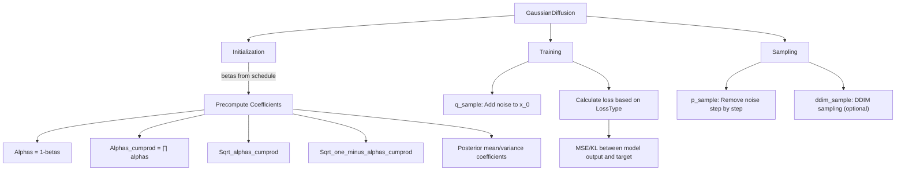
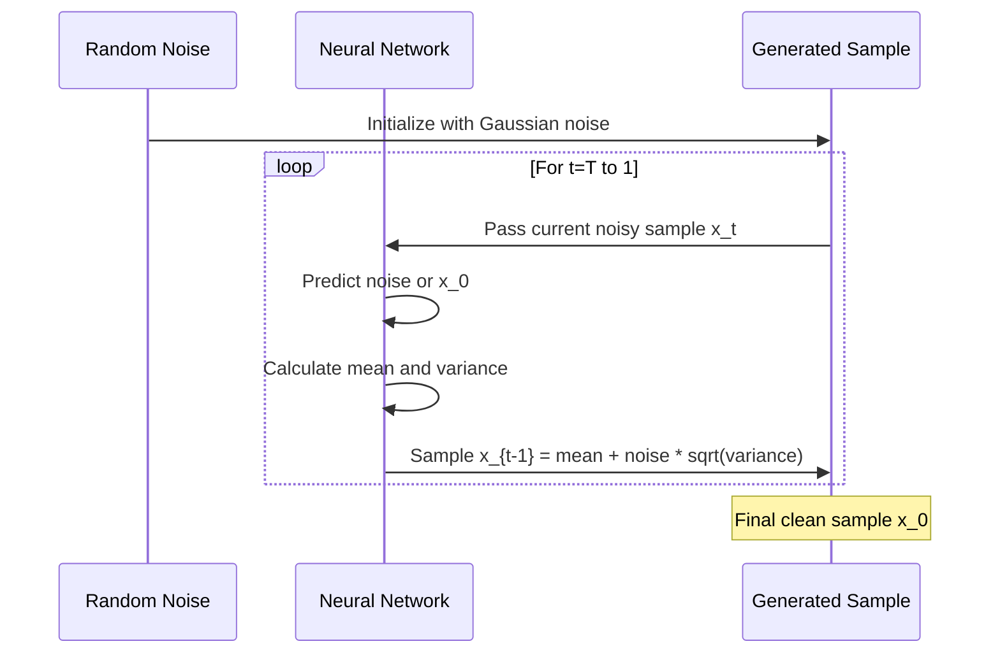
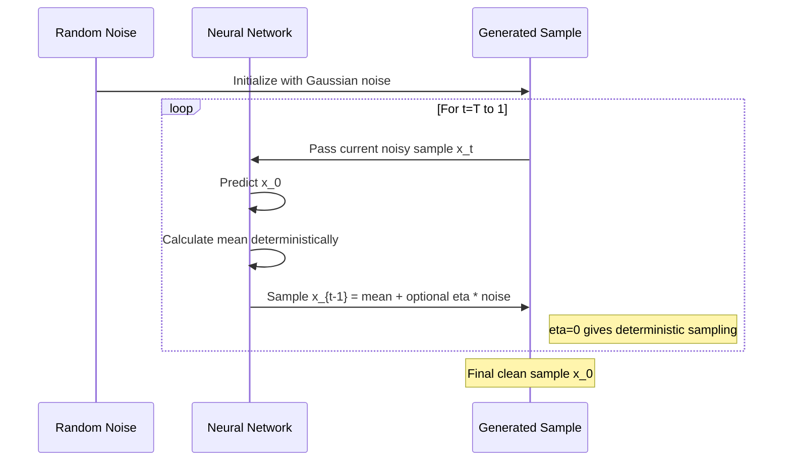
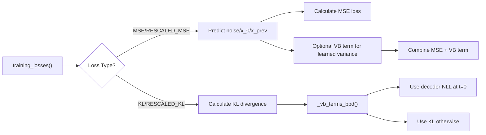
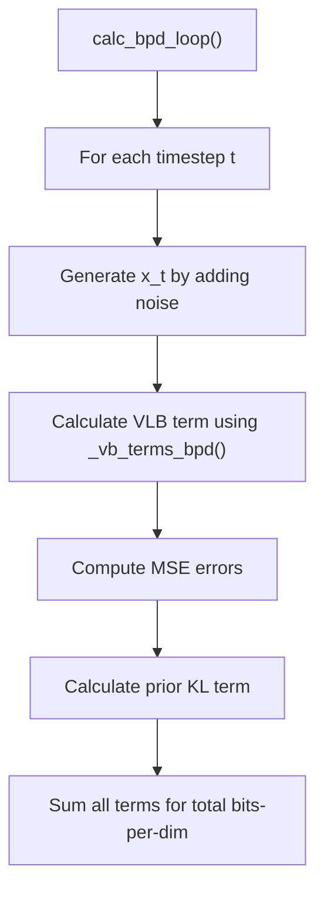
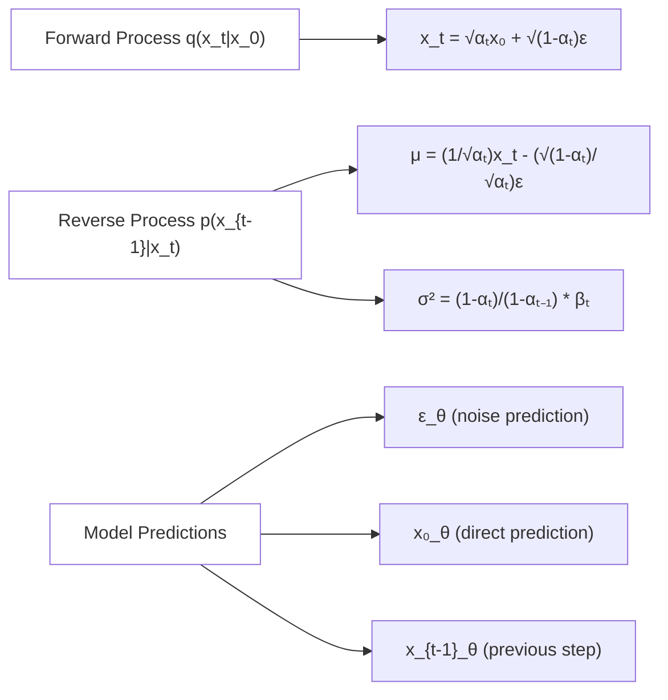
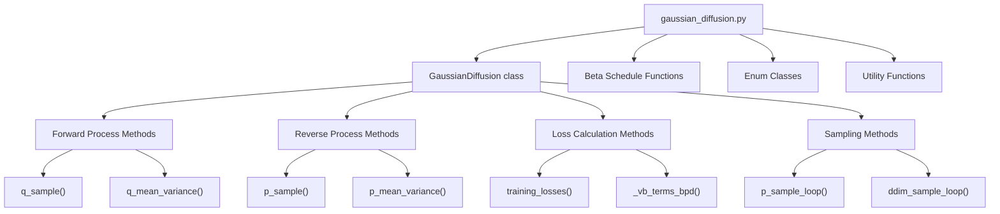

<!-- source: DeepWiki mcp.deepwiki.com · repo openai/improved-diffusion · page 3 Implementation Details · fetched 2026-10-26 -->

# Implementation Details

<details>
<summary>Relevant source files</summary>

The following files were used as context for generating this wiki page:

- [README.md](README.md)
- [improved_diffusion/gaussian_diffusion.py](improved_diffusion/gaussian_diffusion.py)

</details>


This page provides a technical deep dive into the core implementation components of the improved-diffusion codebase. We explore the key classes, algorithms, and architectural decisions that enable the denoising diffusion probabilistic models. For information about the theoretical concepts behind diffusion models, see [Core Concepts](#2), while for specific pipeline implementation details, see [Training Pipeline](#2.1) and [Sampling Pipeline](#2.2).

## Gaussian Diffusion Implementation

The heart of the implementation is the `GaussianDiffusion` class, which handles both the forward diffusion process (adding noise) and the reverse diffusion process (removing noise). This class provides a framework for training diffusion models and sampling from them.



Sources: [improved_diffusion/gaussian_diffusion.py:101-825]()

### Forward and Reverse Processes

The diffusion process operates in two directions:

1. **Forward Process (q)**: Gradually adds noise to data over a series of timesteps
2. **Reverse Process (p)**: Progressively removes noise to generate samples



Sources: [improved_diffusion/gaussian_diffusion.py:171-206](), [improved_diffusion/gaussian_diffusion.py:356-387]()

### Key Implementation Components

The diffusion process is parameterized through several key choices:

1. **Beta Schedule**: Controls the noise schedule through the diffusion process
   - Linear: Linear schedule from 0.0001 to 0.02
   - Cosine: Cosine-based schedule that avoids very small or large values

2. **Model Mean Type**: Determines what the neural network predicts
   - `EPSILON`: Predict the noise that was added (most common)
   - `START_X`: Directly predict the original input x₀
   - `PREVIOUS_X`: Predict the previous timestep x_{t-1}

3. **Model Variance Type**: Controls how the variance is handled
   - `FIXED_SMALL`: Use fixed small variance from posterior
   - `FIXED_LARGE`: Use fixed large variance
   - `LEARNED`: Allow the model to learn the variance
   - `LEARNED_RANGE`: Learn a range between small and large variance

4. **Loss Type**: Determines the training objective
   - `MSE`: Standard mean squared error
   - `RESCALED_MSE`: MSE with rescaling for better balance
   - `KL`: Kullback-Leibler divergence (variational lower bound)
   - `RESCALED_KL`: Rescaled KL for full variational lower bound



Sources: [improved_diffusion/gaussian_diffusion.py:18-62](), [improved_diffusion/gaussian_diffusion.py:118-170](), [improved_diffusion/gaussian_diffusion.py:677-746]()

## Sampling Processes

The implementation supports two sampling approaches:

### Standard Diffusion Sampling

The standard approach (`p_sample_loop`) iteratively removes noise, starting from pure Gaussian noise:



Sources: [improved_diffusion/gaussian_diffusion.py:389-429](), [improved_diffusion/gaussian_diffusion.py:431-477]()

### DDIM Sampling

The Denoising Diffusion Implicit Model (DDIM) sampling approach (`ddim_sample_loop`) offers a deterministic option with fewer steps:



Sources: [improved_diffusion/gaussian_diffusion.py:479-522](), [improved_diffusion/gaussian_diffusion.py:562-640]()

## Loss Calculation

The implementation supports different loss functions, enabling various training strategies:



Sources: [improved_diffusion/gaussian_diffusion.py:642-746]()

## Technical Implementation Details

### Beta Schedules

The codebase implements two beta schedules:

1. **Linear Schedule**:
   ```
   beta_start = 0.0001 * (1000 / num_diffusion_timesteps)
   beta_end = 0.02 * (1000 / num_diffusion_timesteps)
   betas = linspace(beta_start, beta_end, num_diffusion_timesteps)
   ```

2. **Cosine Schedule**:
   ```
   alpha_bar(t) = cos²((t + 0.008) / 1.008 * π/2)
   betas = 1 - alpha_bar(t+1)/alpha_bar(t)
   ```

The cosine schedule produces more visually appealing results by avoiding extreme noise levels at the beginning and end of the diffusion process.

Sources: [improved_diffusion/gaussian_diffusion.py:18-62]()

### Timestep Rescaling

For compatibility with models trained with different numbers of diffusion steps, the implementation includes an option to rescale timesteps:

```python
def _scale_timesteps(self, t):
    if self.rescale_timesteps:
        return t.float() * (1000.0 / self.num_timesteps)
    return t
```

This enables running a model with a different number of steps than it was trained with.

Sources: [improved_diffusion/gaussian_diffusion.py:351-354]()

### Variational Lower Bound Calculation

The code implements a careful calculation of the variational lower bound for evaluating model quality and potentially for training:



Sources: [improved_diffusion/gaussian_diffusion.py:770-825]()

## Mathematical Foundation

The implementation carefully follows the mathematical framework of diffusion models:



The implementation handles all the mathematical complexity of converting between different prediction types and computing the correct variances for the reverse process.

Sources: [improved_diffusion/gaussian_diffusion.py:118-170](), [improved_diffusion/gaussian_diffusion.py:208-230](), [improved_diffusion/gaussian_diffusion.py:232-326]()

## Utility Functions

The implementation includes several utility functions that simplify working with diffusion models:

1. **Extract into tensor**: Efficiently extracts values from a 1D array for a batch of indices, handling broadcasting properly.
   
2. **Predict epsilon from x_start**: Converts between different model prediction types.
   
3. **Calculate model mean and variance**: Handles different model variance types and outputs.

These utilities ensure that the code remains efficient and numerically stable.

Sources: [improved_diffusion/gaussian_diffusion.py:828-841](), [improved_diffusion/gaussian_diffusion.py:328-350]()

## Code Organization

The implementation follows a modular approach that separates different aspects of the diffusion process:



This organization provides a clean separation of concerns and makes the code easier to understand and extend.

Sources: [improved_diffusion/gaussian_diffusion.py:101-825]()

This implementation delivers a flexible and efficient framework for training and sampling diffusion models, supporting various model architectures, noise schedules, and sampling approaches.

---

