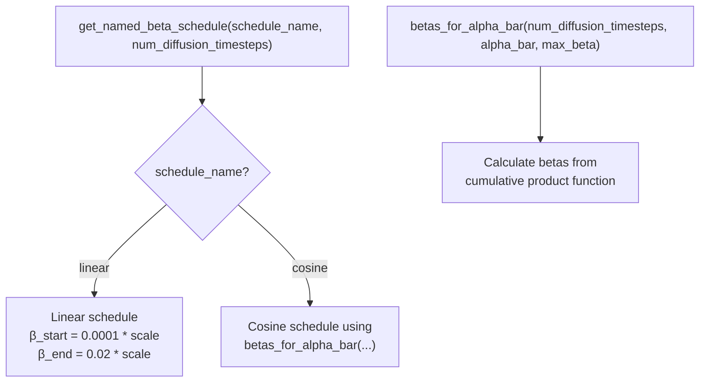
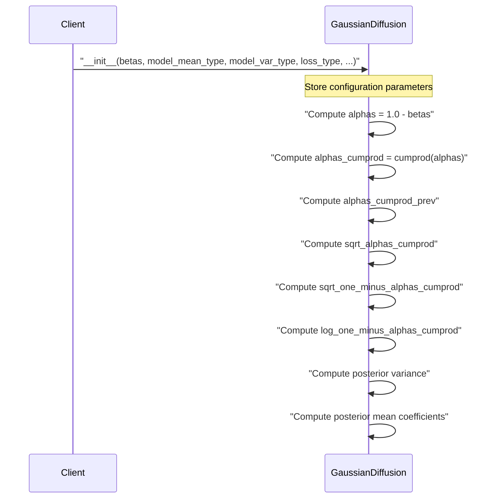
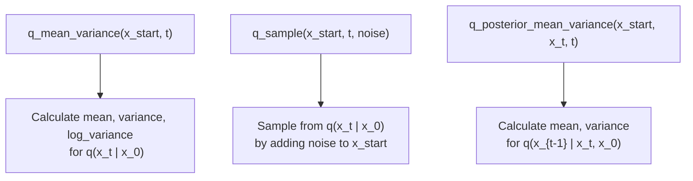
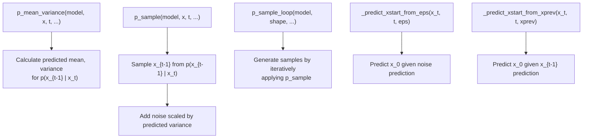
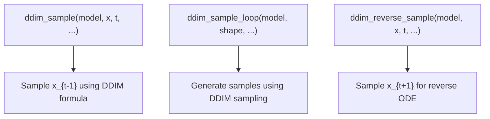
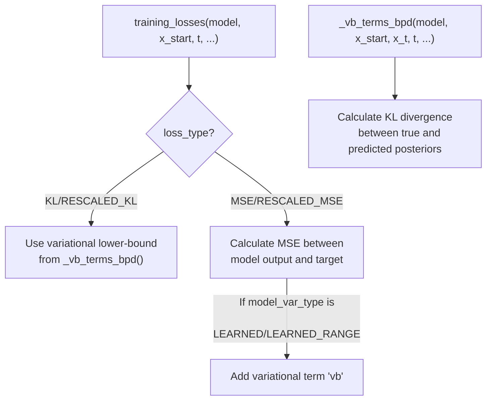
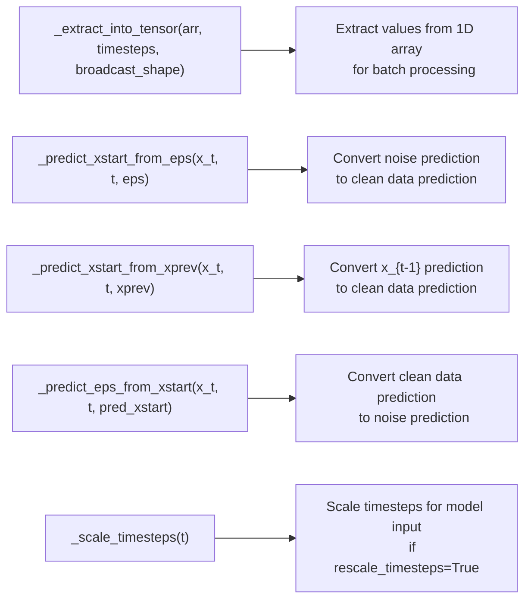

<!-- source: DeepWiki mcp.deepwiki.com · repo openai/improved-diffusion · page 3.1 Gaussian Diffusion · fetched 2026-10-26 -->

# Gaussian Diffusion

<details>
<summary>Relevant source files</summary>

The following files were used as context for generating this wiki page:

- [improved_diffusion/gaussian_diffusion.py](improved_diffusion/gaussian_diffusion.py)

</details>


## Purpose and Scope

This document explains the implementation of the Gaussian diffusion process in the improved-diffusion repository. It covers both the forward process (gradually adding noise to data) and the reverse process (removing noise to generate samples), along with the associated mathematical calculations, loss functions, and sampling methods. For information about the overall training pipeline, see [Training Pipeline](#2.1), and for details on sampling, see [Sampling Pipeline](#2.2).

## Core Components

The Gaussian diffusion implementation consists of a main `GaussianDiffusion` class and several supporting enumerations that configure its behavior. Together, these components define how noise is added and removed from data, as well as how the model is trained to reverse the diffusion process.

```mermaid
classDiagram
    GaussianDiffusion --> ModelMeanType: "uses"
    GaussianDiffusion --> ModelVarType: "uses"
    GaussianDiffusion --> LossType: "uses"
    GaussianDiffusion --> "Beta Schedules": "uses"
    
    class GaussianDiffusion {
        +__init__(betas, model_mean_type, model_var_type, loss_type, rescale_timesteps)
        +q_mean_variance(x_start, t)
        +q_sample(x_start, t, noise)
        +q_posterior_mean_variance(x_start, x_t, t)
        +p_mean_variance(model, x, t, ...)
        +p_sample(model, x, t, ...)
        +p_sample_loop(model, shape, ...)
        +ddim_sample(model, x, t, ...)
        +training_losses(model, x_start, t, ...)
    }
    
    class ModelMeanType {
        <<enum>>
        +PREVIOUS_X: "Model predicts x_{t-1}"
        +START_X: "Model predicts x_0"
        +EPSILON: "Model predicts noise ε"
    }
    
    class ModelVarType {
        <<enum>>
        +LEARNED: "Model outputs log variance"
        +FIXED_SMALL: "Small fixed variance"
        +FIXED_LARGE: "Large fixed variance"
        +LEARNED_RANGE: "Model predicts interpolation"
    }
    
    class LossType {
        <<enum>>
        +MSE: "Mean squared error"
        +RESCALED_MSE: "Rescaled MSE"
        +KL: "KL divergence"
        +RESCALED_KL: "Rescaled KL divergence"
    }
    
    class "Beta Schedules" {
        +get_named_beta_schedule()
        +betas_for_alpha_bar()
    }
```

Sources: [improved_diffusion/gaussian_diffusion.py:65-98](), [improved_diffusion/gaussian_diffusion.py:101-130]()

### ModelMeanType

The `ModelMeanType` enum determines what the neural network model predicts:

- `PREVIOUS_X`: Model predicts x_{t-1} directly
- `START_X`: Model predicts x_0 (the clean, noiseless data)
- `EPSILON`: Model predicts the noise ε that was added to x_0 to obtain x_t

The most common choice in practice is `EPSILON`, as it often leads to more stable training.

Sources: [improved_diffusion/gaussian_diffusion.py:65-72]()

### ModelVarType

The `ModelVarType` enum specifies how the variance of the reverse diffusion process is handled:

- `LEARNED`: Model predicts log variance directly
- `FIXED_SMALL`: Uses small fixed variance from posterior distribution
- `FIXED_LARGE`: Uses large fixed variance (betas)
- `LEARNED_RANGE`: Model predicts a value that interpolates between small and large fixed variances

Sources: [improved_diffusion/gaussian_diffusion.py:75-86]()

### LossType

The `LossType` enum defines the training objective:

- `MSE`: Standard mean squared error
- `RESCALED_MSE`: MSE with rescaled variance terms
- `KL`: Kullback-Leibler divergence for variational lower-bound
- `RESCALED_KL`: Rescaled KL divergence to estimate the full variational lower-bound

Sources: [improved_diffusion/gaussian_diffusion.py:89-98]()

## Beta Schedules

Beta schedules control the noise level added at each timestep of the diffusion process. The repository provides predefined schedules that can be used out of the box.



Sources: [improved_diffusion/gaussian_diffusion.py:18-62]()

The implementation supports two main types of schedules:

1. **Linear Schedule**: A linear interpolation between small and large beta values, scaled based on the number of diffusion steps.
2. **Cosine Schedule**: A schedule based on a cosine function that provides smoother transitions between noise levels.

The `betas_for_alpha_bar` function allows for custom schedules by defining the cumulative product of (1-beta) over time.

Sources: [improved_diffusion/gaussian_diffusion.py:18-42](), [improved_diffusion/gaussian_diffusion.py:45-62]()

## GaussianDiffusion Initialization

When initializing a `GaussianDiffusion` object, various coefficients are precomputed to make the forward and reverse processes more efficient:



Sources: [improved_diffusion/gaussian_diffusion.py:118-169]()

During initialization, the class computes and stores various quantities that are used throughout the diffusion process:

| Variable | Description | Equation |
|----------|-------------|----------|
| `alphas` | One minus beta | `1.0 - betas` |
| `alphas_cumprod` | Cumulative product of alphas | `cumprod(alphas)` |
| `alphas_cumprod_prev` | Previous timestep's cumulative product | `[1.0, alphas_cumprod[:-1]]` |
| `sqrt_alphas_cumprod` | Square root of cumulative alphas | `sqrt(alphas_cumprod)` |
| `sqrt_one_minus_alphas_cumprod` | Square root of 1 minus cumulative alphas | `sqrt(1.0 - alphas_cumprod)` |
| `posterior_variance` | Variance for q(x_{t-1} \| x_t, x_0) | `betas * (1.0 - alphas_cumprod_prev) / (1.0 - alphas_cumprod)` |
| `posterior_mean_coef1` | First coefficient for posterior mean | `betas * sqrt(alphas_cumprod_prev) / (1.0 - alphas_cumprod)` |
| `posterior_mean_coef2` | Second coefficient for posterior mean | `(1.0 - alphas_cumprod_prev) * sqrt(alphas) / (1.0 - alphas_cumprod)` |

Sources: [improved_diffusion/gaussian_diffusion.py:132-169]()

## Forward Process (q)

The forward process gradually adds noise to the input data according to a predefined schedule. This is implemented through the following methods:



Sources: [improved_diffusion/gaussian_diffusion.py:171-230]()

### q_sample Method

The `q_sample` method implements the forward diffusion process by adding noise to the input data:

```
x_t = sqrt(α_cumprod) * x_0 + sqrt(1 - α_cumprod) * ε
```

where:
- `x_t` is the noised data at timestep t
- `x_0` is the original, clean data
- `α_cumprod` is the cumulative product of alphas up to timestep t
- `ε` is Gaussian noise

Sources: [improved_diffusion/gaussian_diffusion.py:188-206]()

### q_posterior_mean_variance Method

This method calculates the posterior distribution `q(x_{t-1} | x_t, x_0)`, which represents the distribution of the less noisy sample given both the current noisy sample and the original clean data:

```
μ(x_t, x_0) = posterior_mean_coef1 * x_0 + posterior_mean_coef2 * x_t
```

This distribution is used during training to calculate losses.

Sources: [improved_diffusion/gaussian_diffusion.py:208-230]()

## Reverse Process (p)

The reverse process removes noise step by step to generate samples. This is the heart of the diffusion model generation process and is implemented through several methods:



Sources: [improved_diffusion/gaussian_diffusion.py:232-327](), [improved_diffusion/gaussian_diffusion.py:328-350](), [improved_diffusion/gaussian_diffusion.py:356-478]()

### p_mean_variance Method

The `p_mean_variance` method uses the neural network model to predict the mean and variance of the reverse diffusion step `p(x_{t-1} | x_t)`:

1. The model produces output based on the noisy sample `x_t` and timestep `t`
2. Depending on `model_mean_type` and `model_var_type`, the method extracts and processes the predicted mean and variance
3. The method also computes a prediction of the original clean data `x_0`

Sources: [improved_diffusion/gaussian_diffusion.py:232-327]()

### p_sample Method

The `p_sample` method uses the predicted mean and variance from `p_mean_variance` to sample the less noisy image at the previous timestep:

```
x_{t-1} = μ_θ(x_t, t) + σ_θ(x_t, t) * z
```

where:
- `μ_θ` is the predicted mean
- `σ_θ` is the predicted standard deviation (square root of variance)
- `z` is standard Gaussian noise

At the final timestep (t=0), no noise is added to ensure a deterministic output.

Sources: [improved_diffusion/gaussian_diffusion.py:356-387]()

### p_sample_loop Method

The `p_sample_loop` method iteratively applies `p_sample` to generate samples starting from pure noise:

1. Starts with random noise `x_T ~ N(0, I)`
2. For each timestep `t` from `T-1` down to `0`:
   - Computes `x_t` using `p_sample`
3. Returns the final sample `x_0`

Sources: [improved_diffusion/gaussian_diffusion.py:389-478]()

## DDIM Sampling

In addition to the standard diffusion sampling, the implementation provides Denoising Diffusion Implicit Models (DDIM) sampling, which allows for faster generation with fewer steps.



Sources: [improved_diffusion/gaussian_diffusion.py:479-640]()

DDIM sampling uses a deterministic sampling process with the option to add controlled noise through the `eta` parameter:

```
x_{t-1} = sqrt(α_{t-1}) * x_0_pred + sqrt(1 - α_{t-1} - σ_t^2) * ε_pred + σ_t * z
```

where:
- `σ_t` is controlled by the parameter `eta`
- When `eta = 0`, the process is deterministic
- `x_0_pred` is the predicted clean image
- `ε_pred` is the predicted noise

Sources: [improved_diffusion/gaussian_diffusion.py:479-522]()

## Training Losses

The `GaussianDiffusion` class provides methods to calculate training losses based on the specified `loss_type`:



Sources: [improved_diffusion/gaussian_diffusion.py:642-825]()

### MSE Losses

When using MSE-based losses, the model is trained to predict one of the following targets based on `model_mean_type`:

- `PREVIOUS_X`: The model predicts `x_{t-1}`
- `START_X`: The model predicts `x_0`
- `EPSILON`: The model predicts the noise `ε`

For learned variance, an additional variational bound term is added to the loss.

Sources: [improved_diffusion/gaussian_diffusion.py:677-746]()

### Variational Bound Losses

When using KL-based losses, the model is trained to minimize the variational lower bound of the negative log-likelihood:

1. `_vb_terms_bpd` calculates the KL divergence between the true posterior `q(x_{t-1} | x_t, x_0)` and the predicted posterior `p_θ(x_{t-1} | x_t)`
2. For the final timestep (t=0), it uses the discretized Gaussian log-likelihood

The `RESCALED_KL` option multiplies the loss by the number of timesteps to estimate the total VLB.

Sources: [improved_diffusion/gaussian_diffusion.py:642-676]()

## Helper Functions

The module includes several helper functions that support the main diffusion process:



Sources: [improved_diffusion/gaussian_diffusion.py:328-354](), [improved_diffusion/gaussian_diffusion.py:828-841]()

The `_extract_into_tensor` function is particularly important as it allows for efficient extraction of time-dependent parameters for batched data processing.

Sources: [improved_diffusion/gaussian_diffusion.py:828-841]()

## Conclusion

The Gaussian diffusion implementation in this repository provides a complete framework for building and training diffusion models. It includes:

1. Flexible configuration through model type enums
2. Multiple beta schedules for controlling the noise process
3. Complete forward and reverse diffusion processes
4. Efficient loss calculation for various training objectives
5. Both standard and DDIM sampling methods

This implementation forms the core of the diffusion model system, enabling both training and inference of high-quality generative models.

---

