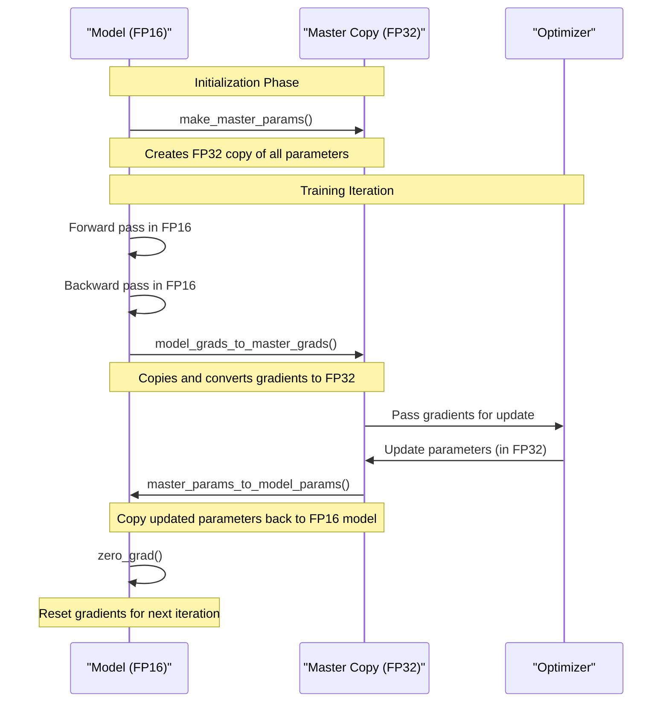
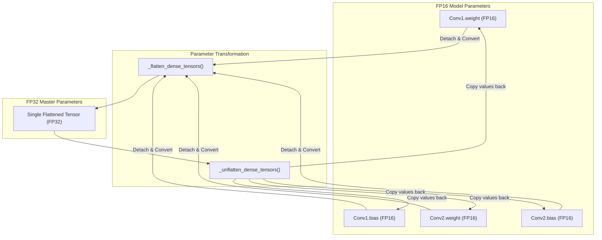
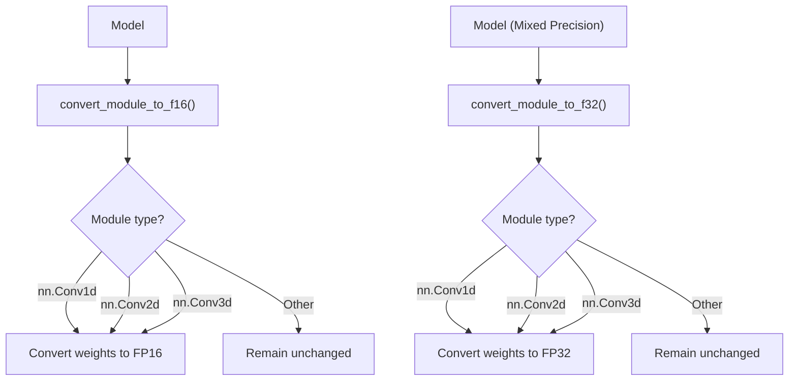

<!-- source: DeepWiki mcp.deepwiki.com · repo openai/improved-diffusion · page 3.2 Mixed Precision Training · fetched 2026-10-26 -->

# Mixed Precision Training

<details>
<summary>Relevant source files</summary>

The following files were used as context for generating this wiki page:

- [improved_diffusion/fp16_util.py](improved_diffusion/fp16_util.py)

</details>


This document explains the implementation of mixed precision training in the Improved Diffusion repository. Mixed precision training leverages both 16-bit (half precision, FP16) and 32-bit (single precision, FP32) floating-point formats to achieve better computational efficiency while maintaining training stability. For information about distributed training across multiple devices, see [Distributed Training](#3.3).

## Purpose and Principles

Mixed precision training serves several key purposes:

1. **Memory Efficiency**: Reduces GPU memory usage by storing model parameters in FP16
2. **Computational Speed**: Accelerates training by leveraging hardware-optimized FP16 operations
3. **Numerical Stability**: Maintains stable training by performing parameter updates in FP32

The implementation follows a master-copy pattern, where the model operates primarily in FP16 but parameter updates occur in FP32.

Sources: [improved_diffusion/fp16_util.py:1-77]()

## Core Components

The mixed precision training functionality is implemented through a set of utility functions in `fp16_util.py`:

| Function | Purpose |
|----------|---------|
| `convert_module_to_f16()` | Converts model layers to FP16 |
| `convert_module_to_f32()` | Converts model layers back to FP32 |
| `make_master_params()` | Creates FP32 copies of model parameters |
| `model_grads_to_master_grads()` | Transfers gradients from model to master parameters |
| `master_params_to_model_params()` | Updates model parameters from master parameters |
| `unflatten_master_params()` | Reshapes master parameters to match model parameters |
| `zero_grad()` | Resets gradients after parameter updates |

Sources: [improved_diffusion/fp16_util.py:9-76]()

## Mixed Precision Training Workflow

The mixed precision training process follows this workflow:



**Diagram: Mixed Precision Training Workflow**

Sources: [improved_diffusion/fp16_util.py:27-76]()

## Parameter Management

The system uses parameter flattening and unflattening to efficiently manage the FP16/FP32 conversion process:



**Diagram: Parameter Conversion Between FP16 and FP32**

Sources: [improved_diffusion/fp16_util.py:27-68]()

## Module Conversion

The system selectively converts specific module types to half precision:



**Diagram: Selective Module Conversion**

Sources: [improved_diffusion/fp16_util.py:9-24]()

## Implementation Details

### Parameter Flattening

The `make_master_params` function creates a single, flattened FP32 tensor from all model parameters:

```python
def make_master_params(model_params):
    master_params = _flatten_dense_tensors(
        [param.detach().float() for param in model_params]
    )
    master_params = nn.Parameter(master_params)
    master_params.requires_grad = True
    return [master_params]
```

This flattened representation simplifies gradient copying and parameter updates.

Sources: [improved_diffusion/fp16_util.py:27-37]()

### Gradient Transfer

After the backward pass in FP16, gradients are copied to the FP32 master parameters:

```python
def model_grads_to_master_grads(model_params, master_params):
    master_params[0].grad = _flatten_dense_tensors(
        [param.grad.data.detach().float() for param in model_params]
    )
```

This ensures gradient updates occur in FP32 precision for numerical stability.

Sources: [improved_diffusion/fp16_util.py:40-47]()

### Parameter Synchronization

After optimizer updates the master parameters, changes are propagated back to the model:

```python
def master_params_to_model_params(model_params, master_params):
    model_params = list(model_params)
    for param, master_param in zip(
        model_params, unflatten_master_params(model_params, master_params)
    ):
        param.detach().copy_(master_param)
```

This maintains the FP16 model while incorporating updates computed in FP32.

Sources: [improved_diffusion/fp16_util.py:50-61]()

## Best Practices for Mixed Precision Training

When using mixed precision training with diffusion models, consider the following:

1. **Memory Usage**: Monitor GPU memory usage to ensure you're getting the expected benefits
2. **Numerical Stability**: Watch for NaN or Inf values in loss or gradients, which could indicate numerical instability
3. **Performance**: Mixed precision typically provides more benefit for larger models and batch sizes
4. **Hardware**: Modern GPUs (especially NVIDIA's Tensor Cores) offer significant speedups for FP16 operations

For very deep or complex diffusion models, mixed precision training can be essential for fitting larger batch sizes into memory and accelerating training.

Sources: [improved_diffusion/fp16_util.py:1-77]()

## Integration with Training Pipeline

The mixed precision training utilities are designed to be integrated into the main training loop. A typical integration pattern would:

1. Convert the model to FP16 using `convert_module_to_f16()`
2. Create master parameters with `make_master_params()`
3. In each training iteration:
   - Perform forward and backward passes in FP16
   - Copy gradients to master parameters with `model_grads_to_master_grads()`
   - Update master parameters with the optimizer
   - Synchronize model parameters with `master_params_to_model_params()`
   - Reset gradients with `zero_grad()`

This approach maintains the efficiency benefits of FP16 while ensuring training stability through FP32 parameter updates.

Sources: [improved_diffusion/fp16_util.py:1-77]()

---

