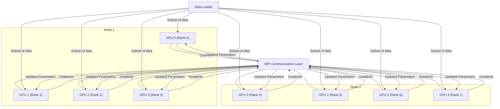
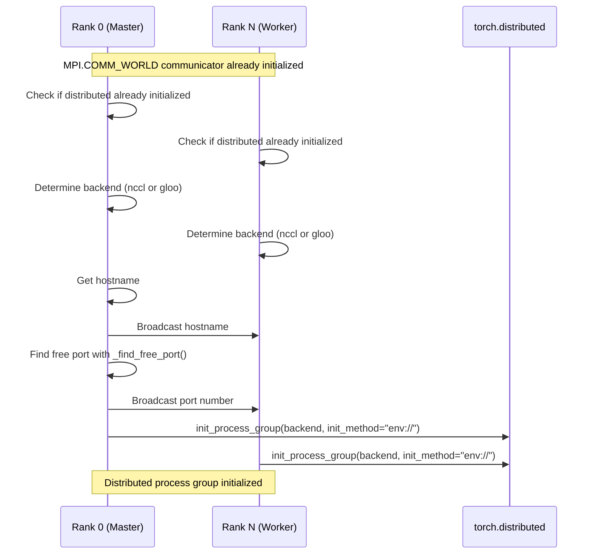
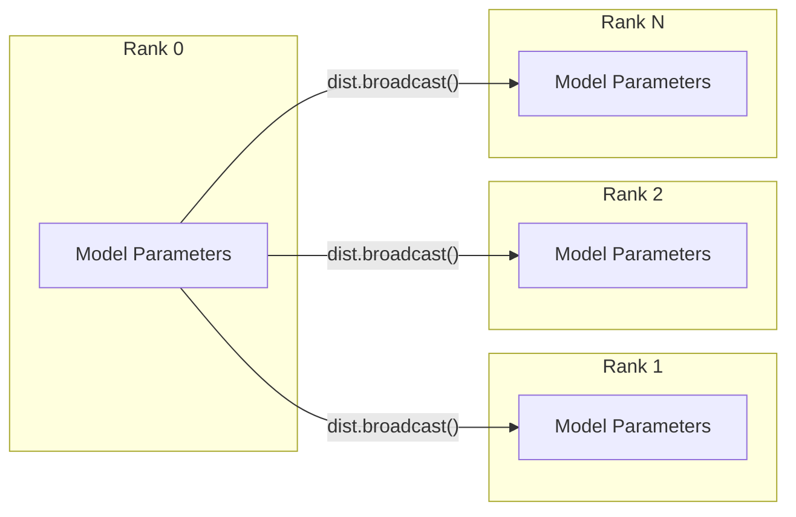
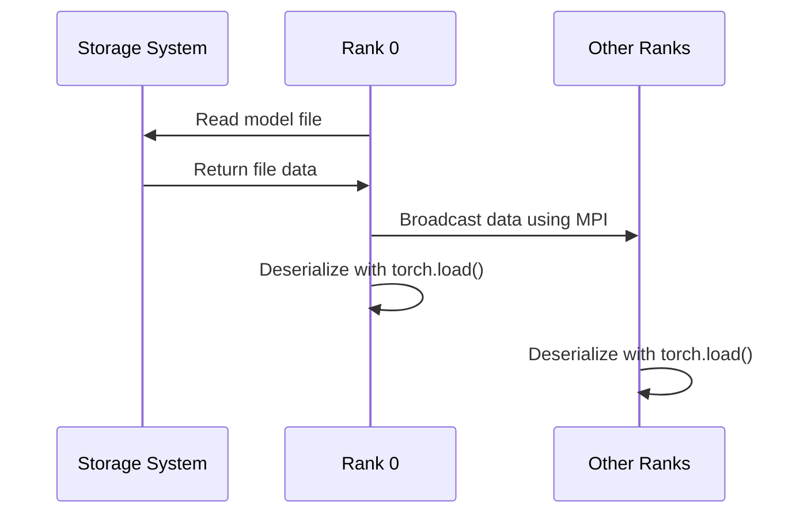

<!-- source: DeepWiki mcp.deepwiki.com · repo openai/improved-diffusion · page 3.3 Distributed Training · fetched 2026-10-26 -->

# Distributed Training

<details>
<summary>Relevant source files</summary>

The following files were used as context for generating this wiki page:

- [README.md](README.md)
- [improved_diffusion/dist_util.py](improved_diffusion/dist_util.py)

</details>


This page documents the distributed training capabilities of the improved-diffusion repository. It covers how the system implements multi-GPU and multi-node training using MPI (Message Passing Interface) to accelerate the training of diffusion models. For information about mixed-precision training, see [Mixed Precision Training](#3.2).

## Overview

The improved-diffusion repository supports distributed training to scale model training across multiple GPUs and multiple nodes. This is particularly important for training large diffusion models, which can be computationally intensive. The distribution mechanism is built on top of MPI via the `mpi4py` package and PyTorch's distributed communication package.

Sources: [README.md:50-56](), [improved_diffusion/dist_util.py:1-13]()

## Distributed Training Architecture

The distributed training system follows a data-parallel approach where:
1. The same model is replicated across multiple devices (GPUs)
2. Each device processes a different subset of the data
3. Gradients are synchronized across devices during backpropagation



Sources: [improved_diffusion/dist_util.py:14-41]()

## MPI Setup and Process Group Initialization

The distributed training infrastructure is initialized through the `setup_dist()` function in the `dist_util.py` module. This function:

1. Creates a process group using `torch.distributed`
2. Automatically selects the appropriate backend ("nccl" for GPU, "gloo" for CPU)
3. Sets up environment variables needed for distributed communication
4. Broadcasts the master address and port to all processes



Sources: [improved_diffusion/dist_util.py:21-41](), [improved_diffusion/dist_util.py:75-82]()

## Device Management

The repository assumes a specific cluster layout where each node has 8 GPUs by default (defined by `GPUS_PER_NODE`). The `dev()` function assigns each process to a specific GPU based on its MPI rank:

| Function | Description |
| --- | --- |
| `dev()` | Returns the appropriate device (GPU or CPU) for the current process based on its rank |

The device assignment follows this formula:
```
GPU_ID = MPI_RANK % GPUS_PER_NODE
```

This ensures that processes are distributed evenly across all available GPUs.

Sources: [improved_diffusion/dist_util.py:44-50](), [improved_diffusion/dist_util.py:16]()

## Parameter Synchronization

The `sync_params()` function ensures that all processes have the same model parameters by broadcasting parameters from rank 0 to all other ranks. This is typically used:

1. After model initialization to ensure all processes start with identical parameters
2. After loading a checkpoint to ensure consistency across all processes



Sources: [improved_diffusion/dist_util.py:66-72]()

## Efficient Model Loading

To avoid redundant file operations across processes, the `load_state_dict()` function implements an efficient model loading strategy:

1. Only rank 0 loads the model file from disk
2. The loaded data is broadcast to all other processes
3. Each process deserializes the model data independently

This approach minimizes I/O operations and network traffic, especially when loading large models.



Sources: [improved_diffusion/dist_util.py:53-63]()

## Using Distributed Training

To run training in a distributed manner, users invoke the training script with `mpiexec`:

```
mpiexec -n $NUM_GPUS python scripts/image_train.py --data_dir path/to/images $MODEL_FLAGS $DIFFUSION_FLAGS $TRAIN_FLAGS
```

When using distributed training, users must manually divide the batch size by the number of processes:

```
# For single GPU training
TRAIN_FLAGS="--lr 1e-4 --batch_size 128"

# For 8-GPU distributed training
TRAIN_FLAGS="--lr 1e-4 --batch_size 16"  # 128 ÷ 8 = 16
```

As an alternative to distributed training for memory-constrained environments, users can use the `--microbatch` flag to reduce memory usage.

Sources: [README.md:50-56]()

## Distributed Sampling

The sampling process also supports distributed execution using MPI. This allows generating large batches of samples across multiple GPUs and machines:

```
mpiexec -n $NUM_GPUS python scripts/image_sample.py --model_path /path/to/model.pt $MODEL_FLAGS $DIFFUSION_FLAGS
```

When running in distributed mode, each process generates its own subset of samples.

Sources: [README.md:72]()

## Best Practices

When using distributed training with improved-diffusion, consider the following best practices:

1. **Batch Size Adjustment**: Always divide the batch size by the number of processes
2. **GPU Assignment**: The system assumes 8 GPUs per node by default, modify `GPUS_PER_NODE` in `dist_util.py` if your setup differs
3. **Backend Selection**: The system automatically selects the appropriate backend (NCCL for GPU, Gloo for CPU)
4. **Memory Management**: If you encounter memory issues even with distributed training, consider using the `--microbatch` flag to further reduce memory usage

Sources: [README.md:56](), [improved_diffusion/dist_util.py:16]()

---

