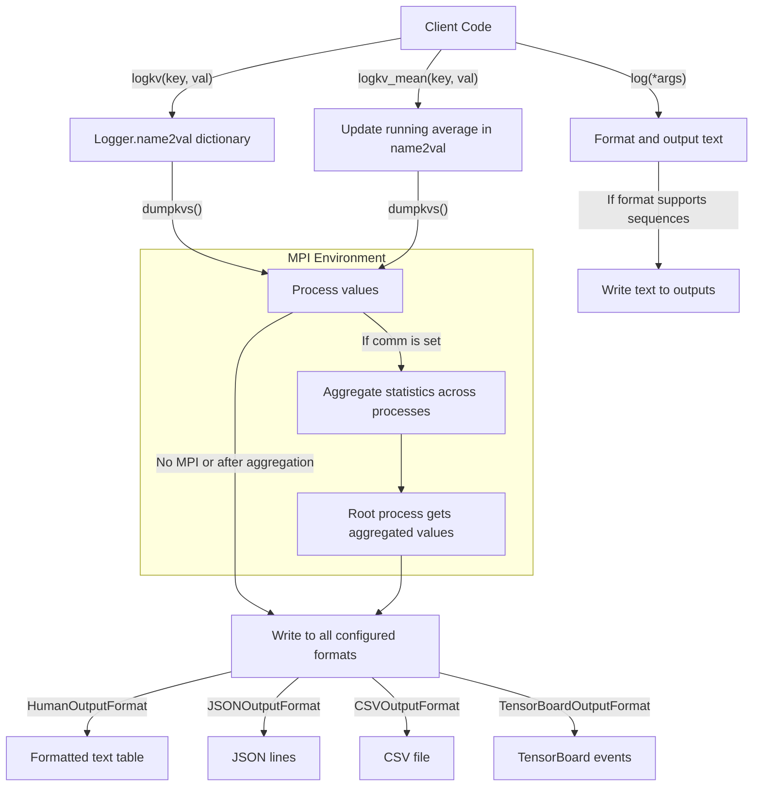
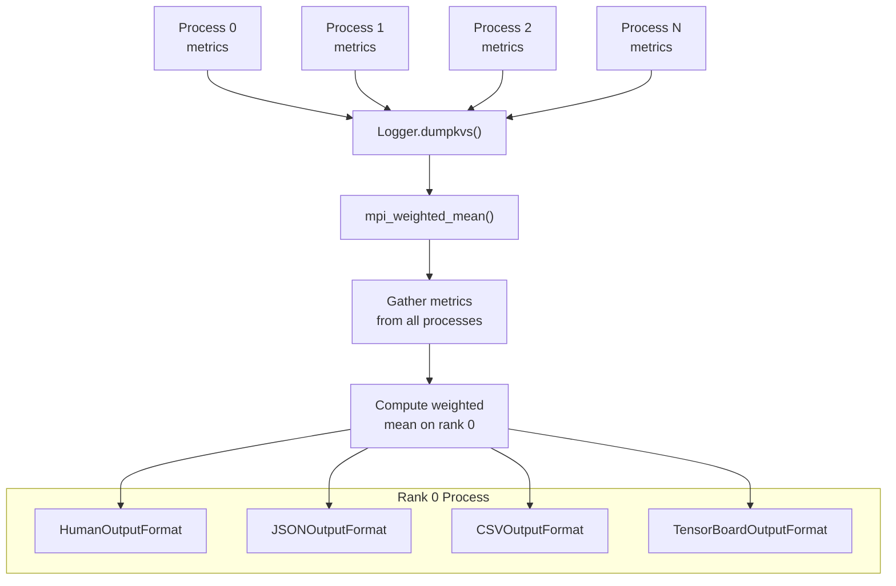
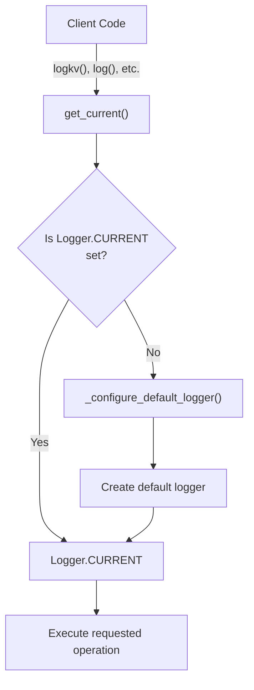

<!-- source: DeepWiki mcp.deepwiki.com · repo openai/improved-diffusion · page 3.4 Logging System · fetched 2026-10-26 -->

# Logging System

<details>
<summary>Relevant source files</summary>

The following files were used as context for generating this wiki page:

- [improved_diffusion/logger.py](improved_diffusion/logger.py)

</details>


The Logging System in the improved-diffusion repository provides comprehensive functionality for tracking metrics, diagnostics, and progress during model training and sampling. It supports multiple output formats, different verbosity levels, and can aggregate statistics across distributed processes. This logging system is adapted from the OpenAI baselines repository to avoid extra RL-based dependencies.

For information about distributed training implementation that interacts with this logging system, see [Distributed Training](#3.3).

## Architecture Overview

The logging system is designed around a central `Logger` class with multiple output format implementations. It supports both key-value pair logging (for metrics) and sequence logging (for textual output).

```mermaid
classDiagram
    class "Logger" {
        -name2val: defaultdict(float)
        -name2cnt: defaultdict(int)
        -level: int
        -dir: string
        -output_formats: list
        -comm: MPI.Comm
        +logkv(key, val)
        +logkv_mean(key, val)
        +dumpkvs()
        +log(*args, level)
        +set_level(level)
        +set_comm(comm)
        +get_dir()
        +close()
    }

    class "KVWriter" {
        <<interface>>
        +writekvs(kvs)
    }

    class "SeqWriter" {
        <<interface>>
        +writeseq(seq)
    }

    class "HumanOutputFormat" {
        -file: file object
        -own_file: bool
        +writekvs(kvs)
        +writeseq(seq)
        +close()
    }

    class "JSONOutputFormat" {
        -file: file object
        +writekvs(kvs)
        +close()
    }

    class "CSVOutputFormat" {
        -file: file object
        -keys: list
        -sep: string
        +writekvs(kvs)
        +close()
    }

    class "TensorBoardOutputFormat" {
        -dir: string
        -step: int
        -writer: EventsWriter
        +writekvs(kvs)
        +close()
    }

    KVWriter <|.. HumanOutputFormat
    SeqWriter <|.. HumanOutputFormat
    KVWriter <|.. JSONOutputFormat
    KVWriter <|.. CSVOutputFormat
    KVWriter <|.. TensorBoardOutputFormat

    Logger --> KVWriter : uses
    Logger --> SeqWriter : uses
```

Sources: [improved_diffusion/logger.py:26-33](), [improved_diffusion/logger.py:332-401]()

## Logging Workflow

The logging system maintains two main types of data: key-value pairs (metrics) and sequences (text logs). Here's how data flows through the system:



Sources: [improved_diffusion/logger.py:346-378](), [improved_diffusion/logger.py:212-252]()

## Output Formats

The logging system supports multiple output formats that can be used simultaneously. Each format implements either the `KVWriter` interface for key-value data, the `SeqWriter` interface for sequence data, or both.

### Human-Readable Text Format

The `HumanOutputFormat` class outputs data in a human-readable format:
- Key-value pairs are formatted as tables with borders
- Text logs are written as plain text
- Output can be directed to a file or to stdout

### JSON Format

The `JSONOutputFormat` class outputs each set of key-value pairs as a JSON object on a new line, creating a JSON Lines format file.

### CSV Format

The `CSVOutputFormat` class maintains a CSV file with:
- Column headers for all keys seen so far
- One row per call to `dumpkvs()`
- Dynamic handling of new keys that appear during logging

### TensorBoard Format

The `TensorBoardOutputFormat` class writes metrics in TensorBoard's event format, allowing visualization with TensorBoard.

| Format | File | Key-Value Support | Sequence Support |
|--------|------|-------------------|------------------|
| Human  | log.txt | ✓ | ✓ |
| JSON   | progress.json | ✓ | ✗ |
| CSV    | progress.csv | ✓ | ✗ |
| TensorBoard | tb directory | ✓ | ✗ |

Sources: [improved_diffusion/logger.py:36-188]()

## Logging API

The logging system provides a simple API for recording metrics and messages:

### Key-Value Logging

```python
# Log a single metric
logkv("loss", 0.123)

# Log a metric that will be averaged if logged multiple times
logkv_mean("accuracy", 0.97)

# Log multiple metrics at once
logkvs({"loss": 0.123, "accuracy": 0.97})

# Write all logged metrics to outputs
dumpkvs()
```

### Text Logging

```python
# Log a message at different levels
log("Starting training", level=INFO)
debug("Debug information")
info("General information")
warn("Warning message")
error("Error message")
```

### Log Levels

The logging system provides several verbosity levels:

| Level | Value | Function |
|-------|-------|----------|
| DEBUG | 10 | `debug()` |
| INFO  | 20 | `info()`, `log()` |
| WARN  | 30 | `warn()` |
| ERROR | 40 | `error()` |
| DISABLED | 50 | No output |

Sources: [improved_diffusion/logger.py:18-23](), [improved_diffusion/logger.py:212-267]()

## Distributed Logging with MPI

When training is distributed across multiple processes with MPI, the logging system can aggregate statistics:



The process works as follows:

1. Each process collects its own metrics
2. When `dumpkvs()` is called, all processes participate in an MPI gather operation
3. The root process (rank 0) calculates weighted means of all metrics
4. Only the root process writes the aggregated metrics to output formats
5. Non-root processes clear their local metrics

Sources: [improved_diffusion/logger.py:356-373](), [improved_diffusion/logger.py:412-439]()

## Configuration

The logger must be configured before use, typically at the start of training or sampling:

```python
# Basic configuration
configure(dir="logs", format_strs=["stdout", "log", "csv"])

# With MPI
configure(dir="logs", format_strs=["stdout", "log", "csv"], comm=MPI.COMM_WORLD)

# Temporary configuration
with scoped_configure(dir="temp_logs", format_strs=["log"]):
    # Logging in this block goes to temp_logs
    # Previous logger is restored after the block
```

The `format_strs` parameter specifies which output formats to use:

| Format String | Output |
|---------------|--------|
| "stdout" | Terminal output |
| "log" | Text log file |
| "json" | JSON lines file |
| "csv" | CSV file |
| "tensorboard" | TensorBoard events |

Sources: [improved_diffusion/logger.py:442-494]()

## Advanced Features

### Profiling

The logging system includes utilities for timing code sections:

```python
# Using a context manager
with profile_kv("operation_name"):
    # Code to be timed
    expensive_operation()

# As a decorator
@profile("function_name")
def my_function():
    # Function will be timed
    pass
```

This adds a key-value pair with the time spent in the operation to the logger.

Sources: [improved_diffusion/logger.py:293-317]()

### Global Logger Instance

The logging system uses a global `Logger` instance that is accessed through API functions:



This design allows for simple usage without manually passing a logger instance around.

Sources: [improved_diffusion/logger.py:325-329](), [improved_diffusion/logger.py:474-476]()

## Integration with Diffusion Model Training

The logging system is used throughout the training and sampling processes to track metrics such as:

- Loss values
- Training progress (step/epoch)
- Timing information
- Hyperparameters
- Model statistics

During distributed training with MPI, metrics from all processes are aggregated, providing a comprehensive view of the training progress.

Sources: [improved_diffusion/logger.py:442-472]()

---

