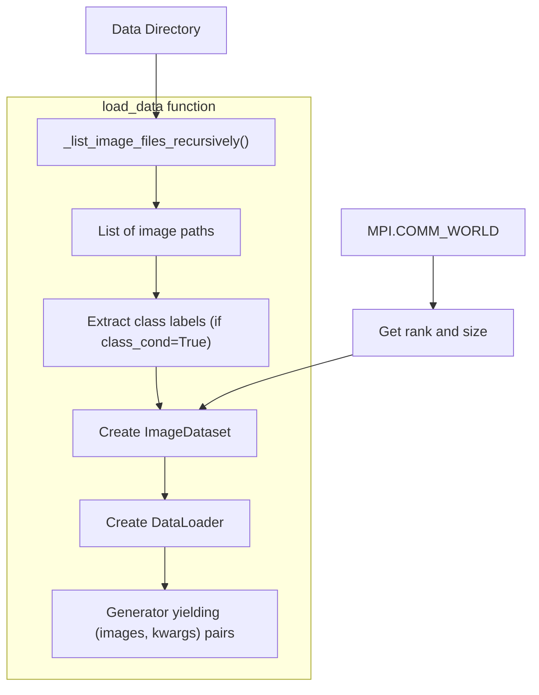
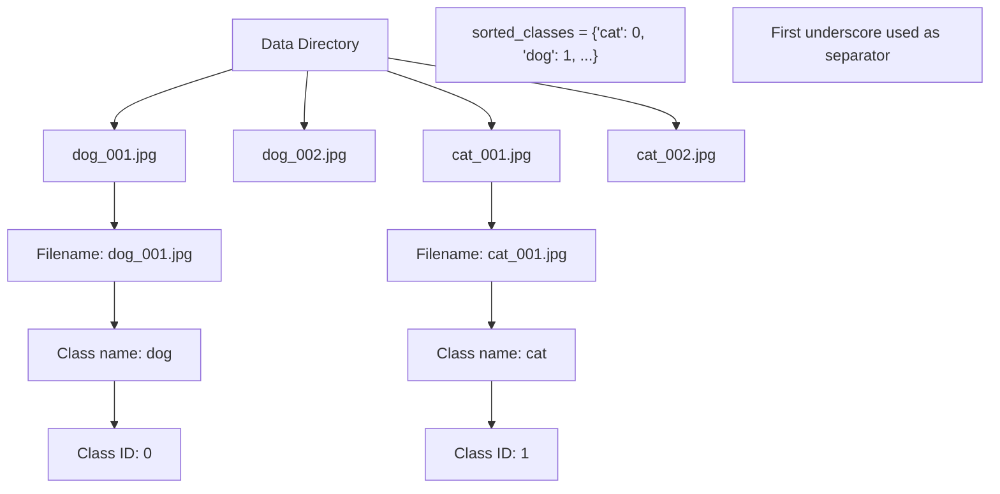
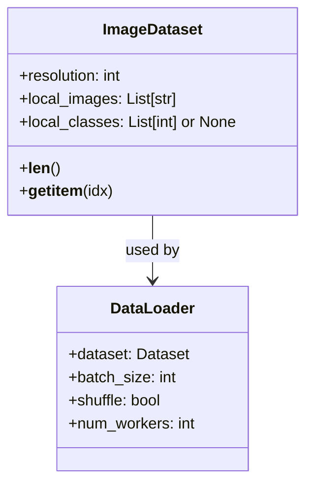
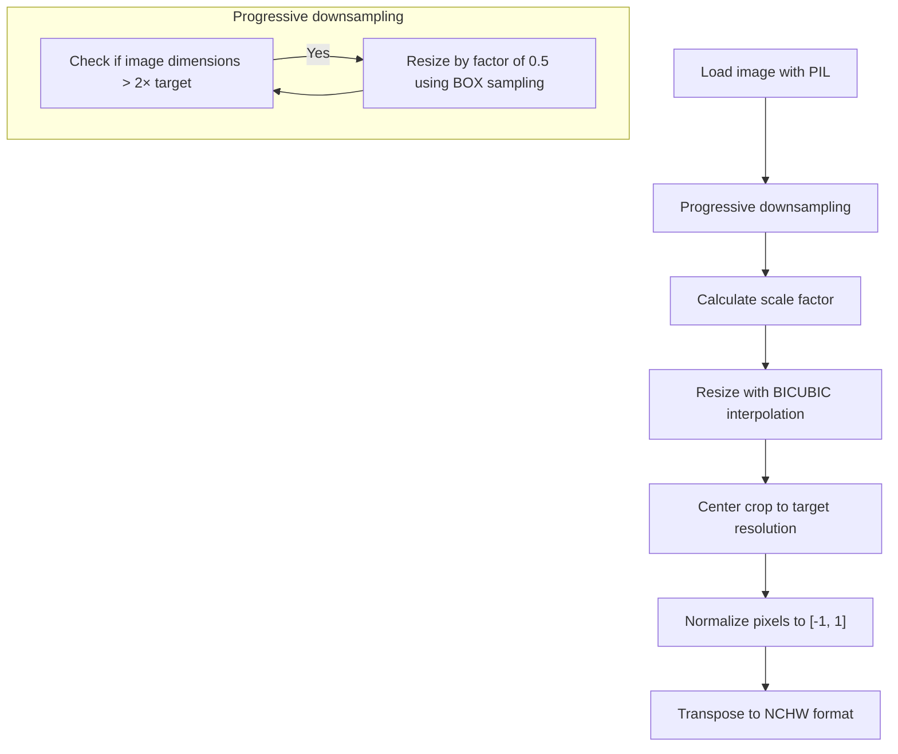
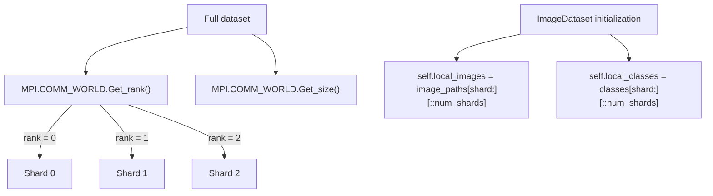
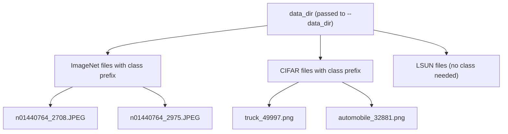

<!-- source: DeepWiki mcp.deepwiki.com · repo openai/improved-diffusion · page 4 Data Management · fetched 2026-10-26 -->

# Data Management

Relevant source files

The following files were used as context for generating this wiki page:

- [datasets/README.md](datasets/README.md)
- [improved_diffusion/image_datasets.py](improved_diffusion/image_datasets.py)

This page documents the data management system in the improved-diffusion repository, explaining how image datasets are prepared, loaded, and processed for training diffusion models. The data management system handles everything from loading raw image files to preprocessing them into the format required by the diffusion model, with support for distributed training environments.

For information about specific data preparation steps for individual datasets, see [Data Preparation](#4.1).

## Data Loading Architecture

The data loading system in improved-diffusion follows a streamlined pipeline that transforms raw image files into batches of normalized tensors ready for model training.

**Data Loading Pipeline Diagram**

Sources: [improved_diffusion/image_datasets.py:8-53]()

The core of the data management system is the `load_data` function, which creates a generator over pairs of images and their associated metadata. Each image is returned as an NCHW float tensor (Batch, Channels, Height, Width), and the metadata is provided as a dictionary that can include class labels when class conditioning is enabled.

Key parameters for the `load_data` function include:
- `data_dir`: Path to the dataset directory
- `batch_size`: Number of images in each batch
- `image_size`: Resolution to which images are resized
- `class_cond`: Whether to include class labels
- `deterministic`: Whether to use a deterministic order for samples

The function creates an infinite generator by continuously yielding from the DataLoader, making it suitable for training loops that need to iterate through the dataset multiple times.

## Dataset Structure and Class Conditioning

The repository supports both unconditional and class-conditional training. Class labels are extracted from filenames when class conditioning is enabled.

**Class Extraction Diagram**

Sources: [improved_diffusion/image_datasets.py:30-36]()

When `class_cond=True`, the system:
1. Extracts class names from filenames (characters before the first underscore)
2. Creates a mapping from class names to class indices
3. Generates a list of class indices for each file
4. Passes these indices to the `ImageDataset`

During training, the class labels are included in the output dictionary with the key "y".

## Image Dataset Implementation

The `ImageDataset` class implements the PyTorch `Dataset` interface, handling image loading and preprocessing.

**ImageDataset Class Diagram**

Sources: [improved_diffusion/image_datasets.py:68-106]()

The `ImageDataset` class:
1. Stores the resolution, image paths, and optional class labels
2. Implements `__len__` to return the number of images
3. Implements `__getitem__` to load and preprocess images at a given index

The preprocessing pipeline for each image involves:
1. Loading the image file
2. Progressive downsampling for higher quality results
3. Resizing to the target resolution
4. Center cropping to ensure consistent dimensions
5. Normalizing pixel values to the range [-1, 1]
6. Transposing to NCHW format required by PyTorch

## Image Preprocessing Pipeline

The image preprocessing pipeline ensures that all images are properly formatted for the diffusion model, regardless of their original size or aspect ratio.

**Image Preprocessing Diagram**

Sources: [improved_diffusion/image_datasets.py:78-106]()

The preprocessing steps in detail:
1. **Progressive downsampling**: For high-resolution images, apply box downsampling in powers of two to improve quality (similar to a mipmap)
2. **Proportional resizing**: Calculate the scale factor based on the smaller dimension and resize the image proportionally
3. **Center cropping**: Extract the central region to match the target resolution exactly
4. **Normalization**: Convert pixel values from [0, 255] to [-1, 1]
5. **Transposition**: Convert from HWC (height, width, channels) to CHW (channels, height, width) format

## Distributed Data Handling

The improved-diffusion repository supports distributed training using MPI, with data automatically sharded across multiple processes.

**Distributed Data Sharding Diagram**

Sources: [improved_diffusion/image_datasets.py:41-43](), [improved_diffusion/image_datasets.py:71-73]()

Key aspects of distributed data handling:
1. Each process gets its MPI rank (index) and the total number of processes
2. The dataset is sharded by having each process take every `num_shards` item starting from its rank
3. This ensures that different processes work with different subsets of the data
4. The local images and classes only contain the subset assigned to the current process

## Supported Datasets

The repository provides support and documentation for several standard image datasets:

| Dataset | Type | Resolution | Class Conditioning | Preparation Script |
|---------|------|------------|-------------------|-------------------|
| ImageNet-64 | Natural images | 64×64 | No | Manual download |
| ImageNet (ILSVRC2012) | Natural images | Variable | Yes | Manual extraction |
| CIFAR-10 | Natural images | 32×32 | Yes | cifar10.py |
| LSUN bedroom | Indoor scenes | Variable | No | lsun_bedroom.py |

Sources: [datasets/README.md]()

Each dataset has specific preparation requirements:
- **ImageNet-64**: Downloaded directly from image-net.org
- **Class-conditional ImageNet**: Requires downloading and extracting 1000 tar files
- **CIFAR-10**: Processed using the provided script to create properly named image files
- **LSUN bedroom**: First downloaded using an external tool, then processed with the provided script

## Data Directory Structure

The expected data directory structure varies by dataset but generally follows a consistent pattern.

**Data Directory Structure Diagram**

Sources: [datasets/README.md:21-25]()

For class-conditional datasets:
- Filenames should start with the class identifier followed by an underscore
- For ImageNet, the WNID (WordNet ID) serves as the class identifier
- For CIFAR-10, the class name (e.g., "truck", "automobile") serves as the identifier

The `_list_image_files_recursively` function scans the data directory recursively, finding all files with supported image extensions (jpg, jpeg, png, gif).

Sources: [improved_diffusion/image_datasets.py:56-65]()

---

