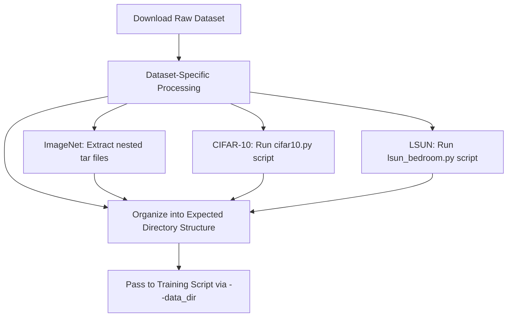
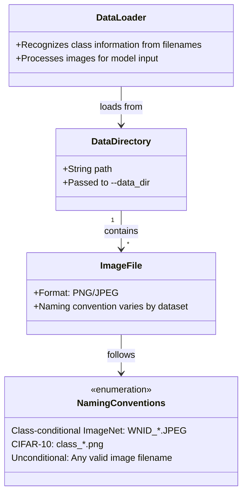
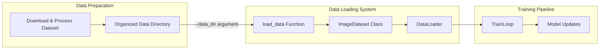

<!-- source: DeepWiki mcp.deepwiki.com · repo openai/improved-diffusion · page 4.1 Data Preparation · fetched 2026-10-26 -->

# Data Preparation

<details>
<summary>Relevant source files</summary>

The following files were used as context for generating this wiki page:

- [datasets/README.md](datasets/README.md)

</details>


This document outlines the process of acquiring and preparing datasets for training diffusion models with the improved-diffusion repository. It covers how to obtain and organize data in the format expected by the training pipeline. For information about how the prepared data is loaded during training, see [Image Dataset Handling](#4.2).

## Supported Datasets

The repository officially supports the following datasets:

| Dataset | Type | Resolution | Preprocessing Needed |
|---------|------|------------|---------------------|
| ImageNet-64 | Unconditional | 64×64 | Minimal (pre-downsampled) |
| ImageNet | Class-conditional | Variable | Extract 1000 class archives |
| CIFAR-10 | Class-conditional | 32×32 | Automated by script |
| LSUN bedroom | Unconditional | Variable | LMDB conversion |

## Dataset Preparation Workflow

The diagram below illustrates the general workflow for preparing datasets:



Sources: [datasets/README.md]()

## Dataset-Specific Instructions

### ImageNet-64 (Unconditional)

For training unconditional models on ImageNet-64:

1. Visit the image-net.org small download page
2. Download the "Train (64x64)" package
3. Extract the archive
4. Use the resulting directory as input to the training script with `--data_dir`

Sources: [datasets/README.md:5-7]()

### Class-conditional ImageNet

For training class-conditional models on ImageNet:

1. Download the ILSVRC2012 dataset from image-net.org
2. Extract the main tarball to get 1000 class-specific tar files
3. Extract each class tar file (which can be automated):
   ```bash
   for file in *.tar; do tar xf "$file"; rm "$file"; done
   ```
4. Verify filenames follow the pattern `WNID_*.JPEG` (e.g., `n01440764_2708.JPEG`)
5. Use the directory as input to the training script with `--data_dir`

The WNID prefix (WordNet ID) is used to automatically determine class labels during training.

Sources: [datasets/README.md:9-21]()

### CIFAR-10

For training on CIFAR-10:

1. Run the provided script `cifar10.py` which:
   - Downloads the CIFAR-10 dataset automatically
   - Creates `cifar_train` and `cifar_test` directories
   - Names files according to their classes (e.g., `truck_49997.png`)
2. Use `cifar_train` as input to the training script with `--data_dir`

Sources: [datasets/README.md:23-27]()

### LSUN Bedroom

For training on LSUN bedroom:

1. Clone the fyu/lsun repository
2. Run the download script: `python3 download.py bedroom`
3. Process the resulting LMDB database with the provided script:
   ```bash
   python lsun_bedroom.py bedroom_train_lmdb lsun_train_output_dir
   ```
4. Use `lsun_train_output_dir` as input to the training script with `--data_dir`

Sources: [datasets/README.md:29-37]()

## Directory Structure and Naming Conventions

The diagram below illustrates the expected directory structure and naming conventions:



The data loader expects specific naming conventions to properly recognize class information:

- **Class-conditional ImageNet**: Files must be named like `n01440764_2708.JPEG`, where the prefix before the underscore is the WordNet ID (WNID) representing the class
- **CIFAR-10**: Files must be named like `truck_49997.png`, where the prefix before the underscore is the class name
- **Unconditional datasets** (LSUN, ImageNet-64): No specific naming convention is required as class information is not used

Sources: [datasets/README.md:21](), [datasets/README.md:25-26]()

## Integration with Training Pipeline

The diagram below shows how data preparation integrates with the training pipeline:



The prepared data directory is passed to the training script via the `--data_dir` argument, which initializes the data loading pipeline. The data loader then automatically handles:

1. Discovering all image files recursively in the directory
2. Extracting class labels from filenames when needed
3. Creating appropriate dataset and loader objects
4. Applying necessary transformations (resizing, normalization)

For detailed information about the data loading process, see [Image Dataset Handling](#4.2).

Sources: [datasets/README.md]()

---

