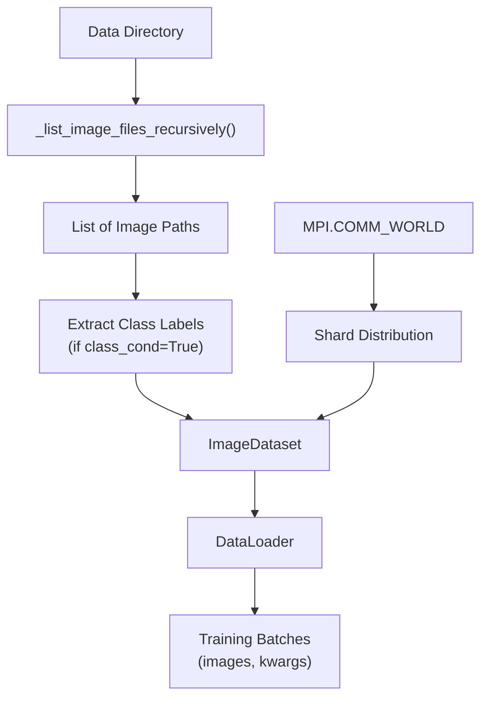
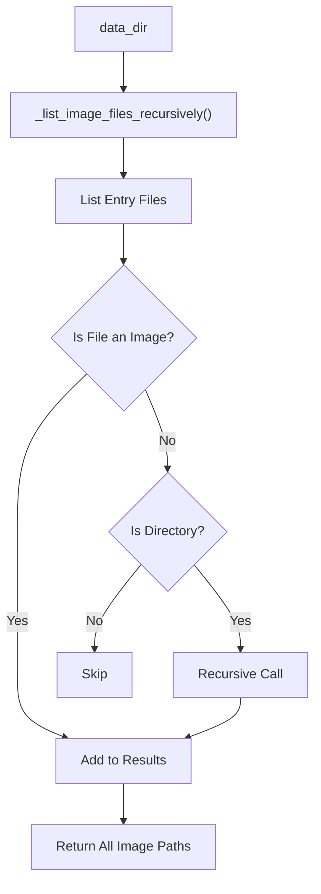
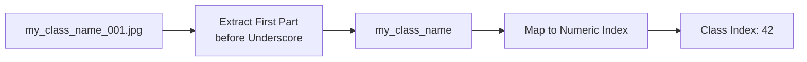
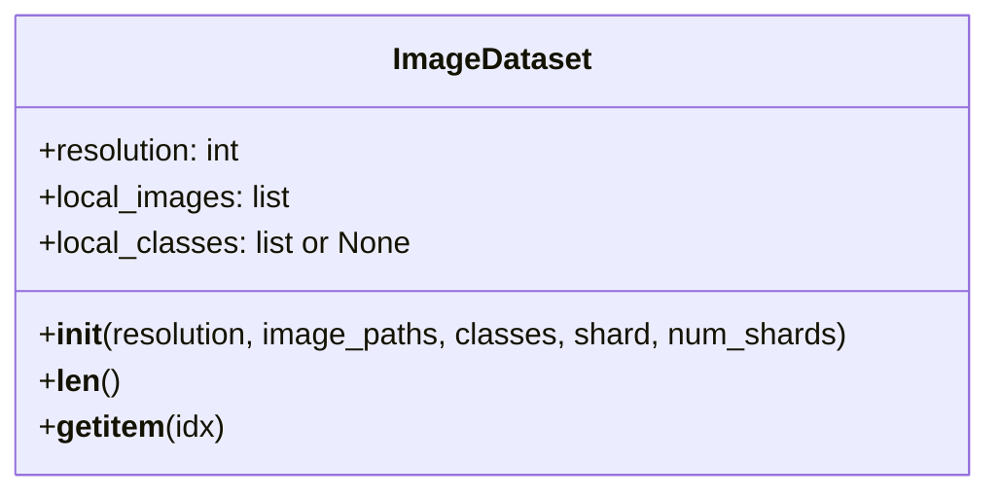
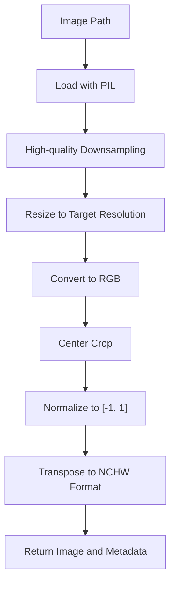
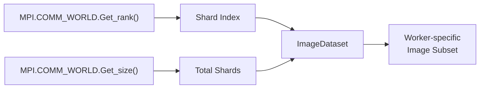

<!-- source: DeepWiki mcp.deepwiki.com · repo openai/improved-diffusion · page 4.2 Image Dataset Handling · fetched 2026-10-26 -->

# Image Dataset Handling

<details>
<summary>Relevant source files</summary>

The following files were used as context for generating this wiki page:

- [improved_diffusion/image_datasets.py](improved_diffusion/image_datasets.py)

</details>


## Purpose and Scope

This document details how the improved-diffusion system manages image datasets for training diffusion models. It covers the loading, processing, and batching of image data, focusing on the implementation in the `image_datasets.py` module. This page explains how images are discovered from the filesystem, loaded into memory, transformed to the proper format, and organized into batches for the training pipeline.

For information about preparing specific datasets before loading, see [Data Preparation](#4.1). For details on processing specific datasets like CIFAR-10 or LSUN Bedroom, see [CIFAR-10 Processing](#4.3) and [LSUN Bedroom Processing](#4.4).

## Image Dataset Pipeline Overview


**Diagram: Image Dataset Loading Pipeline**

Sources: [improved_diffusion/image_datasets.py:8-53](), [improved_diffusion/image_datasets.py:56-65](), [improved_diffusion/image_datasets.py:68-106]()

## Data Loading Function

The main entry point for loading image data is the `load_data` function, which sets up the dataset and returns a generator yielding batches of processed images.

### Function Signature and Parameters

```
load_data(*, data_dir, batch_size, image_size, class_cond=False, deterministic=False)
```

| Parameter | Type | Description |
|-----------|------|-------------|
| `data_dir` | string | Path to the dataset directory |
| `batch_size` | int | Number of images per batch |
| `image_size` | int | Target resolution for images |
| `class_cond` | bool | Whether to include class labels |
| `deterministic` | bool | Whether to yield batches in deterministic order |

Sources: [improved_diffusion/image_datasets.py:8-26]()

### Image Discovery

The system recursively scans the data directory to find all image files using the `_list_image_files_recursively` function:


**Diagram: Image File Discovery Process**

The function identifies images by checking if the file extension is one of: jpg, jpeg, png, or gif (case-insensitive).

Sources: [improved_diffusion/image_datasets.py:56-65]()

### Class Conditioning

When `class_cond=True`, the system extracts class labels from filenames:


**Diagram: Class Label Extraction**

The implementation assumes that the class name is the first part of the filename, before any underscore. All unique class names are sorted alphabetically and assigned integer indices.

Sources: [improved_diffusion/image_datasets.py:31-36]()

## Image Dataset Implementation

The `ImageDataset` class is responsible for loading, processing, and delivering individual images.

### Dataset Initialization and Sharding


**Diagram: ImageDataset Class Structure**

The dataset constructor accepts sharding parameters (`shard` and `num_shards`) to support distributed training. Each worker (rank) only processes a subset of the full dataset:

```python
self.local_images = image_paths[shard:][::num_shards]
self.local_classes = None if classes is None else classes[shard:][::num_shards]
```

This creates an interleaved distribution where rank 0 takes images 0, n, 2n, ..., rank 1 takes images 1, n+1, 2n+1, ..., and so on.

Sources: [improved_diffusion/image_datasets.py:68-73]()

### Image Loading and Processing

When an image is requested via `__getitem__`, it undergoes several processing steps:


**Diagram: Image Processing Pipeline**

Sources: [improved_diffusion/image_datasets.py:78-106]()

#### Processing Details

1. **High-quality downsampling**: To improve resize quality, the image is first downsampled by powers of two using BOX resampling until it's less than twice the target resolution.
   ```python
   while min(*pil_image.size) >= 2 * self.resolution:
       pil_image = pil_image.resize(tuple(x // 2 for x in pil_image.size), resample=Image.BOX)
   ```

2. **Final resize**: The image is then resized to the target resolution using BICUBIC interpolation.
   ```python
   scale = self.resolution / min(*pil_image.size)
   pil_image = pil_image.resize(tuple(round(x * scale) for x in pil_image.size), resample=Image.BICUBIC)
   ```

3. **Center cropping**: If the resized image is not square, it's center-cropped to the target resolution.
   ```python
   crop_y = (arr.shape[0] - self.resolution) // 2
   crop_x = (arr.shape[1] - self.resolution) // 2
   arr = arr[crop_y : crop_y + self.resolution, crop_x : crop_x + self.resolution]
   ```

4. **Normalization**: Pixel values are normalized from [0, 255] to [-1, 1].
   ```python
   arr = arr.astype(np.float32) / 127.5 - 1
   ```

5. **Channel ordering**: The image is transposed from HWC (height, width, channels) to CHW (channels, height, width) format for PyTorch.
   ```python
   return np.transpose(arr, [2, 0, 1]), out_dict
   ```

Sources: [improved_diffusion/image_datasets.py:78-106]()

## Data Batching

The `load_data` function creates a PyTorch `DataLoader` to batch images and handle shuffling.

### DataLoader Configuration

| Mode | Shuffle | Workers | Drop Last |
|------|---------|---------|-----------|
| Deterministic | False | 1 | True |
| Non-deterministic | True | 1 | True |

The `drop_last=True` parameter ensures all batches have the same size by discarding the final incomplete batch. This is important for stable training.

Sources: [improved_diffusion/image_datasets.py:44-51]()

### Infinite Data Generator

The function creates an infinite generator by continuously yielding from the DataLoader:

```python
while True:
    yield from loader
```

This allows the training loop to run for any number of iterations without worrying about dataset size or epochs.

Sources: [improved_diffusion/image_datasets.py:52-53]()

## Integration with Distributed Training

The image dataset handling system integrates with the distributed training infrastructure through MPI.


**Diagram: MPI Integration for Dataset Sharding**

When creating the `ImageDataset`, the current MPI rank and total size are passed to ensure each worker processes a different subset of the data:

```python
dataset = ImageDataset(
    image_size,
    all_files,
    classes=classes,
    shard=MPI.COMM_WORLD.Get_rank(),
    num_shards=MPI.COMM_WORLD.Get_size(),
)
```

This ensures efficient distributed training without duplicate processing of images across workers.

Sources: [improved_diffusion/image_datasets.py:37-43]()

## Summary

The image dataset handling system in the improved-diffusion repository provides a flexible and efficient way to load, process, and batch images for training diffusion models. Key features include:

1. Recursive discovery of images in directories
2. Support for class-conditional training
3. High-quality image resizing and normalization
4. Efficient sharding for distributed training
5. Infinite batching for continuous training

This system forms the foundation of the data pipeline for training diffusion models on various image datasets.

---

