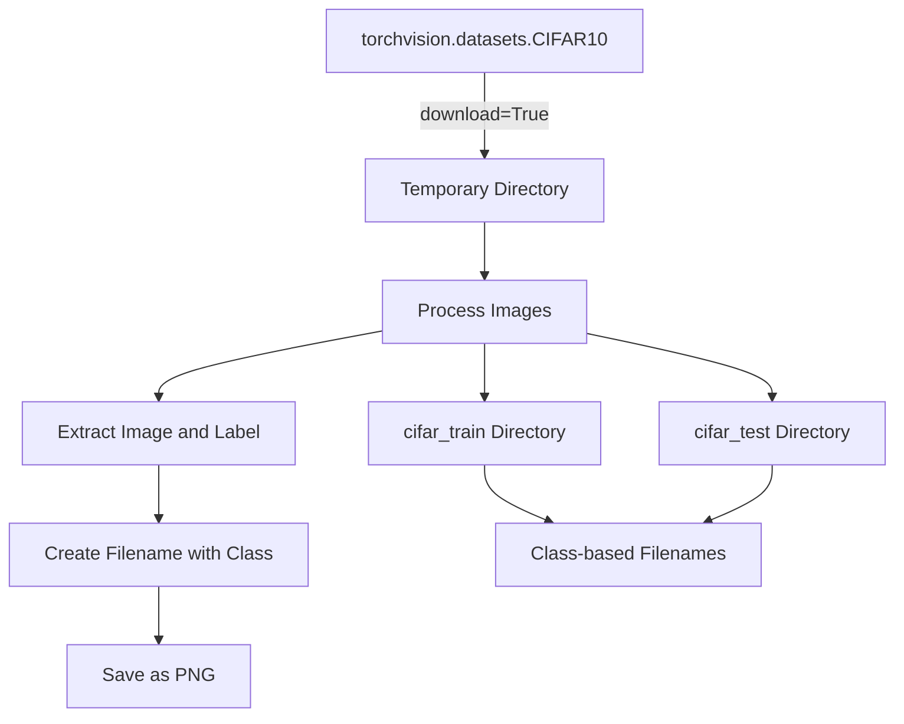
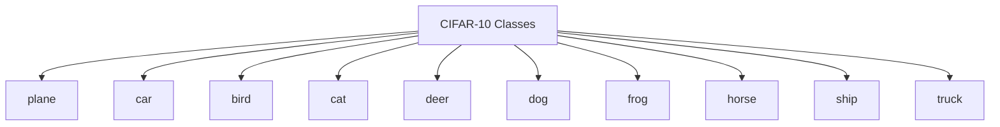
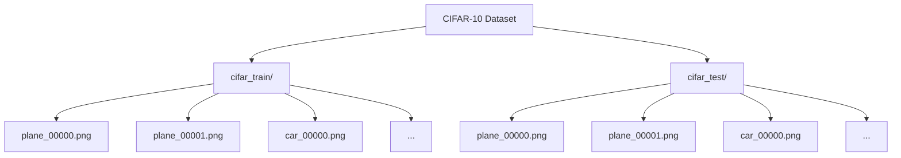
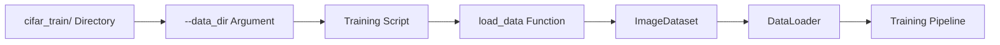

<!-- source: DeepWiki mcp.deepwiki.com · repo openai/improved-diffusion · page 4.3 CIFAR-10 Processing · fetched 2026-10-26 -->

# CIFAR-10 Processing

Relevant source files

The following files were used as context for generating this wiki page:

- [datasets/README.md](datasets/README.md)
- [datasets/cifar10.py](datasets/cifar10.py)

## Purpose and Scope

This document details the specific processing approach for the CIFAR-10 dataset within the improved-diffusion repository. It covers how the dataset is downloaded, processed, and structured for use with the diffusion models. For information about general image dataset handling, see [Image Dataset Handling](#4.2).

## Overview of CIFAR-10

CIFAR-10 is a widely used benchmark dataset in machine learning consisting of 60,000 32x32 color images across 10 different classes. The dataset is split into 50,000 training images and 10,000 test images.

In this repository, CIFAR-10 is processed to create a format compatible with the diffusion model training pipeline.

Sources: [datasets/README.md:23-27]()

## Processing Pipeline

The repository includes a dedicated script for downloading and processing the CIFAR-10 dataset, which transforms the original dataset into a format optimized for training diffusion models.

**Diagram: CIFAR-10 Processing Flow**

Sources: [datasets/cifar10.py:21-39]()

## Dataset Preparation Script

The preparation of the CIFAR-10 dataset is handled by the `cifar10.py` script, which:

1. Downloads the official CIFAR-10 dataset using torchvision
2. Extracts individual images from the dataset
3. Saves each image with a class-specific filename
4. Organizes images into separate train and test directories

The script processes both the training and test splits separately, creating two distinct directories.

Sources: [datasets/cifar10.py:21-43]()

## Class Structure

CIFAR-10 contains 10 distinct classes. The improved-diffusion repository defines these classes as:

**Diagram: CIFAR-10 Class Structure**

Sources: [datasets/cifar10.py:7-18]()

## File Naming Convention

A key aspect of the CIFAR-10 processing is the naming convention used for individual image files. Each image is saved with a filename that embeds the class information:

| Pattern | Example | Description |
|---------|---------|-------------|
| `{class_name}_{index:05d}.png` | `truck_00123.png` | Class name followed by 5-digit zero-padded index |

This naming pattern allows:
- Easy visual inspection of the dataset
- The data loader to automatically extract class labels from filenames
- Simplified class-conditional training

Sources: [datasets/cifar10.py:38](), [datasets/README.md:25]()

## Directory Structure

The CIFAR-10 processing creates two primary directories:

**Diagram: CIFAR-10 Directory Structure**

Sources: [datasets/README.md:25-27](), [datasets/cifar10.py:23-25]()

## Integration with Training Pipeline

The processed CIFAR-10 directories integrate directly with the training pipeline through the command-line interface:

**Diagram: CIFAR-10 Integration with Training**

Sources: [datasets/README.md:27]()

## Implementation Details

The CIFAR-10 processing script uses the following approach:

1. For both "train" and "test" splits:
   - Creates an output directory (`cifar_train` or `cifar_test`)
   - Downloads the dataset using torchvision into a temporary directory
   - Iterates through each image in the dataset
   - Extracts the image and its class label
   - Constructs a filename using the class name and image index
   - Saves the image as a PNG file in the output directory

The script includes checks to avoid reprocessing if the output directories already exist.

Sources: [datasets/cifar10.py:21-43]()

## Usage in the Codebase

To use the CIFAR-10 dataset with the improved-diffusion models:

1. Run the provided `cifar10.py` script to download and process the dataset
2. The script will create two directories: `cifar_train` and `cifar_test`
3. Pass the `cifar_train` directory to the training scripts using the `--data_dir` argument

This enables the training pipeline to automatically load and use the CIFAR-10 images with their associated class labels.

Sources: [datasets/README.md:27]()

---

