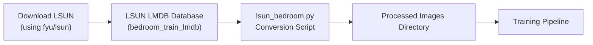
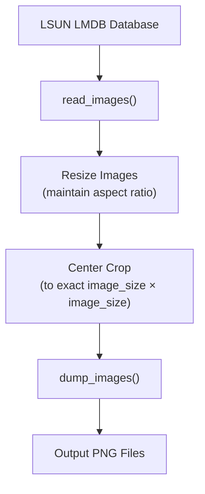
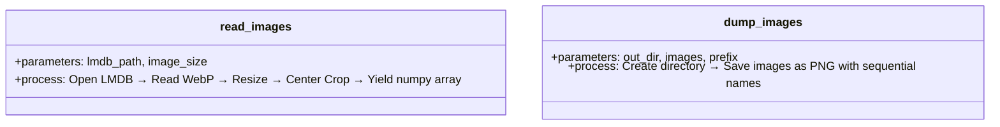
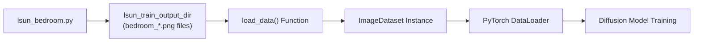

<!-- source: DeepWiki mcp.deepwiki.com · repo openai/improved-diffusion · page 4.4 LSUN Bedroom Processing · fetched 2026-10-26 -->

# LSUN Bedroom Processing

<details>
<summary>Relevant source files</summary>

The following files were used as context for generating this wiki page:

- [datasets/README.md](datasets/README.md)
- [datasets/lsun_bedroom.py](datasets/lsun_bedroom.py)

</details>


## Purpose and Scope

This document explains how the LSUN (Large-scale Scene Understanding) bedroom dataset is downloaded, processed, and prepared for training diffusion models in the improved-diffusion repository. It covers the conversion from the original LSUN LMDB format to the image format required by the training pipeline. For general information about dataset handling in this codebase, see [Image Dataset Handling](#4.2).

## Overview

The LSUN bedroom dataset is a large collection of bedroom images commonly used for training generative models. This document outlines the technical process of acquiring and processing this dataset for compatibility with the diffusion model training pipeline.

### LSUN Bedroom Processing Workflow



Sources: [datasets/README.md:29-37]()

## Downloading the LSUN Dataset

The LSUN bedroom dataset must first be downloaded using the tools provided by the original LSUN repository:

1. Clone the LSUN repository: `git clone https://github.com/fyu/lsun`
2. Run the download script for the bedroom category: `python3 download.py bedroom`

This will create an LSUN LMDB database named `bedroom_train_lmdb` which contains the bedroom images in WebP format.

Sources: [datasets/README.md:29-31]()

## Image Processing Pipeline

The repository includes a conversion script `lsun_bedroom.py` that transforms the LMDB database into a directory of processed images suitable for training diffusion models.

### Image Transformation Process



The image processing involves several key steps:

1. **Reading Images**: The `read_images` function opens the LMDB environment and iterates through its key-value pairs, extracting WebP-encoded image data.

2. **Resizing**: Each image is resized while maintaining its aspect ratio, ensuring that the smallest dimension equals the target image size (default: 256 pixels). This is done using PIL's BOX resampling method.

   ```mermaid
   flowchart LR
      original["Original Image<br>(Variable dimensions)"] --> resized["Resized Image<br>(Smallest dimension = image_size)"]
      resized --> cropped["Cropped Image<br>(image_size × image_size)"]
   ```

3. **Center Cropping**: After resizing, the image is center-cropped to produce a square image with dimensions exactly matching the target image size:

   ```
   h_off = (h - image_size) // 2
   w_off = (w - image_size) // 2
   arr = arr[h_off : h_off + image_size, w_off : w_off + image_size]
   ```

4. **Saving**: The processed images are saved as PNG files with names following the pattern `{prefix}_{i:07d}.png` (e.g., `bedroom_0000001.png`).

Sources: [datasets/lsun_bedroom.py:14-31](), [datasets/lsun_bedroom.py:34-38]()

## Using the Conversion Script

To convert the LSUN LMDB database to a directory of images, use the following command:

```
python lsun_bedroom.py bedroom_train_lmdb lsun_train_output_dir
```

Where:
- `bedroom_train_lmdb` is the path to the downloaded LSUN LMDB database
- `lsun_train_output_dir` is the output directory where the processed images will be saved

### Command-line Arguments

The script accepts the following command-line arguments:

| Argument | Description | Default |
|----------|-------------|---------|
| `--image-size` | The dimensions for the output images (width and height in pixels) | 256 |
| `--prefix` | Class name prefix for the output filenames | "bedroom" |
| `lmdb_path` | Path to the LSUN LMDB database (required positional argument) | - |
| `out_dir` | Path to the output directory (required positional argument) | - |

Sources: [datasets/lsun_bedroom.py:41-47]()

## Code Implementation Details

### LMDB Interaction

The script uses the Python `lmdb` package to interact with the LSUN database:

```python
env = lmdb.open(lmdb_path, map_size=1099511627776, max_readers=100, readonly=True)
```

The `map_size` parameter is set to 1TB to accommodate the potentially large database. The script reads each image from the database as a WebP-encoded binary object, decodes it using PIL, and then processes it.

Sources: [datasets/lsun_bedroom.py:15-16]()

### Image Processing Implementation

The `read_images` generator function handles all the image transformations:



The essential image processing code is in [datasets/lsun_bedroom.py:19-31](), where:
1. Images are read from the LMDB database as WebP data
2. Opened with PIL using `Image.open(io.BytesIO(webp_data))`
3. Resized with appropriate scaling to maintain aspect ratio
4. Center-cropped to the target dimensions
5. Yielded as numpy arrays for saving

Sources: [datasets/lsun_bedroom.py:14-38]()

## Integration with Training Pipeline

After processing, the output directory can be directly used as the data directory for training diffusion models:

```
python scripts/image_train.py --data_dir lsun_train_output_dir [other training arguments]
```



The diffusion model training pipeline will load these images as a single-class dataset. Unlike class-conditional datasets like ImageNet, there is no class subdirectory structure, as all images belong to the "bedroom" class.

Sources: [datasets/README.md:37]()

## Summary

The LSUN bedroom processing workflow can be summarized as:

1. Download the LSUN bedroom dataset using the fyu/lsun repository
2. Convert the resulting LMDB database to a directory of properly sized PNG images using `lsun_bedroom.py`
3. Use the resulting directory as the `--data_dir` parameter when training diffusion models

This preprocessing ensures that all images are consistently sized and formatted for optimal training of the diffusion models.

Sources: [datasets/README.md:29-37](), [datasets/lsun_bedroom.py:1-54]()

---

