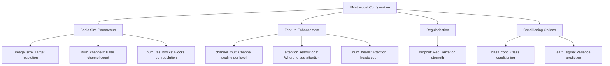
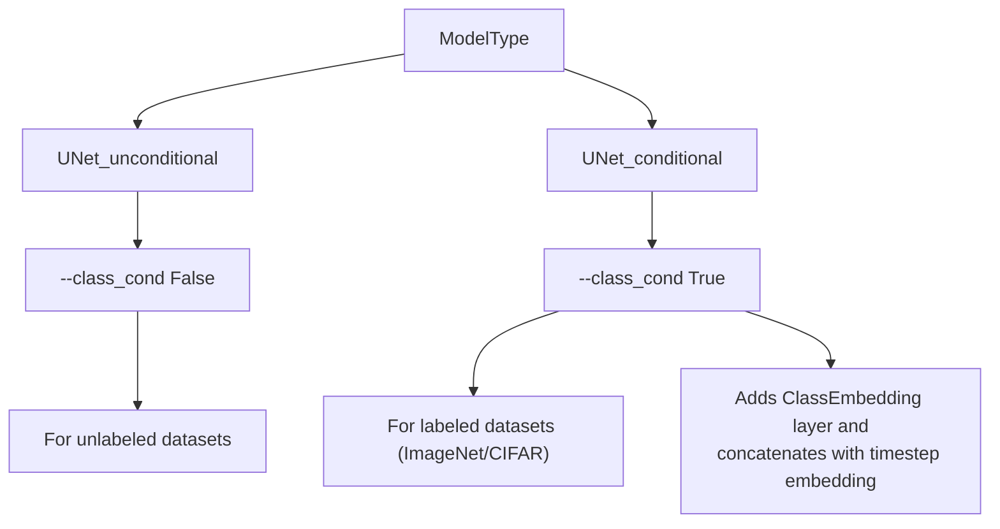
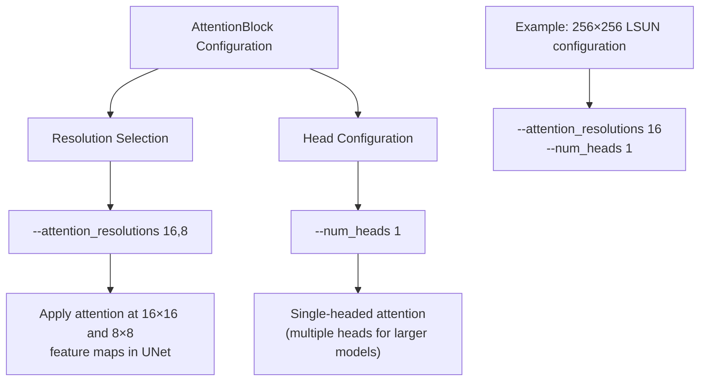
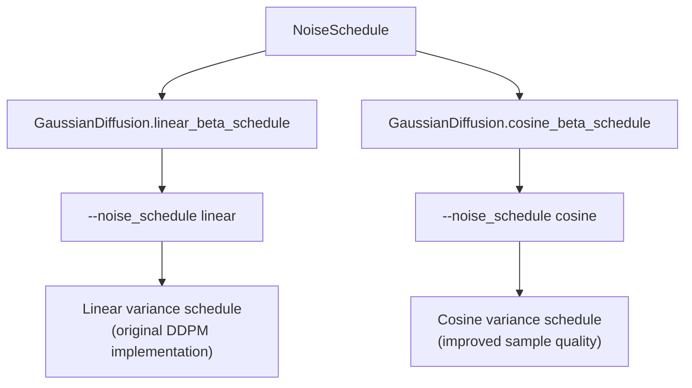
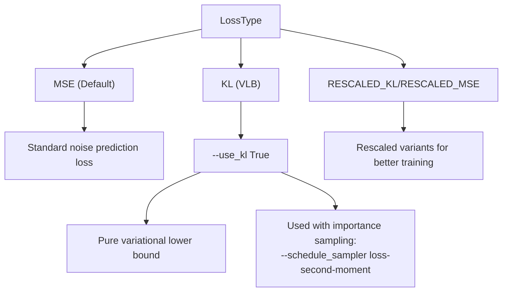
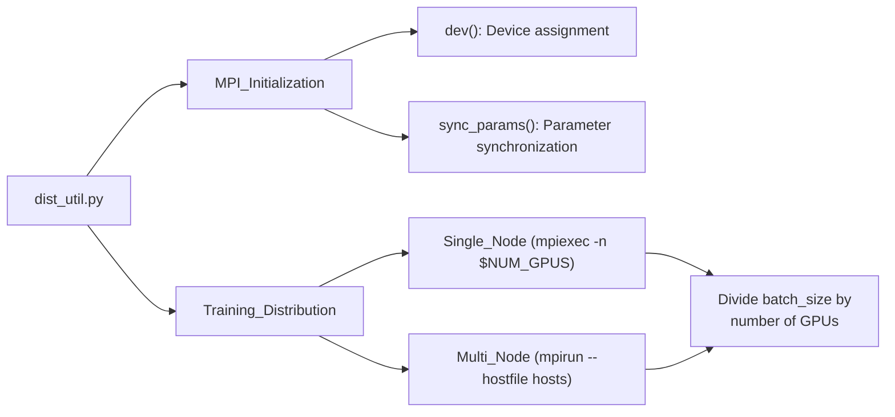
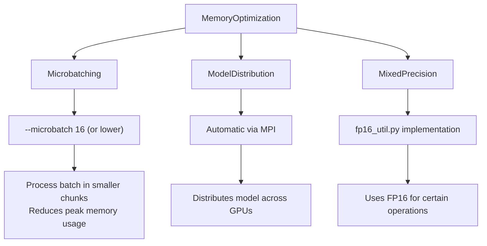
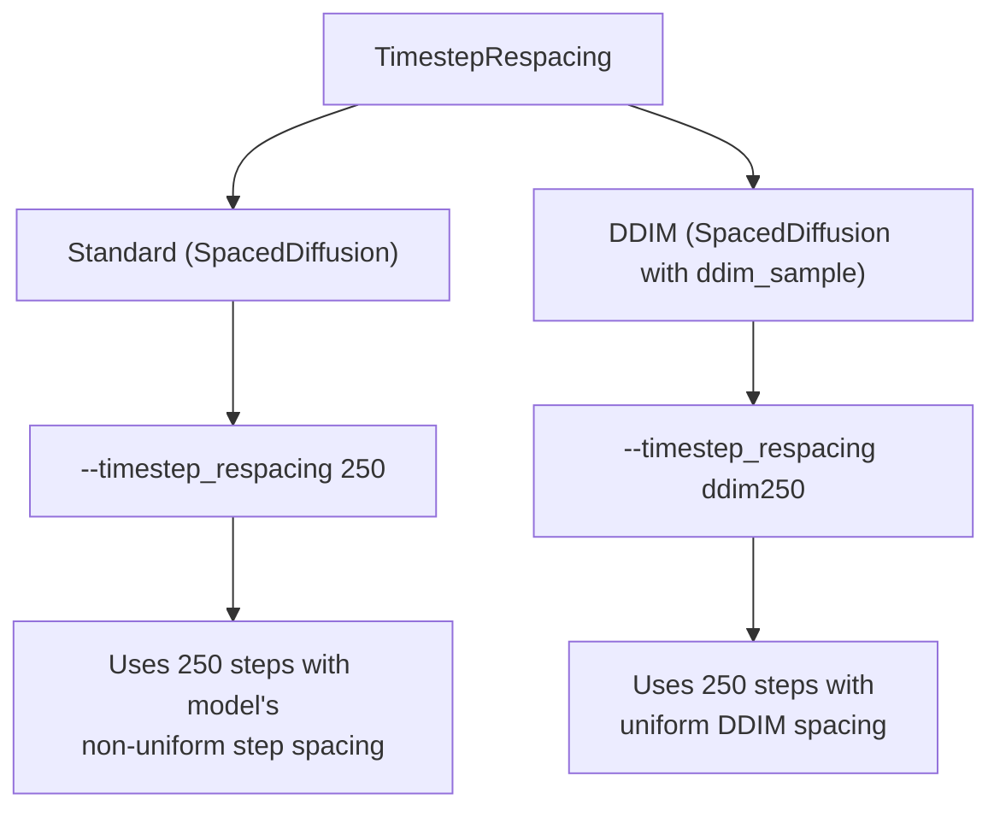
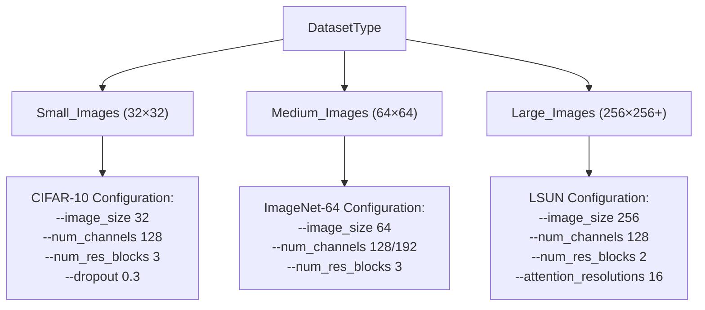

<!-- source: DeepWiki mcp.deepwiki.com · repo openai/improved-diffusion · page 5 Advanced Usage · fetched 2026-10-26 -->

# Advanced Usage

<details>
<summary>Relevant source files</summary>

The following files were used as context for generating this wiki page:

- [README.md](README.md)

</details>


This document provides guidance for advanced usage scenarios and configurations of the Improved Diffusion repository. While the [Overview](#1) and [Command-Line Interface](#1.2) cover the fundamentals, this section explores specialized options, optimization techniques, and configuration recipes for advanced users. For basic installation instructions, see [Installation and Setup](#1.1).

## Advanced Model Configuration Options

The UNet architecture implemented in this repository can be extensively customized through various parameters to optimize for different datasets, image sizes, and computational constraints.



Key model architecture parameters are controlled through command-line arguments that affect the `create_model` function behavior:

| Parameter | Description | Example Values |
|-----------|-------------|----------------|
| `--image_size` | Target image resolution | 32, 64, 256 |
| `--num_channels` | Base channel count for UNet | 128, 192, 256 |
| `--num_res_blocks` | Residual blocks per UNet level | 2, 3 |
| `--channel_mult` | Channel multiplier per resolution | "1,2,2,2", "1,2,4,8" |
| `--learn_sigma` | Learn noise level parameters | True, False |
| `--attention_resolutions` | Resolutions with attention | "16", "16,8" |
| `--num_heads` | Number of attention heads | 1, 4 |
| `--dropout` | Dropout probability | 0.0, 0.3 |
| `--class_cond` | Use class conditioning | True, False |
| `--use_scale_shift_norm` | Use scale and shift in normalization | True, False |

Sources: README.md:29-42

### Conditional vs. Unconditional Models

The repository supports both conditional and unconditional diffusion models:



To configure a class-conditional model, add `--class_cond True` to your model flags. This enables the model to generate samples conditioned on class labels. For datasets where labels are encoded in filenames (e.g., "dog_001.jpg"), the data loader automatically extracts these labels.

Sources: README.md:39-42

### Attention Mechanisms for High-Resolution Images

For larger image sizes, attention mechanisms become critical for capturing long-range dependencies:



Attention mechanisms are particularly important for high-resolution images. For 256×256 images, adding attention at the 16×16 resolution feature maps provides a good balance between computational efficiency and capturing important long-range image features.

Sources: README.md:117-129

## Diffusion Process Optimization

The diffusion process can be fine-tuned through various parameters to balance sample quality, training stability, and computational efficiency.

### Noise Schedules

Two primary noise schedules are supported:



The cosine schedule (`--noise_schedule cosine`) typically produces better sample quality compared to the linear schedule as it allocates more diffusion steps to low-noise regions, where perceptual detail is most important.

Sources: README.md:40

### Loss Functions and Objectives

The repository implements multiple training objectives:



To use the VLB objective with importance sampling (as described in the paper), add:
```bash
--use_kl True --schedule_sampler loss-second-moment
```

This configuration improves training efficiency by focusing computational resources on timesteps with higher loss values.

Sources: README.md:41, 131-146

### Parameter Rescaling Options

For advanced control over the diffusion process:

```bash
--rescale_learned_sigmas False --rescale_timesteps False
```

These options control how learned noise parameters and timesteps are processed:
- `rescale_learned_sigmas`: Controls whether model variance outputs are rescaled
- `rescale_timesteps`: Determines if timesteps are normalized when passed to the model

Sources: README.md:104-105, 120-121

## Advanced Training Techniques

### Distributed Training with MPI

For large models or datasets, distributed training across multiple GPUs is essential:



When using distributed training:
1. Launch with `mpiexec` or `mpirun`
2. Divide the batch size by the number of GPUs
3. Ensure all GPUs have access to the data directory

Example for 4 GPUs with a global batch size of 128:
```bash
mpiexec -n 4 python scripts/image_train.py --data_dir path/to/images --batch_size 32 ...
```

Sources: README.md:50-56

### Memory Optimization Techniques

For memory-constrained environments, several optimizations are available:



1. **Microbatching**: Process the batch in smaller chunks with `--microbatch 16` (or lower)
2. **Distributed training**: Split the model across multiple GPUs using MPI
3. **Mixed precision**: Leverage FP16 operations where possible

Example for training a large model on limited memory:
```bash
python scripts/image_train.py --microbatch 4 --batch_size 128 ...
```

Sources: README.md:56

## Advanced Sampling Methods

### Timestep Respacing for Faster Sampling

Sampling can be accelerated by using fewer diffusion steps than were used during training:



The `--timestep_respacing` argument controls the number and distribution of sampling steps:
- `--timestep_respacing 100` uses 100 steps with the model's regular spacing
- `--timestep_respacing ddim100` uses 100 steps with uniform spacing (DDIM-style)

Sources: README.md:74-75

### DDIM Sampling

Denoising Diffusion Implicit Models (DDIM) offer deterministic sampling with fewer steps:

```bash
python scripts/image_sample.py --model_path model.pt --use_ddim True --timestep_respacing ddim100
```

DDIM sampling often produces higher quality results with fewer steps compared to standard diffusion sampling by using a deterministic sampling path instead of adding random noise at each step.

Sources: README.md:76

## Specialized Model Configurations

The paper includes several specialized model configurations that have been optimized for different datasets.

### Configuration Selection Guide



### Model Recipes from the Paper

Here are the key model configurations presented in the README:

#### ImageNet 64×64 (Unconditional)
```bash
MODEL_FLAGS="--image_size 64 --num_channels 128 --num_res_blocks 3 --learn_sigma True"
DIFFUSION_FLAGS="--diffusion_steps 4000 --noise_schedule cosine"
TRAIN_FLAGS="--lr 1e-4 --batch_size 128"
```

#### CIFAR-10 (Unconditional with Dropout)
```bash
MODEL_FLAGS="--image_size 32 --num_channels 128 --num_res_blocks 3 --learn_sigma True --dropout 0.3"
DIFFUSION_FLAGS="--diffusion_steps 4000 --noise_schedule cosine"
TRAIN_FLAGS="--lr 1e-4 --batch_size 128"
```

#### ImageNet 64×64 (Class-Conditional)
```bash
MODEL_FLAGS="--image_size 64 --num_channels 192 --num_res_blocks 3 --learn_sigma True --class_cond True"
DIFFUSION_FLAGS="--diffusion_steps 4000 --noise_schedule cosine --rescale_learned_sigmas False --rescale_timesteps False"
TRAIN_FLAGS="--lr 3e-4 --batch_size 2048"
```

#### LSUN Bedrooms 256×256
```bash
MODEL_FLAGS="--image_size 256 --num_channels 128 --num_res_blocks 2 --num_heads 1 --learn_sigma True --use_scale_shift_norm False --attention_resolutions 16"
DIFFUSION_FLAGS="--diffusion_steps 1000 --noise_schedule linear --rescale_learned_sigmas False --rescale_timesteps False"
TRAIN_FLAGS="--lr 1e-4 --batch_size 128"
```

Sources: README.md:84-146

## Training Tips and Best Practices

Based on the paper's findings and the repository implementation, here are key optimization tips:

1. **Noise Schedule Selection**:
   - Cosine schedule generally produces better results than linear schedule
   - Linear schedule may work better for very high-resolution images

2. **Model Sizing Guidelines**:
   - 32×32 images: 128 base channels, 3 res blocks, consider dropout (0.3)
   - 64×64 images: 128-192 base channels, 3 res blocks
   - 256×256 images: 128 base channels, 2 res blocks with attention at 16×16

3. **Learning Rate Selection**:
   - Standard: 1e-4
   - Class-conditional models: Consider 3e-4
   - High-resolution images: Try both 1e-4 and lower (2e-5)

4. **Variance Learning**:
   - `--learn_sigma True` generally improves results but increases model parameters

5. **Efficient Sampling**:
   - Train with more diffusion steps (4000) for flexibility
   - Sample with fewer steps (100-250) using timestep respacing
   - DDIM sampling can accelerate generation with minimal quality loss

Sources: README.md:84-146

---

