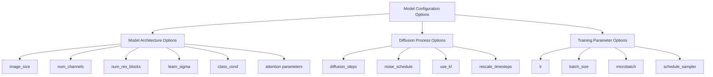
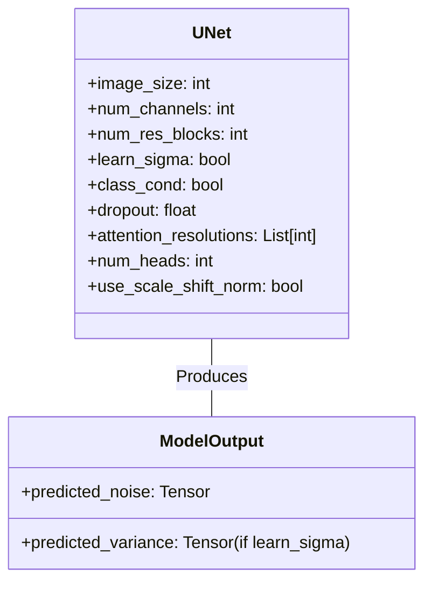
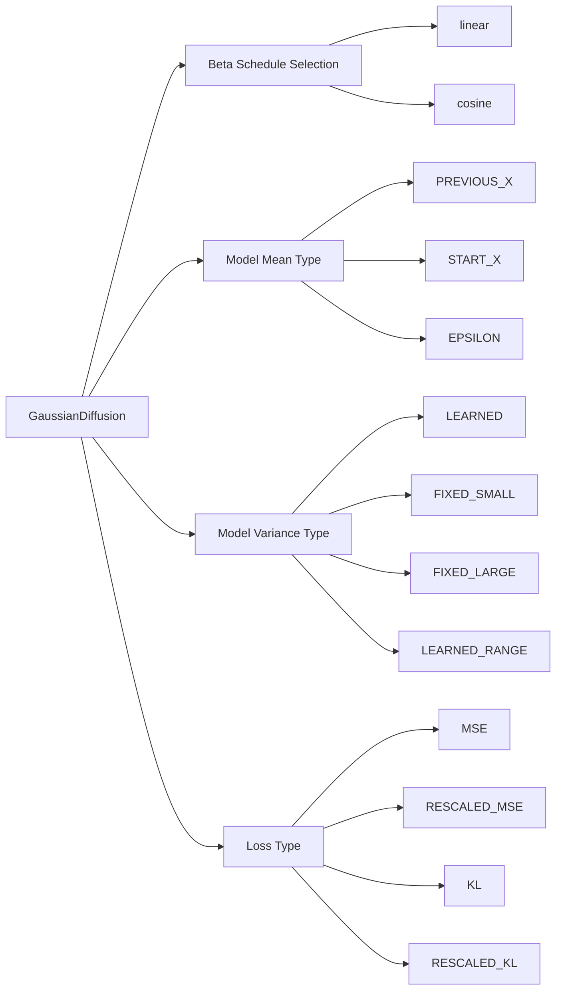
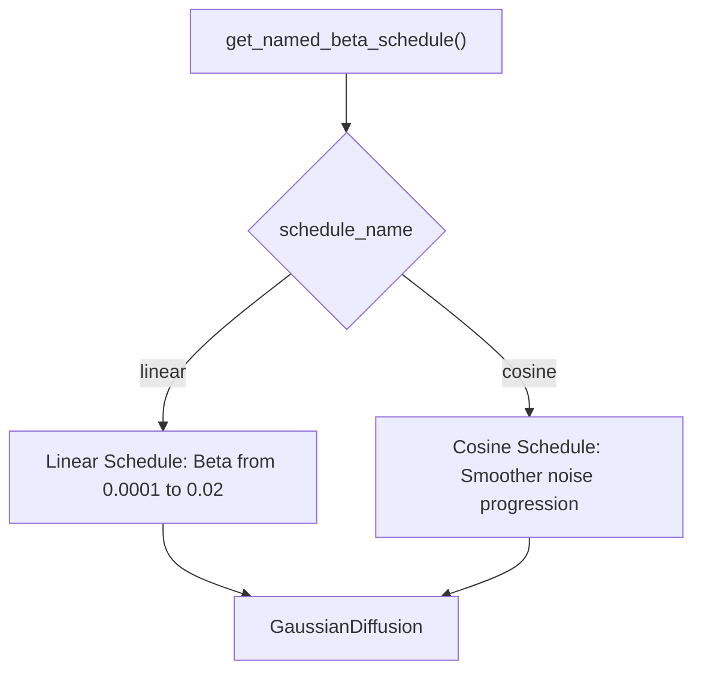
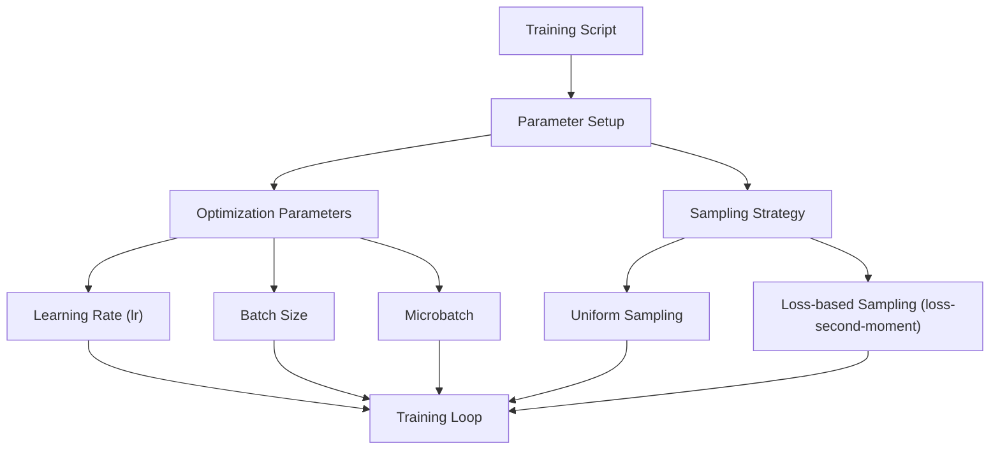
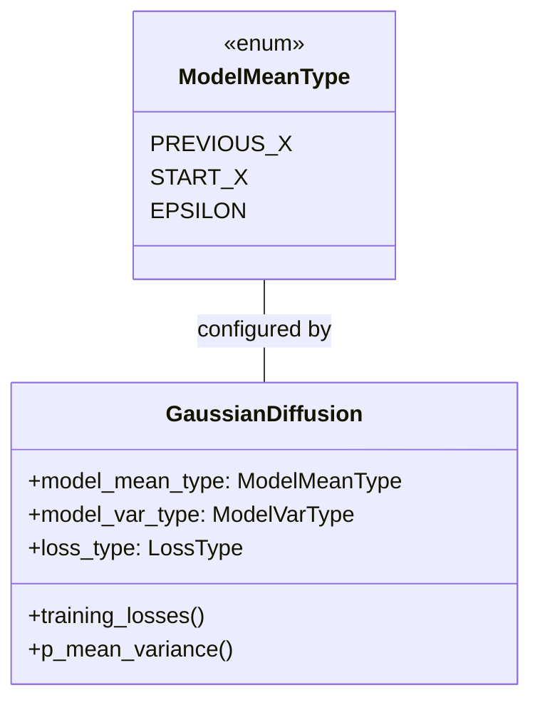

<!-- source: DeepWiki mcp.deepwiki.com · repo openai/improved-diffusion · page 5.1 Model Configuration Options · fetched 2026-10-26 -->

# Model Configuration Options

<details>
<summary>Relevant source files</summary>

The following files were used as context for generating this wiki page:

- [README.md](README.md)
- [improved_diffusion/gaussian_diffusion.py](improved_diffusion/gaussian_diffusion.py)

</details>


This page documents the various configuration options available for the diffusion models in the improved-diffusion repository. These options control model architecture, diffusion process behavior, and training parameters. For information about running training or sampling commands, see [Command-Line Interface](#1.2).

## Overview of Configuration Options

The improved-diffusion repository uses three main categories of configuration options that are typically specified as command-line arguments:



Sources: [README.md:28-34]()

## Model Architecture Options

These options control the structure and capacity of the neural network used for the diffusion model.

| Option | Description | Default | Common Values |
|--------|-------------|---------|--------------|
| `image_size` | Spatial resolution of the model input/output | Required | 32 (CIFAR), 64 (ImageNet), 256 (LSUN) |
| `num_channels` | Base channel count for the UNet | Required | 128, 192, 256 |
| `num_res_blocks` | Number of residual blocks per resolution | Required | 2-3 |
| `learn_sigma` | Whether to learn the noise variance | `False` | `True`, `False` |
| `class_cond` | Whether the model is class-conditional | `False` | `True`, `False` |
| `dropout` | Dropout probability | `0.0` | `0.0`, `0.1`, `0.3` |
| `attention_resolutions` | At which resolutions to use attention | None | `16`, `8` |
| `num_heads` | Number of attention heads | `1` | `1`, `4`, `8` |
| `use_scale_shift_norm` | Whether to use scale and shift in normalization layers | `True` | `True`, `False` |



Sources: [README.md:86-129]()

### Key Architecture Decisions

1. **Image Size**: Determines the resolution at which the model operates. Higher resolutions require more memory and computation.

2. **Channel Counts**: `num_channels` controls the model capacity; higher values mean more parameters and potentially better quality at the cost of increased training time and memory usage.

3. **Residual Blocks**: More `num_res_blocks` increases the depth of the network and can improve quality, but requires more computation.

4. **Learned Sigma**: When `learn_sigma` is `True`, the model predicts both the denoised image and the variance of the noise, which can improve sample quality.

5. **Conditioning**: Setting `class_cond` to `True` enables class-conditional generation, meaning the model can generate images conditioned on class labels.

Sources: [README.md:37-42]()

## Diffusion Process Options

These options control the behavior of the diffusion process itself, including the noise schedule and number of steps.

| Option | Description | Default | Common Values |
|--------|-------------|---------|--------------|
| `diffusion_steps` | Total number of noise steps in the forward process | Required | 1000, 4000 |
| `noise_schedule` | Type of beta schedule | Required | `linear`, `cosine` |
| `use_kl` | Whether to use KL divergence for loss calculation | `False` | `True`, `False` |
| `rescale_learned_sigmas` | Whether to rescale learned sigmas | `False` | `True`, `False` |
| `rescale_timesteps` | Whether to rescale timesteps to a standard range | `False` | `True`, `False` |



Sources: [improved_diffusion/gaussian_diffusion.py:18-42](), [improved_diffusion/gaussian_diffusion.py:65-98]()

### Noise Schedules

The noise schedule determines how quickly noise is added during the forward diffusion process:

1. **Linear Schedule**: The default schedule from the original DDPM paper, where noise is added at a linearly increasing rate.

2. **Cosine Schedule**: A smoother schedule that adds noise more gradually at the beginning and end of the process, which can lead to better sample quality.



Sources: [improved_diffusion/gaussian_diffusion.py:18-42]()

### Loss Type Options

The `GaussianDiffusion` class supports different loss functions that affect the training objective:

1. **MSE**: Standard mean squared error loss
2. **RESCALED_MSE**: MSE with special rescaling for numerical stability
3. **KL**: Kullback-Leibler divergence loss (variational lower bound)
4. **RESCALED_KL**: KL with rescaling to estimate the full variational lower bound

When using `use_kl=True`, the model uses the variational lower bound (VLB) objective which can improve log-likelihood scores.

Sources: [improved_diffusion/gaussian_diffusion.py:89-98](), [improved_diffusion/gaussian_diffusion.py:642-751]()

## Training Parameter Options

These options control the training process, including optimization and batch sizing:

| Option | Description | Default | Common Values |
|--------|-------------|---------|--------------|
| `lr` | Learning rate | Required | 1e-4, 2e-5, 3e-4 |
| `batch_size` | Batch size for training | Required | 64, 128, 256, 2048 |
| `microbatch` | Smaller batch size for GPU memory constraints | None | 4, 16, 32 |
| `schedule_sampler` | How to sample timesteps | `uniform` | `uniform`, `loss-second-moment` |



Sources: [README.md:28-34](), [README.md:51-56]()

### Schedule Samplers

The `schedule_sampler` option determines how timesteps are sampled during training:

1. **Uniform Sampling**: Default approach where all timesteps are equally likely to be selected
2. **Loss-based Sampling**: Samples timesteps based on their contribution to the loss, focusing training on harder steps

When using the VLB objective (`use_kl=True`), it's recommended to use `schedule_sampler=loss-second-moment` which can significantly improve training efficiency.

Sources: [README.md:41](), [README.md:137]()

## Configuration Examples for Different Models

The repository includes recommended configurations for various model types. Here are some examples:

### Unconditional ImageNet-64 with Hybrid Objective

```
MODEL_FLAGS="--image_size 64 --num_channels 128 --num_res_blocks 3 --learn_sigma True"
DIFFUSION_FLAGS="--diffusion_steps 4000 --noise_schedule cosine"
TRAIN_FLAGS="--lr 1e-4 --batch_size 128"
```

Sources: [README.md:86-90]()

### Unconditional CIFAR-10 with Hybrid Objective

```
MODEL_FLAGS="--image_size 32 --num_channels 128 --num_res_blocks 3 --learn_sigma True --dropout 0.3"
DIFFUSION_FLAGS="--diffusion_steps 4000 --noise_schedule cosine"
TRAIN_FLAGS="--lr 1e-4 --batch_size 128"
```

Sources: [README.md:92-96]()

### Class-Conditional ImageNet-64 (270M parameters)

```
MODEL_FLAGS="--image_size 64 --num_channels 192 --num_res_blocks 3 --learn_sigma True --class_cond True"
DIFFUSION_FLAGS="--diffusion_steps 4000 --noise_schedule cosine --rescale_learned_sigmas False --rescale_timesteps False"
TRAIN_FLAGS="--lr 3e-4 --batch_size 2048"
```

Sources: [README.md:100-104]()

### LSUN Bedroom

```
MODEL_FLAGS="--image_size 256 --num_channels 128 --num_res_blocks 2 --num_heads 1 --learn_sigma True --use_scale_shift_norm False --attention_resolutions 16"
DIFFUSION_FLAGS="--diffusion_steps 1000 --noise_schedule linear --rescale_learned_sigmas False --rescale_timesteps False"
TRAIN_FLAGS="--lr 1e-4 --batch_size 128"
```

Sources: [README.md:118-122]()

## Configuration Selection Guide

The following table provides guidance on which configurations to use for different scenarios:

| Goal | Recommended Configuration |
|------|---------------------------|
| Higher quality samples | Increase `num_channels`, `num_res_blocks`, use `cosine` schedule |
| Better log-likelihood | Use `use_kl=True`, `schedule_sampler=loss-second-moment` |
| Faster training | Lower `image_size`, fewer `num_channels`, fewer `diffusion_steps` |
| Memory efficiency | Use `microbatch` parameter, lower `batch_size` |
| Class-conditional generation | Set `class_cond=True` |
| High-resolution images | Higher `image_size`, use attention (`attention_resolutions`) |

Sources: [README.md:37-42](), [README.md:86-146]()

## Advanced Model Configuration

### Model Mean Type Options

The `model_mean_type` parameter controls what the model predicts:



- **PREVIOUS_X**: The model predicts x_{t-1} directly
- **START_X**: The model predicts x_0 (the clean image)
- **EPSILON**: The model predicts the noise (epsilon) that was added

In the improved-diffusion implementation, EPSILON is typically used as it has been shown to work well in practice.

Sources: [improved_diffusion/gaussian_diffusion.py:65-72](), [improved_diffusion/gaussian_diffusion.py:300-316]()

### Model Variance Type Options

The `model_var_type` parameter controls how the variance is handled:

- **LEARNED**: The model outputs the log variance directly
- **FIXED_SMALL**: Uses a fixed small variance from the posterior
- **FIXED_LARGE**: Uses a larger fixed variance
- **LEARNED_RANGE**: The model predicts a value that is interpolated between min and max variance

When `learn_sigma` is set to `True`, the model uses LEARNED or LEARNED_RANGE variance type.

Sources: [improved_diffusion/gaussian_diffusion.py:74-86](), [improved_diffusion/gaussian_diffusion.py:262-291]()

## Conclusion

The model configuration options in the improved-diffusion repository allow for flexible customization of diffusion models for different datasets and requirements. By adjusting the architecture, diffusion process, and training parameters, you can optimize for sample quality, training speed, or model size.

For tips on effectively training these models, see [Training Tips and Best Practices](#5.2).

---

