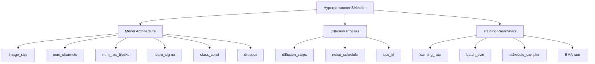
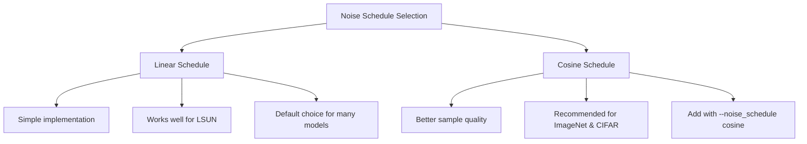
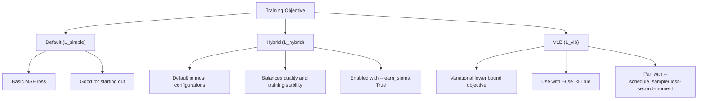
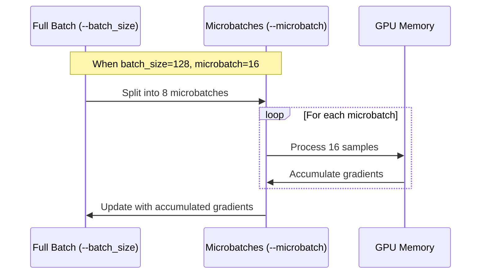
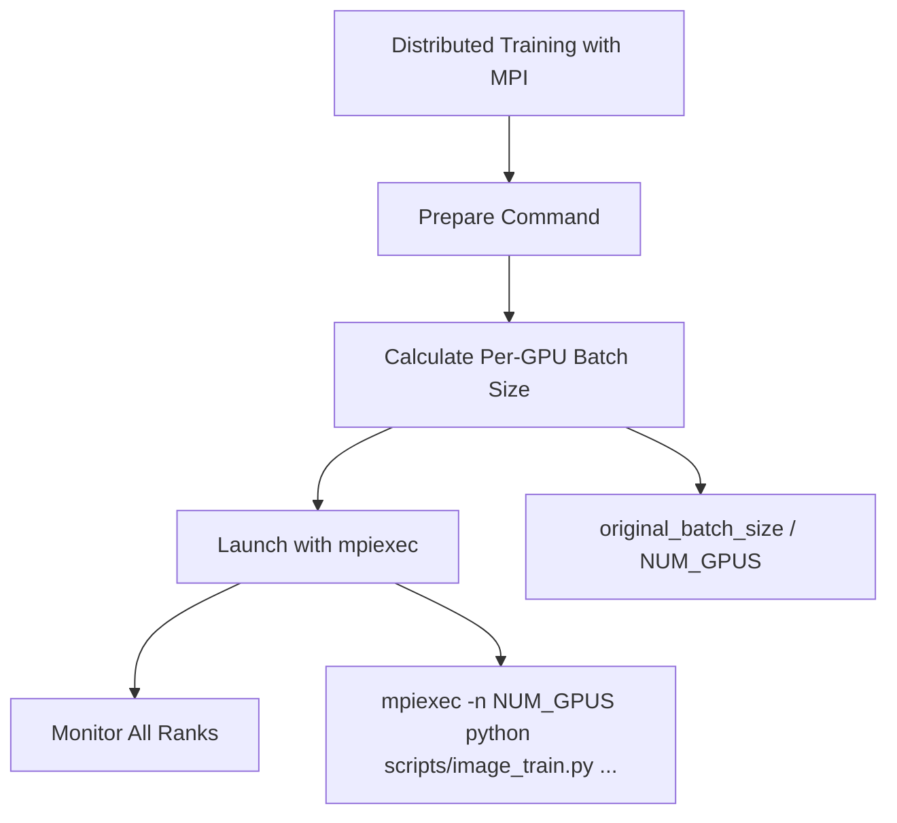
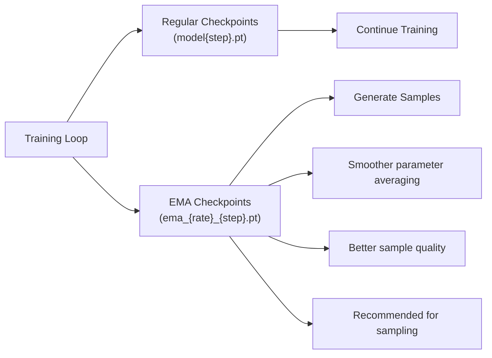
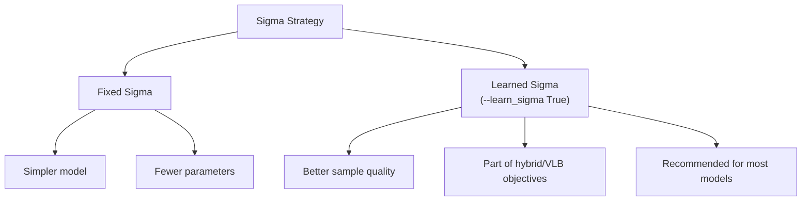
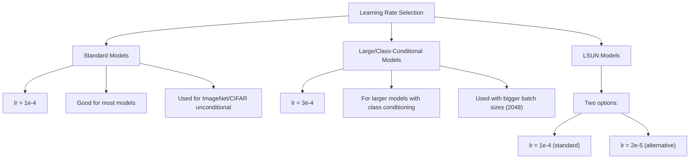

<!-- source: DeepWiki mcp.deepwiki.com · repo openai/improved-diffusion · page 5.2 Training Tips and Best Practices · fetched 2026-10-26 -->

# Training Tips and Best Practices

Relevant source files

The following files were used as context for generating this wiki page:

- [README.md](README.md)

## Purpose and Scope

This document outlines recommended approaches, parameters, and configurations for effectively training diffusion models using the improved-diffusion codebase. It covers model architecture decisions, diffusion process settings, training hyperparameters, and techniques to manage computational resources. For specific model configuration options, see [Model Configuration Options](#5.1). For information about the training pipeline implementation, see [Training Pipeline](#2.1).

## Hyperparameter Selection Guidelines

The performance of diffusion models is significantly affected by hyperparameter choices. Below are evidence-based recommendations derived from the codebase and associated paper.

Sources: [README.md:29-35]()

### Dataset-Specific Recommendations

Different datasets benefit from specific configurations. The table below outlines recommended settings for common datasets:

| Dataset | Architecture | Diffusion Config | Training Params | Notes |
|---------|-------------|-----------------|-----------------|-------|
| ImageNet-64 (Uncond.) | 128 channels, 3 res blocks, learn_sigma=True | 4000 steps, cosine schedule | lr=1e-4, batch_size=128 | Hybrid objective |
| CIFAR-10 (Uncond.) | 128 channels, 3 res blocks, learn_sigma=True, dropout=0.3 | 4000 steps, cosine schedule | lr=1e-4, batch_size=128 | Added dropout for regularization |
| ImageNet-64 (Class-cond.) | 192 channels, 3 res blocks, learn_sigma=True, class_cond=True | 4000 steps, cosine schedule | lr=3e-4, batch_size=2048 | Larger model, higher learning rate |
| LSUN Bedroom | 128 channels, 2 res blocks, attention_resolutions=16 | 1000 steps, linear schedule | lr=1e-4 or 2e-5, batch_size=128 | Two variants with different learning rates |

Sources: [README.md:86-129]()

## Noise Schedule Selection

The noise schedule controls how noise is added during the forward diffusion process and significantly impacts model performance.

**When to choose cosine schedule**: For higher quality samples, especially on natural image datasets like ImageNet and CIFAR-10.

**When to choose linear schedule**: For simpler models or when working with specialized domains like LSUN bedrooms.

Sources: [README.md:38-41](), [README.md:86-92](), [README.md:117-121]()

## Training Objective Options

The codebase supports multiple training objectives that affect model convergence and sample quality.

**Recommended approach**: Start with the hybrid objective (`--learn_sigma True`) for most use cases. For more theoretically grounded training, use the VLB objective with importance sampling.

Sources: [README.md:38-42](), [README.md:132-145]()

## Memory Management Techniques

Managing GPU memory is crucial when training diffusion models, especially for larger architectures or higher resolutions.

### Microbatching

When facing memory constraints, use the `--microbatch` flag to process smaller chunks of the batch sequentially:

**Recommendation**: Start with a reasonable `microbatch` size (e.g., 16). In extreme memory-limited scenarios, use `--microbatch 1`.

Sources: [README.md:56-57]()

### Distributed Training

For faster training on multiple GPUs:

**Important**: When using distributed training, manually divide `--batch_size` by the number of GPUs (ranks) to maintain the same effective batch size.

Sources: [README.md:50-56]()

## Model Checkpointing and EMA

Proper model checkpointing improves both training stability and final sample quality.

**Best practice**: Always use EMA models for sampling. The README notes that EMA models "produce much better samples" than regular checkpoints. For sampling, load checkpoints with names like `ema_0.9999_200000.pt`.

Sources: [README.md:61-63]()

## Advanced Techniques

### Learned Sigma vs. Fixed Sigma

**Recommendation**: Use learned sigma (`--learn_sigma True`) for most applications as it's used in all the recommended model configurations.

Sources: [README.md:39](), [README.md:86-129]()

### Class-Conditional Training

For class-conditional generation:

1. Ensure your dataset has class labels (either as subdirectories or filename prefixes with format `classname_XXX.jpg`)
2. Add `--class_cond True` to your model flags
3. Consider increasing model capacity (e.g., channels=192 instead of 128)
4. You may benefit from larger batch sizes and higher learning rates

Sources: [README.md:21-25](), [README.md:42](), [README.md:100-106]()

### Importance Sampling for VLB Training

When training with the variational lower bound objective:

1. Enable VLB with `--use_kl True`
2. Add `--schedule_sampler loss-second-moment` to improve training stability
3. This approach is theoretically well-grounded but may require more careful tuning

Sources: [README.md:41-42](), [README.md:132-145]()

## Common Training Issues and Solutions

| Issue | Possible Causes | Solutions |
|-------|----------------|-----------|
| Out of memory errors | Batch size too large, model too big | Reduce batch size, use `--microbatch`, decrease model size (channels/res blocks) |
| Poor sample quality | Learning rate issues, insufficient training | Check EMA models, train longer, try cosine noise schedule |
| Training instability | Learning rate too high | Reduce learning rate, add dropout for regularization |
| Slow convergence | Learning rate too low, inefficient schedule | Increase learning rate, try importance sampling |
| Blurry samples | Insufficient model capacity | Increase channels/res blocks, use attention for higher resolutions |

Sources: [README.md:55-57](), [README.md:61-63](), [README.md:93-98]()

## Learning Rate Recommendations

Choosing an appropriate learning rate is critical for training stability and convergence:

**Note**: The LSUN bedroom models use either 1e-4 or 2e-5 learning rates, suggesting that sometimes a much lower learning rate can be beneficial for certain datasets.

Sources: [README.md:32-34](), [README.md:86-129]()

## Batch Size Considerations

Batch size affects both training stability and resource requirements:

| Model Type | Recommended Batch Size | Notes |
|------------|---------------------|-------|
| Standard models | 128 | Good balance of stability and speed |
| Class-conditional ImageNet | 2048 | Larger to capture class diversity |
| Memory-limited scenarios | Use smaller batch size with `--microbatch` | Preserves effective batch size |
| Distributed training | Divide batch_size by number of GPUs | Essential for maintaining same gradient statistics |

**Remember**: In distributed training, you must manually divide the batch size by the number of ranks (GPUs).

Sources: [README.md:32-34](), [README.md:50-57](), [README.md:100-106]()