# Page: Overview

# Overview

<details>
<summary>Relevant source files</summary>

The following files were used as context for generating this wiki page:

- [README.md](README.md)
- [improved_diffusion/__init__.py](improved_diffusion/__init__.py)

</details>


## Purpose and Scope

This page provides an overview of the `improved-diffusion` repository, which implements denoising diffusion probabilistic models (DDPMs) as described in the paper "Improved Denoising Diffusion Probabilistic Models". The repository contains code for training diffusion models on image data and generating high-quality samples from trained models.

Diffusion models work by gradually adding noise to data through a forward process and then learning to reverse this process to generate new samples. This repository implements several improvements to the basic diffusion model, including:

- Learned variance for the reverse process
- Different noise schedules (linear and cosine)
- Importance sampling for the variational lower bound (VLB)
- Support for class-conditional models

For installation instructions, see [Installation and Setup](#1.1).
For information about using the command-line tools, see [Command-Line Interface](#1.2).

## System Architecture

### System Components Diagram

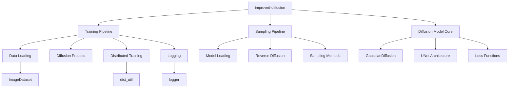

The repository is organized into three main components:

1. **Training Pipeline**: Implemented primarily in `scripts/image_train.py`, handles data loading, model training, and checkpoint saving.
2. **Sampling Pipeline**: Implemented in `scripts/image_sample.py`, loads trained models and generates new samples.
3. **Diffusion Model Core**: Implemented in the `improved_diffusion` module, contains the core diffusion process implementation.

Sources: [README.md:1-146]()

## Workflow

### Training and Sampling Workflow

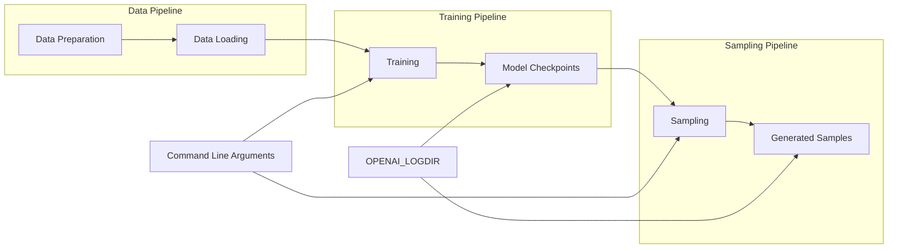

The workflow begins with data preparation, where images are organized into directories. The data loading component reads and preprocesses these images for training. The training process learns to reverse the diffusion process and periodically saves model checkpoints. These checkpoints can then be loaded for sampling to generate new images.

Command line arguments control both the training and sampling processes, allowing configuration of model architecture, diffusion process parameters, and training hyperparameters.

Sources: [README.md:19-26](), [README.md:58-59](), [README.md:60-70]()

## Key Components

### Gaussian Diffusion

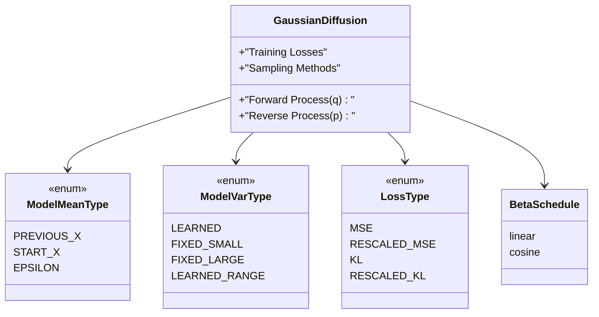

The core of the implementation is the `GaussianDiffusion` class, which implements both the forward process (gradually adding noise) and the reverse process (removing noise). The model's behavior is configured through several options:

- **Model Mean Type**: What the model predicts (previous x, start x, or epsilon)
- **Model Variance Type**: How variance is handled (learned, fixed small, fixed large, or learned range)
- **Loss Type**: The training objective (MSE, rescaled MSE, KL, or rescaled KL)
- **Beta Schedule**: The noise addition rate (linear or cosine)

Sources: [README.md:29-42]()

### Model Configuration

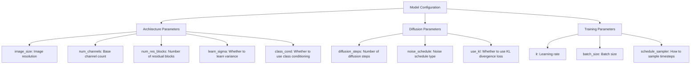

The model is configured through command-line arguments, which are organized into three categories:

1. **Architecture Parameters**: Control the structure and capacity of the model
2. **Diffusion Parameters**: Define how the diffusion process works
3. **Training Parameters**: Specify optimization settings

The README provides several example configurations for different datasets:

| Model Type | Dataset | Key Parameters |
|------------|---------|----------------|
| Unconditional | ImageNet-64 | 128 channels, 3 res blocks, cosine schedule |
| Unconditional | CIFAR-10 | 128 channels, 3 res blocks, 0.3 dropout, cosine schedule |
| Class-conditional | ImageNet-64 | 192 channels, 3 res blocks, cosine schedule |
| Unconditional | LSUN bedroom | 128 channels, 2 res blocks, attention at resolution 16 |

Sources: [README.md:29-35](), [README.md:84-146]()

### Data Processing

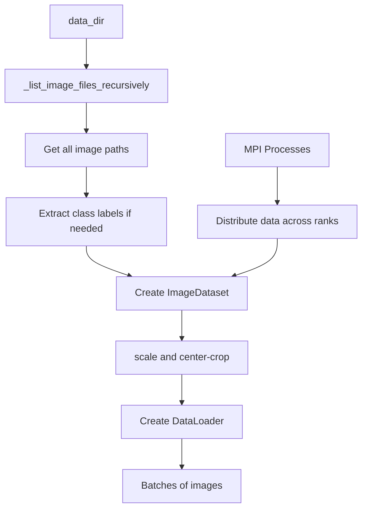

The data processing system takes a directory of images as input. For class-conditional models, labels are extracted from filenames (format: "mylabel_filename.jpg"). All images are automatically scaled and center-cropped during loading.

For distributed training, data is distributed across multiple processes using MPI, with utilities for parameter synchronization and device assignment.

Sources: [README.md:19-26](), [README.md:50-56]()

## Advanced Features

### Mixed-Precision Training

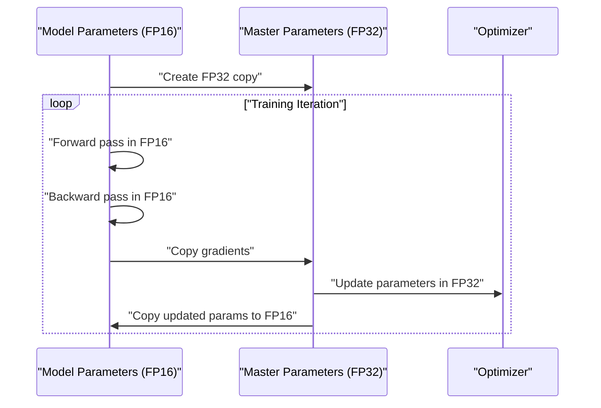

The repository supports mixed-precision training, where most operations are performed in 16-bit floating-point format (FP16) but gradient updates are done in 32-bit precision (FP32). This reduces memory usage and potentially increases training speed while maintaining numerical stability.

In lieu of distributed training, the `--microbatch` argument can be used to process large batches in smaller chunks to reduce memory usage.

Sources: [README.md:50-56]()

### Sampling Methods

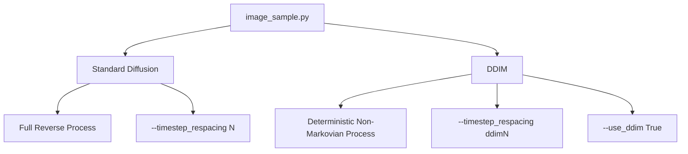

The repository supports two main sampling methods:

1. **Standard Diffusion**: The full reverse process as described in the original diffusion models
2. **DDIM (Denoising Diffusion Implicit Models)**: A deterministic non-Markovian sampling process that can generate samples in fewer steps

Both methods support "timestep respacing," which allows for generating samples with fewer steps than were used during training. For example, `--timestep_respacing 250` uses 250 steps for sampling, while `--timestep_respacing ddim250` uses the uniform stride from the DDIM paper.

Sources: [README.md:73-76]()

## Pre-trained Models

The repository includes checkpoints and hyperparameters for several pre-trained models:

| Model Type | Dataset | Checkpoint Link |
|------------|---------|----------------|
| Unconditional | ImageNet-64 | imagenet64_uncond_100M_1500K.pt |
| Unconditional | CIFAR-10 | cifar10_uncond_50M_500K.pt |
| Class-conditional | ImageNet-64 | imagenet64_cond_270M_250K.pt |
| Upsampling | 256x256 | upsample_cond_500K.pt |
| Unconditional | LSUN bedroom | lsun_uncond_100M_1200K_bs128.pt |

These models vary in architecture, diffusion parameters, and training settings, showcasing the flexibility of the framework.

Sources: [README.md:78-146]()

## Summary

The `improved-diffusion` repository provides a complete implementation of improved denoising diffusion probabilistic models. It includes code for training models on various image datasets and generating high-quality samples. The implementation supports numerous improvements over the base diffusion model, including learned variance, different noise schedules, and importance sampling. The repository also includes several pre-trained models that can be used for generating samples out of the box.

For more detailed information about specific components, see the following pages:
- [Training Pipeline](#2.1)
- [Sampling Pipeline](#2.2)
- [Gaussian Diffusion](#3.1)

Sources: [README.md:1-4](), [README.md:5-8]()

---

# Page: Installation and Setup

# Installation and Setup

<details>
<summary>Relevant source files</summary>

The following files were used as context for generating this wiki page:

- [.gitignore](.gitignore)
- [README.md](README.md)

</details>


This page guides you through the process of installing the improved-diffusion package and setting up your environment for training and sampling with diffusion models. For information about running specific commands and configuration options, see [Command-Line Interface](#1.2).

## Prerequisites

Before installing the improved-diffusion package, ensure you have:

- Python 3.x
- pip package manager
- Git
- GPU with CUDA support (recommended for training)
- MPI implementation (for distributed training)
- Sufficient disk space for datasets and model checkpoints

## Installation Steps

### Repository Structure

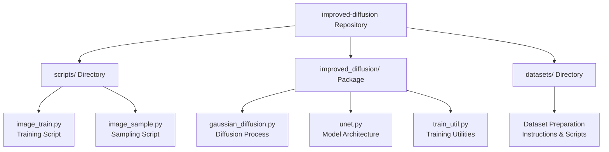

### Step-by-Step Installation

1. Clone the repository:
   ```bash
   git clone https://github.com/openai/improved-diffusion.git
   ```

2. Navigate to the repository directory:
   ```bash
   cd improved-diffusion
   ```

3. Install the package:
   ```bash
   pip install -e .
   ```

This installs the `improved_diffusion` package in development mode, which allows you to make changes to the code while using the package.

Sources: [README.md:9-17]()

## Data Preparation

The training code reads images from a directory. This section explains how to prepare your data.

### Data Processing Flow

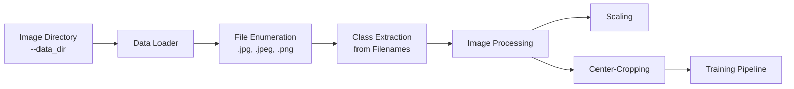

### Standard Datasets

The repository includes instructions for preparing commonly used datasets:

| Dataset | Location | Description |
|---------|----------|-------------|
| ImageNet | datasets/imagenet | High-resolution images with 1000 classes |
| LSUN Bedrooms | datasets/lsun | Large-scale bedroom scene images |
| CIFAR-10 | datasets/cifar10 | Small 32×32 images with 10 classes |

### Custom Dataset Creation

To create your own dataset:

1. Place all images in a directory with `.jpg`, `.jpeg`, or `.png` extensions
2. For class-conditional models, name files with a label prefix: `mylabel1_XXX.jpg`, `mylabel2_YYY.jpg`
3. Subdirectories are automatically enumerated, allowing for recursive organization

The data loading pipeline automatically scales and center-crops the images during training. Simply pass `--data_dir path/to/images` to the training script.

Sources: [README.md:19-25]()

## Environment Configuration

### Logging System

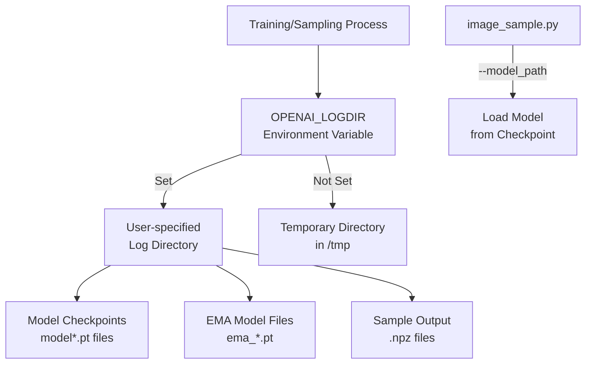

### Key Environment Variables

| Variable | Purpose | Default | Notes |
|----------|---------|---------|-------|
| OPENAI_LOGDIR | Directory for logs and saved models | Temporary dir in `/tmp` | Set this for persistent storage |
| CUDA_VISIBLE_DEVICES | Controls which GPUs are used | All available GPUs | Format: comma-separated list of device IDs |

Sources: [README.md:57-58]()

## Distributed Training Setup

For training on multiple GPUs or machines:

1. Install an MPI implementation (e.g., OpenMPI)
2. Launch with `mpiexec` to use multiple GPUs
3. Divide the batch size by the number of GPUs

Example command for distributed training:
```bash
mpiexec -n $NUM_GPUS python scripts/image_train.py --data_dir path/to/images $MODEL_FLAGS $DIFFUSION_FLAGS $TRAIN_FLAGS
```

For memory-constrained environments, use the `--microbatch` flag:
```bash
python scripts/image_train.py --data_dir path/to/images --microbatch 16 $MODEL_FLAGS $DIFFUSION_FLAGS $TRAIN_FLAGS
```

Sources: [README.md:50-56]()

## Code Architecture

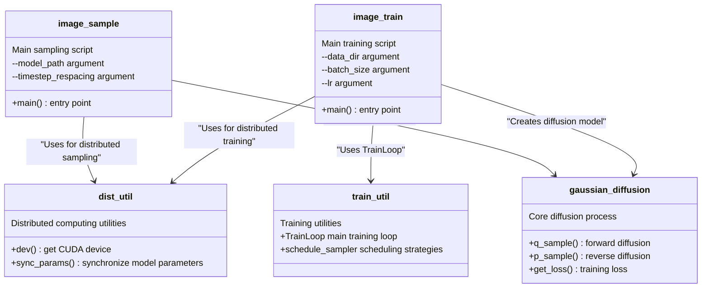

This diagram shows the key code entities and their relationships, illustrating how the scripts interact with the core diffusion implementation.

Sources: [README.md:27-45]()

## Verification and Next Steps

To verify successful installation, run:

```bash
python -c "import improved_diffusion; print('Installation successful')"
```

After completing the installation and setup:

1. **Configure and train a model**: See [Command-Line Interface](#1.2) for training options
2. **Sample from a trained model**: See [Command-Line Interface](#1.2) for sampling parameters
3. **Learn about diffusion models**: See [Core Concepts](#2) for theoretical background
4. **Explore advanced features**: See [Gaussian Diffusion](#3.1) for implementation details

Sources: [README.md:61-76]()

---

# Page: Command-Line Interface

# Command-Line Interface

<details>
<summary>Relevant source files</summary>

The following files were used as context for generating this wiki page:

- [README.md](README.md)

</details>


This document provides a comprehensive guide to the command-line interface of the improved-diffusion repository. It covers the available command-line arguments for both the training and sampling scripts, explaining how they affect model architecture, diffusion process parameters, and training/sampling behavior. For information about installation, see [Installation and Setup](#1.1), and for data preparation details, see [Data Management](#4).

## Overview of Command-Line Arguments

The improved-diffusion repository provides two main scripts with command-line interfaces:
- `image_train.py` - For training diffusion models
- `image_sample.py` - For sampling from trained models

Command-line arguments are logically organized into three main categories:

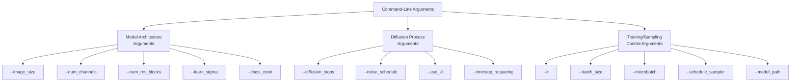

Sources: [README.md:28-76](https://github.com/openai/improved-diffusion/blob/main/README.md)

## Argument Organization in Practice

The repository's examples typically organize arguments into these groups for clarity:

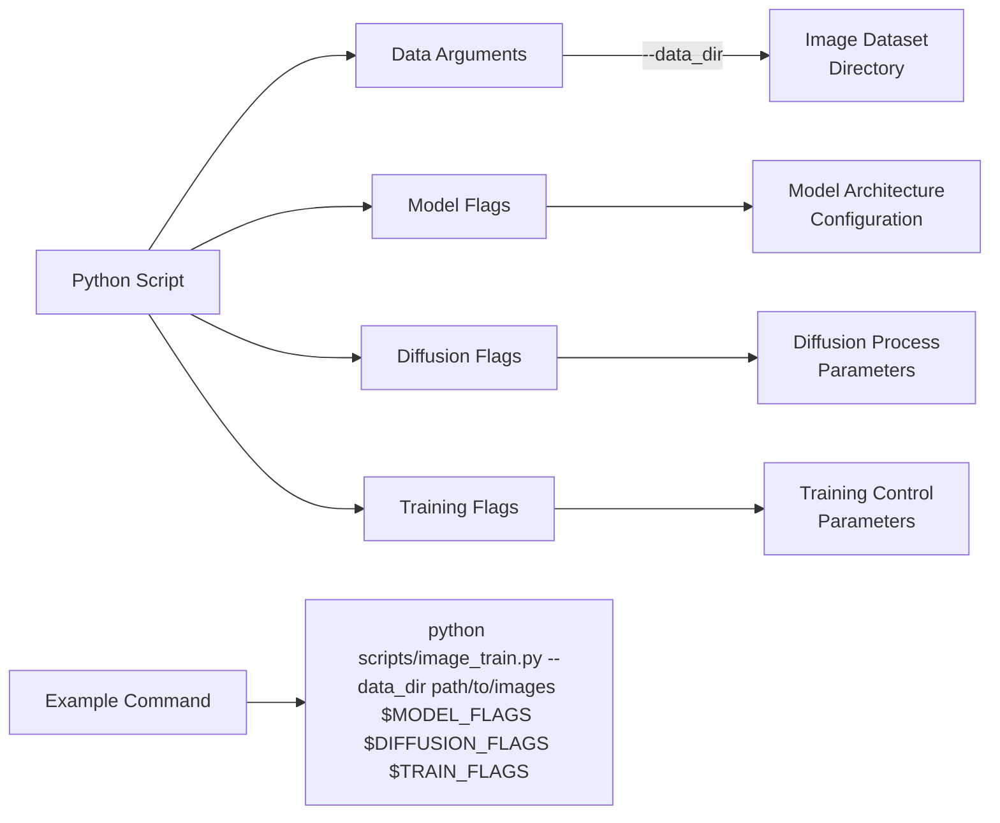

Sources: [README.md:28-48](https://github.com/openai/improved-diffusion/blob/main/README.md)

## Training Arguments

### Model Architecture Arguments

These arguments define the structure and capabilities of the neural network model:

| Argument | Description | Example Values |
|----------|-------------|----------------|
| `--image_size` | Size of images to train on (square) | 32, 64, 256 |
| `--num_channels` | Base channel count for the model | 128, 192 |
| `--num_res_blocks` | Number of residual blocks per downsample | 2, 3 |
| `--learn_sigma` | Whether to learn the variance parameter | True, False |
| `--class_cond` | Whether to use class-conditional model | True, False |
| `--dropout` | Dropout rate | 0.0, 0.3 |
| `--attention_resolutions` | Resolutions at which to apply attention | 16 |
| `--num_heads` | Number of attention heads | 1 |
| `--use_scale_shift_norm` | Use scale and shift for normalization | True, False |

Sources: [README.md:29-42](https://github.com/openai/improved-diffusion/blob/main/README.md), [README.md:80-146](https://github.com/openai/improved-diffusion/blob/main/README.md)

### Diffusion Process Arguments

These arguments control how the diffusion process works:

| Argument | Description | Example Values |
|----------|-------------|----------------|
| `--diffusion_steps` | Number of steps in diffusion process | 1000, 4000 |
| `--noise_schedule` | Schedule for adding noise | linear, cosine |
| `--use_kl` | Use KL divergence for variance loss | True, False |
| `--rescale_learned_sigmas` | Rescale learned sigmas | True, False |
| `--rescale_timesteps` | Rescale timesteps | True, False |

Sources: [README.md:29-42](https://github.com/openai/improved-diffusion/blob/main/README.md), [README.md:80-146](https://github.com/openai/improved-diffusion/blob/main/README.md)

### Training Control Arguments

These arguments affect the training process itself:

| Argument | Description | Example Values |
|----------|-------------|----------------|
| `--lr` | Learning rate | 1e-4, 3e-4, 2e-5 |
| `--batch_size` | Batch size for training | 128, 256, 2048 |
| `--microbatch` | Microbatch size for memory-constrained training | 1, 4, 16 |
| `--schedule_sampler` | Timestep sampling strategy | uniform, loss-second-moment |
| `--data_dir` | Directory containing training images | path/to/images |

Sources: [README.md:29-42](https://github.com/openai/improved-diffusion/blob/main/README.md), [README.md:50-58](https://github.com/openai/improved-diffusion/blob/main/README.md)

## Sampling Arguments

These arguments control the generation of samples from a trained model:

| Argument | Description | Example Values |
|----------|-------------|----------------|
| `--model_path` | Path to the trained model checkpoint | /path/to/model.pt |
| `--timestep_respacing` | Modify number of diffusion steps for sampling | 250, ddim250 |
| `--use_ddim` | Whether to use DDIM sampling | True, False |

Sources: [README.md:60-76](https://github.com/openai/improved-diffusion/blob/main/README.md)

## Relationship Between CLI Arguments and System Components

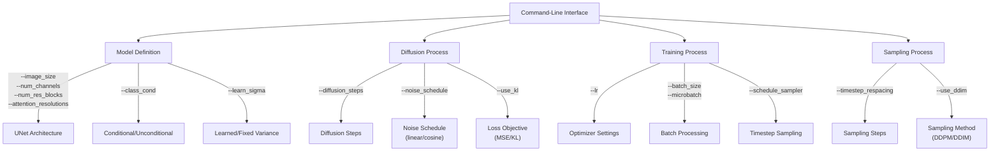

Sources: [README.md:28-76](https://github.com/openai/improved-diffusion/blob/main/README.md)

## Training Workflow with Command-Line Arguments

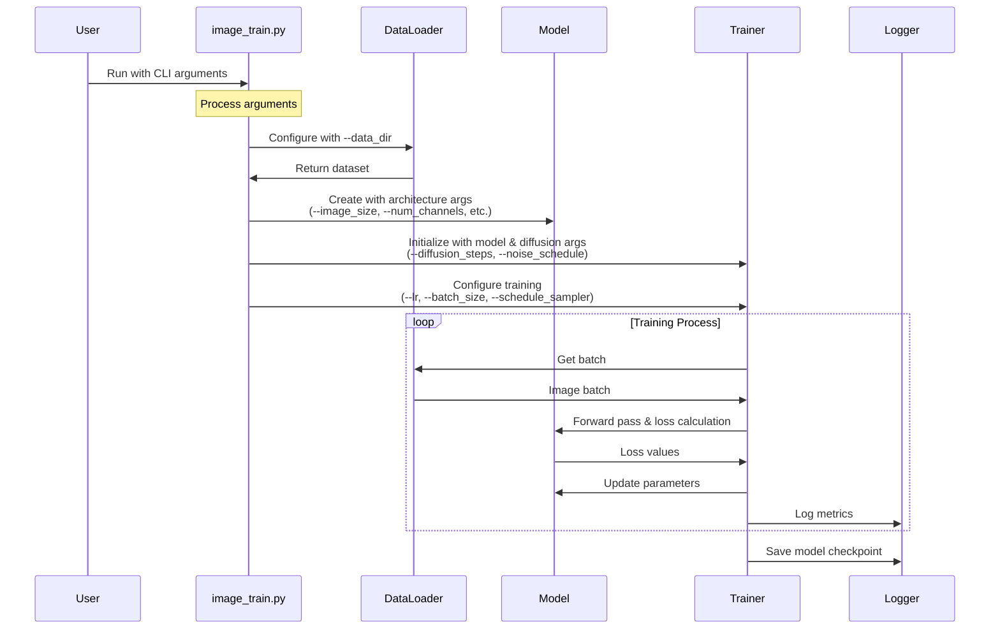

Sources: [README.md:28-58](https://github.com/openai/improved-diffusion/blob/main/README.md)

## Sampling Workflow with Command-Line Arguments

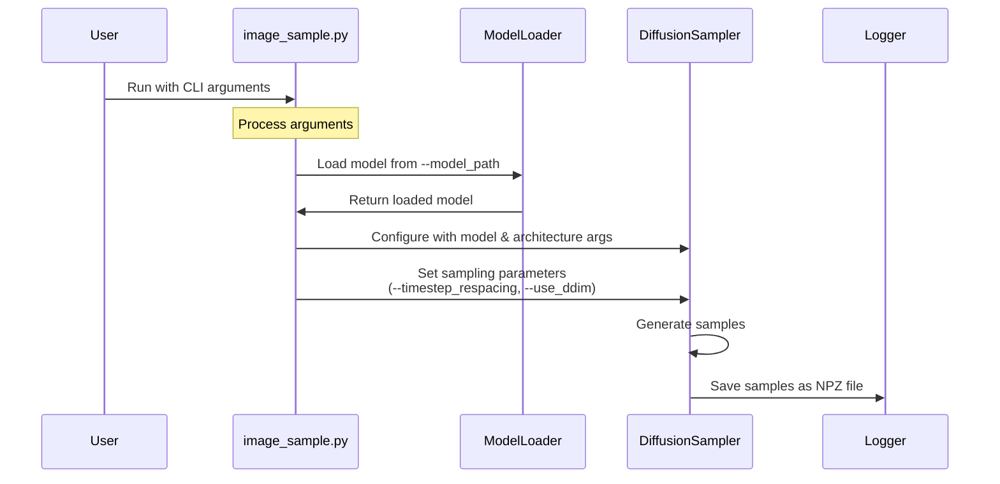

Sources: [README.md:60-76](https://github.com/openai/improved-diffusion/blob/main/README.md)

## Common Usage Examples

### Basic Training Example

```bash
MODEL_FLAGS="--image_size 64 --num_channels 128 --num_res_blocks 3"
DIFFUSION_FLAGS="--diffusion_steps 4000 --noise_schedule linear"
TRAIN_FLAGS="--lr 1e-4 --batch_size 128"

python scripts/image_train.py --data_dir path/to/images $MODEL_FLAGS $DIFFUSION_FLAGS $TRAIN_FLAGS
```

### Training with Learned Sigmas and Cosine Schedule

```bash
MODEL_FLAGS="--image_size 64 --num_channels 128 --num_res_blocks 3 --learn_sigma True"
DIFFUSION_FLAGS="--diffusion_steps 4000 --noise_schedule cosine"
TRAIN_FLAGS="--lr 1e-4 --batch_size 128"

python scripts/image_train.py --data_dir path/to/images $MODEL_FLAGS $DIFFUSION_FLAGS $TRAIN_FLAGS
```

### Training Class-Conditional Model

```bash
MODEL_FLAGS="--image_size 64 --num_channels 192 --num_res_blocks 3 --learn_sigma True --class_cond True"
DIFFUSION_FLAGS="--diffusion_steps 4000 --noise_schedule cosine --rescale_learned_sigmas False --rescale_timesteps False"
TRAIN_FLAGS="--lr 3e-4 --batch_size 2048"

python scripts/image_train.py --data_dir path/to/images $MODEL_FLAGS $DIFFUSION_FLAGS $TRAIN_FLAGS
```

### Distributed Training with MPI

```bash
MODEL_FLAGS="--image_size 64 --num_channels 128 --num_res_blocks 3"
DIFFUSION_FLAGS="--diffusion_steps 4000 --noise_schedule linear"
TRAIN_FLAGS="--lr 1e-4 --batch_size 32" # Batch size divided by number of GPUs

mpiexec -n 4 python scripts/image_train.py --data_dir path/to/images $MODEL_FLAGS $DIFFUSION_FLAGS $TRAIN_FLAGS
```

### Basic Sampling

```bash
MODEL_FLAGS="--image_size 64 --num_channels 128 --num_res_blocks 3"
DIFFUSION_FLAGS="--diffusion_steps 4000 --noise_schedule linear"

python scripts/image_sample.py --model_path /path/to/model.pt $MODEL_FLAGS $DIFFUSION_FLAGS
```

### Sampling with Fewer Steps

```bash
MODEL_FLAGS="--image_size 64 --num_channels 128 --num_res_blocks 3"
DIFFUSION_FLAGS="--diffusion_steps 4000 --noise_schedule linear --timestep_respacing 250"

python scripts/image_sample.py --model_path /path/to/model.pt $MODEL_FLAGS $DIFFUSION_FLAGS
```

### Sampling with DDIM

```bash
MODEL_FLAGS="--image_size 64 --num_channels 128 --num_res_blocks 3"
DIFFUSION_FLAGS="--diffusion_steps 4000 --noise_schedule linear --timestep_respacing ddim250 --use_ddim True"

python scripts/image_sample.py --model_path /path/to/model.pt $MODEL_FLAGS $DIFFUSION_FLAGS
```

Sources: [README.md:28-146](https://github.com/openai/improved-diffusion/blob/main/README.md)

## Special Notes on Argument Usage

1. **Batch Size in Distributed Training**: When using distributed training with MPI, you must manually divide the `--batch_size` argument by the number of GPUs (ranks).

2. **Memory Constraints**: For memory-limited scenarios, use `--microbatch` with small values (e.g., 16 or even 1) to reduce memory usage.

3. **Logging Directory**: Results, logs, and saved models are written to a directory determined by the `OPENAI_LOGDIR` environment variable. If not set, a temporary directory in `/tmp` is created.

4. **EMA Models**: When sampling, prefer checkpoints with names like `ema_0.9999_200000.pt` over those like `model200000.pt`, as EMA models produce better samples.

5. **DDIM Sampling**: To use DDIM sampling, enable it with `--use_ddim True` and set `--timestep_respacing` to values like `ddim250`.

Sources: [README.md:50-76](https://github.com/openai/improved-diffusion/blob/main/README.md)

---

# Page: Core Concepts

# Core Concepts

<details>
<summary>Relevant source files</summary>

The following files were used as context for generating this wiki page:

- [README.md](README.md)
- [improved_diffusion/gaussian_diffusion.py](improved_diffusion/gaussian_diffusion.py)

</details>


## Introduction

This document explains the fundamental concepts of diffusion models as implemented in the improved-diffusion repository. It covers the theoretical framework, core components, and their interactions in both training and sampling processes. For implementation details of specific processes, see [Training Pipeline](#2.1) and [Sampling Pipeline](#2.2).

## Diffusion Models Fundamentals

Diffusion Probabilistic Models operate through two key processes:

1. **Forward Process (q)**: A fixed Markov chain that gradually adds noise to data
2. **Reverse Process (p)**: A learned Markov chain that gradually removes noise to generate data

### Forward and Reverse Diffusion Process

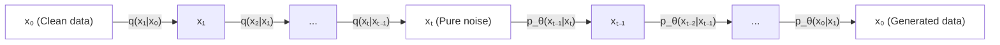

Sources: [improved_diffusion/gaussian_diffusion.py:1-7]()

### Mathematical Formulation

The forward process adds noise by:

x_t = √(α̅_t) * x_0 + √(1 - α̅_t) * ε

Where:
- α_t = 1 - β_t (β_t is the noise level at step t)
- α̅_t = ∏_{s=1}^t α_s (cumulative product)
- ε is Gaussian noise

The reverse process denoises by learning:

p_θ(x_{t-1} | x_t) = N(x_{t-1}; μ_θ(x_t, t), Σ_θ(x_t, t))

Sources: [improved_diffusion/gaussian_diffusion.py:140-169]()

## Core Components

The implementation centers around the `GaussianDiffusion` class and several enumeration types that configure its behavior.

### Diffusion System Architecture

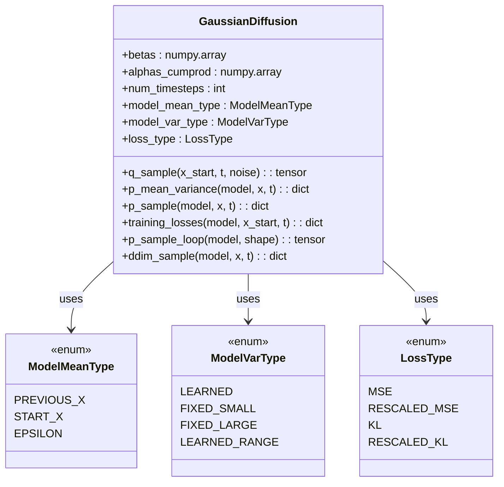

Sources: [improved_diffusion/gaussian_diffusion.py:101-126]()

### Model Mean Types

The `ModelMeanType` enum determines what the neural network predicts:

| Enum Value | Description | Implementation |
|------------|-------------|----------------|
| `PREVIOUS_X` | Model predicts x_{t-1} directly | [improved_diffusion/gaussian_diffusion.py:300-304]() |
| `START_X` | Model predicts x_0 (the clean data) | [improved_diffusion/gaussian_diffusion.py:306-307]() |
| `EPSILON` | Model predicts ε (the noise) - most common | [improved_diffusion/gaussian_diffusion.py:309-311]() |

Sources: [improved_diffusion/gaussian_diffusion.py:65-72]()

### Model Variance Types

The `ModelVarType` enum configures how the variance of the reverse process is determined:

| Enum Value | Description | Implementation |
|------------|-------------|----------------|
| `LEARNED` | Model outputs log variance directly | [improved_diffusion/gaussian_diffusion.py:265-267]() |
| `FIXED_SMALL` | Uses fixed posterior variance | [improved_diffusion/gaussian_diffusion.py:285-288]() |
| `FIXED_LARGE` | Uses fixed larger variance (β_t) | [improved_diffusion/gaussian_diffusion.py:281-284]() |
| `LEARNED_RANGE` | Model outputs interpolation factor between min/max variance | [improved_diffusion/gaussian_diffusion.py:269-276]() |

Sources: [improved_diffusion/gaussian_diffusion.py:75-86]()

### Loss Types

The `LossType` enum defines the training objective:

| Enum Value | Description | Implementation |
|------------|-------------|----------------|
| `MSE` | Mean squared error between prediction and target | [improved_diffusion/gaussian_diffusion.py:709-746]() |
| `RESCALED_MSE` | MSE with rescaled variance learning term | [improved_diffusion/gaussian_diffusion.py:729-732]() |
| `KL` | Kullback-Leibler divergence (variational lower bound) | [improved_diffusion/gaussian_diffusion.py:698-706]() |
| `RESCALED_KL` | KL rescaled by timesteps for better estimation | [improved_diffusion/gaussian_diffusion.py:707-708]() |

Sources: [improved_diffusion/gaussian_diffusion.py:89-98]()

### Beta Schedules

The beta schedule determines the noise addition rate in the forward process:

| Schedule | Description | Implementation |
|----------|-------------|----------------|
| `linear` | Linear schedule from 0.0001 to 0.02 | [improved_diffusion/gaussian_diffusion.py:27-35]() |
| `cosine` | Cosine schedule for smoother noise addition | [improved_diffusion/gaussian_diffusion.py:36-40]() |

Sources: [improved_diffusion/gaussian_diffusion.py:18-42]()

## Forward Process Implementation

The forward process (adding noise) is implemented in several methods:

### Forward Process Functions

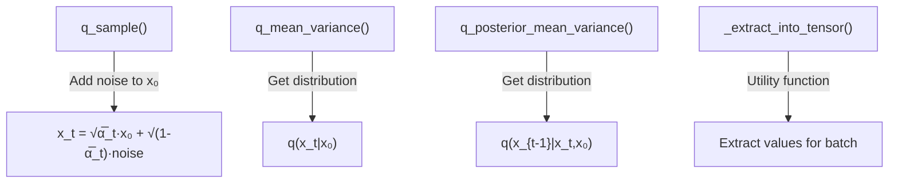

Sources: [improved_diffusion/gaussian_diffusion.py:171-230](), [improved_diffusion/gaussian_diffusion.py:828-841]()

The forward process adds noise according to the predetermined schedule using `q_sample()`, which directly implements the formula:

```
x_t = sqrt_alphas_cumprod[t] * x_start + sqrt_one_minus_alphas_cumprod[t] * noise
```

## Reverse Process Implementation

The reverse process (denoising) is implemented in these key methods:

### Reverse Process Functions

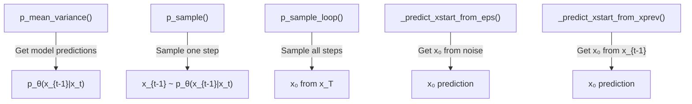

Sources: [improved_diffusion/gaussian_diffusion.py:232-387]()

## Training Process

During training, the model learns to reverse the diffusion process:

### Training Workflow

```mermaid
sequenceDiagram
    participant D as "Data x₀"
    participant T as "Timestep t"
    participant N as "Noise ε"
    participant F as "Forward Process q"
    participant M as "Model"
    participant L as "Loss Function"
    
    D->>D: "Sample batch"
    D->>T: "Sample random timesteps"
    D->>N: "Sample random noise"
    D->>F: "q_sample(x₀, t, noise)"
    F->>M: "x_t, t"
    M->>M: "Predict noise or x₀"
    M->>L: "Calculate loss against target"
    L->>M: "Update model parameters"
```

Sources: [improved_diffusion/gaussian_diffusion.py:677-750]()

The training loss depends on the loss type:
- For `MSE` and `RESCALED_MSE`: Mean squared error between prediction and target
- For `KL` and `RESCALED_KL`: Variational lower bound using KL divergence

## Sampling Process

During sampling, the model generates new data starting from noise:

### Sampling Workflow

```mermaid
sequenceDiagram
    participant N as "Noise x_T"
    participant M as "Model"
    participant P as "p_sample()"
    participant S as "Final Sample x₀"
    
    N->>N: "Initialize with random noise"
    loop t from T to 1
        N->>M: "Current x_t, timestep t"
        M->>M: "Predict mean and variance"
        M->>P: "Sample x_{t-1}"
        P->>N: "Update to new x_{t-1}"
    end
    N->>S: "Return final x₀"
```

Sources: [improved_diffusion/gaussian_diffusion.py:389-477]()

### DDIM Sampling

The implementation also supports Denoising Diffusion Implicit Models (DDIM) sampling, which enables faster generation with fewer steps:

```mermaid
graph TD
    A["ddim_sample()"] -->|"One step DDIM"| B["Deterministic update with optional noise"]
    
    C["ddim_sample_loop()"] -->|"Full DDIM sampling"| D["Generate sample with fewer steps"]
    
    E["eta parameter"] -->|"Controls stochasticity"| F["η=0: deterministic, η=1: DDPM equivalent"]
```

Sources: [improved_diffusion/gaussian_diffusion.py:479-640]()

## Precomputed Diffusion Parameters

The `GaussianDiffusion` class precomputes various quantities used throughout the diffusion process:

| Parameter | Description | Formula |
|-----------|-------------|---------|
| `alphas` | Complement of beta values | 1 - β_t |
| `alphas_cumprod` | Cumulative product of alphas | ∏_{s=1}^t α_s |
| `sqrt_alphas_cumprod` | Square root of alphas_cumprod | √(∏_{s=1}^t α_s) |
| `sqrt_one_minus_alphas_cumprod` | Square root of complement | √(1 - ∏_{s=1}^t α_s) |
| `posterior_variance` | Variance for q(x_{t-1}\|x_t,x_0) | β_t·(1-α̅_{t-1})/(1-α̅_t) |
| `posterior_mean_coef1` | First coefficient for posterior mean | β_t·√α̅_{t-1}/(1-α̅_t) |
| `posterior_mean_coef2` | Second coefficient for posterior mean | (1-α̅_{t-1})·√α_t/(1-α̅_t) |

Sources: [improved_diffusion/gaussian_diffusion.py:140-169]()

## Configuration Options

The model can be configured with various parameters specified as command-line arguments:

### Model Configuration

```mermaid
graph TD
    A["Improved Diffusion Model Configuration"] --> B["Model Architecture"]
    A --> C["Diffusion Process"]
    A --> D["Training Parameters"]
    
    B --> B1["--image_size: Size of images"]
    B --> B2["--num_channels: Base channel count"]
    B --> B3["--num_res_blocks: ResNet blocks per level"]
    B --> B4["--learn_sigma: Learn variance parameter"]
    B --> B5["--class_cond: Class conditional model"]
    
    C --> C1["--diffusion_steps: Number of steps T"]
    C --> C2["--noise_schedule: linear or cosine"]
    C --> C3["--use_kl: Use KL loss rather than MSE"]
    
    D --> D1["--lr: Learning rate"]
    D --> D2["--batch_size: Batch size"]
    D --> D3["--schedule_sampler: How to sample timesteps"]
```

Sources: [README.md:29-43]()

## Model-to-Diffusion Integration

The neural network model integrates with the diffusion process as follows:

### Model-Diffusion Integration

```mermaid
graph TD
    A["Neural Network Input"] --> A1["x_t: Noisy data at step t"]
    A --> A2["t: Timestep"]
    A --> A3["Conditioning (optional)"]
    
    A --> B["UNet Model"]
    
    B --> C["Model Output"]
    
    C --> C1["If ModelMeanType.EPSILON: predicted noise ε"]
    C --> C2["If ModelMeanType.START_X: predicted clean data x₀"]
    C --> C3["If ModelMeanType.PREVIOUS_X: predicted previous step x_{t-1}"]
    
    C --> D["If ModelVarType.LEARNED or LEARNED_RANGE: additional variance outputs"]
    
    E["GaussianDiffusion"] --> E1["Processes model output"]
    E1 --> E2["Computes mean and variance"]
    E2 --> E3["Samples next step x_{t-1}"]
```

Sources: [improved_diffusion/gaussian_diffusion.py:232-267]()

The model's output is processed by the `GaussianDiffusion` class to compute the parameters of the reverse distribution and sample the next step in the denoising process.

---

# Page: Training Pipeline

# Training Pipeline

<details>
<summary>Relevant source files</summary>

The following files were used as context for generating this wiki page:

- [README.md](README.md)
- [improved_diffusion/gaussian_diffusion.py](improved_diffusion/gaussian_diffusion.py)

</details>


This page documents the training pipeline for the Improved Diffusion repository, explaining how the system trains denoising diffusion probabilistic models (DDPMs). For information about sampling from trained models, see [Sampling Pipeline](#2.2).

## Overview

The training pipeline transforms clean images into a trained diffusion model through an iterative process of adding noise and then learning to reverse this process. It implements the procedures outlined in the "Improved Denoising Diffusion Probabilistic Models" paper with enhancements for stability and performance.

```mermaid
flowchart TD
    A["Data Directory"] --> B["Data Loading"]
    B --> C["Model Initialization"]
    C --> D["Training Loop"]
    D --> E["Model Checkpoints"]
    
    D -->|"Each Iteration"| F["Sample Batch & Timesteps"]
    F --> G["Add Noise (q_sample)"]
    G --> H["Model Prediction"]
    H --> I["Loss Calculation"]
    I --> J["Gradient Update"]
    J --> D
    
    K["Command-line Arguments"] --> B
    K --> C
```

Sources: [README.md:25-59]()

## Training Configuration

The training pipeline is configured through command-line arguments, which can be organized into three categories:

| Category | Flag Group | Purpose | Examples |
|----------|------------|---------|----------|
| Model Architecture | MODEL_FLAGS | Define the model structure | `--image_size`, `--num_channels`, `--learn_sigma` |
| Diffusion Process | DIFFUSION_FLAGS | Configure the noise addition process | `--diffusion_steps`, `--noise_schedule` |
| Training Parameters | TRAIN_FLAGS | Set optimization hyperparameters | `--lr`, `--batch_size` |

Training is initiated through the `image_train.py` script, which accepts these configuration flags:

```
python scripts/image_train.py --data_dir path/to/images $MODEL_FLAGS $DIFFUSION_FLAGS $TRAIN_FLAGS
```

Sources: [README.md:27-46]()

## Data Pipeline

The training pipeline begins with loading and preprocessing image data:

```mermaid
flowchart LR
    A["Data Directory"] --> B["Image Files"]
    B --> C["_list_image_files_recursively"]
    C --> D["Extract class labels"]
    D --> E["ImageDataset Creation"]
    E --> F["DataLoader"]
    F --> G["Training Batches"]
    
    H["Class-conditional?"] -->|"Yes"| D
    H -->|"No"| E
    
    I["Batch Size"] --> F
    J["Image Size"] --> E
```

Key characteristics:

- Images are automatically scaled and center-cropped
- For class-conditional training, labels are extracted from filenames (format: "label_XXX.jpg")
- Subdirectories are automatically enumerated
- In distributed training, the dataset is partitioned across ranks

Sources: [README.md:19-25]()

## Diffusion Process

The core of the training is the diffusion process, implemented in the `GaussianDiffusion` class:

```mermaid
classDiagram
    class GaussianDiffusion {
        +betas
        +alphas_cumprod
        +model_mean_type
        +model_var_type
        +loss_type
        +q_sample()
        +p_mean_variance()
        +training_losses()
    }
    
    GaussianDiffusion --> ModelMeanType
    GaussianDiffusion --> ModelVarType
    GaussianDiffusion --> LossType
    
    class ModelMeanType {
        <<enum>>
        PREVIOUS_X
        START_X
        EPSILON
    }
    
    class ModelVarType {
        <<enum>>
        LEARNED
        FIXED_SMALL
        FIXED_LARGE
        LEARNED_RANGE
    }
    
    class LossType {
        <<enum>>
        MSE
        RESCALED_MSE
        KL
        RESCALED_KL
    }
```

During each training iteration:

1. A batch of clean images (x₀) is sampled
2. Random timesteps (t) are sampled for each image
3. Noise is added via `q_sample()` to produce noisy images (x_t)
4. The model predicts either the noise, original image, or previous timestep
5. Loss is calculated based on the prediction and target
6. Model parameters are updated via gradient descent

Sources: [improved_diffusion/gaussian_diffusion.py:101-171](), [improved_diffusion/gaussian_diffusion.py:677-750]()

## Forward Process and Loss Calculation

The training process involves two key components:

```mermaid
sequenceDiagram
    participant X0 as "Clean Image (x₀)"
    participant Xt as "Noisy Image (x_t)"
    participant Model as "UNet Model"
    participant Loss as "Loss Function"
    
    X0->>Xt: q_sample(x₀, t, noise)
    Xt->>Model: model(x_t, t)
    Model->>Loss: training_losses()
    
    Note over Loss: Different loss types
    
    alt ModelMeanType.EPSILON
        Model-->>Loss: Predicted noise (ε)
    else ModelMeanType.START_X
        Model-->>Loss: Predicted x₀
    else ModelMeanType.PREVIOUS_X
        Model-->>Loss: Predicted x_{t-1}
    end
    
    alt LossType.MSE
        Loss-->>Loss: Mean Squared Error
    else LossType.KL
        Loss-->>Loss: KL Divergence
    else LossType.RESCALED_MSE/KL
        Loss-->>Loss: Rescaled versions
    end
```

The `training_losses` method in `GaussianDiffusion` handles this process:

1. Adds noise to the clean image using `q_sample`
2. Feeds the noisy image to the model
3. Calculates the appropriate loss based on model predictions
4. Returns a dictionary with loss values

Sources: [improved_diffusion/gaussian_diffusion.py:677-750]()

## Distributed Training

The pipeline supports distributed training through MPI (Message Passing Interface):

```mermaid
flowchart TD
    A["mpiexec -n NUM_GPUS"] --> B["MPI Initialization"]
    B --> C["Process Rank Assignment"]
    C --> D["Device Assignment"]
    D --> E["Data Partitioning"]
    E --> F["Synchronized Training"]
    
    G["Original Batch Size"] --> H["Batch Size / NUM_GPUS"]
    H --> E
    
    I["Alternative: Microbatching"] -->|"--microbatch"| J["Process in smaller chunks"]
    J --> F
```

Key aspects of distributed training:

- Run with `mpiexec -n NUM_GPUS python scripts/image_train.py ...`
- Must divide batch size by number of ranks
- Alternative: use `--microbatch` flag for memory-constrained scenarios
- Gradient synchronization happens automatically across processes

Sources: [README.md:50-56]()

## Logging and Checkpoints

Training progress is tracked through the logging system, which saves both metrics and model checkpoints:

```mermaid
flowchart LR
    A["Training Loop"] --> B["Logger"]
    B --> C["Metrics Logging"]
    C --> D["Console Output"]
    C --> E["Log Files"]
    
    A -->|"Every N steps"| F["Checkpoint Saving"]
    F --> G["Model Parameters"]
    F --> H["EMA Model Parameters"]
    
    I["OPENAI_LOGDIR"] --> J["Logging Directory"]
    J --> E
    J --> G
    J --> H
```

Important details:

- Logs and checkpoints are written to `OPENAI_LOGDIR` environment variable
- If not set, a temporary directory in `/tmp` is used
- EMA (Exponential Moving Average) checkpoints are saved with names like `ema_0.9999_200000.pt`
- Regular model checkpoints are saved as `model200000.pt`
- EMA checkpoints typically produce better samples

Sources: [README.md:58-62]()

## Training Tips

Based on the paper and repository:

1. **Loss Functions**:
   - `L_hybrid` (combination of MSE and VLB terms) often performs best
   - Enable with `--learn_sigma True` in model flags

2. **Noise Schedule**:
   - Cosine schedule typically outperforms linear
   - Set with `--noise_schedule cosine`

3. **Importance Sampling**:
   - For improved training stability, use:
     - `--use_kl True` (DIFFUSION_FLAGS)
     - `--schedule_sampler loss-second-moment` (TRAIN_FLAGS)

4. **Class-Conditional Training**:
   - Enable with `--class_cond True` in MODEL_FLAGS
   - Requires properly formatted filenames ("class_XXX.jpg")

Sources: [README.md:37-46](), [README.md:87-146]()

---

# Page: Sampling Pipeline

# Sampling Pipeline

<details>
<summary>Relevant source files</summary>

The following files were used as context for generating this wiki page:

- [README.md](README.md)
- [improved_diffusion/gaussian_diffusion.py](improved_diffusion/gaussian_diffusion.py)

</details>


The Sampling Pipeline in the improved-diffusion repository is responsible for generating images from trained diffusion models. This component takes trained model checkpoints and performs the reverse diffusion process to create new samples. This page focuses on the implementation details of how samples are generated, including both standard diffusion sampling and DDIM sampling methods.

For information about the training process, see [Training Pipeline](#2.1).

## Overview of the Sampling Process

The sampling process starts with random noise and progressively denoises it by reversing the diffusion process using a trained model. This reverse process corresponds to the p-distribution in the diffusion framework, which approximates the true posterior distribution.

```mermaid
flowchart LR
    A["Random Noise (x_T)"] --> B["Reverse Diffusion Process"]
    B --> C["Generated Sample (x_0)"]
    D["Trained Model"] --> B
    E["Sampling Parameters"] --> B
    
    subgraph "Sampling Pipeline"
    A
    B
    C
    end
    
    subgraph "Input Parameters"
    D
    E
    end
```

The core sampling pipeline consists of several key steps:
1. Loading a trained model checkpoint
2. Generating initial random noise
3. Progressively denoising the sample using the model
4. Producing the final generated image

Sources: [README.md:61-77](), [improved_diffusion/gaussian_diffusion.py:389-429]()

## Sampling Methods

The codebase implements two primary sampling methods:

### Standard Diffusion Sampling

The standard diffusion sampling process follows the stochastic reverse process defined in the diffusion model framework. It adds carefully calibrated noise at each step of the reverse process:

```mermaid
sequenceDiagram
    participant X_t as "x_t (Noisy Sample)"
    participant Model as "Model"
    participant X_t_minus_1 as "x_{t-1} (Less Noisy Sample)"
    
    Note over X_t,X_t_minus_1: For each timestep t from T to 1
    X_t->>Model: Input x_t, timestep t
    Model->>Model: p_mean_variance(model, x_t, t)
    Model->>X_t_minus_1: Predict mean and variance
    X_t_minus_1->>X_t_minus_1: Add noise scaled by variance
    Note over X_t_minus_1: sample = mean + noise × sqrt(variance)
```

This method is implemented in the `p_sample` function, which samples x_{t-1} from x_t using the model predictions. The `p_sample_loop` function calls `p_sample` repeatedly to generate a complete sample from random noise.

Sources: [improved_diffusion/gaussian_diffusion.py:356-388](), [improved_diffusion/gaussian_diffusion.py:389-429]()

### DDIM Sampling

DDIM (Denoising Diffusion Implicit Models) sampling is an alternative deterministic sampling method that often produces higher quality samples with fewer steps:

```mermaid
sequenceDiagram
    participant X_t as "x_t (Noisy Sample)"
    participant Model as "Model"
    participant Eps as "ε (Predicted Noise)"
    participant X_t_minus_1 as "x_{t-1} (Less Noisy Sample)"
    
    X_t->>Model: Input x_t, timestep t
    Model->>Model: p_mean_variance(model, x_t, t)
    Model->>Eps: Re-derive epsilon from pred_xstart
    Eps->>X_t_minus_1: Calculate mean using DDIM formula
    Note over X_t_minus_1: Deterministic (η=0) or stochastic (η>0)
```

DDIM sampling allows for fewer sampling steps while maintaining quality, making it more efficient than standard diffusion. The parameter η controls the stochasticity, with η=0 making the process deterministic.

Sources: [improved_diffusion/gaussian_diffusion.py:479-522](), [improved_diffusion/gaussian_diffusion.py:562-592]()

## Core Implementation

The sampling pipeline is primarily implemented in the `GaussianDiffusion` class, which provides methods for both standard diffusion and DDIM sampling.

```mermaid
classDiagram
    class GaussianDiffusion {
        +p_mean_variance(model, x, t)
        +p_sample(model, x, t)
        +p_sample_loop(model, shape)
        +p_sample_loop_progressive(model, shape)
        +ddim_sample(model, x, t, eta)
        +ddim_sample_loop(model, shape, eta)
        +ddim_sample_loop_progressive(model, shape, eta)
    }
    
    GaussianDiffusion "1" --> "1" ModelMeanType: uses
    GaussianDiffusion "1" --> "1" ModelVarType: uses
    
    class ModelMeanType {
        <<enum>>
        PREVIOUS_X
        START_X
        EPSILON
    }
    
    class ModelVarType {
        <<enum>>
        LEARNED
        FIXED_SMALL
        FIXED_LARGE
        LEARNED_RANGE
    }
```

The key sampling methods include:

1. **`p_mean_variance`**: Calculates the mean and variance for the reverse diffusion step, as well as a prediction of x_0.

2. **`p_sample`**: Samples a single timestep x_{t-1} from x_t using the model and adding noise. 

3. **`p_sample_loop`**: Generates a complete sample by repeatedly calling `p_sample`, going from random noise to the final sample.

4. **`ddim_sample`**: Implements DDIM sampling for a single timestep.

5. **`ddim_sample_loop`**: Generates a complete sample using DDIM sampling.

Sources: [improved_diffusion/gaussian_diffusion.py:232-326](), [improved_diffusion/gaussian_diffusion.py:356-477](), [improved_diffusion/gaussian_diffusion.py:479-641]()

## Detailed Sampling Process Flow

```mermaid
flowchart TD
    A["image_sample.py script"] --> B["Load model checkpoint"]
    B --> C["Create GaussianDiffusion instance"]
    C --> D["Initialize random noise (x_T)"]
    D --> E{"Use DDIM?"}
    
    E -->|Yes| F["ddim_sample_loop"]
    E -->|No| G["p_sample_loop"]
    
    F --> H["Generate sample progressively"]
    G --> H
    
    H --> I["Save generated samples"]
    
    F --> J["ddim_sample for each step t"]
    G --> K["p_sample for each step t"]
    
    J --> L["Calculate model predictions"]
    K --> L
    
    L --> M["Derive noise or clean prediction"]
    M --> N["Compute mean and variance"]
    N --> O["Sample new point x_{t-1}"]
```

The sampling process begins with the `image_sample.py` script, which loads a trained model checkpoint and creates an instance of the `GaussianDiffusion` class. Based on command-line arguments, it either uses standard diffusion sampling (`p_sample_loop`) or DDIM sampling (`ddim_sample_loop`) to generate samples.

Sources: [improved_diffusion/gaussian_diffusion.py:389-429](), [improved_diffusion/gaussian_diffusion.py:562-592]()

## Timestep Respacing

The codebase supports "timestep respacing", which allows sampling with a different number of steps than what was used during training. This is particularly useful for accelerating the sampling process:

```mermaid
flowchart LR
    A["Original Diffusion Steps (e.g., 4000)"] --> B["Timestep Respacing"]
    B --> C["Reduced Sampling Steps (e.g., 250)"]
    B --> D["DDIM-style Uniform Stride"]
    
    B --> |"--timestep_respacing 250"| C
    B --> |"--timestep_respacing ddim250"| D
```

Timestep respacing can significantly reduce the number of diffusion steps needed for sampling, making the generation process much faster. The `--timestep_respacing` argument can be passed to the `image_sample.py` script to control this behavior.

Sources: [README.md:74-76]()

## Practical Usage

To generate samples from a trained model, you can use the `image_sample.py` script with appropriate arguments. Here are some example commands:

### Basic Sampling Command

```
python scripts/image_sample.py --model_path /path/to/model.pt --image_size 64 --num_channels 128 --num_res_blocks 3
```

### Using DDIM Sampling

```
python scripts/image_sample.py --model_path /path/to/model.pt --image_size 64 --num_channels 128 --num_res_blocks 3 --use_ddim True
```

### Controlling Number of Sampling Steps

```
python scripts/image_sample.py --model_path /path/to/model.pt --image_size 64 --num_channels 128 --num_res_blocks 3 --timestep_respacing 250
```

The sampling script saves results to a logging directory determined by the `OPENAI_LOGDIR` environment variable. Samples are saved as a large `npz` file, with `arr_0` containing the batch of samples.

Sources: [README.md:61-77]()

## Model Parameters and Sampling

The model parameters specified during training must match those used during sampling. The following table shows the key parameters for different datasets:

| Dataset | Image Size | Channels | Res Blocks | Learn Sigma | Diffusion Steps | Noise Schedule |
|---------|-----------|----------|------------|-------------|-----------------|----------------|
| ImageNet-64 (Uncond) | 64 | 128 | 3 | True | 4000 | cosine |
| CIFAR-10 (Uncond) | 32 | 128 | 3 | True | 4000 | cosine |
| ImageNet-64 (Cond) | 64 | 192 | 3 | True | 4000 | cosine |
| LSUN bedroom | 256 | 128 | 2 | True | 1000 | linear |

When sampling, these parameters must be consistent with those used during training to ensure proper model loading and generation.

Sources: [README.md:84-138]()

## Conclusion

The sampling pipeline in the improved-diffusion repository provides flexible and efficient methods for generating samples from diffusion models. By supporting both standard diffusion sampling and DDIM sampling, along with adjustable timestep respacing, the pipeline allows for trade-offs between sample quality and generation speed.

---

# Page: Implementation Details

# Implementation Details

<details>
<summary>Relevant source files</summary>

The following files were used as context for generating this wiki page:

- [README.md](README.md)
- [improved_diffusion/gaussian_diffusion.py](improved_diffusion/gaussian_diffusion.py)

</details>


This page provides a technical deep dive into the core implementation components of the improved-diffusion codebase. We explore the key classes, algorithms, and architectural decisions that enable the denoising diffusion probabilistic models. For information about the theoretical concepts behind diffusion models, see [Core Concepts](#2), while for specific pipeline implementation details, see [Training Pipeline](#2.1) and [Sampling Pipeline](#2.2).

## Gaussian Diffusion Implementation

The heart of the implementation is the `GaussianDiffusion` class, which handles both the forward diffusion process (adding noise) and the reverse diffusion process (removing noise). This class provides a framework for training diffusion models and sampling from them.

```mermaid
classDiagram
    class GaussianDiffusion {
        +betas
        +alphas_cumprod
        +model_mean_type
        +model_var_type
        +loss_type
        +rescale_timesteps
        +q_sample()
        +p_sample()
        +training_losses()
        +ddim_sample()
    }
    
    GaussianDiffusion --> ModelMeanType
    GaussianDiffusion --> ModelVarType
    GaussianDiffusion --> LossType
    
    class ModelMeanType {
        <<enum>>
        +PREVIOUS_X
        +START_X
        +EPSILON
    }
    
    class ModelVarType {
        <<enum>>
        +LEARNED
        +FIXED_SMALL
        +FIXED_LARGE
        +LEARNED_RANGE
    }
    
    class LossType {
        <<enum>>
        +MSE
        +RESCALED_MSE
        +KL
        +RESCALED_KL
    }
    
    class BetaSchedule {
        +linear(num_diffusion_timesteps)
        +cosine(num_diffusion_timesteps)
    }
    
    GaussianDiffusion --> BetaSchedule : uses
```

Sources: [improved_diffusion/gaussian_diffusion.py:101-825]()

### Forward and Reverse Processes

The diffusion process operates in two directions:

1. **Forward Process (q)**: Gradually adds noise to data over a series of timesteps
2. **Reverse Process (p)**: Progressively removes noise to generate samples

```mermaid
flowchart LR
    subgraph "Forward Process q(x_t|x_0)"
        A["x_0 (original)"] --> B["x_1"] --> C["x_2"] --> D["..."] --> E["x_T (noise)"]
    end
    
    subgraph "Reverse Process p(x_{t-1}|x_t)"
        E2["x_T (noise)"] --> D2["..."] --> C2["x_2"] --> B2["x_1"] --> A2["x_0 (generated)"]
    end
    
    A --> |"q_sample()"| B
    E2 --> |"p_sample()"| D2
    
    style A fill:white
    style E fill:white
    style A2 fill:white
    style E2 fill:white
```

Sources: [improved_diffusion/gaussian_diffusion.py:171-206](), [improved_diffusion/gaussian_diffusion.py:356-387]()

### Key Implementation Components

The diffusion process is parameterized through several key choices:

1. **Beta Schedule**: Controls the noise schedule through the diffusion process
   - Linear: Linear schedule from 0.0001 to 0.02
   - Cosine: Cosine-based schedule that avoids very small or large values

2. **Model Mean Type**: Determines what the neural network predicts
   - `EPSILON`: Predict the noise that was added (most common)
   - `START_X`: Directly predict the original input x₀
   - `PREVIOUS_X`: Predict the previous timestep x_{t-1}

3. **Model Variance Type**: Controls how the variance is handled
   - `FIXED_SMALL`: Use fixed small variance from posterior
   - `FIXED_LARGE`: Use fixed large variance
   - `LEARNED`: Allow the model to learn the variance
   - `LEARNED_RANGE`: Learn a range between small and large variance

4. **Loss Type**: Determines the training objective
   - `MSE`: Standard mean squared error
   - `RESCALED_MSE`: MSE with rescaling for better balance
   - `KL`: Kullback-Leibler divergence (variational lower bound)
   - `RESCALED_KL`: Rescaled KL for full variational lower bound

```mermaid
flowchart TD
    A["GaussianDiffusion"] --> B["Initialization"]
    B --> |"betas from schedule"| C["Precompute Coefficients"]
    C --> D["Alphas = 1-betas"]
    C --> E["Alphas_cumprod = ∏ alphas"]
    C --> F["Sqrt_alphas_cumprod"]
    C --> G["Sqrt_one_minus_alphas_cumprod"]
    C --> H["Posterior mean/variance coefficients"]
    
    A --> I["Training"]
    I --> J["q_sample: Add noise to x_0"] 
    I --> K["Calculate loss based on LossType"]
    K --> L["MSE/KL between model output and target"]
    
    A --> M["Sampling"]
    M --> N["p_sample: Remove noise step by step"]
    M --> O["ddim_sample: DDIM sampling (optional)"]
```

Sources: [improved_diffusion/gaussian_diffusion.py:18-62](), [improved_diffusion/gaussian_diffusion.py:118-170](), [improved_diffusion/gaussian_diffusion.py:677-746]()

## Sampling Processes

The implementation supports two sampling approaches:

### Standard Diffusion Sampling

The standard approach (`p_sample_loop`) iteratively removes noise, starting from pure Gaussian noise:

```mermaid
sequenceDiagram
    participant Noise as Random Noise
    participant Model as Neural Network
    participant Sample as Generated Sample
    
    Noise->>Sample: Initialize with Gaussian noise
    loop For t=T to 1
        Sample->>Model: Pass current noisy sample x_t
        Model->>Model: Predict noise or x_0
        Model->>Model: Calculate mean and variance
        Model->>Sample: Sample x_{t-1} = mean + noise * sqrt(variance)
    end
    Note over Sample: Final clean sample x_0
```

Sources: [improved_diffusion/gaussian_diffusion.py:389-429](), [improved_diffusion/gaussian_diffusion.py:431-477]()

### DDIM Sampling

The Denoising Diffusion Implicit Model (DDIM) sampling approach (`ddim_sample_loop`) offers a deterministic option with fewer steps:

```mermaid
sequenceDiagram
    participant Noise as Random Noise
    participant Model as Neural Network
    participant Sample as Generated Sample
    
    Noise->>Sample: Initialize with Gaussian noise
    loop For t=T to 1
        Sample->>Model: Pass current noisy sample x_t
        Model->>Model: Predict x_0
        Model->>Model: Calculate mean deterministically
        Model->>Sample: Sample x_{t-1} = mean + optional eta * noise
        Note right of Sample: eta=0 gives deterministic sampling
    end
    Note over Sample: Final clean sample x_0
```

Sources: [improved_diffusion/gaussian_diffusion.py:479-522](), [improved_diffusion/gaussian_diffusion.py:562-640]()

## Loss Calculation

The implementation supports different loss functions, enabling various training strategies:

```mermaid
flowchart LR
    A["training_losses()"] --> B{"Loss Type?"}
    
    B -->|"MSE/RESCALED_MSE"| C["Predict noise/x_0/x_prev"]
    C --> D["Calculate MSE loss"]
    C --> E["Optional VB term for learned variance"]
    E --> F["Combine MSE + VB term"]
    
    B -->|"KL/RESCALED_KL"| G["Calculate KL divergence"]
    G --> H["_vb_terms_bpd()"]
    H --> I["Use decoder NLL at t=0"]
    H --> J["Use KL otherwise"]
    
    style B fill:white
```

Sources: [improved_diffusion/gaussian_diffusion.py:642-746]()

## Technical Implementation Details

### Beta Schedules

The codebase implements two beta schedules:

1. **Linear Schedule**:
   ```
   beta_start = 0.0001 * (1000 / num_diffusion_timesteps)
   beta_end = 0.02 * (1000 / num_diffusion_timesteps)
   betas = linspace(beta_start, beta_end, num_diffusion_timesteps)
   ```

2. **Cosine Schedule**:
   ```
   alpha_bar(t) = cos²((t + 0.008) / 1.008 * π/2)
   betas = 1 - alpha_bar(t+1)/alpha_bar(t)
   ```

The cosine schedule produces more visually appealing results by avoiding extreme noise levels at the beginning and end of the diffusion process.

Sources: [improved_diffusion/gaussian_diffusion.py:18-62]()

### Timestep Rescaling

For compatibility with models trained with different numbers of diffusion steps, the implementation includes an option to rescale timesteps:

```python
def _scale_timesteps(self, t):
    if self.rescale_timesteps:
        return t.float() * (1000.0 / self.num_timesteps)
    return t
```

This enables running a model with a different number of steps than it was trained with.

Sources: [improved_diffusion/gaussian_diffusion.py:351-354]()

### Variational Lower Bound Calculation

The code implements a careful calculation of the variational lower bound for evaluating model quality and potentially for training:

```mermaid
flowchart TD
    A["calc_bpd_loop()"] --> B["For each timestep t"]
    B --> C["Generate x_t by adding noise"]
    C --> D["Calculate VLB term using _vb_terms_bpd()"]
    D --> E["Compute MSE errors"]
    E --> F["Calculate prior KL term"]
    F --> G["Sum all terms for total bits-per-dim"]
```

Sources: [improved_diffusion/gaussian_diffusion.py:770-825]()

## Mathematical Foundation

The implementation carefully follows the mathematical framework of diffusion models:

```mermaid
flowchart LR
    A["Forward Process q(x_t|x_0)"] --> B["x_t = √αₜx₀ + √(1-αₜ)ε"]
    
    C["Reverse Process p(x_{t-1}|x_t)"] --> D["μ = (1/√αₜ)x_t - (√(1-αₜ)/√αₜ)ε"]
    C --> E["σ² = (1-αₜ)/(1-αₜ₋₁) * βₜ"]
    
    F["Model Predictions"] --> G["ε_θ (noise prediction)"]
    F --> H["x₀_θ (direct prediction)"]
    F --> I["x_{t-1}_θ (previous step)"]
    
    style A fill:white
    style C fill:white
    style F fill:white
```

The implementation handles all the mathematical complexity of converting between different prediction types and computing the correct variances for the reverse process.

Sources: [improved_diffusion/gaussian_diffusion.py:118-170](), [improved_diffusion/gaussian_diffusion.py:208-230](), [improved_diffusion/gaussian_diffusion.py:232-326]()

## Utility Functions

The implementation includes several utility functions that simplify working with diffusion models:

1. **Extract into tensor**: Efficiently extracts values from a 1D array for a batch of indices, handling broadcasting properly.
   
2. **Predict epsilon from x_start**: Converts between different model prediction types.
   
3. **Calculate model mean and variance**: Handles different model variance types and outputs.

These utilities ensure that the code remains efficient and numerically stable.

Sources: [improved_diffusion/gaussian_diffusion.py:828-841](), [improved_diffusion/gaussian_diffusion.py:328-350]()

## Code Organization

The implementation follows a modular approach that separates different aspects of the diffusion process:

```mermaid
flowchart TD
    A["gaussian_diffusion.py"] --> B["GaussianDiffusion class"]
    A --> C["Beta Schedule Functions"]
    A --> D["Enum Classes"]
    A --> E["Utility Functions"]
    
    B --> F["Forward Process Methods"]
    B --> G["Reverse Process Methods"]
    B --> H["Loss Calculation Methods"]
    B --> I["Sampling Methods"]
    
    F --> F1["q_sample()"]
    F --> F2["q_mean_variance()"]
    
    G --> G1["p_sample()"]
    G --> G2["p_mean_variance()"]
    
    H --> H1["training_losses()"]
    H --> H2["_vb_terms_bpd()"]
    
    I --> I1["p_sample_loop()"]
    I --> I2["ddim_sample_loop()"]
```

This organization provides a clean separation of concerns and makes the code easier to understand and extend.

Sources: [improved_diffusion/gaussian_diffusion.py:101-825]()

This implementation delivers a flexible and efficient framework for training and sampling diffusion models, supporting various model architectures, noise schedules, and sampling approaches.

---

# Page: Gaussian Diffusion

# Gaussian Diffusion

<details>
<summary>Relevant source files</summary>

The following files were used as context for generating this wiki page:

- [improved_diffusion/gaussian_diffusion.py](improved_diffusion/gaussian_diffusion.py)

</details>


## Purpose and Scope

This document explains the implementation of the Gaussian diffusion process in the improved-diffusion repository. It covers both the forward process (gradually adding noise to data) and the reverse process (removing noise to generate samples), along with the associated mathematical calculations, loss functions, and sampling methods. For information about the overall training pipeline, see [Training Pipeline](#2.1), and for details on sampling, see [Sampling Pipeline](#2.2).

## Core Components

The Gaussian diffusion implementation consists of a main `GaussianDiffusion` class and several supporting enumerations that configure its behavior. Together, these components define how noise is added and removed from data, as well as how the model is trained to reverse the diffusion process.

```mermaid
classDiagram
    GaussianDiffusion --> ModelMeanType: "uses"
    GaussianDiffusion --> ModelVarType: "uses"
    GaussianDiffusion --> LossType: "uses"
    GaussianDiffusion --> "Beta Schedules": "uses"
    
    class GaussianDiffusion {
        +__init__(betas, model_mean_type, model_var_type, loss_type, rescale_timesteps)
        +q_mean_variance(x_start, t)
        +q_sample(x_start, t, noise)
        +q_posterior_mean_variance(x_start, x_t, t)
        +p_mean_variance(model, x, t, ...)
        +p_sample(model, x, t, ...)
        +p_sample_loop(model, shape, ...)
        +ddim_sample(model, x, t, ...)
        +training_losses(model, x_start, t, ...)
    }
    
    class ModelMeanType {
        <<enum>>
        +PREVIOUS_X: "Model predicts x_{t-1}"
        +START_X: "Model predicts x_0"
        +EPSILON: "Model predicts noise ε"
    }
    
    class ModelVarType {
        <<enum>>
        +LEARNED: "Model outputs log variance"
        +FIXED_SMALL: "Small fixed variance"
        +FIXED_LARGE: "Large fixed variance"
        +LEARNED_RANGE: "Model predicts interpolation"
    }
    
    class LossType {
        <<enum>>
        +MSE: "Mean squared error"
        +RESCALED_MSE: "Rescaled MSE"
        +KL: "KL divergence"
        +RESCALED_KL: "Rescaled KL divergence"
    }
    
    class "Beta Schedules" {
        +get_named_beta_schedule()
        +betas_for_alpha_bar()
    }
```

Sources: [improved_diffusion/gaussian_diffusion.py:65-98](), [improved_diffusion/gaussian_diffusion.py:101-130]()

### ModelMeanType

The `ModelMeanType` enum determines what the neural network model predicts:

- `PREVIOUS_X`: Model predicts x_{t-1} directly
- `START_X`: Model predicts x_0 (the clean, noiseless data)
- `EPSILON`: Model predicts the noise ε that was added to x_0 to obtain x_t

The most common choice in practice is `EPSILON`, as it often leads to more stable training.

Sources: [improved_diffusion/gaussian_diffusion.py:65-72]()

### ModelVarType

The `ModelVarType` enum specifies how the variance of the reverse diffusion process is handled:

- `LEARNED`: Model predicts log variance directly
- `FIXED_SMALL`: Uses small fixed variance from posterior distribution
- `FIXED_LARGE`: Uses large fixed variance (betas)
- `LEARNED_RANGE`: Model predicts a value that interpolates between small and large fixed variances

Sources: [improved_diffusion/gaussian_diffusion.py:75-86]()

### LossType

The `LossType` enum defines the training objective:

- `MSE`: Standard mean squared error
- `RESCALED_MSE`: MSE with rescaled variance terms
- `KL`: Kullback-Leibler divergence for variational lower-bound
- `RESCALED_KL`: Rescaled KL divergence to estimate the full variational lower-bound

Sources: [improved_diffusion/gaussian_diffusion.py:89-98]()

## Beta Schedules

Beta schedules control the noise level added at each timestep of the diffusion process. The repository provides predefined schedules that can be used out of the box.

```mermaid
flowchart TD
    A["get_named_beta_schedule(schedule_name, num_diffusion_timesteps)"] --> B{"schedule_name?"}
    B -->|"linear"| C["Linear schedule
    β_start = 0.0001 * scale
    β_end = 0.02 * scale"]
    B -->|"cosine"| D["Cosine schedule using
    betas_for_alpha_bar(...)"]
    
    E["betas_for_alpha_bar(num_diffusion_timesteps, alpha_bar, max_beta)"] --> F["Calculate betas from
    cumulative product function"]
```

Sources: [improved_diffusion/gaussian_diffusion.py:18-62]()

The implementation supports two main types of schedules:

1. **Linear Schedule**: A linear interpolation between small and large beta values, scaled based on the number of diffusion steps.
2. **Cosine Schedule**: A schedule based on a cosine function that provides smoother transitions between noise levels.

The `betas_for_alpha_bar` function allows for custom schedules by defining the cumulative product of (1-beta) over time.

Sources: [improved_diffusion/gaussian_diffusion.py:18-42](), [improved_diffusion/gaussian_diffusion.py:45-62]()

## GaussianDiffusion Initialization

When initializing a `GaussianDiffusion` object, various coefficients are precomputed to make the forward and reverse processes more efficient:

```mermaid
sequenceDiagram
    participant Client
    participant GaussianDiffusion
    
    Client->>GaussianDiffusion: "__init__(betas, model_mean_type, model_var_type, loss_type, ...)"
    Note over GaussianDiffusion: Store configuration parameters
    
    GaussianDiffusion->>GaussianDiffusion: "Compute alphas = 1.0 - betas"
    GaussianDiffusion->>GaussianDiffusion: "Compute alphas_cumprod = cumprod(alphas)"
    GaussianDiffusion->>GaussianDiffusion: "Compute alphas_cumprod_prev"
    GaussianDiffusion->>GaussianDiffusion: "Compute sqrt_alphas_cumprod"
    GaussianDiffusion->>GaussianDiffusion: "Compute sqrt_one_minus_alphas_cumprod"
    GaussianDiffusion->>GaussianDiffusion: "Compute log_one_minus_alphas_cumprod"
    GaussianDiffusion->>GaussianDiffusion: "Compute posterior variance"
    GaussianDiffusion->>GaussianDiffusion: "Compute posterior mean coefficients"
```

Sources: [improved_diffusion/gaussian_diffusion.py:118-169]()

During initialization, the class computes and stores various quantities that are used throughout the diffusion process:

| Variable | Description | Equation |
|----------|-------------|----------|
| `alphas` | One minus beta | `1.0 - betas` |
| `alphas_cumprod` | Cumulative product of alphas | `cumprod(alphas)` |
| `alphas_cumprod_prev` | Previous timestep's cumulative product | `[1.0, alphas_cumprod[:-1]]` |
| `sqrt_alphas_cumprod` | Square root of cumulative alphas | `sqrt(alphas_cumprod)` |
| `sqrt_one_minus_alphas_cumprod` | Square root of 1 minus cumulative alphas | `sqrt(1.0 - alphas_cumprod)` |
| `posterior_variance` | Variance for q(x_{t-1} \| x_t, x_0) | `betas * (1.0 - alphas_cumprod_prev) / (1.0 - alphas_cumprod)` |
| `posterior_mean_coef1` | First coefficient for posterior mean | `betas * sqrt(alphas_cumprod_prev) / (1.0 - alphas_cumprod)` |
| `posterior_mean_coef2` | Second coefficient for posterior mean | `(1.0 - alphas_cumprod_prev) * sqrt(alphas) / (1.0 - alphas_cumprod)` |

Sources: [improved_diffusion/gaussian_diffusion.py:132-169]()

## Forward Process (q)

The forward process gradually adds noise to the input data according to a predefined schedule. This is implemented through the following methods:

```mermaid
flowchart TD
    A["q_mean_variance(x_start, t)"] --> B["Calculate mean, variance, log_variance
    for q(x_t | x_0)"]
    
    C["q_sample(x_start, t, noise)"] --> D["Sample from q(x_t | x_0)
    by adding noise to x_start"]
    
    E["q_posterior_mean_variance(x_start, x_t, t)"] --> F["Calculate mean, variance
    for q(x_{t-1} | x_t, x_0)"]
```

Sources: [improved_diffusion/gaussian_diffusion.py:171-230]()

### q_sample Method

The `q_sample` method implements the forward diffusion process by adding noise to the input data:

```
x_t = sqrt(α_cumprod) * x_0 + sqrt(1 - α_cumprod) * ε
```

where:
- `x_t` is the noised data at timestep t
- `x_0` is the original, clean data
- `α_cumprod` is the cumulative product of alphas up to timestep t
- `ε` is Gaussian noise

Sources: [improved_diffusion/gaussian_diffusion.py:188-206]()

### q_posterior_mean_variance Method

This method calculates the posterior distribution `q(x_{t-1} | x_t, x_0)`, which represents the distribution of the less noisy sample given both the current noisy sample and the original clean data:

```
μ(x_t, x_0) = posterior_mean_coef1 * x_0 + posterior_mean_coef2 * x_t
```

This distribution is used during training to calculate losses.

Sources: [improved_diffusion/gaussian_diffusion.py:208-230]()

## Reverse Process (p)

The reverse process removes noise step by step to generate samples. This is the heart of the diffusion model generation process and is implemented through several methods:

```mermaid
flowchart TD
    A["p_mean_variance(model, x, t, ...)"] --> B["Calculate predicted mean, variance
    for p(x_{t-1} | x_t)"]
    
    C["p_sample(model, x, t, ...)"] --> D["Sample x_{t-1} from p(x_{t-1} | x_t)"]
    D --> E["Add noise scaled by predicted variance"]
    
    F["p_sample_loop(model, shape, ...)"] --> G["Generate samples by iteratively
    applying p_sample"]
    
    H["_predict_xstart_from_eps(x_t, t, eps)"] --> I["Predict x_0 given noise prediction"]
    
    J["_predict_xstart_from_xprev(x_t, t, xprev)"] --> K["Predict x_0 given x_{t-1} prediction"]
```

Sources: [improved_diffusion/gaussian_diffusion.py:232-327](), [improved_diffusion/gaussian_diffusion.py:328-350](), [improved_diffusion/gaussian_diffusion.py:356-478]()

### p_mean_variance Method

The `p_mean_variance` method uses the neural network model to predict the mean and variance of the reverse diffusion step `p(x_{t-1} | x_t)`:

1. The model produces output based on the noisy sample `x_t` and timestep `t`
2. Depending on `model_mean_type` and `model_var_type`, the method extracts and processes the predicted mean and variance
3. The method also computes a prediction of the original clean data `x_0`

Sources: [improved_diffusion/gaussian_diffusion.py:232-327]()

### p_sample Method

The `p_sample` method uses the predicted mean and variance from `p_mean_variance` to sample the less noisy image at the previous timestep:

```
x_{t-1} = μ_θ(x_t, t) + σ_θ(x_t, t) * z
```

where:
- `μ_θ` is the predicted mean
- `σ_θ` is the predicted standard deviation (square root of variance)
- `z` is standard Gaussian noise

At the final timestep (t=0), no noise is added to ensure a deterministic output.

Sources: [improved_diffusion/gaussian_diffusion.py:356-387]()

### p_sample_loop Method

The `p_sample_loop` method iteratively applies `p_sample` to generate samples starting from pure noise:

1. Starts with random noise `x_T ~ N(0, I)`
2. For each timestep `t` from `T-1` down to `0`:
   - Computes `x_t` using `p_sample`
3. Returns the final sample `x_0`

Sources: [improved_diffusion/gaussian_diffusion.py:389-478]()

## DDIM Sampling

In addition to the standard diffusion sampling, the implementation provides Denoising Diffusion Implicit Models (DDIM) sampling, which allows for faster generation with fewer steps.

```mermaid
flowchart TD
    A["ddim_sample(model, x, t, ...)"] --> B["Sample x_{t-1} using DDIM formula"]
    
    C["ddim_sample_loop(model, shape, ...)"] --> D["Generate samples using DDIM sampling"]
    
    E["ddim_reverse_sample(model, x, t, ...)"] --> F["Sample x_{t+1} for reverse ODE"]
```

Sources: [improved_diffusion/gaussian_diffusion.py:479-640]()

DDIM sampling uses a deterministic sampling process with the option to add controlled noise through the `eta` parameter:

```
x_{t-1} = sqrt(α_{t-1}) * x_0_pred + sqrt(1 - α_{t-1} - σ_t^2) * ε_pred + σ_t * z
```

where:
- `σ_t` is controlled by the parameter `eta`
- When `eta = 0`, the process is deterministic
- `x_0_pred` is the predicted clean image
- `ε_pred` is the predicted noise

Sources: [improved_diffusion/gaussian_diffusion.py:479-522]()

## Training Losses

The `GaussianDiffusion` class provides methods to calculate training losses based on the specified `loss_type`:

```mermaid
flowchart TD
    A["training_losses(model, x_start, t, ...)"] --> B{"loss_type?"}
    
    B -->|"KL/RESCALED_KL"| C["Use variational lower-bound
    from _vb_terms_bpd()"]
    
    B -->|"MSE/RESCALED_MSE"| D["Calculate MSE between
    model output and target"]
    
    D -->|"If model_var_type is
    LEARNED/LEARNED_RANGE"| E["Add variational term 'vb'"]
    
    F["_vb_terms_bpd(model, x_start, x_t, t, ...)"] --> G["Calculate KL divergence
    between true and predicted posteriors"]
```

Sources: [improved_diffusion/gaussian_diffusion.py:642-825]()

### MSE Losses

When using MSE-based losses, the model is trained to predict one of the following targets based on `model_mean_type`:

- `PREVIOUS_X`: The model predicts `x_{t-1}`
- `START_X`: The model predicts `x_0`
- `EPSILON`: The model predicts the noise `ε`

For learned variance, an additional variational bound term is added to the loss.

Sources: [improved_diffusion/gaussian_diffusion.py:677-746]()

### Variational Bound Losses

When using KL-based losses, the model is trained to minimize the variational lower bound of the negative log-likelihood:

1. `_vb_terms_bpd` calculates the KL divergence between the true posterior `q(x_{t-1} | x_t, x_0)` and the predicted posterior `p_θ(x_{t-1} | x_t)`
2. For the final timestep (t=0), it uses the discretized Gaussian log-likelihood

The `RESCALED_KL` option multiplies the loss by the number of timesteps to estimate the total VLB.

Sources: [improved_diffusion/gaussian_diffusion.py:642-676]()

## Helper Functions

The module includes several helper functions that support the main diffusion process:

```mermaid
flowchart LR
    A["_extract_into_tensor(arr, timesteps, broadcast_shape)"] --> B["Extract values from 1D array
    for batch processing"]
    
    C["_predict_xstart_from_eps(x_t, t, eps)"] --> D["Convert noise prediction
    to clean data prediction"]
    
    E["_predict_xstart_from_xprev(x_t, t, xprev)"] --> F["Convert x_{t-1} prediction
    to clean data prediction"]
    
    G["_predict_eps_from_xstart(x_t, t, pred_xstart)"] --> H["Convert clean data prediction
    to noise prediction"]
    
    I["_scale_timesteps(t)"] --> J["Scale timesteps for model input
    if rescale_timesteps=True"]
```

Sources: [improved_diffusion/gaussian_diffusion.py:328-354](), [improved_diffusion/gaussian_diffusion.py:828-841]()

The `_extract_into_tensor` function is particularly important as it allows for efficient extraction of time-dependent parameters for batched data processing.

Sources: [improved_diffusion/gaussian_diffusion.py:828-841]()

## Conclusion

The Gaussian diffusion implementation in this repository provides a complete framework for building and training diffusion models. It includes:

1. Flexible configuration through model type enums
2. Multiple beta schedules for controlling the noise process
3. Complete forward and reverse diffusion processes
4. Efficient loss calculation for various training objectives
5. Both standard and DDIM sampling methods

This implementation forms the core of the diffusion model system, enabling both training and inference of high-quality generative models.

---

# Page: Mixed Precision Training

# Mixed Precision Training

<details>
<summary>Relevant source files</summary>

The following files were used as context for generating this wiki page:

- [improved_diffusion/fp16_util.py](improved_diffusion/fp16_util.py)

</details>


This document explains the implementation of mixed precision training in the Improved Diffusion repository. Mixed precision training leverages both 16-bit (half precision, FP16) and 32-bit (single precision, FP32) floating-point formats to achieve better computational efficiency while maintaining training stability. For information about distributed training across multiple devices, see [Distributed Training](#3.3).

## Purpose and Principles

Mixed precision training serves several key purposes:

1. **Memory Efficiency**: Reduces GPU memory usage by storing model parameters in FP16
2. **Computational Speed**: Accelerates training by leveraging hardware-optimized FP16 operations
3. **Numerical Stability**: Maintains stable training by performing parameter updates in FP32

The implementation follows a master-copy pattern, where the model operates primarily in FP16 but parameter updates occur in FP32.

Sources: [improved_diffusion/fp16_util.py:1-77]()

## Core Components

The mixed precision training functionality is implemented through a set of utility functions in `fp16_util.py`:

| Function | Purpose |
|----------|---------|
| `convert_module_to_f16()` | Converts model layers to FP16 |
| `convert_module_to_f32()` | Converts model layers back to FP32 |
| `make_master_params()` | Creates FP32 copies of model parameters |
| `model_grads_to_master_grads()` | Transfers gradients from model to master parameters |
| `master_params_to_model_params()` | Updates model parameters from master parameters |
| `unflatten_master_params()` | Reshapes master parameters to match model parameters |
| `zero_grad()` | Resets gradients after parameter updates |

Sources: [improved_diffusion/fp16_util.py:9-76]()

## Mixed Precision Training Workflow

The mixed precision training process follows this workflow:

```mermaid
sequenceDiagram
    participant Model as "Model (FP16)"
    participant Master as "Master Copy (FP32)"
    participant Optimizer as "Optimizer"
    
    Note over Model, Master: Initialization Phase
    Model->>Master: make_master_params()
    Note over Model, Master: Creates FP32 copy of all parameters
    
    Note over Model, Optimizer: Training Iteration
    Model->>Model: Forward pass in FP16
    Model->>Model: Backward pass in FP16
    Model->>Master: model_grads_to_master_grads()
    Note over Model, Master: Copies and converts gradients to FP32
    
    Master->>Optimizer: Pass gradients for update
    Optimizer->>Master: Update parameters (in FP32)
    Master->>Model: master_params_to_model_params()
    Note over Master, Model: Copy updated parameters back to FP16 model
    
    Model->>Model: zero_grad()
    Note over Model: Reset gradients for next iteration
```

**Diagram: Mixed Precision Training Workflow**

Sources: [improved_diffusion/fp16_util.py:27-76]()

## Parameter Management

The system uses parameter flattening and unflattening to efficiently manage the FP16/FP32 conversion process:

```mermaid
graph TD
    subgraph "FP16 Model Parameters"
        A["Conv1.weight (FP16)"]
        B["Conv1.bias (FP16)"]
        C["Conv2.weight (FP16)"]
        D["Conv2.bias (FP16)"]
    end
    
    subgraph "Parameter Transformation"
        E["_flatten_dense_tensors()"]
        F["_unflatten_dense_tensors()"]
    end
    
    subgraph "FP32 Master Parameters"
        G["Single Flattened Tensor (FP32)"]
    end
    
    A -->|"Detach & Convert"| E
    B -->|"Detach & Convert"| E
    C -->|"Detach & Convert"| E
    D -->|"Detach & Convert"| E
    
    E --> G
    G --> F
    
    F -->|"Copy values back"| A
    F -->|"Copy values back"| B
    F -->|"Copy values back"| C
    F -->|"Copy values back"| D
```

**Diagram: Parameter Conversion Between FP16 and FP32**

Sources: [improved_diffusion/fp16_util.py:27-68]()

## Module Conversion

The system selectively converts specific module types to half precision:

```mermaid
graph TD
    A["Model"] --> B["convert_module_to_f16()"]
    B --> C{"Module type?"}
    
    C -->|"nn.Conv1d"| D["Convert weights to FP16"]
    C -->|"nn.Conv2d"| D
    C -->|"nn.Conv3d"| D
    C -->|"Other"| E["Remain unchanged"]
    
    F["Model (Mixed Precision)"] --> G["convert_module_to_f32()"]
    G --> H{"Module type?"}
    
    H -->|"nn.Conv1d"| I["Convert weights to FP32"]
    H -->|"nn.Conv2d"| I
    H -->|"nn.Conv3d"| I
    H -->|"Other"| J["Remain unchanged"]
```

**Diagram: Selective Module Conversion**

Sources: [improved_diffusion/fp16_util.py:9-24]()

## Implementation Details

### Parameter Flattening

The `make_master_params` function creates a single, flattened FP32 tensor from all model parameters:

```python
def make_master_params(model_params):
    master_params = _flatten_dense_tensors(
        [param.detach().float() for param in model_params]
    )
    master_params = nn.Parameter(master_params)
    master_params.requires_grad = True
    return [master_params]
```

This flattened representation simplifies gradient copying and parameter updates.

Sources: [improved_diffusion/fp16_util.py:27-37]()

### Gradient Transfer

After the backward pass in FP16, gradients are copied to the FP32 master parameters:

```python
def model_grads_to_master_grads(model_params, master_params):
    master_params[0].grad = _flatten_dense_tensors(
        [param.grad.data.detach().float() for param in model_params]
    )
```

This ensures gradient updates occur in FP32 precision for numerical stability.

Sources: [improved_diffusion/fp16_util.py:40-47]()

### Parameter Synchronization

After optimizer updates the master parameters, changes are propagated back to the model:

```python
def master_params_to_model_params(model_params, master_params):
    model_params = list(model_params)
    for param, master_param in zip(
        model_params, unflatten_master_params(model_params, master_params)
    ):
        param.detach().copy_(master_param)
```

This maintains the FP16 model while incorporating updates computed in FP32.

Sources: [improved_diffusion/fp16_util.py:50-61]()

## Best Practices for Mixed Precision Training

When using mixed precision training with diffusion models, consider the following:

1. **Memory Usage**: Monitor GPU memory usage to ensure you're getting the expected benefits
2. **Numerical Stability**: Watch for NaN or Inf values in loss or gradients, which could indicate numerical instability
3. **Performance**: Mixed precision typically provides more benefit for larger models and batch sizes
4. **Hardware**: Modern GPUs (especially NVIDIA's Tensor Cores) offer significant speedups for FP16 operations

For very deep or complex diffusion models, mixed precision training can be essential for fitting larger batch sizes into memory and accelerating training.

Sources: [improved_diffusion/fp16_util.py:1-77]()

## Integration with Training Pipeline

The mixed precision training utilities are designed to be integrated into the main training loop. A typical integration pattern would:

1. Convert the model to FP16 using `convert_module_to_f16()`
2. Create master parameters with `make_master_params()`
3. In each training iteration:
   - Perform forward and backward passes in FP16
   - Copy gradients to master parameters with `model_grads_to_master_grads()`
   - Update master parameters with the optimizer
   - Synchronize model parameters with `master_params_to_model_params()`
   - Reset gradients with `zero_grad()`

This approach maintains the efficiency benefits of FP16 while ensuring training stability through FP32 parameter updates.

Sources: [improved_diffusion/fp16_util.py:1-77]()

---

# Page: Distributed Training

# Distributed Training

<details>
<summary>Relevant source files</summary>

The following files were used as context for generating this wiki page:

- [README.md](README.md)
- [improved_diffusion/dist_util.py](improved_diffusion/dist_util.py)

</details>


This page documents the distributed training capabilities of the improved-diffusion repository. It covers how the system implements multi-GPU and multi-node training using MPI (Message Passing Interface) to accelerate the training of diffusion models. For information about mixed-precision training, see [Mixed Precision Training](#3.2).

## Overview

The improved-diffusion repository supports distributed training to scale model training across multiple GPUs and multiple nodes. This is particularly important for training large diffusion models, which can be computationally intensive. The distribution mechanism is built on top of MPI via the `mpi4py` package and PyTorch's distributed communication package.

Sources: [README.md:50-56](), [improved_diffusion/dist_util.py:1-13]()

## Distributed Training Architecture

The distributed training system follows a data-parallel approach where:
1. The same model is replicated across multiple devices (GPUs)
2. Each device processes a different subset of the data
3. Gradients are synchronized across devices during backpropagation

```mermaid
flowchart TD
    subgraph "Node 1"
        A["GPU 0 (Rank 0)"] 
        B["GPU 1 (Rank 1)"]
        C["GPU 2 (Rank 2)"]
        D["GPU 3 (Rank 3)"]
    end
    
    subgraph "Node 2"
        E["GPU 0 (Rank 4)"]
        F["GPU 1 (Rank 5)"]
        G["GPU 2 (Rank 6)"]
        H["GPU 3 (Rank 7)"]
    end
    
    I["MPI Communication Layer"] --- A & B & C & D & E & F & G & H
    
    J["Data Loader"] --> |"Subset of data"| A & B & C & D & E & F & G & H
    
    A & B & C & D & E & F & G & H --> |"Gradients"| I
    I --> |"Updated Parameters"| A & B & C & D & E & F & G & H
```

Sources: [improved_diffusion/dist_util.py:14-41]()

## MPI Setup and Process Group Initialization

The distributed training infrastructure is initialized through the `setup_dist()` function in the `dist_util.py` module. This function:

1. Creates a process group using `torch.distributed`
2. Automatically selects the appropriate backend ("nccl" for GPU, "gloo" for CPU)
3. Sets up environment variables needed for distributed communication
4. Broadcasts the master address and port to all processes

```mermaid
sequenceDiagram
    participant Rank0 as Rank 0 (Master)
    participant RankN as Rank N (Worker)
    participant PyTorch as torch.distributed
    
    Note over Rank0, RankN: MPI.COMM_WORLD communicator already initialized
    
    Rank0->>Rank0: Check if distributed already initialized
    RankN->>RankN: Check if distributed already initialized
    
    Rank0->>Rank0: Determine backend (nccl or gloo)
    RankN->>RankN: Determine backend (nccl or gloo)
    
    Rank0->>Rank0: Get hostname
    Rank0->>RankN: Broadcast hostname
    
    Rank0->>Rank0: Find free port with _find_free_port()
    Rank0->>RankN: Broadcast port number
    
    Rank0->>PyTorch: init_process_group(backend, init_method="env://")
    RankN->>PyTorch: init_process_group(backend, init_method="env://")
    
    Note over Rank0, RankN: Distributed process group initialized
```

Sources: [improved_diffusion/dist_util.py:21-41](), [improved_diffusion/dist_util.py:75-82]()

## Device Management

The repository assumes a specific cluster layout where each node has 8 GPUs by default (defined by `GPUS_PER_NODE`). The `dev()` function assigns each process to a specific GPU based on its MPI rank:

| Function | Description |
| --- | --- |
| `dev()` | Returns the appropriate device (GPU or CPU) for the current process based on its rank |

The device assignment follows this formula:
```
GPU_ID = MPI_RANK % GPUS_PER_NODE
```

This ensures that processes are distributed evenly across all available GPUs.

Sources: [improved_diffusion/dist_util.py:44-50](), [improved_diffusion/dist_util.py:16]()

## Parameter Synchronization

The `sync_params()` function ensures that all processes have the same model parameters by broadcasting parameters from rank 0 to all other ranks. This is typically used:

1. After model initialization to ensure all processes start with identical parameters
2. After loading a checkpoint to ensure consistency across all processes

```mermaid
flowchart LR
    subgraph "Rank 0"
        A["Model Parameters"]
    end
    
    subgraph "Rank 1"
        B["Model Parameters"]
    end
    
    subgraph "Rank 2"
        C["Model Parameters"]
    end
    
    subgraph "Rank N"
        D["Model Parameters"]
    end
    
    A -->|"dist.broadcast()"| B & C & D
```

Sources: [improved_diffusion/dist_util.py:66-72]()

## Efficient Model Loading

To avoid redundant file operations across processes, the `load_state_dict()` function implements an efficient model loading strategy:

1. Only rank 0 loads the model file from disk
2. The loaded data is broadcast to all other processes
3. Each process deserializes the model data independently

This approach minimizes I/O operations and network traffic, especially when loading large models.

```mermaid
sequenceDiagram
    participant Storage as Storage System
    participant Rank0 as Rank 0
    participant RankN as Other Ranks
    
    Rank0->>Storage: Read model file
    Storage->>Rank0: Return file data
    Rank0->>RankN: Broadcast data using MPI
    Rank0->>Rank0: Deserialize with torch.load()
    RankN->>RankN: Deserialize with torch.load()
```

Sources: [improved_diffusion/dist_util.py:53-63]()

## Using Distributed Training

To run training in a distributed manner, users invoke the training script with `mpiexec`:

```
mpiexec -n $NUM_GPUS python scripts/image_train.py --data_dir path/to/images $MODEL_FLAGS $DIFFUSION_FLAGS $TRAIN_FLAGS
```

When using distributed training, users must manually divide the batch size by the number of processes:

```
# For single GPU training
TRAIN_FLAGS="--lr 1e-4 --batch_size 128"

# For 8-GPU distributed training
TRAIN_FLAGS="--lr 1e-4 --batch_size 16"  # 128 ÷ 8 = 16
```

As an alternative to distributed training for memory-constrained environments, users can use the `--microbatch` flag to reduce memory usage.

Sources: [README.md:50-56]()

## Distributed Sampling

The sampling process also supports distributed execution using MPI. This allows generating large batches of samples across multiple GPUs and machines:

```
mpiexec -n $NUM_GPUS python scripts/image_sample.py --model_path /path/to/model.pt $MODEL_FLAGS $DIFFUSION_FLAGS
```

When running in distributed mode, each process generates its own subset of samples.

Sources: [README.md:72]()

## Best Practices

When using distributed training with improved-diffusion, consider the following best practices:

1. **Batch Size Adjustment**: Always divide the batch size by the number of processes
2. **GPU Assignment**: The system assumes 8 GPUs per node by default, modify `GPUS_PER_NODE` in `dist_util.py` if your setup differs
3. **Backend Selection**: The system automatically selects the appropriate backend (NCCL for GPU, Gloo for CPU)
4. **Memory Management**: If you encounter memory issues even with distributed training, consider using the `--microbatch` flag to further reduce memory usage

Sources: [README.md:56](), [improved_diffusion/dist_util.py:16]()

---

# Page: Logging System

# Logging System

<details>
<summary>Relevant source files</summary>

The following files were used as context for generating this wiki page:

- [improved_diffusion/logger.py](improved_diffusion/logger.py)

</details>


The Logging System in the improved-diffusion repository provides comprehensive functionality for tracking metrics, diagnostics, and progress during model training and sampling. It supports multiple output formats, different verbosity levels, and can aggregate statistics across distributed processes. This logging system is adapted from the OpenAI baselines repository to avoid extra RL-based dependencies.

For information about distributed training implementation that interacts with this logging system, see [Distributed Training](#3.3).

## Architecture Overview

The logging system is designed around a central `Logger` class with multiple output format implementations. It supports both key-value pair logging (for metrics) and sequence logging (for textual output).

```mermaid
classDiagram
    class "Logger" {
        -name2val: defaultdict(float)
        -name2cnt: defaultdict(int)
        -level: int
        -dir: string
        -output_formats: list
        -comm: MPI.Comm
        +logkv(key, val)
        +logkv_mean(key, val)
        +dumpkvs()
        +log(*args, level)
        +set_level(level)
        +set_comm(comm)
        +get_dir()
        +close()
    }

    class "KVWriter" {
        <<interface>>
        +writekvs(kvs)
    }

    class "SeqWriter" {
        <<interface>>
        +writeseq(seq)
    }

    class "HumanOutputFormat" {
        -file: file object
        -own_file: bool
        +writekvs(kvs)
        +writeseq(seq)
        +close()
    }

    class "JSONOutputFormat" {
        -file: file object
        +writekvs(kvs)
        +close()
    }

    class "CSVOutputFormat" {
        -file: file object
        -keys: list
        -sep: string
        +writekvs(kvs)
        +close()
    }

    class "TensorBoardOutputFormat" {
        -dir: string
        -step: int
        -writer: EventsWriter
        +writekvs(kvs)
        +close()
    }

    KVWriter <|.. HumanOutputFormat
    SeqWriter <|.. HumanOutputFormat
    KVWriter <|.. JSONOutputFormat
    KVWriter <|.. CSVOutputFormat
    KVWriter <|.. TensorBoardOutputFormat

    Logger --> KVWriter : uses
    Logger --> SeqWriter : uses
```

Sources: [improved_diffusion/logger.py:26-33](), [improved_diffusion/logger.py:332-401]()

## Logging Workflow

The logging system maintains two main types of data: key-value pairs (metrics) and sequences (text logs). Here's how data flows through the system:

```mermaid
flowchart TD
    A["Client Code"] -->|"logkv(key, val)"| B["Logger.name2val dictionary"]
    A -->|"logkv_mean(key, val)"| C["Update running average in name2val"]
    A -->|"log(*args)"| D["Format and output text"]

    B -->|"dumpkvs()"| E["Process values"]
    C -->|"dumpkvs()"| E
    
    subgraph "MPI Environment"
        E -->|"If comm is set"| F["Aggregate statistics across processes"]
        F --> G["Root process gets aggregated values"]
    end
    
    E -->|"No MPI or after aggregation"| H["Write to all configured formats"]
    G --> H
    
    H -->|"HumanOutputFormat"| I["Formatted text table"]
    H -->|"JSONOutputFormat"| J["JSON lines"]
    H -->|"CSVOutputFormat"| K["CSV file"]
    H -->|"TensorBoardOutputFormat"| L["TensorBoard events"]
    
    D -->|"If format supports sequences"| M["Write text to outputs"]
```

Sources: [improved_diffusion/logger.py:346-378](), [improved_diffusion/logger.py:212-252]()

## Output Formats

The logging system supports multiple output formats that can be used simultaneously. Each format implements either the `KVWriter` interface for key-value data, the `SeqWriter` interface for sequence data, or both.

### Human-Readable Text Format

The `HumanOutputFormat` class outputs data in a human-readable format:
- Key-value pairs are formatted as tables with borders
- Text logs are written as plain text
- Output can be directed to a file or to stdout

### JSON Format

The `JSONOutputFormat` class outputs each set of key-value pairs as a JSON object on a new line, creating a JSON Lines format file.

### CSV Format

The `CSVOutputFormat` class maintains a CSV file with:
- Column headers for all keys seen so far
- One row per call to `dumpkvs()`
- Dynamic handling of new keys that appear during logging

### TensorBoard Format

The `TensorBoardOutputFormat` class writes metrics in TensorBoard's event format, allowing visualization with TensorBoard.

| Format | File | Key-Value Support | Sequence Support |
|--------|------|-------------------|------------------|
| Human  | log.txt | ✓ | ✓ |
| JSON   | progress.json | ✓ | ✗ |
| CSV    | progress.csv | ✓ | ✗ |
| TensorBoard | tb directory | ✓ | ✗ |

Sources: [improved_diffusion/logger.py:36-188]()

## Logging API

The logging system provides a simple API for recording metrics and messages:

### Key-Value Logging

```python
# Log a single metric
logkv("loss", 0.123)

# Log a metric that will be averaged if logged multiple times
logkv_mean("accuracy", 0.97)

# Log multiple metrics at once
logkvs({"loss": 0.123, "accuracy": 0.97})

# Write all logged metrics to outputs
dumpkvs()
```

### Text Logging

```python
# Log a message at different levels
log("Starting training", level=INFO)
debug("Debug information")
info("General information")
warn("Warning message")
error("Error message")
```

### Log Levels

The logging system provides several verbosity levels:

| Level | Value | Function |
|-------|-------|----------|
| DEBUG | 10 | `debug()` |
| INFO  | 20 | `info()`, `log()` |
| WARN  | 30 | `warn()` |
| ERROR | 40 | `error()` |
| DISABLED | 50 | No output |

Sources: [improved_diffusion/logger.py:18-23](), [improved_diffusion/logger.py:212-267]()

## Distributed Logging with MPI

When training is distributed across multiple processes with MPI, the logging system can aggregate statistics:

```mermaid
flowchart TD
    A1["Process 0\nmetrics"] --> B["Logger.dumpkvs()"]
    A2["Process 1\nmetrics"] --> B
    A3["Process 2\nmetrics"] --> B
    A4["Process N\nmetrics"] --> B
    
    B --> C["mpi_weighted_mean()"]
    C --> D["Gather metrics\nfrom all processes"]
    D --> E["Compute weighted\nmean on rank 0"]
    
    E --> F1["HumanOutputFormat"]
    E --> F2["JSONOutputFormat"]
    E --> F3["CSVOutputFormat"]
    E --> F4["TensorBoardOutputFormat"]
    
    subgraph "Rank 0 Process"
        F1
        F2
        F3
        F4
    end
```

The process works as follows:

1. Each process collects its own metrics
2. When `dumpkvs()` is called, all processes participate in an MPI gather operation
3. The root process (rank 0) calculates weighted means of all metrics
4. Only the root process writes the aggregated metrics to output formats
5. Non-root processes clear their local metrics

Sources: [improved_diffusion/logger.py:356-373](), [improved_diffusion/logger.py:412-439]()

## Configuration

The logger must be configured before use, typically at the start of training or sampling:

```python
# Basic configuration
configure(dir="logs", format_strs=["stdout", "log", "csv"])

# With MPI
configure(dir="logs", format_strs=["stdout", "log", "csv"], comm=MPI.COMM_WORLD)

# Temporary configuration
with scoped_configure(dir="temp_logs", format_strs=["log"]):
    # Logging in this block goes to temp_logs
    # Previous logger is restored after the block
```

The `format_strs` parameter specifies which output formats to use:

| Format String | Output |
|---------------|--------|
| "stdout" | Terminal output |
| "log" | Text log file |
| "json" | JSON lines file |
| "csv" | CSV file |
| "tensorboard" | TensorBoard events |

Sources: [improved_diffusion/logger.py:442-494]()

## Advanced Features

### Profiling

The logging system includes utilities for timing code sections:

```python
# Using a context manager
with profile_kv("operation_name"):
    # Code to be timed
    expensive_operation()

# As a decorator
@profile("function_name")
def my_function():
    # Function will be timed
    pass
```

This adds a key-value pair with the time spent in the operation to the logger.

Sources: [improved_diffusion/logger.py:293-317]()

### Global Logger Instance

The logging system uses a global `Logger` instance that is accessed through API functions:

```mermaid
flowchart TD
    A["Client Code"] -->|"logkv(), log(), etc."| B["get_current()"]
    B --> C{"Is Logger.CURRENT\nset?"}
    C -->|"Yes"| D["Logger.CURRENT"]
    C -->|"No"| E["_configure_default_logger()"]
    E --> F["Create default logger"]
    F --> D
    D --> G["Execute requested operation"]
```

This design allows for simple usage without manually passing a logger instance around.

Sources: [improved_diffusion/logger.py:325-329](), [improved_diffusion/logger.py:474-476]()

## Integration with Diffusion Model Training

The logging system is used throughout the training and sampling processes to track metrics such as:

- Loss values
- Training progress (step/epoch)
- Timing information
- Hyperparameters
- Model statistics

During distributed training with MPI, metrics from all processes are aggregated, providing a comprehensive view of the training progress.

Sources: [improved_diffusion/logger.py:442-472]()

---

# Page: Data Management

# Data Management

<details>
<summary>Relevant source files</summary>

The following files were used as context for generating this wiki page:

- [datasets/README.md](datasets/README.md)
- [improved_diffusion/image_datasets.py](improved_diffusion/image_datasets.py)

</details>


This page documents the data management system in the improved-diffusion repository, explaining how image datasets are prepared, loaded, and processed for training diffusion models. The data management system handles everything from loading raw image files to preprocessing them into the format required by the diffusion model, with support for distributed training environments.

For information about specific data preparation steps for individual datasets, see [Data Preparation](#4.1).

## Data Loading Architecture

The data loading system in improved-diffusion follows a streamlined pipeline that transforms raw image files into batches of normalized tensors ready for model training.

```mermaid
flowchart TD
    A["Data Directory"] --> B["_list_image_files_recursively()"]
    B --> C["List of image paths"]
    C --> D["Extract class labels (if class_cond=True)"]
    D --> E["Create ImageDataset"]
    E --> F["Create DataLoader"]
    F --> G["Generator yielding (images, kwargs) pairs"]
    
    H["MPI.COMM_WORLD"] --> I["Get rank and size"]
    I --> E

    subgraph "load_data function"
    B
    C
    D
    E
    F
    G
    end
```

**Data Loading Pipeline Diagram**

Sources: [improved_diffusion/image_datasets.py:8-53]()

The core of the data management system is the `load_data` function, which creates a generator over pairs of images and their associated metadata. Each image is returned as an NCHW float tensor (Batch, Channels, Height, Width), and the metadata is provided as a dictionary that can include class labels when class conditioning is enabled.

Key parameters for the `load_data` function include:
- `data_dir`: Path to the dataset directory
- `batch_size`: Number of images in each batch
- `image_size`: Resolution to which images are resized
- `class_cond`: Whether to include class labels
- `deterministic`: Whether to use a deterministic order for samples

The function creates an infinite generator by continuously yielding from the DataLoader, making it suitable for training loops that need to iterate through the dataset multiple times.

## Dataset Structure and Class Conditioning

The repository supports both unconditional and class-conditional training. Class labels are extracted from filenames when class conditioning is enabled.

```mermaid
flowchart TD
    A["Data Directory"] --> B["dog_001.jpg"]
    A --> C["dog_002.jpg"]
    A --> D["cat_001.jpg"]
    A --> E["cat_002.jpg"]
    
    B --> F["Filename: dog_001.jpg"]
    F --> G["Class name: dog"]
    G --> H["Class ID: 0"]
    
    D --> I["Filename: cat_001.jpg"]
    I --> J["Class name: cat"]
    J --> K["Class ID: 1"]
    
    L["sorted_classes = {'cat': 0, 'dog': 1, ...}"]
    
    M["First underscore used as separator"]
```

**Class Extraction Diagram**

Sources: [improved_diffusion/image_datasets.py:30-36]()

When `class_cond=True`, the system:
1. Extracts class names from filenames (characters before the first underscore)
2. Creates a mapping from class names to class indices
3. Generates a list of class indices for each file
4. Passes these indices to the `ImageDataset`

During training, the class labels are included in the output dictionary with the key "y".

## Image Dataset Implementation

The `ImageDataset` class implements the PyTorch `Dataset` interface, handling image loading and preprocessing.

```mermaid
classDiagram
    class ImageDataset {
        +resolution: int
        +local_images: List[str]
        +local_classes: List[int] or None
        +__len__()
        +__getitem__(idx)
    }
    
    class DataLoader {
        +dataset: Dataset
        +batch_size: int
        +shuffle: bool
        +num_workers: int
    }
    
    ImageDataset --> DataLoader: used by
```

**ImageDataset Class Diagram**

Sources: [improved_diffusion/image_datasets.py:68-106]()

The `ImageDataset` class:
1. Stores the resolution, image paths, and optional class labels
2. Implements `__len__` to return the number of images
3. Implements `__getitem__` to load and preprocess images at a given index

The preprocessing pipeline for each image involves:
1. Loading the image file
2. Progressive downsampling for higher quality results
3. Resizing to the target resolution
4. Center cropping to ensure consistent dimensions
5. Normalizing pixel values to the range [-1, 1]
6. Transposing to NCHW format required by PyTorch

## Image Preprocessing Pipeline

The image preprocessing pipeline ensures that all images are properly formatted for the diffusion model, regardless of their original size or aspect ratio.

```mermaid
flowchart TD
    A["Load image with PIL"] --> B["Progressive downsampling"]
    B --> C["Calculate scale factor"]
    C --> D["Resize with BICUBIC interpolation"]
    D --> E["Center crop to target resolution"]
    E --> F["Normalize pixels to [-1, 1]"]
    F --> G["Transpose to NCHW format"]
    
    subgraph "Progressive downsampling"
    H["Check if image dimensions > 2× target"]
    H -- Yes --> I["Resize by factor of 0.5 using BOX sampling"]
    I --> H
    end
```

**Image Preprocessing Diagram**

Sources: [improved_diffusion/image_datasets.py:78-106]()

The preprocessing steps in detail:
1. **Progressive downsampling**: For high-resolution images, apply box downsampling in powers of two to improve quality (similar to a mipmap)
2. **Proportional resizing**: Calculate the scale factor based on the smaller dimension and resize the image proportionally
3. **Center cropping**: Extract the central region to match the target resolution exactly
4. **Normalization**: Convert pixel values from [0, 255] to [-1, 1]
5. **Transposition**: Convert from HWC (height, width, channels) to CHW (channels, height, width) format

## Distributed Data Handling

The improved-diffusion repository supports distributed training using MPI, with data automatically sharded across multiple processes.

```mermaid
flowchart TD
    A["Full dataset"] --> B["MPI.COMM_WORLD.Get_rank()"]
    A --> C["MPI.COMM_WORLD.Get_size()"]
    
    B -- "rank = 0" --> D["Shard 0"]
    B -- "rank = 1" --> E["Shard 1"]
    B -- "rank = 2" --> F["Shard 2"]
    
    G["ImageDataset initialization"]
    G --> H["self.local_images = image_paths[shard:][::num_shards]"]
    G --> I["self.local_classes = classes[shard:][::num_shards]"]
```

**Distributed Data Sharding Diagram**

Sources: [improved_diffusion/image_datasets.py:41-43](), [improved_diffusion/image_datasets.py:71-73]()

Key aspects of distributed data handling:
1. Each process gets its MPI rank (index) and the total number of processes
2. The dataset is sharded by having each process take every `num_shards` item starting from its rank
3. This ensures that different processes work with different subsets of the data
4. The local images and classes only contain the subset assigned to the current process

## Supported Datasets

The repository provides support and documentation for several standard image datasets:

| Dataset | Type | Resolution | Class Conditioning | Preparation Script |
|---------|------|------------|-------------------|-------------------|
| ImageNet-64 | Natural images | 64×64 | No | Manual download |
| ImageNet (ILSVRC2012) | Natural images | Variable | Yes | Manual extraction |
| CIFAR-10 | Natural images | 32×32 | Yes | cifar10.py |
| LSUN bedroom | Indoor scenes | Variable | No | lsun_bedroom.py |

Sources: [datasets/README.md]()

Each dataset has specific preparation requirements:
- **ImageNet-64**: Downloaded directly from image-net.org
- **Class-conditional ImageNet**: Requires downloading and extracting 1000 tar files
- **CIFAR-10**: Processed using the provided script to create properly named image files
- **LSUN bedroom**: First downloaded using an external tool, then processed with the provided script

## Data Directory Structure

The expected data directory structure varies by dataset but generally follows a consistent pattern.

```mermaid
flowchart TD
    A["data_dir (passed to --data_dir)"] --> B["ImageNet files with class prefix"]
    A --> C["CIFAR files with class prefix"]
    A --> D["LSUN files (no class needed)"]
    
    B --> E["n01440764_2708.JPEG"]
    B --> F["n01440764_2975.JPEG"]
    
    C --> G["truck_49997.png"]
    C --> H["automobile_32881.png"]
```

**Data Directory Structure Diagram**

Sources: [datasets/README.md:21-25]()

For class-conditional datasets:
- Filenames should start with the class identifier followed by an underscore
- For ImageNet, the WNID (WordNet ID) serves as the class identifier
- For CIFAR-10, the class name (e.g., "truck", "automobile") serves as the identifier

The `_list_image_files_recursively` function scans the data directory recursively, finding all files with supported image extensions (jpg, jpeg, png, gif).

Sources: [improved_diffusion/image_datasets.py:56-65]()

---

# Page: Data Preparation

# Data Preparation

<details>
<summary>Relevant source files</summary>

The following files were used as context for generating this wiki page:

- [datasets/README.md](datasets/README.md)

</details>


This document outlines the process of acquiring and preparing datasets for training diffusion models with the improved-diffusion repository. It covers how to obtain and organize data in the format expected by the training pipeline. For information about how the prepared data is loaded during training, see [Image Dataset Handling](#4.2).

## Supported Datasets

The repository officially supports the following datasets:

| Dataset | Type | Resolution | Preprocessing Needed |
|---------|------|------------|---------------------|
| ImageNet-64 | Unconditional | 64×64 | Minimal (pre-downsampled) |
| ImageNet | Class-conditional | Variable | Extract 1000 class archives |
| CIFAR-10 | Class-conditional | 32×32 | Automated by script |
| LSUN bedroom | Unconditional | Variable | LMDB conversion |

## Dataset Preparation Workflow

The diagram below illustrates the general workflow for preparing datasets:

```mermaid
flowchart TD
    A["Download Raw Dataset"] --> B["Dataset-Specific Processing"]
    B --> C["Organize into Expected Directory Structure"]
    C --> D["Pass to Training Script via --data_dir"]
    
    B --> B1["ImageNet: Extract nested tar files"]
    B --> B2["CIFAR-10: Run cifar10.py script"]
    B --> B3["LSUN: Run lsun_bedroom.py script"]
    
    B1 --> C
    B2 --> C
    B3 --> C
```

Sources: [datasets/README.md]()

## Dataset-Specific Instructions

### ImageNet-64 (Unconditional)

For training unconditional models on ImageNet-64:

1. Visit the image-net.org small download page
2. Download the "Train (64x64)" package
3. Extract the archive
4. Use the resulting directory as input to the training script with `--data_dir`

Sources: [datasets/README.md:5-7]()

### Class-conditional ImageNet

For training class-conditional models on ImageNet:

1. Download the ILSVRC2012 dataset from image-net.org
2. Extract the main tarball to get 1000 class-specific tar files
3. Extract each class tar file (which can be automated):
   ```bash
   for file in *.tar; do tar xf "$file"; rm "$file"; done
   ```
4. Verify filenames follow the pattern `WNID_*.JPEG` (e.g., `n01440764_2708.JPEG`)
5. Use the directory as input to the training script with `--data_dir`

The WNID prefix (WordNet ID) is used to automatically determine class labels during training.

Sources: [datasets/README.md:9-21]()

### CIFAR-10

For training on CIFAR-10:

1. Run the provided script `cifar10.py` which:
   - Downloads the CIFAR-10 dataset automatically
   - Creates `cifar_train` and `cifar_test` directories
   - Names files according to their classes (e.g., `truck_49997.png`)
2. Use `cifar_train` as input to the training script with `--data_dir`

Sources: [datasets/README.md:23-27]()

### LSUN Bedroom

For training on LSUN bedroom:

1. Clone the fyu/lsun repository
2. Run the download script: `python3 download.py bedroom`
3. Process the resulting LMDB database with the provided script:
   ```bash
   python lsun_bedroom.py bedroom_train_lmdb lsun_train_output_dir
   ```
4. Use `lsun_train_output_dir` as input to the training script with `--data_dir`

Sources: [datasets/README.md:29-37]()

## Directory Structure and Naming Conventions

The diagram below illustrates the expected directory structure and naming conventions:

```mermaid
classDiagram
    class DataDirectory {
        +String path
        +Passed to --data_dir
    }
    
    class ImageFile {
        +Format: PNG/JPEG
        +Naming convention varies by dataset
    }
    
    class DataLoader {
        +Recognizes class information from filenames
        +Processes images for model input
    }
    
    DataDirectory "1" --> "*" ImageFile: contains
    DataLoader --> DataDirectory: loads from
    
    class NamingConventions {
        <<enumeration>>
        Class-conditional ImageNet: WNID_*.JPEG
        CIFAR-10: class_*.png
        Unconditional: Any valid image filename
    }
    
    ImageFile --> NamingConventions: follows
```

The data loader expects specific naming conventions to properly recognize class information:

- **Class-conditional ImageNet**: Files must be named like `n01440764_2708.JPEG`, where the prefix before the underscore is the WordNet ID (WNID) representing the class
- **CIFAR-10**: Files must be named like `truck_49997.png`, where the prefix before the underscore is the class name
- **Unconditional datasets** (LSUN, ImageNet-64): No specific naming convention is required as class information is not used

Sources: [datasets/README.md:21](), [datasets/README.md:25-26]()

## Integration with Training Pipeline

The diagram below shows how data preparation integrates with the training pipeline:

```mermaid
flowchart LR
    subgraph "Data Preparation"
        A["Download & Process Dataset"] --> B["Organized Data Directory"]
    end
    
    subgraph "Data Loading System"
        C["load_data Function"] --> D["ImageDataset Class"]
        D --> E["DataLoader"]
    end
    
    subgraph "Training Pipeline"
        F["TrainLoop"] --> G["Model Updates"]
    end
    
    B -- "--data_dir argument" --> C
    E --> F
```

The prepared data directory is passed to the training script via the `--data_dir` argument, which initializes the data loading pipeline. The data loader then automatically handles:

1. Discovering all image files recursively in the directory
2. Extracting class labels from filenames when needed
3. Creating appropriate dataset and loader objects
4. Applying necessary transformations (resizing, normalization)

For detailed information about the data loading process, see [Image Dataset Handling](#4.2).

Sources: [datasets/README.md]()

---

# Page: Image Dataset Handling

# Image Dataset Handling

<details>
<summary>Relevant source files</summary>

The following files were used as context for generating this wiki page:

- [improved_diffusion/image_datasets.py](improved_diffusion/image_datasets.py)

</details>


## Purpose and Scope

This document details how the improved-diffusion system manages image datasets for training diffusion models. It covers the loading, processing, and batching of image data, focusing on the implementation in the `image_datasets.py` module. This page explains how images are discovered from the filesystem, loaded into memory, transformed to the proper format, and organized into batches for the training pipeline.

For information about preparing specific datasets before loading, see [Data Preparation](#4.1). For details on processing specific datasets like CIFAR-10 or LSUN Bedroom, see [CIFAR-10 Processing](#4.3) and [LSUN Bedroom Processing](#4.4).

## Image Dataset Pipeline Overview

```mermaid
flowchart TD
    A["Data Directory"] --> B["_list_image_files_recursively()"]
    B --> C["List of Image Paths"]
    C --> D["Extract Class Labels\n(if class_cond=True)"]
    D --> E["ImageDataset"]
    E --> F["DataLoader"]
    F --> G["Training Batches\n(images, kwargs)"]
    
    H["MPI.COMM_WORLD"] --> I["Shard Distribution"]
    I --> E
```
**Diagram: Image Dataset Loading Pipeline**

Sources: [improved_diffusion/image_datasets.py:8-53](), [improved_diffusion/image_datasets.py:56-65](), [improved_diffusion/image_datasets.py:68-106]()

## Data Loading Function

The main entry point for loading image data is the `load_data` function, which sets up the dataset and returns a generator yielding batches of processed images.

### Function Signature and Parameters

```
load_data(*, data_dir, batch_size, image_size, class_cond=False, deterministic=False)
```

| Parameter | Type | Description |
|-----------|------|-------------|
| `data_dir` | string | Path to the dataset directory |
| `batch_size` | int | Number of images per batch |
| `image_size` | int | Target resolution for images |
| `class_cond` | bool | Whether to include class labels |
| `deterministic` | bool | Whether to yield batches in deterministic order |

Sources: [improved_diffusion/image_datasets.py:8-26]()

### Image Discovery

The system recursively scans the data directory to find all image files using the `_list_image_files_recursively` function:

```mermaid
flowchart TD
    A["data_dir"] --> B["_list_image_files_recursively()"]
    B --> C["List Entry Files"]
    C --> D{"Is File an Image?"}
    D -->|Yes| E["Add to Results"]
    D -->|No| F{"Is Directory?"}
    F -->|Yes| G["Recursive Call"]
    G --> E
    F -->|No| H["Skip"]
    E --> I["Return All Image Paths"]
```
**Diagram: Image File Discovery Process**

The function identifies images by checking if the file extension is one of: jpg, jpeg, png, or gif (case-insensitive).

Sources: [improved_diffusion/image_datasets.py:56-65]()

### Class Conditioning

When `class_cond=True`, the system extracts class labels from filenames:

```mermaid
flowchart LR
    A["my_class_name_001.jpg"] --> B["Extract First Part\nbefore Underscore"]
    B --> C["my_class_name"]
    C --> D["Map to Numeric Index"]
    D --> E["Class Index: 42"]
```
**Diagram: Class Label Extraction**

The implementation assumes that the class name is the first part of the filename, before any underscore. All unique class names are sorted alphabetically and assigned integer indices.

Sources: [improved_diffusion/image_datasets.py:31-36]()

## Image Dataset Implementation

The `ImageDataset` class is responsible for loading, processing, and delivering individual images.

### Dataset Initialization and Sharding

```mermaid
classDiagram
    class ImageDataset {
        +resolution: int
        +local_images: list
        +local_classes: list or None
        +__init__(resolution, image_paths, classes, shard, num_shards)
        +__len__()
        +__getitem__(idx)
    }
```
**Diagram: ImageDataset Class Structure**

The dataset constructor accepts sharding parameters (`shard` and `num_shards`) to support distributed training. Each worker (rank) only processes a subset of the full dataset:

```python
self.local_images = image_paths[shard:][::num_shards]
self.local_classes = None if classes is None else classes[shard:][::num_shards]
```

This creates an interleaved distribution where rank 0 takes images 0, n, 2n, ..., rank 1 takes images 1, n+1, 2n+1, ..., and so on.

Sources: [improved_diffusion/image_datasets.py:68-73]()

### Image Loading and Processing

When an image is requested via `__getitem__`, it undergoes several processing steps:

```mermaid
flowchart TD
    A["Image Path"] --> B["Load with PIL"]
    B --> C["High-quality Downsampling"]
    C --> D["Resize to Target Resolution"]
    D --> E["Convert to RGB"]
    E --> F["Center Crop"]
    F --> G["Normalize to [-1, 1]"]
    G --> H["Transpose to NCHW Format"]
    H --> I["Return Image and Metadata"]
```
**Diagram: Image Processing Pipeline**

Sources: [improved_diffusion/image_datasets.py:78-106]()

#### Processing Details

1. **High-quality downsampling**: To improve resize quality, the image is first downsampled by powers of two using BOX resampling until it's less than twice the target resolution.
   ```python
   while min(*pil_image.size) >= 2 * self.resolution:
       pil_image = pil_image.resize(tuple(x // 2 for x in pil_image.size), resample=Image.BOX)
   ```

2. **Final resize**: The image is then resized to the target resolution using BICUBIC interpolation.
   ```python
   scale = self.resolution / min(*pil_image.size)
   pil_image = pil_image.resize(tuple(round(x * scale) for x in pil_image.size), resample=Image.BICUBIC)
   ```

3. **Center cropping**: If the resized image is not square, it's center-cropped to the target resolution.
   ```python
   crop_y = (arr.shape[0] - self.resolution) // 2
   crop_x = (arr.shape[1] - self.resolution) // 2
   arr = arr[crop_y : crop_y + self.resolution, crop_x : crop_x + self.resolution]
   ```

4. **Normalization**: Pixel values are normalized from [0, 255] to [-1, 1].
   ```python
   arr = arr.astype(np.float32) / 127.5 - 1
   ```

5. **Channel ordering**: The image is transposed from HWC (height, width, channels) to CHW (channels, height, width) format for PyTorch.
   ```python
   return np.transpose(arr, [2, 0, 1]), out_dict
   ```

Sources: [improved_diffusion/image_datasets.py:78-106]()

## Data Batching

The `load_data` function creates a PyTorch `DataLoader` to batch images and handle shuffling.

### DataLoader Configuration

| Mode | Shuffle | Workers | Drop Last |
|------|---------|---------|-----------|
| Deterministic | False | 1 | True |
| Non-deterministic | True | 1 | True |

The `drop_last=True` parameter ensures all batches have the same size by discarding the final incomplete batch. This is important for stable training.

Sources: [improved_diffusion/image_datasets.py:44-51]()

### Infinite Data Generator

The function creates an infinite generator by continuously yielding from the DataLoader:

```python
while True:
    yield from loader
```

This allows the training loop to run for any number of iterations without worrying about dataset size or epochs.

Sources: [improved_diffusion/image_datasets.py:52-53]()

## Integration with Distributed Training

The image dataset handling system integrates with the distributed training infrastructure through MPI.

```mermaid
flowchart LR
    A["MPI.COMM_WORLD.Get_rank()"] --> B["Shard Index"]
    C["MPI.COMM_WORLD.Get_size()"] --> D["Total Shards"]
    B --> E["ImageDataset"]
    D --> E
    E --> F["Worker-specific\nImage Subset"]
```
**Diagram: MPI Integration for Dataset Sharding**

When creating the `ImageDataset`, the current MPI rank and total size are passed to ensure each worker processes a different subset of the data:

```python
dataset = ImageDataset(
    image_size,
    all_files,
    classes=classes,
    shard=MPI.COMM_WORLD.Get_rank(),
    num_shards=MPI.COMM_WORLD.Get_size(),
)
```

This ensures efficient distributed training without duplicate processing of images across workers.

Sources: [improved_diffusion/image_datasets.py:37-43]()

## Summary

The image dataset handling system in the improved-diffusion repository provides a flexible and efficient way to load, process, and batch images for training diffusion models. Key features include:

1. Recursive discovery of images in directories
2. Support for class-conditional training
3. High-quality image resizing and normalization
4. Efficient sharding for distributed training
5. Infinite batching for continuous training

This system forms the foundation of the data pipeline for training diffusion models on various image datasets.

---

# Page: CIFAR-10 Processing

# CIFAR-10 Processing

<details>
<summary>Relevant source files</summary>

The following files were used as context for generating this wiki page:

- [datasets/README.md](datasets/README.md)
- [datasets/cifar10.py](datasets/cifar10.py)

</details>


## Purpose and Scope

This document details the specific processing approach for the CIFAR-10 dataset within the improved-diffusion repository. It covers how the dataset is downloaded, processed, and structured for use with the diffusion models. For information about general image dataset handling, see [Image Dataset Handling](#4.2).

## Overview of CIFAR-10

CIFAR-10 is a widely used benchmark dataset in machine learning consisting of 60,000 32x32 color images across 10 different classes. The dataset is split into 50,000 training images and 10,000 test images.

In this repository, CIFAR-10 is processed to create a format compatible with the diffusion model training pipeline.

Sources: [datasets/README.md:23-27]()

## Processing Pipeline

The repository includes a dedicated script for downloading and processing the CIFAR-10 dataset, which transforms the original dataset into a format optimized for training diffusion models.

```mermaid
flowchart TD
    A["torchvision.datasets.CIFAR10"] -->|"download=True"| B["Temporary Directory"]
    B --> C["Process Images"]
    C --> D["Extract Image and Label"]
    D --> E["Create Filename with Class"]
    E --> F["Save as PNG"]
    
    G["cifar_train Directory"] --> H["Class-based Filenames"]
    I["cifar_test Directory"] --> H
    
    C --> G
    C --> I
```
**Diagram: CIFAR-10 Processing Flow**

Sources: [datasets/cifar10.py:21-39]()

## Dataset Preparation Script

The preparation of the CIFAR-10 dataset is handled by the `cifar10.py` script, which:

1. Downloads the official CIFAR-10 dataset using torchvision
2. Extracts individual images from the dataset
3. Saves each image with a class-specific filename
4. Organizes images into separate train and test directories

The script processes both the training and test splits separately, creating two distinct directories.

Sources: [datasets/cifar10.py:21-43]()

## Class Structure

CIFAR-10 contains 10 distinct classes. The improved-diffusion repository defines these classes as:

```mermaid
graph TD
    A["CIFAR-10 Classes"] --> B["plane"]
    A --> C["car"]
    A --> D["bird"]
    A --> E["cat"]
    A --> F["deer"]
    A --> G["dog"]
    A --> H["frog"]
    A --> I["horse"]
    A --> J["ship"]
    A --> K["truck"]
```
**Diagram: CIFAR-10 Class Structure**

Sources: [datasets/cifar10.py:7-18]()

## File Naming Convention

A key aspect of the CIFAR-10 processing is the naming convention used for individual image files. Each image is saved with a filename that embeds the class information:

| Pattern | Example | Description |
|---------|---------|-------------|
| `{class_name}_{index:05d}.png` | `truck_00123.png` | Class name followed by 5-digit zero-padded index |

This naming pattern allows:
- Easy visual inspection of the dataset
- The data loader to automatically extract class labels from filenames
- Simplified class-conditional training

Sources: [datasets/cifar10.py:38](), [datasets/README.md:25]()

## Directory Structure

The CIFAR-10 processing creates two primary directories:

```mermaid
graph TD
    A["CIFAR-10 Dataset"] --> B["cifar_train/"]
    A --> C["cifar_test/"]
    
    B --> D["plane_00000.png"]
    B --> E["plane_00001.png"]
    B --> F["car_00000.png"]
    B --> G["..."]
    
    C --> H["plane_00000.png"]
    C --> I["plane_00001.png"]
    C --> J["car_00000.png"]
    C --> K["..."]
```
**Diagram: CIFAR-10 Directory Structure**

Sources: [datasets/README.md:25-27](), [datasets/cifar10.py:23-25]()

## Integration with Training Pipeline

The processed CIFAR-10 directories integrate directly with the training pipeline through the command-line interface:

```mermaid
flowchart LR
    A["cifar_train/ Directory"] --> B["--data_dir Argument"]
    B --> C["Training Script"]
    C --> D["load_data Function"]
    D --> E["ImageDataset"]
    E --> F["DataLoader"]
    F --> G["Training Pipeline"]
```
**Diagram: CIFAR-10 Integration with Training**

Sources: [datasets/README.md:27]()

## Implementation Details

The CIFAR-10 processing script uses the following approach:

1. For both "train" and "test" splits:
   - Creates an output directory (`cifar_train` or `cifar_test`)
   - Downloads the dataset using torchvision into a temporary directory
   - Iterates through each image in the dataset
   - Extracts the image and its class label
   - Constructs a filename using the class name and image index
   - Saves the image as a PNG file in the output directory

The script includes checks to avoid reprocessing if the output directories already exist.

Sources: [datasets/cifar10.py:21-43]()

## Usage in the Codebase

To use the CIFAR-10 dataset with the improved-diffusion models:

1. Run the provided `cifar10.py` script to download and process the dataset
2. The script will create two directories: `cifar_train` and `cifar_test`
3. Pass the `cifar_train` directory to the training scripts using the `--data_dir` argument

This enables the training pipeline to automatically load and use the CIFAR-10 images with their associated class labels.

Sources: [datasets/README.md:27]()

---

# Page: LSUN Bedroom Processing

# LSUN Bedroom Processing

<details>
<summary>Relevant source files</summary>

The following files were used as context for generating this wiki page:

- [datasets/README.md](datasets/README.md)
- [datasets/lsun_bedroom.py](datasets/lsun_bedroom.py)

</details>


## Purpose and Scope

This document explains how the LSUN (Large-scale Scene Understanding) bedroom dataset is downloaded, processed, and prepared for training diffusion models in the improved-diffusion repository. It covers the conversion from the original LSUN LMDB format to the image format required by the training pipeline. For general information about dataset handling in this codebase, see [Image Dataset Handling](#4.2).

## Overview

The LSUN bedroom dataset is a large collection of bedroom images commonly used for training generative models. This document outlines the technical process of acquiring and processing this dataset for compatibility with the diffusion model training pipeline.

### LSUN Bedroom Processing Workflow

```mermaid
flowchart LR
    download["Download LSUN<br>(using fyu/lsun)"] --> lmdb["LSUN LMDB Database<br>(bedroom_train_lmdb)"]
    lmdb --> conversion["lsun_bedroom.py<br>Conversion Script"]
    conversion --> processed["Processed Images Directory"]
    processed --> training["Training Pipeline"]
```

Sources: [datasets/README.md:29-37]()

## Downloading the LSUN Dataset

The LSUN bedroom dataset must first be downloaded using the tools provided by the original LSUN repository:

1. Clone the LSUN repository: `git clone https://github.com/fyu/lsun`
2. Run the download script for the bedroom category: `python3 download.py bedroom`

This will create an LSUN LMDB database named `bedroom_train_lmdb` which contains the bedroom images in WebP format.

Sources: [datasets/README.md:29-31]()

## Image Processing Pipeline

The repository includes a conversion script `lsun_bedroom.py` that transforms the LMDB database into a directory of processed images suitable for training diffusion models.

### Image Transformation Process

```mermaid
flowchart TD
    lmdb["LSUN LMDB Database"] --> read["read_images()"]
    read --> resize["Resize Images<br>(maintain aspect ratio)"]
    resize --> crop["Center Crop<br>(to exact image_size × image_size)"]
    crop --> dump["dump_images()"]
    dump --> output["Output PNG Files"]
```

The image processing involves several key steps:

1. **Reading Images**: The `read_images` function opens the LMDB environment and iterates through its key-value pairs, extracting WebP-encoded image data.

2. **Resizing**: Each image is resized while maintaining its aspect ratio, ensuring that the smallest dimension equals the target image size (default: 256 pixels). This is done using PIL's BOX resampling method.

   ```mermaid
   flowchart LR
      original["Original Image<br>(Variable dimensions)"] --> resized["Resized Image<br>(Smallest dimension = image_size)"]
      resized --> cropped["Cropped Image<br>(image_size × image_size)"]
   ```

3. **Center Cropping**: After resizing, the image is center-cropped to produce a square image with dimensions exactly matching the target image size:

   ```
   h_off = (h - image_size) // 2
   w_off = (w - image_size) // 2
   arr = arr[h_off : h_off + image_size, w_off : w_off + image_size]
   ```

4. **Saving**: The processed images are saved as PNG files with names following the pattern `{prefix}_{i:07d}.png` (e.g., `bedroom_0000001.png`).

Sources: [datasets/lsun_bedroom.py:14-31](), [datasets/lsun_bedroom.py:34-38]()

## Using the Conversion Script

To convert the LSUN LMDB database to a directory of images, use the following command:

```
python lsun_bedroom.py bedroom_train_lmdb lsun_train_output_dir
```

Where:
- `bedroom_train_lmdb` is the path to the downloaded LSUN LMDB database
- `lsun_train_output_dir` is the output directory where the processed images will be saved

### Command-line Arguments

The script accepts the following command-line arguments:

| Argument | Description | Default |
|----------|-------------|---------|
| `--image-size` | The dimensions for the output images (width and height in pixels) | 256 |
| `--prefix` | Class name prefix for the output filenames | "bedroom" |
| `lmdb_path` | Path to the LSUN LMDB database (required positional argument) | - |
| `out_dir` | Path to the output directory (required positional argument) | - |

Sources: [datasets/lsun_bedroom.py:41-47]()

## Code Implementation Details

### LMDB Interaction

The script uses the Python `lmdb` package to interact with the LSUN database:

```python
env = lmdb.open(lmdb_path, map_size=1099511627776, max_readers=100, readonly=True)
```

The `map_size` parameter is set to 1TB to accommodate the potentially large database. The script reads each image from the database as a WebP-encoded binary object, decodes it using PIL, and then processes it.

Sources: [datasets/lsun_bedroom.py:15-16]()

### Image Processing Implementation

The `read_images` generator function handles all the image transformations:

```mermaid
classDiagram
    class read_images {
        +parameters: lmdb_path, image_size
        +process: Open LMDB → Read WebP → Resize → Center Crop → Yield numpy array
    }
    
    class dump_images {
        +parameters: out_dir, images, prefix
        +process: Create directory → Save images as PNG with sequential names
    }
```

The essential image processing code is in [datasets/lsun_bedroom.py:19-31](), where:
1. Images are read from the LMDB database as WebP data
2. Opened with PIL using `Image.open(io.BytesIO(webp_data))`
3. Resized with appropriate scaling to maintain aspect ratio
4. Center-cropped to the target dimensions
5. Yielded as numpy arrays for saving

Sources: [datasets/lsun_bedroom.py:14-38]()

## Integration with Training Pipeline

After processing, the output directory can be directly used as the data directory for training diffusion models:

```
python scripts/image_train.py --data_dir lsun_train_output_dir [other training arguments]
```

```mermaid
flowchart LR
    processor["lsun_bedroom.py"] --> output_dir["lsun_train_output_dir<br>(bedroom_*.png files)"]
    output_dir --> loader["load_data() Function"]
    loader --> dataset["ImageDataset Instance"]
    dataset --> dataloader["PyTorch DataLoader"]
    dataloader --> training["Diffusion Model Training"]
```

The diffusion model training pipeline will load these images as a single-class dataset. Unlike class-conditional datasets like ImageNet, there is no class subdirectory structure, as all images belong to the "bedroom" class.

Sources: [datasets/README.md:37]()

## Summary

The LSUN bedroom processing workflow can be summarized as:

1. Download the LSUN bedroom dataset using the fyu/lsun repository
2. Convert the resulting LMDB database to a directory of properly sized PNG images using `lsun_bedroom.py`
3. Use the resulting directory as the `--data_dir` parameter when training diffusion models

This preprocessing ensures that all images are consistently sized and formatted for optimal training of the diffusion models.

Sources: [datasets/README.md:29-37](), [datasets/lsun_bedroom.py:1-54]()

---

# Page: Advanced Usage

# Advanced Usage

<details>
<summary>Relevant source files</summary>

The following files were used as context for generating this wiki page:

- [README.md](README.md)

</details>


This document provides guidance for advanced usage scenarios and configurations of the Improved Diffusion repository. While the [Overview](#1) and [Command-Line Interface](#1.2) cover the fundamentals, this section explores specialized options, optimization techniques, and configuration recipes for advanced users. For basic installation instructions, see [Installation and Setup](#1.1).

## Advanced Model Configuration Options

The UNet architecture implemented in this repository can be extensively customized through various parameters to optimize for different datasets, image sizes, and computational constraints.

```mermaid
graph TD
    A["UNet Model Configuration"] --> B["Basic Size Parameters"]
    A --> C["Feature Enhancement"]
    A --> D["Regularization"]
    A --> E["Conditioning Options"]
    
    B --> F["image_size: Target resolution"]
    B --> G["num_channels: Base channel count"]
    B --> H["num_res_blocks: Blocks per resolution"]
    
    C --> I["channel_mult: Channel scaling per level"]
    C --> J["attention_resolutions: Where to add attention"]
    C --> K["num_heads: Attention heads count"]
    
    D --> L["dropout: Regularization strength"]
    
    E --> M["class_cond: Class conditioning"]
    E --> N["learn_sigma: Variance prediction"]
```

Key model architecture parameters are controlled through command-line arguments that affect the `create_model` function behavior:

| Parameter | Description | Example Values |
|-----------|-------------|----------------|
| `--image_size` | Target image resolution | 32, 64, 256 |
| `--num_channels` | Base channel count for UNet | 128, 192, 256 |
| `--num_res_blocks` | Residual blocks per UNet level | 2, 3 |
| `--channel_mult` | Channel multiplier per resolution | "1,2,2,2", "1,2,4,8" |
| `--learn_sigma` | Learn noise level parameters | True, False |
| `--attention_resolutions` | Resolutions with attention | "16", "16,8" |
| `--num_heads` | Number of attention heads | 1, 4 |
| `--dropout` | Dropout probability | 0.0, 0.3 |
| `--class_cond` | Use class conditioning | True, False |
| `--use_scale_shift_norm` | Use scale and shift in normalization | True, False |

Sources: README.md:29-42

### Conditional vs. Unconditional Models

The repository supports both conditional and unconditional diffusion models:

```mermaid
flowchart TD
    A["ModelType"] --> B["UNet_unconditional"]
    A --> C["UNet_conditional"]
    
    B --> D["--class_cond False"]
    C --> E["--class_cond True"]
    
    D --> F["For unlabeled datasets"]
    E --> G["For labeled datasets (ImageNet/CIFAR)"]
    
    E --> H["Adds ClassEmbedding layer and\nconcatenates with timestep embedding"]
```

To configure a class-conditional model, add `--class_cond True` to your model flags. This enables the model to generate samples conditioned on class labels. For datasets where labels are encoded in filenames (e.g., "dog_001.jpg"), the data loader automatically extracts these labels.

Sources: README.md:39-42

### Attention Mechanisms for High-Resolution Images

For larger image sizes, attention mechanisms become critical for capturing long-range dependencies:

```mermaid
graph TD
    A["AttentionBlock Configuration"] --> B["Resolution Selection"]
    A --> C["Head Configuration"]
    
    B --> D["--attention_resolutions 16,8"]
    C --> E["--num_heads 1"]
    
    D --> F["Apply attention at 16×16 and 8×8\nfeature maps in UNet"]
    E --> G["Single-headed attention\n(multiple heads for larger models)"]
    
    H["Example: 256×256 LSUN configuration"] --> I["--attention_resolutions 16\n--num_heads 1"]
```

Attention mechanisms are particularly important for high-resolution images. For 256×256 images, adding attention at the 16×16 resolution feature maps provides a good balance between computational efficiency and capturing important long-range image features.

Sources: README.md:117-129

## Diffusion Process Optimization

The diffusion process can be fine-tuned through various parameters to balance sample quality, training stability, and computational efficiency.

### Noise Schedules

Two primary noise schedules are supported:

```mermaid
graph TD
    A["NoiseSchedule"] --> B["GaussianDiffusion.linear_beta_schedule"]
    A --> C["GaussianDiffusion.cosine_beta_schedule"]
    
    B --> D["--noise_schedule linear"]
    C --> E["--noise_schedule cosine"]
    
    D --> F["Linear variance schedule\n(original DDPM implementation)"]
    E --> G["Cosine variance schedule\n(improved sample quality)"]
```

The cosine schedule (`--noise_schedule cosine`) typically produces better sample quality compared to the linear schedule as it allocates more diffusion steps to low-noise regions, where perceptual detail is most important.

Sources: README.md:40

### Loss Functions and Objectives

The repository implements multiple training objectives:

```mermaid
flowchart TD
    A["LossType"] --> B["MSE (Default)"]
    A --> C["KL (VLB)"]
    A --> D["RESCALED_KL/RESCALED_MSE"]
    
    B --> E["Standard noise prediction loss"]
    C --> F["--use_kl True"]
    D --> G["Rescaled variants for better training"]
    
    F --> H["Pure variational lower bound"]
    F --> I["Used with importance sampling:\n--schedule_sampler loss-second-moment"]
```

To use the VLB objective with importance sampling (as described in the paper), add:
```bash
--use_kl True --schedule_sampler loss-second-moment
```

This configuration improves training efficiency by focusing computational resources on timesteps with higher loss values.

Sources: README.md:41, 131-146

### Parameter Rescaling Options

For advanced control over the diffusion process:

```bash
--rescale_learned_sigmas False --rescale_timesteps False
```

These options control how learned noise parameters and timesteps are processed:
- `rescale_learned_sigmas`: Controls whether model variance outputs are rescaled
- `rescale_timesteps`: Determines if timesteps are normalized when passed to the model

Sources: README.md:104-105, 120-121

## Advanced Training Techniques

### Distributed Training with MPI

For large models or datasets, distributed training across multiple GPUs is essential:

```mermaid
flowchart LR
    A["dist_util.py"] --> B["MPI_Initialization"]
    B --> C["dev(): Device assignment"]
    B --> D["sync_params(): Parameter synchronization"]
    
    A --> E["Training_Distribution"]
    E --> F["Single_Node (mpiexec -n $NUM_GPUS)"]
    E --> G["Multi_Node (mpirun --hostfile hosts)"]
    
    F --> H["Divide batch_size by\nnumber of GPUs"]
    G --> H
```

When using distributed training:
1. Launch with `mpiexec` or `mpirun`
2. Divide the batch size by the number of GPUs
3. Ensure all GPUs have access to the data directory

Example for 4 GPUs with a global batch size of 128:
```bash
mpiexec -n 4 python scripts/image_train.py --data_dir path/to/images --batch_size 32 ...
```

Sources: README.md:50-56

### Memory Optimization Techniques

For memory-constrained environments, several optimizations are available:

```mermaid
graph TD
    A["MemoryOptimization"] --> B["Microbatching"]
    A --> C["ModelDistribution"]
    A --> D["MixedPrecision"]
    
    B --> E["--microbatch 16 (or lower)"]
    C --> F["Automatic via MPI"]
    D --> G["fp16_util.py implementation"]
    
    E --> H["Process batch in smaller chunks\nReduces peak memory usage"]
    F --> I["Distributes model across GPUs"]
    G --> J["Uses FP16 for certain operations"]
```

1. **Microbatching**: Process the batch in smaller chunks with `--microbatch 16` (or lower)
2. **Distributed training**: Split the model across multiple GPUs using MPI
3. **Mixed precision**: Leverage FP16 operations where possible

Example for training a large model on limited memory:
```bash
python scripts/image_train.py --microbatch 4 --batch_size 128 ...
```

Sources: README.md:56

## Advanced Sampling Methods

### Timestep Respacing for Faster Sampling

Sampling can be accelerated by using fewer diffusion steps than were used during training:

```mermaid
graph TD
    A["TimestepRespacing"] --> B["Standard (SpacedDiffusion)"]
    A --> C["DDIM (SpacedDiffusion with ddim_sample)"]
    
    B --> D["--timestep_respacing 250"]
    C --> E["--timestep_respacing ddim250"]
    
    D --> F["Uses 250 steps with model's\nnon-uniform step spacing"]
    E --> G["Uses 250 steps with\nuniform DDIM spacing"]
```

The `--timestep_respacing` argument controls the number and distribution of sampling steps:
- `--timestep_respacing 100` uses 100 steps with the model's regular spacing
- `--timestep_respacing ddim100` uses 100 steps with uniform spacing (DDIM-style)

Sources: README.md:74-75

### DDIM Sampling

Denoising Diffusion Implicit Models (DDIM) offer deterministic sampling with fewer steps:

```bash
python scripts/image_sample.py --model_path model.pt --use_ddim True --timestep_respacing ddim100
```

DDIM sampling often produces higher quality results with fewer steps compared to standard diffusion sampling by using a deterministic sampling path instead of adding random noise at each step.

Sources: README.md:76

## Specialized Model Configurations

The paper includes several specialized model configurations that have been optimized for different datasets.

### Configuration Selection Guide

```mermaid
flowchart TD
    A["DatasetType"] --> B["Small_Images (32×32)"]
    A --> C["Medium_Images (64×64)"]
    A --> D["Large_Images (256×256+)"]
    
    B --> E["CIFAR-10 Configuration:\n--image_size 32\n--num_channels 128\n--num_res_blocks 3\n--dropout 0.3"]
    
    C --> F["ImageNet-64 Configuration:\n--image_size 64\n--num_channels 128/192\n--num_res_blocks 3"]
    
    D --> G["LSUN Configuration:\n--image_size 256\n--num_channels 128\n--num_res_blocks 2\n--attention_resolutions 16"]
```

### Model Recipes from the Paper

Here are the key model configurations presented in the README:

#### ImageNet 64×64 (Unconditional)
```bash
MODEL_FLAGS="--image_size 64 --num_channels 128 --num_res_blocks 3 --learn_sigma True"
DIFFUSION_FLAGS="--diffusion_steps 4000 --noise_schedule cosine"
TRAIN_FLAGS="--lr 1e-4 --batch_size 128"
```

#### CIFAR-10 (Unconditional with Dropout)
```bash
MODEL_FLAGS="--image_size 32 --num_channels 128 --num_res_blocks 3 --learn_sigma True --dropout 0.3"
DIFFUSION_FLAGS="--diffusion_steps 4000 --noise_schedule cosine"
TRAIN_FLAGS="--lr 1e-4 --batch_size 128"
```

#### ImageNet 64×64 (Class-Conditional)
```bash
MODEL_FLAGS="--image_size 64 --num_channels 192 --num_res_blocks 3 --learn_sigma True --class_cond True"
DIFFUSION_FLAGS="--diffusion_steps 4000 --noise_schedule cosine --rescale_learned_sigmas False --rescale_timesteps False"
TRAIN_FLAGS="--lr 3e-4 --batch_size 2048"
```

#### LSUN Bedrooms 256×256
```bash
MODEL_FLAGS="--image_size 256 --num_channels 128 --num_res_blocks 2 --num_heads 1 --learn_sigma True --use_scale_shift_norm False --attention_resolutions 16"
DIFFUSION_FLAGS="--diffusion_steps 1000 --noise_schedule linear --rescale_learned_sigmas False --rescale_timesteps False"
TRAIN_FLAGS="--lr 1e-4 --batch_size 128"
```

Sources: README.md:84-146

## Training Tips and Best Practices

Based on the paper's findings and the repository implementation, here are key optimization tips:

1. **Noise Schedule Selection**:
   - Cosine schedule generally produces better results than linear schedule
   - Linear schedule may work better for very high-resolution images

2. **Model Sizing Guidelines**:
   - 32×32 images: 128 base channels, 3 res blocks, consider dropout (0.3)
   - 64×64 images: 128-192 base channels, 3 res blocks
   - 256×256 images: 128 base channels, 2 res blocks with attention at 16×16

3. **Learning Rate Selection**:
   - Standard: 1e-4
   - Class-conditional models: Consider 3e-4
   - High-resolution images: Try both 1e-4 and lower (2e-5)

4. **Variance Learning**:
   - `--learn_sigma True` generally improves results but increases model parameters

5. **Efficient Sampling**:
   - Train with more diffusion steps (4000) for flexibility
   - Sample with fewer steps (100-250) using timestep respacing
   - DDIM sampling can accelerate generation with minimal quality loss

Sources: README.md:84-146

---

# Page: Model Configuration Options

# Model Configuration Options

<details>
<summary>Relevant source files</summary>

The following files were used as context for generating this wiki page:

- [README.md](README.md)
- [improved_diffusion/gaussian_diffusion.py](improved_diffusion/gaussian_diffusion.py)

</details>


This page documents the various configuration options available for the diffusion models in the improved-diffusion repository. These options control model architecture, diffusion process behavior, and training parameters. For information about running training or sampling commands, see [Command-Line Interface](#1.2).

## Overview of Configuration Options

The improved-diffusion repository uses three main categories of configuration options that are typically specified as command-line arguments:

```mermaid
flowchart TD
    A["Model Configuration Options"] --> B["Model Architecture Options"]
    A --> C["Diffusion Process Options"]
    A --> D["Training Parameter Options"]
    
    B --> B1["image_size"]
    B --> B2["num_channels"]
    B --> B3["num_res_blocks"]
    B --> B4["learn_sigma"]
    B --> B5["class_cond"]
    B --> B6["attention parameters"]
    
    C --> C1["diffusion_steps"]
    C --> C2["noise_schedule"]
    C --> C3["use_kl"]
    C --> C4["rescale_timesteps"]
    
    D --> D1["lr"]
    D --> D2["batch_size"]
    D --> D3["microbatch"]
    D --> D4["schedule_sampler"]
```

Sources: [README.md:28-34]()

## Model Architecture Options

These options control the structure and capacity of the neural network used for the diffusion model.

| Option | Description | Default | Common Values |
|--------|-------------|---------|--------------|
| `image_size` | Spatial resolution of the model input/output | Required | 32 (CIFAR), 64 (ImageNet), 256 (LSUN) |
| `num_channels` | Base channel count for the UNet | Required | 128, 192, 256 |
| `num_res_blocks` | Number of residual blocks per resolution | Required | 2-3 |
| `learn_sigma` | Whether to learn the noise variance | `False` | `True`, `False` |
| `class_cond` | Whether the model is class-conditional | `False` | `True`, `False` |
| `dropout` | Dropout probability | `0.0` | `0.0`, `0.1`, `0.3` |
| `attention_resolutions` | At which resolutions to use attention | None | `16`, `8` |
| `num_heads` | Number of attention heads | `1` | `1`, `4`, `8` |
| `use_scale_shift_norm` | Whether to use scale and shift in normalization layers | `True` | `True`, `False` |

```mermaid
classDiagram
    class UNet {
        +image_size: int
        +num_channels: int
        +num_res_blocks: int
        +learn_sigma: bool
        +class_cond: bool
        +dropout: float
        +attention_resolutions: List[int]
        +num_heads: int
        +use_scale_shift_norm: bool
    }
    
    class ModelOutput {
        +predicted_noise: Tensor
        +predicted_variance: Tensor (if learn_sigma)
    }
    
    UNet -- ModelOutput: Produces
```

Sources: [README.md:86-129]()

### Key Architecture Decisions

1. **Image Size**: Determines the resolution at which the model operates. Higher resolutions require more memory and computation.

2. **Channel Counts**: `num_channels` controls the model capacity; higher values mean more parameters and potentially better quality at the cost of increased training time and memory usage.

3. **Residual Blocks**: More `num_res_blocks` increases the depth of the network and can improve quality, but requires more computation.

4. **Learned Sigma**: When `learn_sigma` is `True`, the model predicts both the denoised image and the variance of the noise, which can improve sample quality.

5. **Conditioning**: Setting `class_cond` to `True` enables class-conditional generation, meaning the model can generate images conditioned on class labels.

Sources: [README.md:37-42]()

## Diffusion Process Options

These options control the behavior of the diffusion process itself, including the noise schedule and number of steps.

| Option | Description | Default | Common Values |
|--------|-------------|---------|--------------|
| `diffusion_steps` | Total number of noise steps in the forward process | Required | 1000, 4000 |
| `noise_schedule` | Type of beta schedule | Required | `linear`, `cosine` |
| `use_kl` | Whether to use KL divergence for loss calculation | `False` | `True`, `False` |
| `rescale_learned_sigmas` | Whether to rescale learned sigmas | `False` | `True`, `False` |
| `rescale_timesteps` | Whether to rescale timesteps to a standard range | `False` | `True`, `False` |

```mermaid
flowchart LR
    A["GaussianDiffusion"] --> B["Beta Schedule Selection"]
    B --> C["linear"]
    B --> D["cosine"]
    
    A --> E["Model Mean Type"]
    E --> F["PREVIOUS_X"]
    E --> G["START_X"] 
    E --> H["EPSILON"]
    
    A --> I["Model Variance Type"]
    I --> J["LEARNED"]
    I --> K["FIXED_SMALL"]
    I --> L["FIXED_LARGE"]
    I --> M["LEARNED_RANGE"]
    
    A --> N["Loss Type"]
    N --> O["MSE"]
    N --> P["RESCALED_MSE"]
    N --> Q["KL"]
    N --> R["RESCALED_KL"]
```

Sources: [improved_diffusion/gaussian_diffusion.py:18-42](), [improved_diffusion/gaussian_diffusion.py:65-98]()

### Noise Schedules

The noise schedule determines how quickly noise is added during the forward diffusion process:

1. **Linear Schedule**: The default schedule from the original DDPM paper, where noise is added at a linearly increasing rate.

2. **Cosine Schedule**: A smoother schedule that adds noise more gradually at the beginning and end of the process, which can lead to better sample quality.

```mermaid
graph TD
    A["get_named_beta_schedule()"] --> B{"schedule_name"}
    B -->|"linear"| C["Linear Schedule: Beta from 0.0001 to 0.02"]
    B -->|"cosine"| D["Cosine Schedule: Smoother noise progression"]
    C --> E["GaussianDiffusion"]
    D --> E
```

Sources: [improved_diffusion/gaussian_diffusion.py:18-42]()

### Loss Type Options

The `GaussianDiffusion` class supports different loss functions that affect the training objective:

1. **MSE**: Standard mean squared error loss
2. **RESCALED_MSE**: MSE with special rescaling for numerical stability
3. **KL**: Kullback-Leibler divergence loss (variational lower bound)
4. **RESCALED_KL**: KL with rescaling to estimate the full variational lower bound

When using `use_kl=True`, the model uses the variational lower bound (VLB) objective which can improve log-likelihood scores.

Sources: [improved_diffusion/gaussian_diffusion.py:89-98](), [improved_diffusion/gaussian_diffusion.py:642-751]()

## Training Parameter Options

These options control the training process, including optimization and batch sizing:

| Option | Description | Default | Common Values |
|--------|-------------|---------|--------------|
| `lr` | Learning rate | Required | 1e-4, 2e-5, 3e-4 |
| `batch_size` | Batch size for training | Required | 64, 128, 256, 2048 |
| `microbatch` | Smaller batch size for GPU memory constraints | None | 4, 16, 32 |
| `schedule_sampler` | How to sample timesteps | `uniform` | `uniform`, `loss-second-moment` |

```mermaid
flowchart TD
    A["Training Script"] --> B["Parameter Setup"]
    B --> C["Optimization Parameters"]
    C --> C1["Learning Rate (lr)"]
    C --> C2["Batch Size"]
    C --> C3["Microbatch"]
    
    B --> D["Sampling Strategy"]
    D --> D1["Uniform Sampling"]
    D --> D2["Loss-based Sampling (loss-second-moment)"]
    
    C1 --> E["Training Loop"]
    C2 --> E
    C3 --> E
    D1 --> E
    D2 --> E
```

Sources: [README.md:28-34](), [README.md:51-56]()

### Schedule Samplers

The `schedule_sampler` option determines how timesteps are sampled during training:

1. **Uniform Sampling**: Default approach where all timesteps are equally likely to be selected
2. **Loss-based Sampling**: Samples timesteps based on their contribution to the loss, focusing training on harder steps

When using the VLB objective (`use_kl=True`), it's recommended to use `schedule_sampler=loss-second-moment` which can significantly improve training efficiency.

Sources: [README.md:41](), [README.md:137]()

## Configuration Examples for Different Models

The repository includes recommended configurations for various model types. Here are some examples:

### Unconditional ImageNet-64 with Hybrid Objective

```
MODEL_FLAGS="--image_size 64 --num_channels 128 --num_res_blocks 3 --learn_sigma True"
DIFFUSION_FLAGS="--diffusion_steps 4000 --noise_schedule cosine"
TRAIN_FLAGS="--lr 1e-4 --batch_size 128"
```

Sources: [README.md:86-90]()

### Unconditional CIFAR-10 with Hybrid Objective

```
MODEL_FLAGS="--image_size 32 --num_channels 128 --num_res_blocks 3 --learn_sigma True --dropout 0.3"
DIFFUSION_FLAGS="--diffusion_steps 4000 --noise_schedule cosine"
TRAIN_FLAGS="--lr 1e-4 --batch_size 128"
```

Sources: [README.md:92-96]()

### Class-Conditional ImageNet-64 (270M parameters)

```
MODEL_FLAGS="--image_size 64 --num_channels 192 --num_res_blocks 3 --learn_sigma True --class_cond True"
DIFFUSION_FLAGS="--diffusion_steps 4000 --noise_schedule cosine --rescale_learned_sigmas False --rescale_timesteps False"
TRAIN_FLAGS="--lr 3e-4 --batch_size 2048"
```

Sources: [README.md:100-104]()

### LSUN Bedroom

```
MODEL_FLAGS="--image_size 256 --num_channels 128 --num_res_blocks 2 --num_heads 1 --learn_sigma True --use_scale_shift_norm False --attention_resolutions 16"
DIFFUSION_FLAGS="--diffusion_steps 1000 --noise_schedule linear --rescale_learned_sigmas False --rescale_timesteps False"
TRAIN_FLAGS="--lr 1e-4 --batch_size 128"
```

Sources: [README.md:118-122]()

## Configuration Selection Guide

The following table provides guidance on which configurations to use for different scenarios:

| Goal | Recommended Configuration |
|------|---------------------------|
| Higher quality samples | Increase `num_channels`, `num_res_blocks`, use `cosine` schedule |
| Better log-likelihood | Use `use_kl=True`, `schedule_sampler=loss-second-moment` |
| Faster training | Lower `image_size`, fewer `num_channels`, fewer `diffusion_steps` |
| Memory efficiency | Use `microbatch` parameter, lower `batch_size` |
| Class-conditional generation | Set `class_cond=True` |
| High-resolution images | Higher `image_size`, use attention (`attention_resolutions`) |

Sources: [README.md:37-42](), [README.md:86-146]()

## Advanced Model Configuration

### Model Mean Type Options

The `model_mean_type` parameter controls what the model predicts:

```mermaid
classDiagram
    class ModelMeanType {
        <<enum>>
        PREVIOUS_X
        START_X
        EPSILON
    }
    
    class GaussianDiffusion {
        +model_mean_type: ModelMeanType
        +model_var_type: ModelVarType
        +loss_type: LossType
        +training_losses()
        +p_mean_variance()
    }
    
    ModelMeanType -- GaussianDiffusion: configured by
```

- **PREVIOUS_X**: The model predicts x_{t-1} directly
- **START_X**: The model predicts x_0 (the clean image)
- **EPSILON**: The model predicts the noise (epsilon) that was added

In the improved-diffusion implementation, EPSILON is typically used as it has been shown to work well in practice.

Sources: [improved_diffusion/gaussian_diffusion.py:65-72](), [improved_diffusion/gaussian_diffusion.py:300-316]()

### Model Variance Type Options

The `model_var_type` parameter controls how the variance is handled:

- **LEARNED**: The model outputs the log variance directly
- **FIXED_SMALL**: Uses a fixed small variance from the posterior
- **FIXED_LARGE**: Uses a larger fixed variance
- **LEARNED_RANGE**: The model predicts a value that is interpolated between min and max variance

When `learn_sigma` is set to `True`, the model uses LEARNED or LEARNED_RANGE variance type.

Sources: [improved_diffusion/gaussian_diffusion.py:74-86](), [improved_diffusion/gaussian_diffusion.py:262-291]()

## Conclusion

The model configuration options in the improved-diffusion repository allow for flexible customization of diffusion models for different datasets and requirements. By adjusting the architecture, diffusion process, and training parameters, you can optimize for sample quality, training speed, or model size.

For tips on effectively training these models, see [Training Tips and Best Practices](#5.2).

---

# Page: Training Tips and Best Practices

# Training Tips and Best Practices

<details>
<summary>Relevant source files</summary>

The following files were used as context for generating this wiki page:

- [README.md](README.md)

</details>


## Purpose and Scope

This document outlines recommended approaches, parameters, and configurations for effectively training diffusion models using the improved-diffusion codebase. It covers model architecture decisions, diffusion process settings, training hyperparameters, and techniques to manage computational resources. For specific model configuration options, see [Model Configuration Options](#5.1). For information about the training pipeline implementation, see [Training Pipeline](#2.1).

## Hyperparameter Selection Guidelines

The performance of diffusion models is significantly affected by hyperparameter choices. Below are evidence-based recommendations derived from the codebase and associated paper.

```mermaid
flowchart TD
    A["Hyperparameter Selection"] --> B["Model Architecture"]
    A --> C["Diffusion Process"]
    A --> D["Training Parameters"]
    
    B --> B1["image_size"]
    B --> B2["num_channels"]
    B --> B3["num_res_blocks"]
    B --> B4["learn_sigma"]
    B --> B5["class_cond"]
    B --> B6["dropout"]
    
    C --> C1["diffusion_steps"]
    C --> C2["noise_schedule"]
    C --> C3["use_kl"]
    
    D --> D1["learning_rate"]
    D --> D2["batch_size"]
    D --> D3["schedule_sampler"]
    D --> D4["EMA rate"]
```

Sources: [README.md:29-35]()

### Dataset-Specific Recommendations

Different datasets benefit from specific configurations. The table below outlines recommended settings for common datasets:

| Dataset | Architecture | Diffusion Config | Training Params | Notes |
|---------|-------------|-----------------|-----------------|-------|
| ImageNet-64 (Uncond.) | 128 channels, 3 res blocks, learn_sigma=True | 4000 steps, cosine schedule | lr=1e-4, batch_size=128 | Hybrid objective |
| CIFAR-10 (Uncond.) | 128 channels, 3 res blocks, learn_sigma=True, dropout=0.3 | 4000 steps, cosine schedule | lr=1e-4, batch_size=128 | Added dropout for regularization |
| ImageNet-64 (Class-cond.) | 192 channels, 3 res blocks, learn_sigma=True, class_cond=True | 4000 steps, cosine schedule | lr=3e-4, batch_size=2048 | Larger model, higher learning rate |
| LSUN Bedroom | 128 channels, 2 res blocks, attention_resolutions=16 | 1000 steps, linear schedule | lr=1e-4 or 2e-5, batch_size=128 | Two variants with different learning rates |

Sources: [README.md:86-129]()

## Noise Schedule Selection

The noise schedule controls how noise is added during the forward diffusion process and significantly impacts model performance.

```mermaid
flowchart TD
    A["Noise Schedule Selection"] --> B["Linear Schedule"]
    A --> C["Cosine Schedule"]
    
    B --> B1["Simple implementation"]
    B --> B2["Works well for LSUN"]
    B --> B3["Default choice for many models"]
    
    C --> C1["Better sample quality"]
    C --> C2["Recommended for ImageNet & CIFAR"]
    C --> C3["Add with --noise_schedule cosine"]
```

**When to choose cosine schedule**: For higher quality samples, especially on natural image datasets like ImageNet and CIFAR-10.

**When to choose linear schedule**: For simpler models or when working with specialized domains like LSUN bedrooms.

Sources: [README.md:38-41](), [README.md:86-92](), [README.md:117-121]()

## Training Objective Options

The codebase supports multiple training objectives that affect model convergence and sample quality.

```mermaid
flowchart TD
    A["Training Objective"] --> B["Default (L_simple)"]
    A --> C["Hybrid (L_hybrid)"]
    A --> D["VLB (L_vlb)"]
    
    B --> B1["Basic MSE loss"]
    B --> B2["Good for starting out"]
    
    C --> C1["Default in most configurations"]
    C --> C2["Balances quality and training stability"]
    C --> C3["Enabled with --learn_sigma True"]
    
    D --> D1["Variational lower bound objective"]
    D --> D2["Use with --use_kl True"]
    D --> D3["Pair with --schedule_sampler loss-second-moment"]
```

**Recommended approach**: Start with the hybrid objective (`--learn_sigma True`) for most use cases. For more theoretically grounded training, use the VLB objective with importance sampling.

Sources: [README.md:38-42](), [README.md:132-145]()

## Memory Management Techniques

Managing GPU memory is crucial when training diffusion models, especially for larger architectures or higher resolutions.

### Microbatching

When facing memory constraints, use the `--microbatch` flag to process smaller chunks of the batch sequentially:

```mermaid
sequenceDiagram
    participant B as Full Batch (--batch_size)
    participant M as Microbatches (--microbatch)
    participant G as GPU Memory
    
    Note over B,M: When batch_size=128, microbatch=16
    B->>M: Split into 8 microbatches
    loop For each microbatch
        M->>G: Process 16 samples
        G->>M: Accumulate gradients
    end
    M->>B: Update with accumulated gradients
```

**Recommendation**: Start with a reasonable `microbatch` size (e.g., 16). In extreme memory-limited scenarios, use `--microbatch 1`.

Sources: [README.md:56-57]()

### Distributed Training

For faster training on multiple GPUs:

```mermaid
flowchart TD
    A["Distributed Training with MPI"] --> B["Prepare Command"]
    B --> C["Calculate Per-GPU Batch Size"]
    C --> D["Launch with mpiexec"]
    D --> E["Monitor All Ranks"]
    
    C --> C1["original_batch_size / NUM_GPUS"]
    D --> D1["mpiexec -n NUM_GPUS python scripts/image_train.py ..."]
```

**Important**: When using distributed training, manually divide `--batch_size` by the number of GPUs (ranks) to maintain the same effective batch size.

Sources: [README.md:50-56]()

## Model Checkpointing and EMA

Proper model checkpointing improves both training stability and final sample quality.

```mermaid
flowchart LR
    A["Training Loop"] --> B["Regular Checkpoints\n(model{step}.pt)"]
    A --> C["EMA Checkpoints\n(ema_{rate}_{step}.pt)"]
    
    B --> D["Continue Training"]
    C --> E["Generate Samples"]
    
    C --> C1["Smoother parameter averaging"]
    C --> C2["Better sample quality"]
    C --> C3["Recommended for sampling"]
```

**Best practice**: Always use EMA models for sampling. The README notes that EMA models "produce much better samples" than regular checkpoints. For sampling, load checkpoints with names like `ema_0.9999_200000.pt`.

Sources: [README.md:61-63]()

## Advanced Techniques

### Learned Sigma vs. Fixed Sigma

```mermaid
flowchart TD
    A["Sigma Strategy"] --> B["Fixed Sigma"]
    A --> C["Learned Sigma\n(--learn_sigma True)"]
    
    B --> B1["Simpler model"]
    B --> B2["Fewer parameters"]
    
    C --> C1["Better sample quality"]
    C --> C2["Part of hybrid/VLB objectives"]
    C --> C3["Recommended for most models"]
```

**Recommendation**: Use learned sigma (`--learn_sigma True`) for most applications as it's used in all the recommended model configurations.

Sources: [README.md:39](), [README.md:86-129]()

### Class-Conditional Training

For class-conditional generation:

1. Ensure your dataset has class labels (either as subdirectories or filename prefixes with format `classname_XXX.jpg`)
2. Add `--class_cond True` to your model flags
3. Consider increasing model capacity (e.g., channels=192 instead of 128)
4. You may benefit from larger batch sizes and higher learning rates

Sources: [README.md:21-25](), [README.md:42](), [README.md:100-106]()

### Importance Sampling for VLB Training

When training with the variational lower bound objective:

1. Enable VLB with `--use_kl True`
2. Add `--schedule_sampler loss-second-moment` to improve training stability
3. This approach is theoretically well-grounded but may require more careful tuning

Sources: [README.md:41-42](), [README.md:132-145]()

## Common Training Issues and Solutions

| Issue | Possible Causes | Solutions |
|-------|----------------|-----------|
| Out of memory errors | Batch size too large, model too big | Reduce batch size, use `--microbatch`, decrease model size (channels/res blocks) |
| Poor sample quality | Learning rate issues, insufficient training | Check EMA models, train longer, try cosine noise schedule |
| Training instability | Learning rate too high | Reduce learning rate, add dropout for regularization |
| Slow convergence | Learning rate too low, inefficient schedule | Increase learning rate, try importance sampling |
| Blurry samples | Insufficient model capacity | Increase channels/res blocks, use attention for higher resolutions |

Sources: [README.md:55-57](), [README.md:61-63](), [README.md:93-98]()

## Learning Rate Recommendations

Choosing an appropriate learning rate is critical for training stability and convergence:

```mermaid
flowchart TD
    A["Learning Rate Selection"] --> B["Standard Models"]
    A --> C["Large/Class-Conditional Models"]
    A --> D["LSUN Models"]
    
    B --> B1["lr = 1e-4"]
    B --> B2["Good for most models"]
    B --> B3["Used for ImageNet/CIFAR unconditional"]
    
    C --> C1["lr = 3e-4"]
    C --> C2["For larger models with class conditioning"]
    C --> C3["Used with bigger batch sizes (2048)"]
    
    D --> D1["Two options:"]
    D1 --> D2["lr = 1e-4 (standard)"]
    D1 --> D3["lr = 2e-5 (alternative)"]
```

**Note**: The LSUN bedroom models use either 1e-4 or 2e-5 learning rates, suggesting that sometimes a much lower learning rate can be beneficial for certain datasets.

Sources: [README.md:32-34](), [README.md:86-129]()

## Batch Size Considerations

Batch size affects both training stability and resource requirements:

| Model Type | Recommended Batch Size | Notes |
|------------|---------------------|-------|
| Standard models | 128 | Good balance of stability and speed |
| Class-conditional ImageNet | 2048 | Larger to capture class diversity |
| Memory-limited scenarios | Use smaller batch size with `--microbatch` | Preserves effective batch size |
| Distributed training | Divide batch_size by number of GPUs | Essential for maintaining same gradient statistics |

**Remember**: In distributed training, you must manually divide the batch size by the number of ranks (GPUs).

Sources: [README.md:32-34](), [README.md:50-57](), [README.md:100-106]()