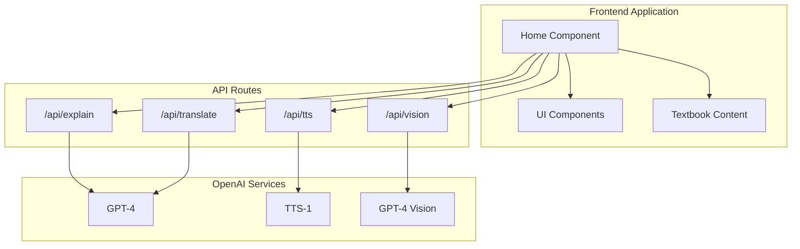
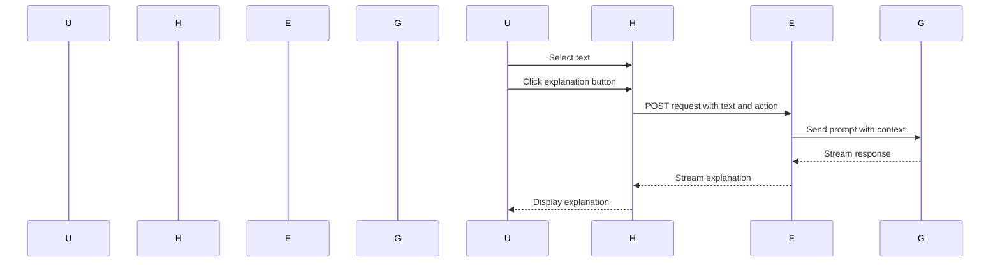
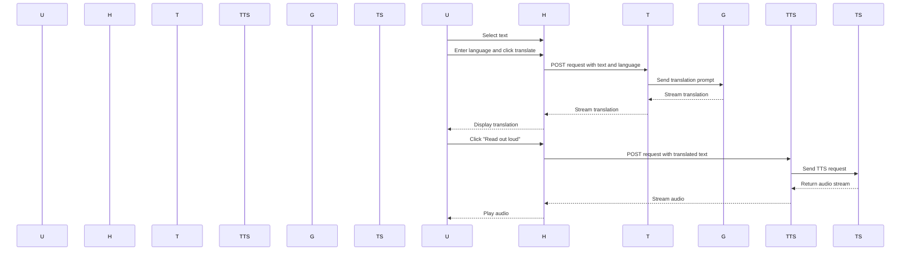
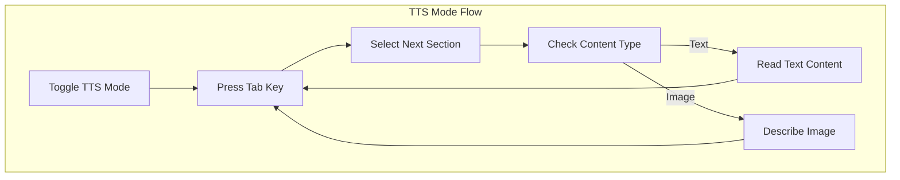
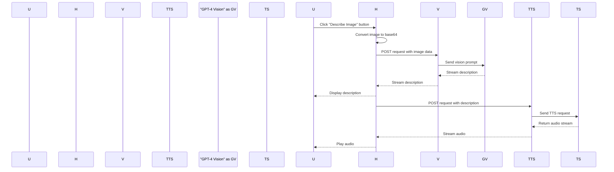
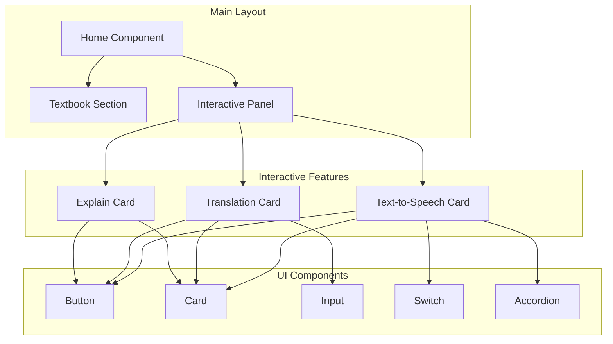
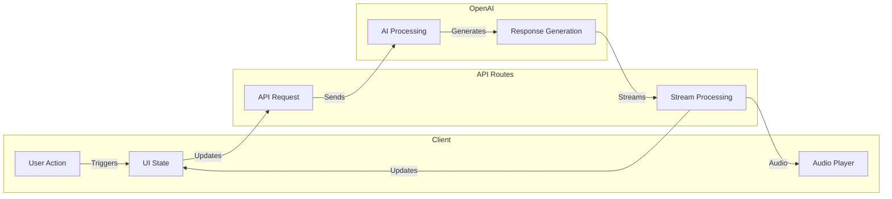

<!-- source: DeepWiki mcp.deepwiki.com · repo openai/interactive-textbook-demo · page 1 Overview · fetched 2026-10-26 -->

# Overview

Relevant source files

The following files were used as context for generating this wiki page:

- [.env.example](.env.example)
- [README.md](README.md)
- [app/page.tsx](app/page.tsx)

This document provides a comprehensive overview of the Interactive Textbook Demo application, which showcases how OpenAI's technologies can be used to make educational content more accessible to people with visual disabilities or language and learning barriers.

The Interactive Textbook Demo is a web application that allows users to interact with textbook content in various ways, including getting explanations, translations, text-to-speech narration, and image descriptions. This document covers the high-level architecture, key features, and components of the application.

Sources: [README.md:3-5]()

## Purpose and Scope

The Interactive Textbook Demo demonstrates how AI technologies can enhance accessibility in educational materials through:

1. **Text explanations** - Simplifying complex concepts for different learning levels
2. **Translation** - Converting content to different languages
3. **Text-to-speech** - Reading content aloud for visually impaired users
4. **Image descriptions** - Providing detailed descriptions of visual content

This overview document focuses on the high-level architecture and features. For detailed setup instructions, see [Getting Started](#1.1), and for security configuration information, see [Security Configuration](#1.2).

Sources: [README.md:5-5](), [app/page.tsx:458-459]()

## System Architecture

The Interactive Textbook Demo is built as a Next.js application with a client-side frontend and serverless API routes that integrate with OpenAI's services.

The application consists of three main components:

1. **Frontend Application**: A React-based UI that displays textbook content and provides interactive features
2. **API Routes**: Serverless functions that handle requests from the frontend and communicate with OpenAI services
3. **OpenAI Services**: External AI services that power the application's features

Sources: [app/page.tsx:1-572](), [README.md:3-7]()

## Key Features

### Text Selection and Explanation

Users can select text in the textbook and request different types of explanations:

- **ELI5 (Explain Like I'm 5)**: Simplifies complex concepts
- **Summarize**: Provides a concise summary of the selected text
- **Make a poem**: Transforms the content into a poetic form

Sources: [app/page.tsx:171-199](), [app/page.tsx:484-501]()

### Translation

Users can translate selected text to any language and have it read aloud:

Sources: [app/page.tsx:201-232](), [app/page.tsx:510-524]()

### Text-to-Speech Mode

The application includes a dedicated TTS mode for visually impaired users:

1. Users can toggle TTS mode on
2. Press Tab to navigate through sections of the textbook
3. The application reads each section aloud automatically
4. Images are described using GPT-4 Vision

Sources: [app/page.tsx:380-430](), [app/page.tsx:534-540]()

### Image Description

The application can describe images in the textbook using GPT-4 Vision:

Sources: [app/page.tsx:310-358](), [app/page.tsx:544-565]()

## Component Structure

The application's UI is organized into several key components:

The UI is divided into two main sections:
1. **Textbook Section**: Displays the educational content
2. **Interactive Panel**: Contains cards for different features (Explain, Translation, Text-to-Speech)

Sources: [app/page.tsx:453-569]()

## Data Flow

The application uses a streaming architecture to provide real-time feedback to users:

Key aspects of the data flow:

1. **User Actions**: Text selection, button clicks, and keyboard navigation
2. **UI State Management**: React state hooks track application state
3. **API Communication**: Fetch API with streaming responses
4. **Response Processing**: Chunk decoders for text streams and MediaSource API for audio

Sources: [app/page.tsx:171-199](), [app/page.tsx:201-232](), [app/page.tsx:235-278](), [app/page.tsx:310-358]()

## Configuration and Security

The application requires an OpenAI API key to function, which is configured through environment variables:

| Configuration File | Purpose |
|-------------------|---------|
| `.env.example`    | Template for environment variables |
| `.env.local`      | Local environment configuration (not committed to repository) |

Security measures include:
- Pre-commit hooks with TruffleHog to prevent accidental exposure of API keys
- Proper environment variable management
- Comprehensive `.gitignore` configuration

Sources: [README.md:10-22](), [.env.example:1-1](), [README.md:24-41]()

## Technical Implementation

The application is built with the following technologies:

| Technology | Purpose |
|------------|---------|
| Next.js    | Web framework for frontend and API routes |
| React      | UI component library |
| OpenAI API | AI services for text generation, translation, TTS, and vision |
| Tailwind CSS | Styling framework |
| Radix UI   | Accessible UI components |

The main application logic is contained in the `app/page.tsx` file, which implements the Home component and all the interactive features.

Sources: [app/page.tsx:1-572](), [README.md:3-7]()

## Summary

The Interactive Textbook Demo showcases how AI technologies can enhance accessibility in educational materials. By integrating OpenAI's capabilities for text explanation, translation, text-to-speech, and image description, the application provides a more inclusive learning experience for users with different needs and abilities.

The application's architecture is designed to be responsive and user-friendly, with a focus on real-time feedback through streaming responses. The codebase is organized in a modular way, making it easy to understand and extend.

Sources: [README.md:3-7](), [app/page.tsx:458-459]()

---

