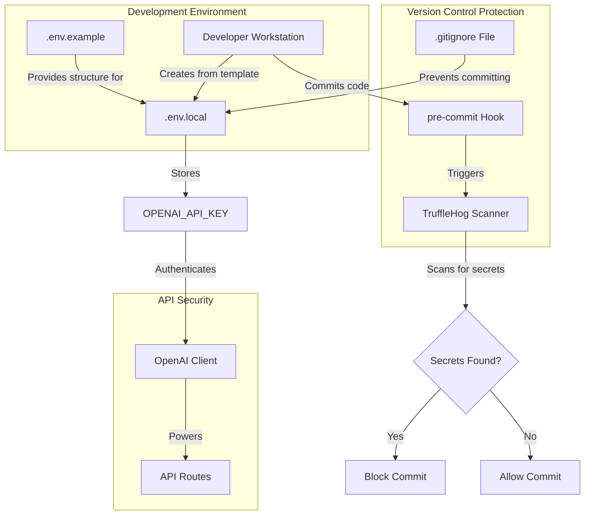
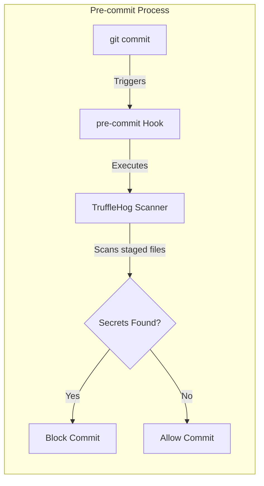
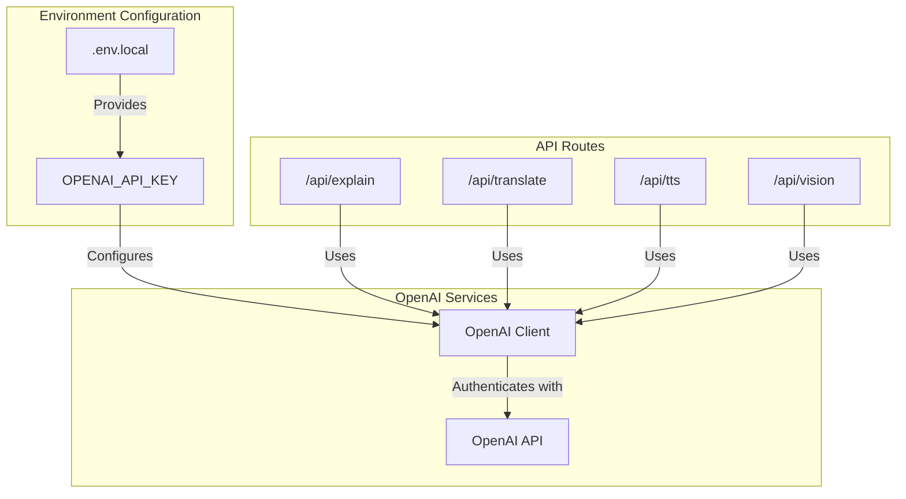

<!-- source: DeepWiki mcp.deepwiki.com · repo openai/interactive-textbook-demo · page 1.2 Security Configuration · fetched 2026-10-26 -->

# Security Configuration

<details>
<summary>Relevant source files</summary>

The following files were used as context for generating this wiki page:

- [.gitignore](.gitignore)
- [.pre-commit-config.yaml](.pre-commit-config.yaml)
- [README.md](README.md)
- [SECURITY.md](SECURITY.md)

</details>


This document outlines the security measures implemented in the Interactive Textbook Demo project, focusing on protecting sensitive information such as API keys and preventing accidental exposure of secrets during development.

## Purpose and Scope

The security configuration in this project addresses:
- Protection of OpenAI API keys
- Prevention of accidental secret exposure in code commits
- Environment variable management
- Git security practices

For information about the general project setup, see [Getting Started](#1.1).

## Security Architecture Overview

The project implements a multi-layered security approach to protect sensitive information, particularly the OpenAI API key required for accessing AI services.



Sources: [README.md:9-22](), [.pre-commit-config.yaml:1-9](), [.gitignore:103-111](), [.gitignore:154-156]()

## Environment Variable Management

### Configuration Files

The project uses environment variables to securely store sensitive information:

1. `.env.example` - Template file committed to the repository that shows the required environment variables without actual values
2. `.env.local` - Local environment file containing actual API keys (not committed to the repository)

### Setup Process

Developers must:
1. Create a `.env.local` file in the project root
2. Copy the structure from `.env.example`
3. Add their personal OpenAI API key to the `.env.local` file

```
# Example .env.local file structure
OPENAI_API_KEY=your-api-key-here
```

### Git Protection

The `.gitignore` file explicitly excludes environment files containing secrets:

```
# Environments
.env
.venv
env/
venv/
ENV/
env.bak/
venv.bak/

# local env files
.env*.local
```

This prevents accidental commits of files containing API keys or other sensitive information.

Sources: [README.md:10-12](), [.gitignore:103-111](), [.gitignore:154-156]()

## Pre-commit Hook with TruffleHog

The project implements a pre-commit hook using TruffleHog to scan code for secrets before each commit, providing an additional layer of protection against accidental secret exposure.

### TruffleHog Configuration

TruffleHog is configured in the `.pre-commit-config.yaml` file:



The pre-commit hook is defined in the `.pre-commit-config.yaml` file and executes TruffleHog to scan for secrets in the staged changes:

```yaml
repos:
- repo: local
  hooks:
    - id: trufflehog
      name: TruffleHog
      description: Detect secrets in your data.
      entry: bash -c 'trufflehog git file://. --since-commit HEAD --fail'
      language: system
      stages: ["commit", "push"]
```

### Setup and Usage

Developers need to:

1. Install pre-commit:
   ```bash
   pip3 install pre-commit
   ```

2. Install TruffleHog:
   ```bash
   brew install trufflehog
   ```

3. Install the pre-commit hooks:
   ```bash
   pre-commit install
   ```

Once installed, the pre-commit hook automatically runs before each commit, scanning for potential secrets like API keys. If secrets are detected, the commit is blocked, and the developer is prompted to remove them before trying again.

Sources: [README.md:24-42](), [.pre-commit-config.yaml:1-9]()

## Security Policy

The project adheres to OpenAI's Coordinated Vulnerability Disclosure Policy. For security-related concerns, developers can refer to the `SECURITY.md` file which provides links to:

1. OpenAI's Coordinated Vulnerability Disclosure Policy
2. OpenAI's PGP key for secure communication

This ensures that any security vulnerabilities discovered in the project can be reported and addressed appropriately.

Sources: [SECURITY.md:1-5]()

## Security Integration with API Routes

The security configuration directly impacts the API routes that communicate with OpenAI services. The OpenAI API key stored in the environment variables is used to authenticate requests to the OpenAI API.



Each API route in the application requires the OpenAI API key to function properly. The security measures ensure this key remains protected while still being accessible to the application.

Sources: [README.md:10-12]()

## Best Practices for Developers

When working with this codebase, developers should follow these security best practices:

1. **Never commit API keys**: Always store API keys in `.env.local` which is excluded from git
2. **Use the pre-commit hook**: Ensure pre-commit is installed and running to catch accidental secret exposure
3. **Don't disable security measures**: Don't bypass the pre-commit hook or modify the `.gitignore` to include sensitive files
4. **Rotate compromised keys**: If an API key is accidentally exposed, generate a new one immediately
5. **Keep dependencies updated**: Regularly update project dependencies to address security vulnerabilities

Sources: [README.md:24-42](), [.gitignore:103-111](), [.gitignore:154-156]()

## Security Measures Summary

| Security Measure | Implementation | Purpose |
|------------------|----------------|---------|
| Environment Variables | `.env.local` file | Store API keys securely |
| Git Exclusions | `.gitignore` entries | Prevent committing sensitive files |
| Pre-commit Hook | TruffleHog scanner | Detect secrets before they're committed |
| Security Policy | `SECURITY.md` | Guide for reporting vulnerabilities |

Sources: [README.md:10-12](), [README.md:24-42](), [.pre-commit-config.yaml:1-9](), [.gitignore:103-111](), [.gitignore:154-156](), [SECURITY.md:1-5]()

---

