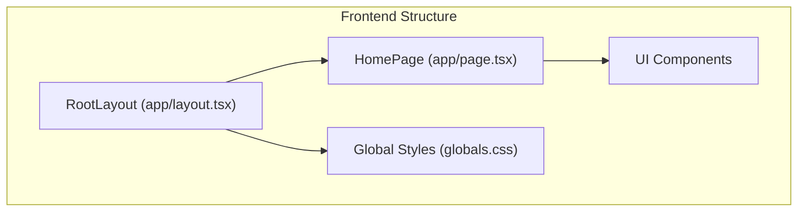
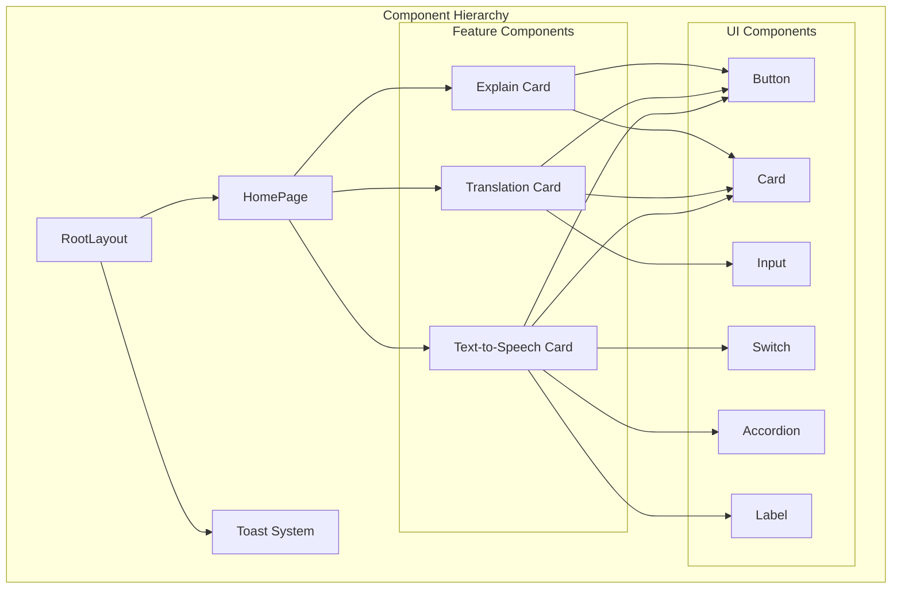
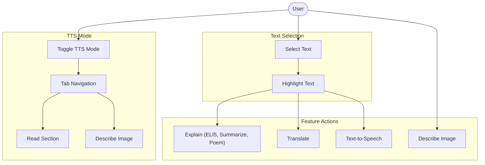
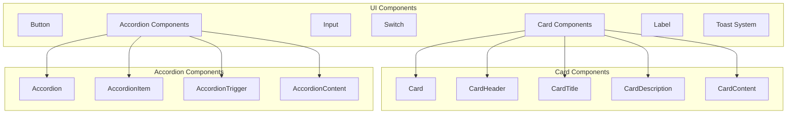

<!-- source: DeepWiki mcp.deepwiki.com · repo openai/interactive-textbook-demo · page 2 Frontend Architecture · fetched 2026-10-26 -->

# Frontend Architecture

Relevant source files

The following files were used as context for generating this wiki page:

- [app/globals.css](app/globals.css)
- [app/layout.tsx](app/layout.tsx)
- [app/page.tsx](app/page.tsx)

This document provides an overview of the frontend architecture for the Interactive Textbook Demo application. It covers the main components, structure, and UI elements that make up the frontend portion of the application.

For information about the API routes that connect the frontend to OpenAI services, see [API Routes](#3).

## Overview

The Interactive Textbook Demo is a Next.js application designed to enhance textbook accessibility through AI-powered features. The frontend architecture follows a component-based approach with a single main page that provides various interactive features.

Sources: [app/layout.tsx:16-30](), [app/page.tsx:23-572](), [app/globals.css:1-89]()

## Component Hierarchy

The application follows a simple component hierarchy with a root layout that wraps the main page component. The main page contains various UI components for different features.

Sources: [app/layout.tsx:16-30](), [app/page.tsx:453-570]()

## Main Page Component

The main page component (`HomePage`) is the core of the application, defined in [app/page.tsx]() as a client-side component. It contains:

1. A textbook content area on the left side
2. Interactive feature cards on the right side
3. State management for various features
4. Event handlers for user interactions

The component is marked with `"use client"` directive to enable client-side rendering and interactivity.

Sources: [app/page.tsx:1-23](), [app/page.tsx:453-570]()

## State Management

The application uses React's `useState` and `useRef` hooks for state management. Key state variables include:

| State Variable | Purpose |
|----------------|---------|
| `selectedText` | Stores text highlighted by the user |
| `explainLoading` | Tracks loading state for explanation features |
| `explainCompletion` | Stores explanation text from the API |
| `currentExplainAction` | Tracks which explanation action is active |
| `language` | Stores the target language for translation |
| `translation` | Stores translated text from the API |
| `ttsMode` | Toggles text-to-speech mode |
| `describeImageText` | Stores image descriptions from the API |

References are used to track DOM elements and asynchronous operations:

| Reference | Purpose |
|-----------|---------|
| `textbookRef` | References the textbook content container |
| `playerRef` | References the audio player element |
| `asyncIdRef` | Tracks asynchronous operations to prevent race conditions |
| `sectionIdxRef` | Tracks the current section index in TTS mode |

Sources: [app/page.tsx:24-45]()

## User Interaction Flow

The application supports several user interaction flows:

Sources: [app/page.tsx:62-169](), [app/page.tsx:380-430]()

## Feature Implementation

### Text Selection and Highlighting

The application implements a sophisticated text selection and highlighting mechanism using the DOM Selection API. When a user selects text in the textbook area, the application:

1. Captures the selected text using `document.getSelection()`
2. Creates highlight elements by wrapping the selected text in `` elements
3. Updates the `selectedText` state with the selected text content

This functionality is implemented in the `handleMouseUp` event handler within a `useEffect` hook.

Sources: [app/page.tsx:62-169]()

### Explanation Feature

The explanation feature allows users to get AI-powered explanations of selected text in three formats:

1. ELI5 (Explain Like I'm 5)
2. Summarize
3. Make a poem

The implementation uses the `/api/explain` endpoint with streaming responses to provide real-time feedback to the user.

Sources: [app/page.tsx:171-199](), [app/page.tsx:484-502]()

### Translation Feature

The translation feature translates selected text to a user-specified language using the `/api/translate` endpoint. It also supports reading the translation aloud using the text-to-speech feature.

Sources: [app/page.tsx:201-232](), [app/page.tsx:510-525]()

### Text-to-Speech Feature

The application provides two text-to-speech modes:

1. On-demand TTS for selected text or translations
2. TTS mode for navigating through the textbook using the Tab key

The TTS feature uses the `/api/tts` endpoint to convert text to speech using OpenAI's TTS model.

Sources: [app/page.tsx:235-278](), [app/page.tsx:380-430](), [app/page.tsx:534-540]()

### Image Description Feature

The image description feature uses OpenAI's Vision capabilities to describe images in the textbook. It sends the image data to the `/api/vision` endpoint and receives a textual description, which can also be read aloud using TTS.

Sources: [app/page.tsx:310-378](), [app/page.tsx:544-566]()

## UI Components

The application uses a set of reusable UI components imported from the `@/components/ui` directory:

Sources: [app/page.tsx:3-16](), [app/page.tsx:478-567]()

## Styling

The application uses Tailwind CSS for styling, with global styles defined in [app/globals.css](). The styling includes:

1. Tailwind base, components, and utilities
2. Custom CSS variables for theming (light and dark modes)
3. Custom styles for headings and TTS highlighting

The layout uses a split-screen approach with the textbook content on the left and interactive features on the right.

Sources: [app/globals.css:1-89](), [app/page.tsx:454-569]()

## Toast Notification System

The application includes a toast notification system for displaying temporary messages to the user. The system is implemented using:

1. A `Toaster` component in the root layout
2. The `useToast` hook for creating and managing toasts
3. Toast actions for interactive notifications

The toast system is used to notify users when text is being read aloud and provides a way to stop the audio playback.

Sources: [app/layout.tsx:5-26](), [app/page.tsx:16-45](), [app/page.tsx:432-451]()

## Root Layout

The root layout component (`RootLayout`) provides the basic HTML structure for the application, including:

1. HTML and body tags with language and font settings
2. The `Toaster` component for toast notifications
3. Analytics integration with Vercel

The layout uses the Inter font from Google Fonts and sets metadata for the application.

Sources: [app/layout.tsx:1-30]()

## Conclusion

The frontend architecture of the Interactive Textbook Demo is built around a single main page component that provides various AI-powered features to enhance textbook accessibility. The application uses React hooks for state management, custom event handlers for user interactions, and a set of reusable UI components for the interface.

For more detailed information about specific components and features, refer to the following pages:
- [Main Page Component](#2.1)
- [UI Components](#2.2)
- [Toast Notification System](#2.3)
- [Styling and CSS](#2.4)

---

