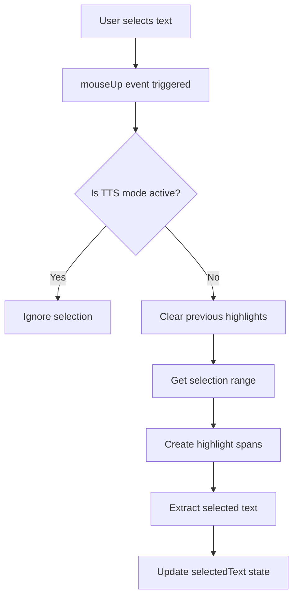
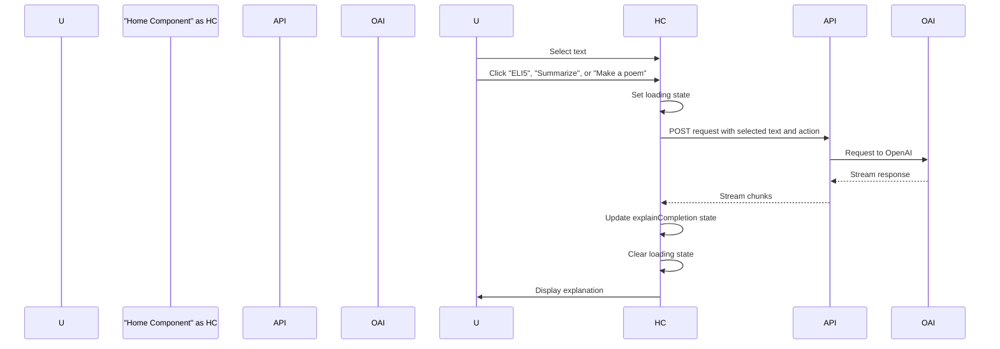
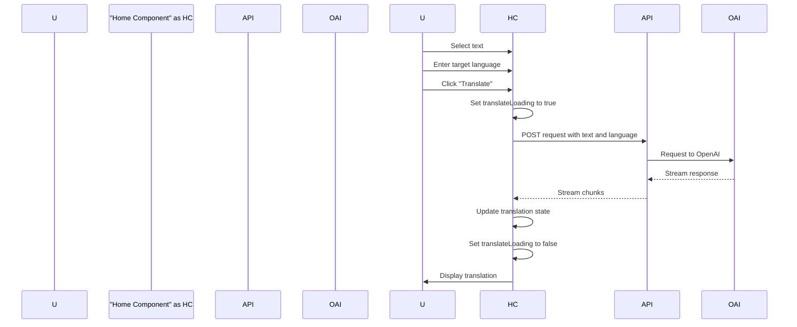
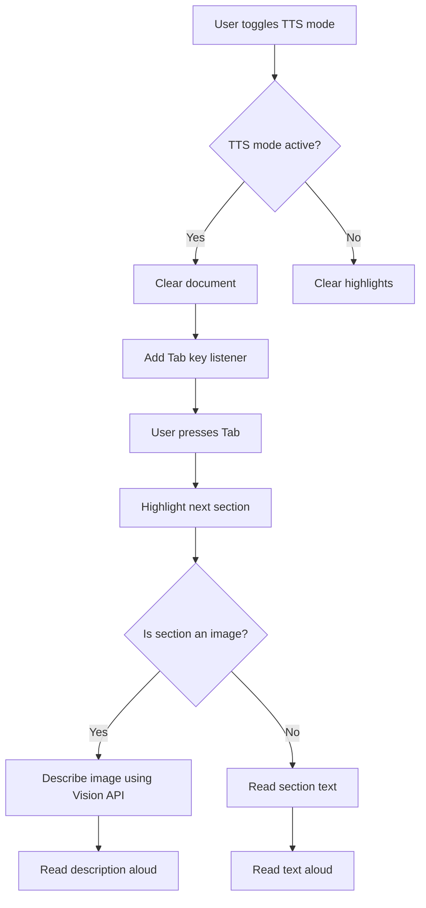
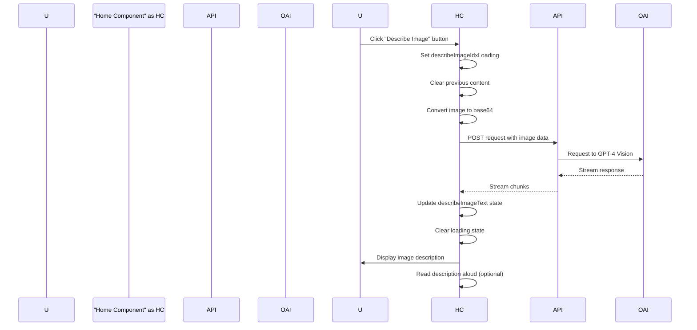
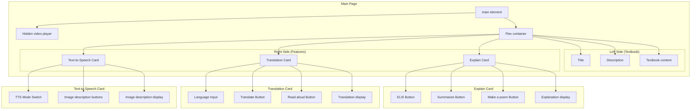

<!-- source: DeepWiki mcp.deepwiki.com · repo openai/interactive-textbook-demo · page 2.1 Main Page Component · fetched 2026-10-26 -->

# Main Page Component

<details>
<summary>Relevant source files</summary>

The following files were used as context for generating this wiki page:

- [app/page.tsx](app/page.tsx)

</details>


This document provides a detailed explanation of the Home component in the interactive textbook demo application. The Home component serves as the main page of the application, implementing the user interface and core functionality for making textbook content more accessible through AI-powered features.

## Purpose and Scope

The Main Page Component is responsible for:
- Rendering the interactive textbook content
- Implementing text selection and highlighting functionality
- Providing AI-powered explanation, translation, and text-to-speech features
- Enabling image description using GPT-4 Vision
- Managing the application's state and user interactions

For information about the UI components used in this page, see [UI Components](#2.2).

## Component Structure

The Home component is defined in the `app/page.tsx` file and is the default export. It is a client-side component as indicated by the `"use client"` directive at the top of the file.

### Main Page Layout

The page is divided into two main sections:
1. Left side (50% width): Displays the textbook content
2. Right side (50% width): Contains the interactive features (Explain, Translation, Text-to-Speech)

Sources: [app/page.tsx:453-569]()

## Component State Management

The component uses React's `useState` hook to manage various states:

```
State Variable          Purpose
----------------        -------------------------------------------------
selectedText            Stores the text currently highlighted by the user
explainLoading          Tracks loading state for explanation features
explainCompletion       Stores the AI-generated explanation text
currentExplainAction    Tracks which explanation action is currently active
language                Stores the target language for translation
translateLoading        Tracks loading state for translation
translation             Stores the translated text
translationTTSLoading   Tracks loading state for translation TTS
ttsMode                 Toggles the text-to-speech navigation mode
describeImageIdxLoading Tracks which image is being processed
describeImageText       Stores the AI-generated image description
```

Additionally, several `useRef` hooks are used to maintain references:
- `sectionIdxRef`: Tracks the current section index in TTS mode
- `textbookRef`: References the textbook content container
- `playerRef`: References the audio player element
- `asyncIdRef`: Manages asynchronous operations

Sources: [app/page.tsx:23-45]()

## Text Selection and Highlighting

The component implements a sophisticated text selection and highlighting system using the browser's Selection API.

### Text Selection Flow



Sources: [app/page.tsx:62-169]()

The text selection functionality:
1. Listens for `mouseup` events to detect when the user has selected text
2. Checks if the selection is within the textbook content
3. Creates highlight spans around the selected text
4. Updates the `selectedText` state with the selected text content

The highlighting process handles complex selections that span multiple DOM nodes by creating multiple ranges and wrapping each in a highlight span.

Sources: [app/page.tsx:62-169]()

## AI-Powered Features

The component implements several AI-powered features using OpenAI's models through API routes.

### Explanation Feature



The explanation feature allows users to:
- Get an "Explain Like I'm 5" (ELI5) explanation of selected text
- Generate a summary of selected text
- Transform selected text into a poem

The component uses streaming responses to display the AI-generated content as it's being generated.

Sources: [app/page.tsx:171-199](), [app/page.tsx:484-501]()

### Translation Feature



The translation feature:
- Allows users to specify a target language
- Translates selected text to the target language
- Supports reading the translation aloud using text-to-speech

Sources: [app/page.tsx:201-232](), [app/page.tsx:504-525]()

### Text-to-Speech Feature

The component implements two TTS approaches:

1. **On-demand TTS**: Reading selected text or translations
2. **TTS Navigation Mode**: Navigating through textbook sections using the Tab key



The TTS navigation mode:
- Allows users to navigate through textbook sections using the Tab key
- Automatically reads the content of each section
- Uses GPT-4 Vision to describe images when encountered

Sources: [app/page.tsx:235-246](), [app/page.tsx:248-278](), [app/page.tsx:380-430](), [app/page.tsx:528-567]()

### Image Description Feature



The image description feature:
- Allows users to get AI-generated descriptions of images in the textbook
- Uses GPT-4 Vision to analyze and describe images
- Can read the descriptions aloud using text-to-speech

Sources: [app/page.tsx:310-378](), [app/page.tsx:542-565]()

## User Interface Components

The main page UI is composed of several sections:

1. **Textbook Content**: Displays the textbook content with images and text
2. **Explanation Card**: Provides options to explain, summarize, or transform selected text
3. **Translation Card**: Allows translating selected text to different languages
4. **Text-to-Speech Card**: Provides TTS navigation mode and image description features

### UI Layout



Sources: [app/page.tsx:453-569]()

## Toast Notification System

The component uses a toast notification system to provide feedback to users:

- Displays a loading toast when reading text aloud
- Provides a "Stop" action to cancel the current TTS operation

The toast system is implemented using the `useToast` hook from the UI components.

Sources: [app/page.tsx:432-451]()

## Key Functions

### Text Selection and Highlighting

- `clearDocument()`: Clears all highlights and resets the component state
- `handleMouseUp()`: Handles text selection and highlighting

Sources: [app/page.tsx:47-60](), [app/page.tsx:62-169]()

### AI Feature Handlers

- `handleExplainAction()`: Processes explanation requests
- `handleTranslate()`: Processes translation requests
- `handleReadTranslation()`: Processes translation TTS requests
- `tts()`: Handles text-to-speech conversion
- `describeImage()`: Processes image description requests
- `handleDescribeImageFromIdx()`: Handles image description button clicks

Sources: [app/page.tsx:171-199](), [app/page.tsx:201-232](), [app/page.tsx:248-278](), [app/page.tsx:310-378]()

### TTS Navigation Mode

- `handleTtsModeChange()`: Toggles TTS navigation mode
- `handleTabPress()`: Handles Tab key presses in TTS mode

Sources: [app/page.tsx:291-308](), [app/page.tsx:380-430]()

## API Integration

The component integrates with four API routes:

1. `/api/explain`: Provides text explanations, summaries, and transformations
2. `/api/translate`: Translates text to different languages
3. `/api/tts`: Converts text to speech
4. `/api/vision`: Describes images using GPT-4 Vision

Each API route is called with appropriate parameters and handles streaming responses.

Sources: [app/page.tsx:175-196](), [app/page.tsx:203-228](), [app/page.tsx:236-245](), [app/page.tsx:326-355]()

## Summary

The Main Page Component is the central piece of the interactive textbook demo, implementing all the user interface and functionality for making textbook content more accessible. It leverages OpenAI's capabilities through API routes to provide AI-powered explanations, translations, text-to-speech, and image descriptions.

The component is designed with accessibility in mind, providing features that help users with visual disabilities or language and learning barriers to better understand textbook content.

---

