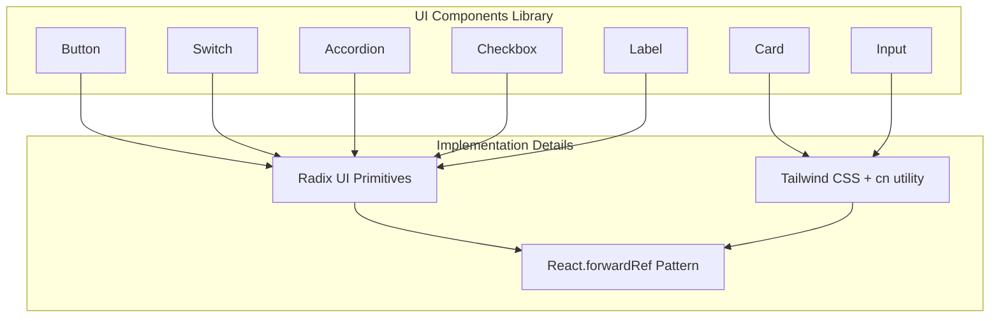
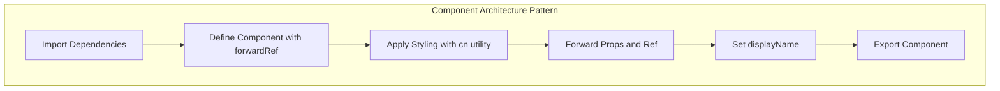
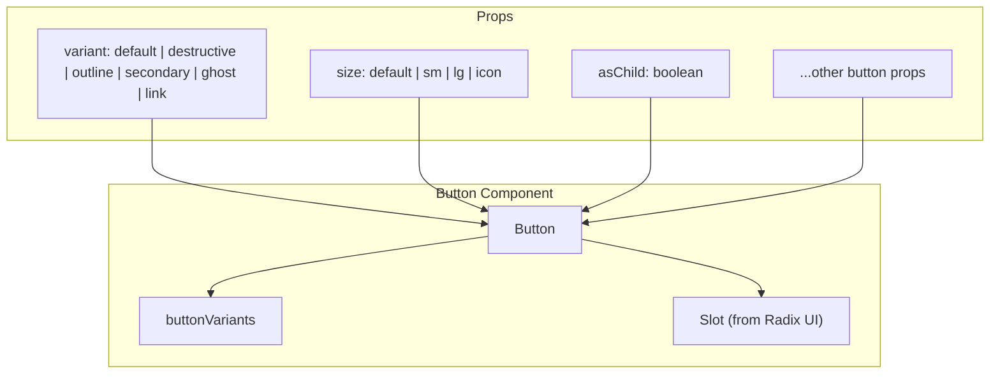
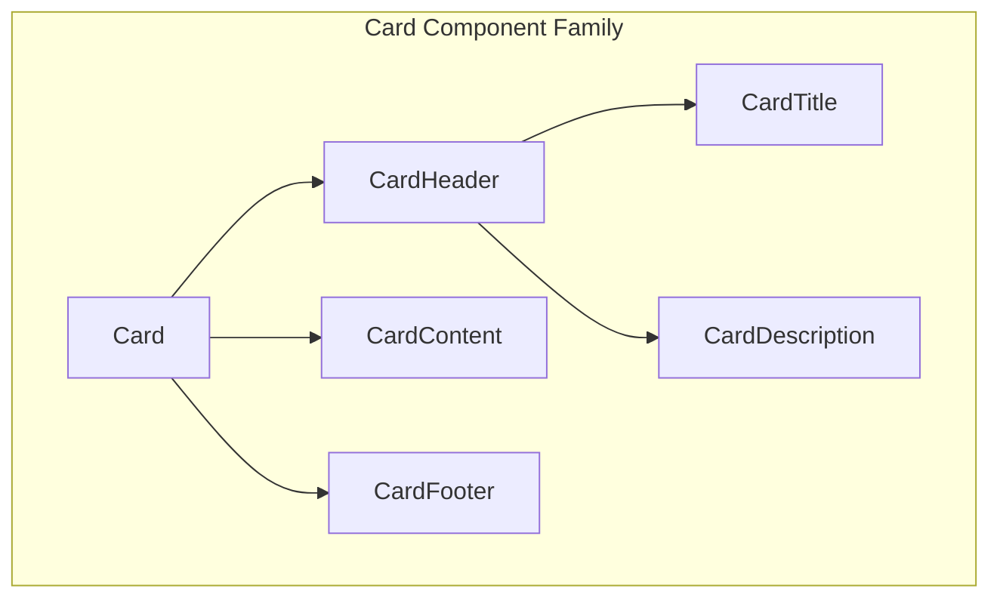
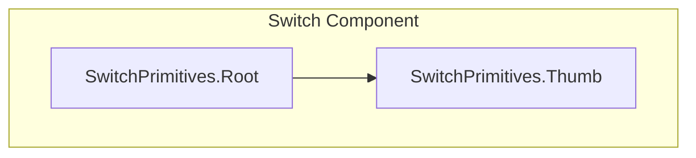
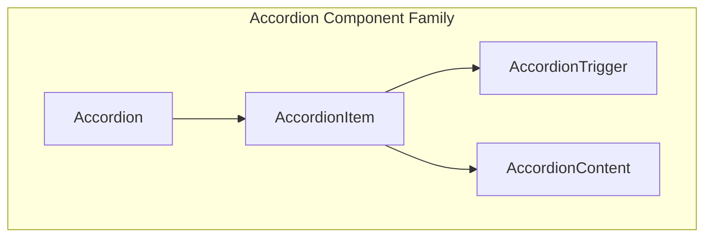
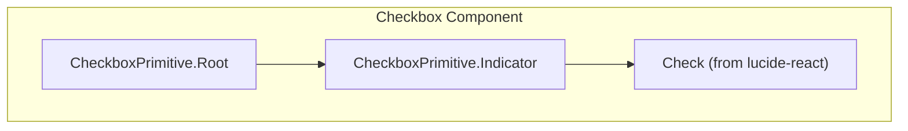
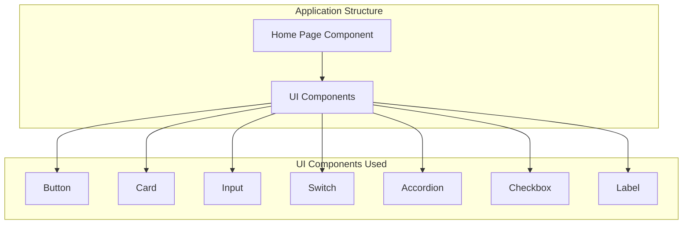

<!-- source: DeepWiki mcp.deepwiki.com · repo openai/interactive-textbook-demo · page 2.2 UI Components · fetched 2026-10-26 -->

# UI Components

Relevant source files

The following files were used as context for generating this wiki page:

- [components/ui/accordion.tsx](components/ui/accordion.tsx)
- [components/ui/button.tsx](components/ui/button.tsx)
- [components/ui/card.tsx](components/ui/card.tsx)
- [components/ui/checkbox.tsx](components/ui/checkbox.tsx)
- [components/ui/input.tsx](components/ui/input.tsx)
- [components/ui/label.tsx](components/ui/label.tsx)
- [components/ui/switch.tsx](components/ui/switch.tsx)

This document provides a comprehensive overview of the reusable UI components used in the interactive textbook demo application. These components serve as the building blocks for the user interface, providing consistent styling and behavior throughout the application.

For information about the main page structure and implementation, see [Main Page Component](#2.1). For details on the toast notification system, see [Toast Notification System](#2.3).

## Component Overview

The application uses a set of reusable UI components built with React and enhanced with Radix UI primitives. These components provide accessible, customizable interface elements that maintain a consistent design language throughout the application.

Sources: [components/ui/button.tsx](). [components/ui/card.tsx](). [components/ui/input.tsx](). [components/ui/switch.tsx](). [components/ui/accordion.tsx](). [components/ui/checkbox.tsx](). [components/ui/label.tsx]().

## Component Architecture

Each UI component follows a consistent architecture pattern:

1. Components are built using React's `forwardRef` to properly handle ref forwarding
2. Many components are built on top of Radix UI primitives for accessibility
3. Styling is applied using Tailwind CSS classes combined with the `cn` utility function
4. Components accept standard HTML attributes plus additional custom props when needed

Sources: [components/ui/button.tsx:42-54](). [components/ui/input.tsx:8-23](). [components/ui/switch.tsx:8-27]().

## Button Component

The Button component provides a customizable button with various styles and sizes.

### Features

- Multiple variants: default, destructive, outline, secondary, ghost, link
- Multiple sizes: default, sm, lg, icon
- Support for asChild pattern to change the underlying element

### Implementation

Sources: [components/ui/button.tsx]().

## Card Component

The Card component provides a container with consistent styling for grouping related content.

### Features

- Composed of multiple sub-components: Card, CardHeader, CardTitle, CardDescription, CardContent, CardFooter
- Consistent styling with rounded corners, border, and shadow

### Implementation

Sources: [components/ui/card.tsx]().

## Input Component

The Input component provides a styled input field.

### Features

- Consistent styling with the design system
- Supports all standard HTML input attributes

### Implementation

The Input component is a simple wrapper around the HTML `<input>` element with consistent styling applied.

Sources: [components/ui/input.tsx]().

## Switch Component

The Switch component provides a toggle switch for binary choices.

### Features

- Accessible toggle switch built on Radix UI primitives
- Animated state transitions
- Support for disabled state

### Implementation

Sources: [components/ui/switch.tsx]().

## Accordion Component

The Accordion component provides collapsible content sections.

### Features

- Animated expand/collapse transitions
- Accessible implementation using Radix UI primitives
- Composed of multiple sub-components: Accordion, AccordionItem, AccordionTrigger, AccordionContent

### Implementation

Sources: [components/ui/accordion.tsx]().

## Checkbox Component

The Checkbox component provides a styled checkbox input.

### Features

- Accessible implementation using Radix UI primitives
- Visual indicator for checked state
- Support for disabled state

### Implementation

Sources: [components/ui/checkbox.tsx]().

## Label Component

The Label component provides a styled label for form elements.

### Features

- Accessible implementation using Radix UI primitives
- Consistent styling with the design system

### Implementation

The Label component is a wrapper around the Radix UI Label primitive with consistent styling applied.

Sources: [components/ui/label.tsx]().

## Common Patterns

### The `cn` Utility Function

All UI components use the `cn` utility function from `@/lib/utils` to conditionally merge Tailwind CSS classes. This function is a wrapper around the `clsx` and `tailwind-merge` libraries, allowing for dynamic class composition while properly handling Tailwind class conflicts.

### Radix UI Integration

Many components are built on top of Radix UI primitives, which provide accessible, unstyled components that can be customized with Tailwind CSS. This approach ensures that the components are accessible while maintaining design flexibility.

### Component Composition

The UI components are designed to be composed together to create more complex interfaces. For example, the Card component family includes several sub-components that can be combined in different ways to create various card layouts.

## Usage in the Application

These UI components are used throughout the application to create a consistent user interface. The main page component imports and uses these components to build the interactive textbook interface.

Sources: [components/ui/button.tsx](). [components/ui/card.tsx](). [components/ui/input.tsx](). [components/ui/switch.tsx](). [components/ui/accordion.tsx](). [components/ui/checkbox.tsx](). [components/ui/label.tsx]().

## Component Props Table

Below is a summary of the key props for each UI component:

| Component | Key Props | Description |
|-----------|-----------|-------------|
| Button | variant, size, asChild | Controls button appearance and behavior |
| Card | className, ...props | Standard HTML div attributes |
| CardHeader | className, ...props | Standard HTML div attributes |
| CardTitle | className, ...props | Standard HTML h3 attributes |
| CardDescription | className, ...props | Standard HTML p attributes |
| CardContent | className, ...props | Standard HTML div attributes |
| CardFooter | className, ...props | Standard HTML div attributes |
| Input | type, className, ...props | Standard HTML input attributes |
| Switch | className, ...props | Standard switch attributes from Radix UI |
| Accordion | type, collapsible | Controls accordion behavior |
| AccordionItem | value, className, ...props | Identifies the accordion item |
| AccordionTrigger | className, ...props | Controls the clickable trigger |
| AccordionContent | className, ...props | Contains the collapsible content |
| Checkbox | checked, onCheckedChange, ...props | Controls checkbox state |
| Label | className, ...props | Standard label attributes from Radix UI |

Sources: [components/ui/button.tsx:36-40](). [components/ui/input.tsx:5-6](). [components/ui/card.tsx]().

---

