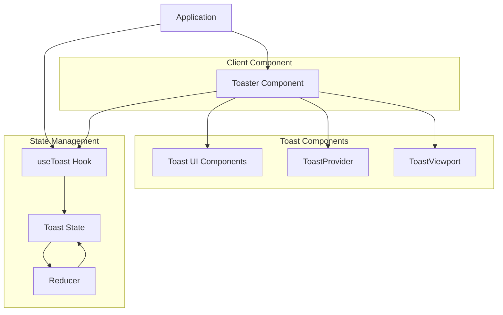
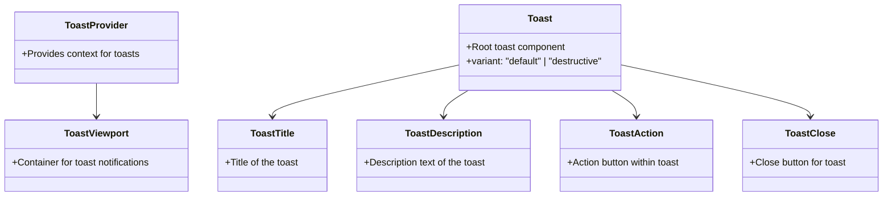
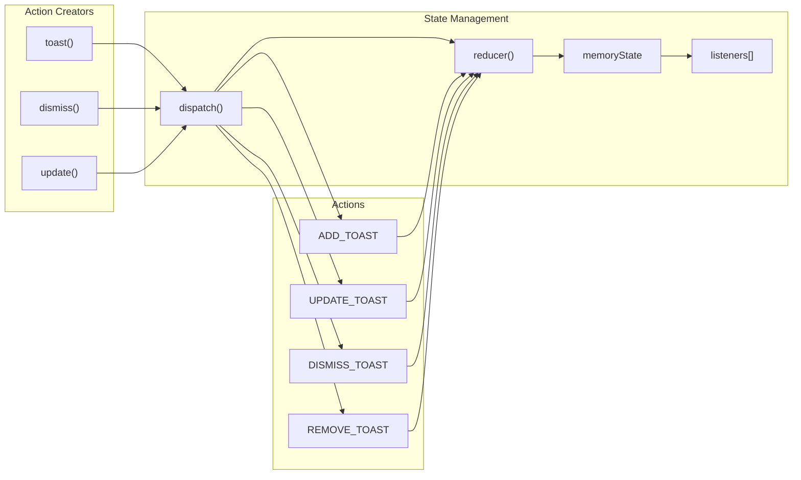
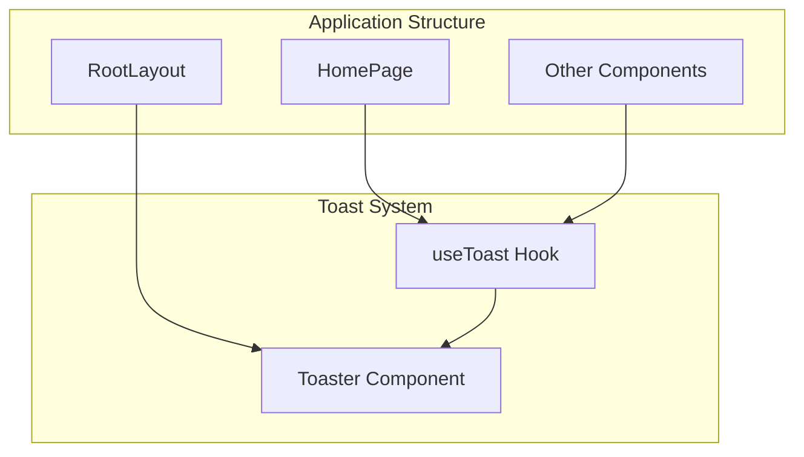

<!-- source: DeepWiki mcp.deepwiki.com · repo openai/interactive-textbook-demo · page 2.3 Toast Notification System · fetched 2026-10-26 -->

# Toast Notification System

<details>
<summary>Relevant source files</summary>

The following files were used as context for generating this wiki page:

- [components/ui/toast.tsx](components/ui/toast.tsx)
- [components/ui/toaster.tsx](components/ui/toaster.tsx)
- [components/ui/use-toast.ts](components/ui/use-toast.ts)

</details>


## Purpose and Scope

This document describes the Toast Notification System used in the Interactive Textbook Demo application. The system provides a way to display temporary notifications to users, typically to confirm actions or display status messages. This document covers the components, hooks, and utilities that make up the toast system, as well as how to implement and use toasts in the application.

Sources: [components/ui/toast.tsx:1-127](), [components/ui/toaster.tsx:1-35](), [components/ui/use-toast.ts:1-192]()

## System Overview

The Toast Notification System consists of three main parts:

1. **Toast UI Components**: The visual elements that make up a toast notification
2. **Toaster Component**: A client component that renders active toasts
3. **Toast Hook and State Management**: A custom hook and state management system for creating and controlling toasts

The following diagram illustrates the high-level architecture of the Toast Notification System:



Sources: [components/ui/toast.tsx:1-127](), [components/ui/toaster.tsx:1-35](), [components/ui/use-toast.ts:1-192]()

## Toast UI Components

The toast UI components are built using Radix UI's Toast primitives, which provide accessible toast notifications with keyboard navigation support.

### Component Hierarchy



Sources: [components/ui/toast.tsx:8-127]()

### Component Details

1. **ToastProvider**: Provides context for the toast system
   ```typescript
   const ToastProvider = ToastPrimitives.Provider
   ```

2. **ToastViewport**: Container where toasts are rendered, positioned at the top of the screen on mobile and bottom-right on larger screens
   ```typescript
   const ToastViewport = React.forwardRef<...>
   ```

3. **Toast**: The main toast component with variant support (default or destructive)
   ```typescript
   const Toast = React.forwardRef<...>
   ```

4. **ToastTitle**: Component for the toast title
   ```typescript
   const ToastTitle = React.forwardRef<...>
   ```

5. **ToastDescription**: Component for the toast description
   ```typescript
   const ToastDescription = React.forwardRef<...>
   ```

6. **ToastAction**: Component for action buttons within a toast
   ```typescript
   const ToastAction = React.forwardRef<...>
   ```

7. **ToastClose**: Component for the close button
   ```typescript
   const ToastClose = React.forwardRef<...>
   ```

Sources: [components/ui/toast.tsx:8-127]()

## Toaster Component

The `Toaster` component is a client component that renders all active toasts. It uses the `useToast` hook to access the current toast state and renders each toast with its title, description, and action.

```typescript
export function Toaster() {
  const { toasts } = useToast()

  return (
    <ToastProvider>
      {toasts.map(function ({ id, title, description, action, ...props }) {
        return (
          <Toast key={id} {...props}>
            <div className="grid gap-1">
              {title && <ToastTitle>{title}</ToastTitle>}
              {description && (
                <ToastDescription>{description}</ToastDescription>
              )}
            </div>
            {action}
            <ToastClose />
          </Toast>
        )
      })}
      <ToastViewport />
    </ToastProvider>
  )
}
```

The `Toaster` component should be included once in your application, typically in the root layout, to ensure toasts can be displayed from anywhere in the application.

Sources: [components/ui/toaster.tsx:1-35]()

## Toast State Management

The toast system uses a custom state management solution inspired by the react-hot-toast library. It consists of:

1. **State**: Stores the current toasts
2. **Reducer**: Handles state updates based on actions
3. **Dispatch**: Updates the state and notifies listeners
4. **Listeners**: Components that subscribe to state changes

### Toast State Flow



Sources: [components/ui/use-toast.ts:19-190]()

### Toast Types and Interfaces

The toast system defines several types and interfaces:

```typescript
// Toast properties
type ToasterToast = ToastProps & {
  id: string
  title?: React.ReactNode
  description?: React.ReactNode
  action?: ToastActionElement
}

// State interface
interface State {
  toasts: ToasterToast[]
}

// Action types
const actionTypes = {
  ADD_TOAST: "ADD_TOAST",
  UPDATE_TOAST: "UPDATE_TOAST",
  DISMISS_TOAST: "DISMISS_TOAST",
  REMOVE_TOAST: "REMOVE_TOAST",
} as const
```

Sources: [components/ui/use-toast.ts:12-54]()

## Using the Toast System

### The `useToast` Hook

The `useToast` hook provides access to the toast state and methods to create, update, and dismiss toasts.

```typescript
function useToast() {
  const [state, setState] = React.useState<State>(memoryState)

  React.useEffect(() => {
    listeners.push(setState)
    return () => {
      const index = listeners.indexOf(setState)
      if (index > -1) {
        listeners.splice(index, 1)
      }
    }
  }, [state])

  return {
    ...state,
    toast,
    dismiss: (toastId?: string) => dispatch({ type: "DISMISS_TOAST", toastId }),
  }
}
```

Sources: [components/ui/use-toast.ts:172-190]()

### Creating Toasts

To create a toast, import the `useToast` hook and call the `toast` function:

```typescript
import { useToast } from "@/components/ui/use-toast"

function MyComponent() {
  const { toast } = useToast()
  
  const handleClick = () => {
    toast({
      title: "Success",
      description: "Your action was completed successfully.",
    })
  }
  
  return <button onClick={handleClick}>Show Toast</button>
}
```

### Toast Configuration Options

When creating a toast, you can provide the following options:

| Option | Type | Description |
|--------|------|-------------|
| `title` | React.ReactNode | The title of the toast |
| `description` | React.ReactNode | The description text |
| `action` | ToastActionElement | An optional action button |
| `variant` | "default" \| "destructive" | The visual style of the toast |

Sources: [components/ui/use-toast.ts:141-170](), [components/ui/toast.tsx:25-39]()

## Implementation Details

### Toast Limits and Behavior

The toast system is configured with the following constants:

```typescript
const TOAST_LIMIT = 1
const TOAST_REMOVE_DELAY = 1000000
```

This means:
- Only one toast can be displayed at a time
- Toasts have a very long display duration (effectively permanent until dismissed)

Note: The automatic removal functionality is commented out in the code, meaning toasts will remain visible until explicitly dismissed.

Sources: [components/ui/use-toast.ts:9-10](), [components/ui/use-toast.ts:59-73]()

### Toast Reducer

The reducer handles four types of actions:

1. **ADD_TOAST**: Adds a new toast to the state
2. **UPDATE_TOAST**: Updates an existing toast
3. **DISMISS_TOAST**: Marks a toast as closed
4. **REMOVE_TOAST**: Removes a toast from the state

```typescript
export const reducer = (state: State, action: Action): State => {
  switch (action.type) {
    case "ADD_TOAST":
      return {
        ...state,
        toasts: [action.toast, ...state.toasts].slice(0, TOAST_LIMIT),
      }
    // Other cases...
  }
}
```

Sources: [components/ui/use-toast.ts:75-128]()

## Integration with the Application

The Toast Notification System is integrated into the application through the `Toaster` component, which should be included in the root layout. This allows toasts to be displayed from any component in the application.



Sources: [components/ui/toaster.tsx:1-35](), [components/ui/use-toast.ts:172-190]()

## Summary

The Toast Notification System provides a flexible and accessible way to display notifications to users. It consists of UI components built with Radix UI, a client component for rendering toasts, and a custom state management solution. The system is designed to be easy to use through the `useToast` hook, which provides methods for creating, updating, and dismissing toasts.

Key features of the system include:
- Accessible toast notifications with keyboard navigation
- Support for different toast variants (default and destructive)
- Customizable toast content with title, description, and action
- Client-side state management with a reducer pattern

Sources: [components/ui/toast.tsx:1-127](), [components/ui/toaster.tsx:1-35](), [components/ui/use-toast.ts:1-192]()

---

