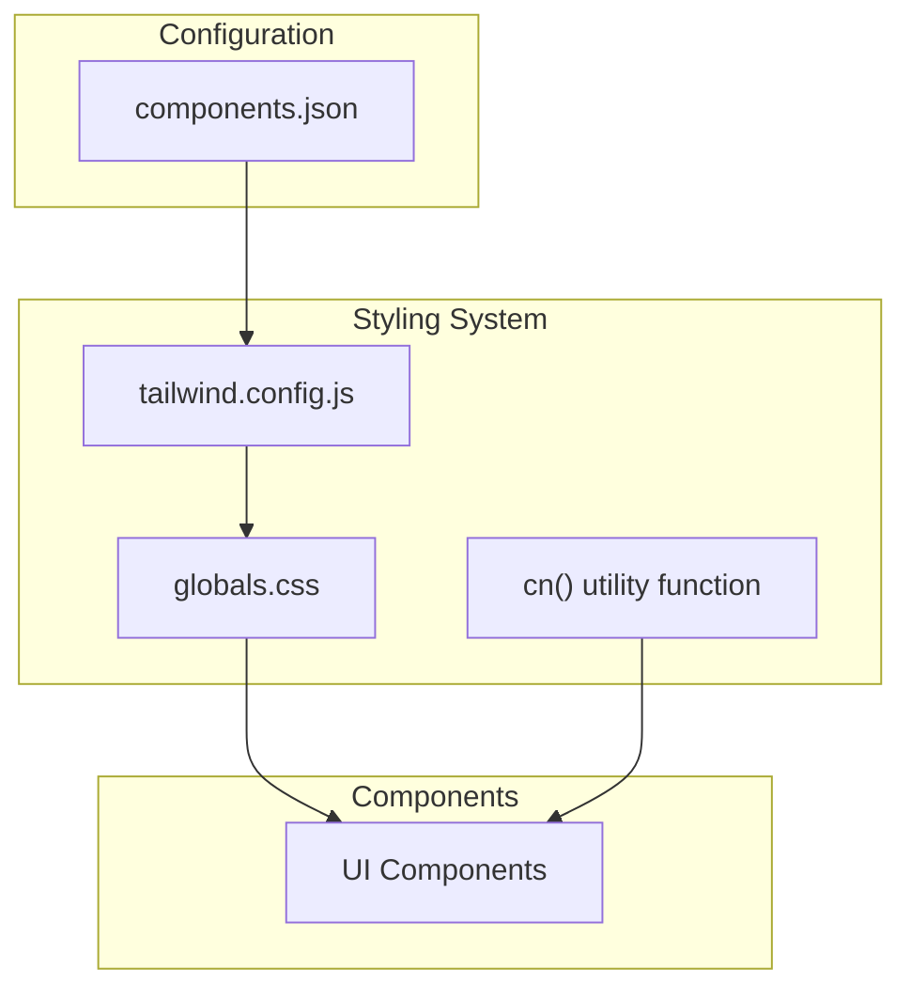
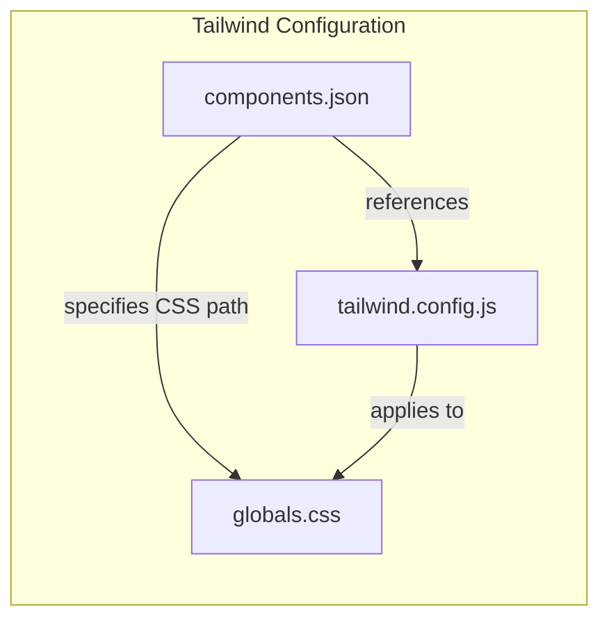
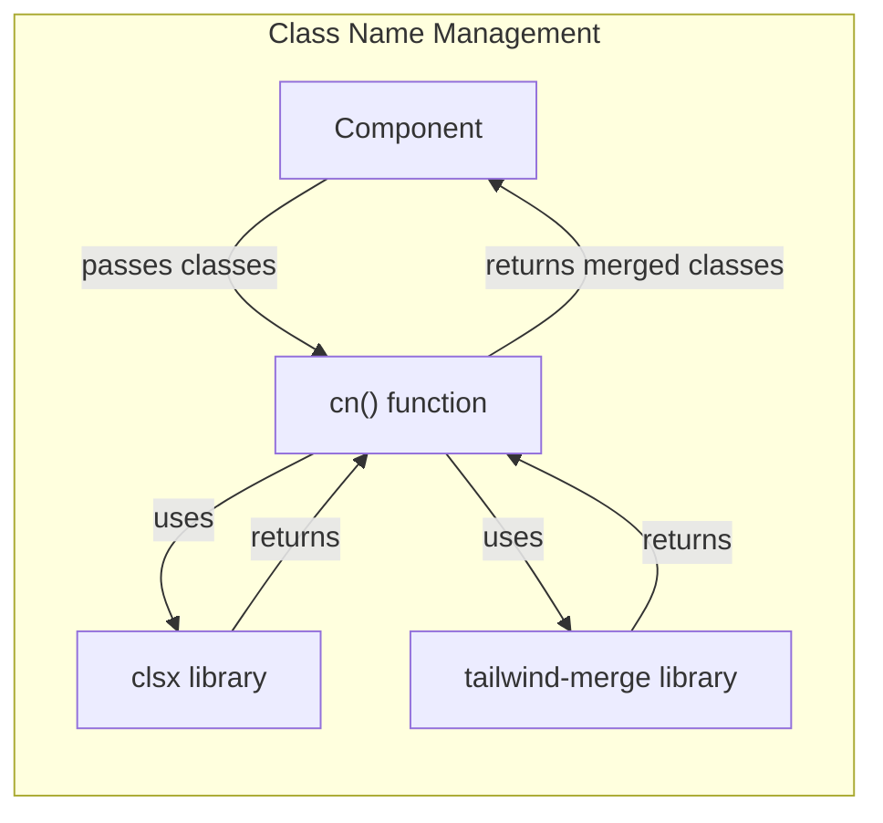
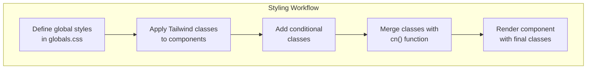

<!-- source: DeepWiki mcp.deepwiki.com · repo openai/interactive-textbook-demo · page 2.4 Styling and CSS · fetched 2026-10-26 -->

# Styling and CSS

<details>
<summary>Relevant source files</summary>

The following files were used as context for generating this wiki page:

- [app/globals.css](app/globals.css)
- [components.json](components.json)
- [lib/utils.ts](lib/utils.ts)

</details>


This document covers the styling approach used in the Interactive Textbook Demo application. It details the Tailwind CSS configuration, global styles, and utility functions for managing CSS classes. For information about UI components, see [UI Components](#2.2).

## Overview

The application uses Tailwind CSS as its primary styling framework, with CSS variables for theming and a utility function for class name management. The styling system supports both light and dark modes through CSS variables.



Sources: [app/globals.css](), [lib/utils.ts](), [components.json]()

## Tailwind CSS Configuration

The application uses Tailwind CSS with a configuration defined in `tailwind.config.js` and referenced in `components.json`. The configuration specifies:

- Base color scheme: slate
- CSS variables for theming
- Path to global CSS file



Sources: [components.json]()

### Components JSON Configuration

The `components.json` file contains the configuration for the shadcn/ui components and Tailwind CSS:

```
{
  "style": "default",
  "tailwind": {
    "config": "tailwind.config.js",
    "css": "app/globals.css",
    "baseColor": "slate",
    "cssVariables": true
  },
  "aliases": {
    "components": "@/components",
    "utils": "@/lib/utils"
  }
}
```

This configuration:
- Sets the component style to "default"
- Enables React Server Components (RSC)
- Configures Tailwind CSS with CSS variables
- Defines path aliases for components and utilities

Sources: [components.json:1-16]()

## Global CSS

The global CSS file (`app/globals.css`) defines the application's base styles, including:

1. Tailwind CSS directives
2. CSS variables for theming (light and dark modes)
3. Base element styles
4. Typography styles for headings
5. Special utility classes

### Tailwind Directives

The file begins with the standard Tailwind CSS directives:

```css
@tailwind base;
@tailwind components;
@tailwind utilities;
```

Sources: [app/globals.css:1-3]()

### CSS Variables

CSS variables are defined for both light and dark modes, providing a consistent theming system:

| Category | Variables |
|----------|-----------|
| Colors | `--background`, `--foreground`, `--card`, `--card-foreground`, etc. |
| UI Elements | `--primary`, `--secondary`, `--muted`, `--accent`, `--destructive` |
| Borders | `--border`, `--input`, `--ring` |
| Other | `--radius` |

The variables are defined within the `:root` selector for light mode and within the `.dark` class for dark mode.

Sources: [app/globals.css:5-67]()

### Base Styles

Base styles apply Tailwind classes to HTML elements:

```css
@layer base {
  * {
    @apply border-border;
  }
  body {
    @apply bg-background text-foreground;
    overscroll-behavior-y: none;
  }
}
```

This sets default border colors for all elements and background/text colors for the body, along with preventing overscroll behavior.

Sources: [app/globals.css:69-77]()

### Typography Styles

Heading styles are defined using Tailwind's `@apply` directive:

```css
h1 {
  @apply scroll-m-20 text-4xl font-extrabold tracking-tight lg:text-5xl
}

h2 {
  @apply scroll-m-20 border-b pb-2 text-3xl font-semibold tracking-tight first:mt-0
}
```

Sources: [app/globals.css:79-85]()

### Utility Classes

The application includes special utility classes for specific features:

```css
.tts-highlight {
  @apply bg-yellow-400 border-4 border-yellow-400;
}
```

This class is used to highlight text during text-to-speech playback.

Sources: [app/globals.css:87-89]()

## CSS Utility Functions

The application includes a utility function for managing CSS class names in `lib/utils.ts`:

```typescript
export function cn(...inputs: ClassValue[]) {
  return twMerge(clsx(inputs))
}
```

This function combines:
- `clsx`: For conditionally joining class names
- `tailwind-merge`: For resolving Tailwind CSS class conflicts

The `cn()` function is used throughout the application to manage component class names, especially when combining default styles with conditional or user-provided classes.



Sources: [lib/utils.ts:1-6]()

## Styling Workflow

The application follows a consistent styling workflow:

1. Global styles are defined in `globals.css`
2. Component-specific styles use Tailwind CSS classes
3. The `cn()` utility function manages class combinations
4. CSS variables provide theming capabilities



Sources: [app/globals.css](), [lib/utils.ts]()

## Summary

The styling system in the Interactive Textbook Demo uses:

1. **Tailwind CSS** as the primary styling framework
2. **CSS variables** for consistent theming across light and dark modes
3. **Global styles** for typography and base elements
4. The **`cn()` utility function** for managing class names
5. **Special utility classes** for specific features like text-to-speech highlighting

This approach provides a flexible, maintainable styling system that supports the application's accessibility features while maintaining a consistent visual design.

---

