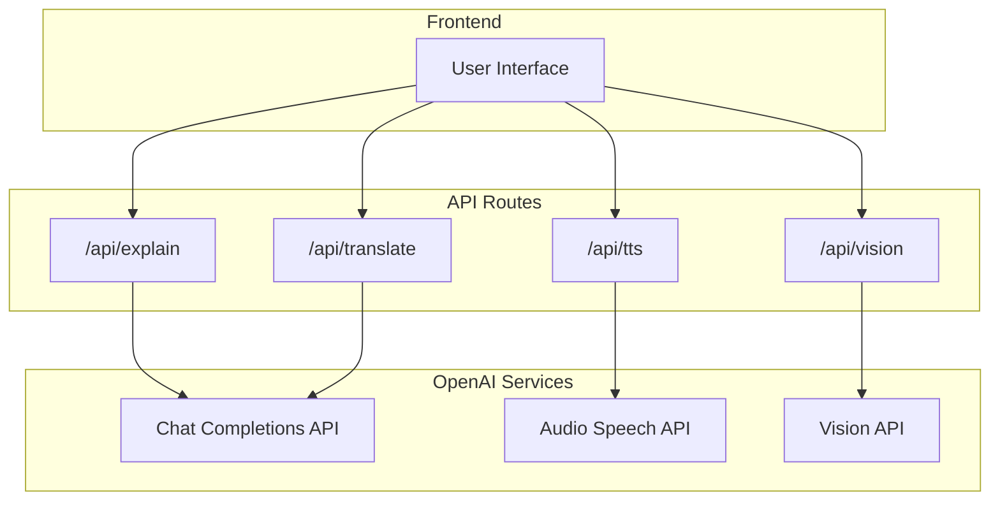
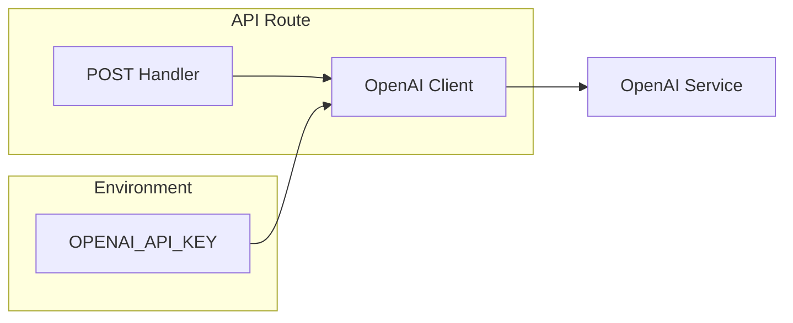
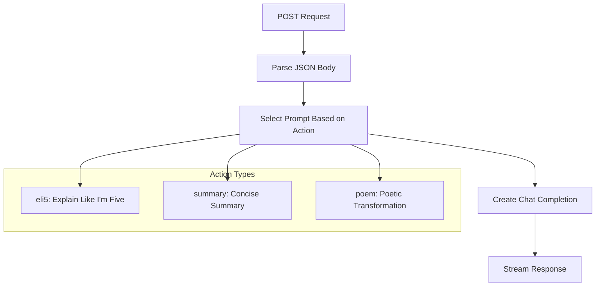
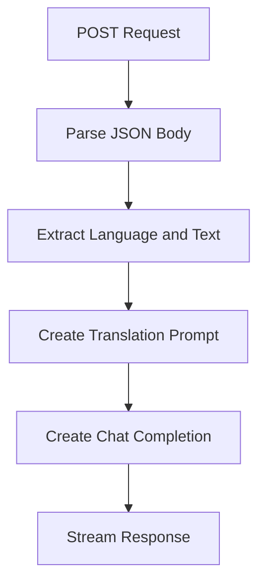
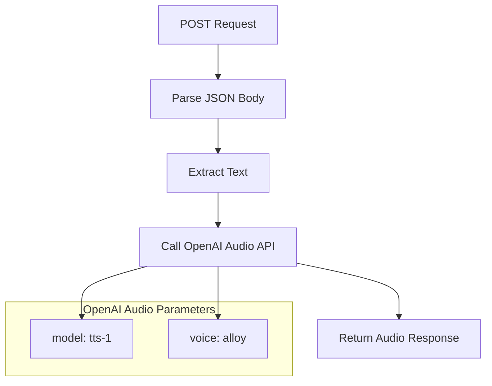
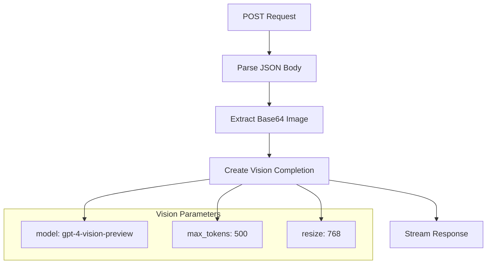
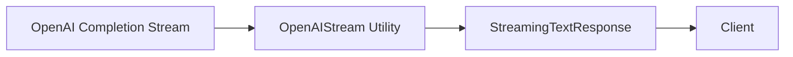
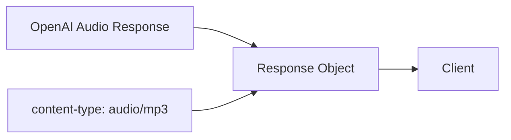
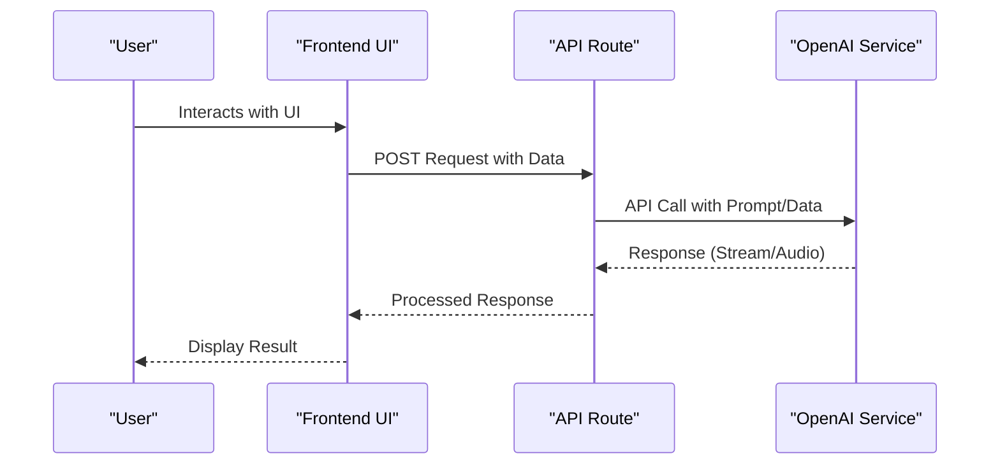

<!-- source: DeepWiki mcp.deepwiki.com · repo openai/interactive-textbook-demo · page 3 API Routes · fetched 2026-10-26 -->

# API Routes

<details>
<summary>Relevant source files</summary>

The following files were used as context for generating this wiki page:

- [app/api/explain/route.ts](app/api/explain/route.ts)
- [app/api/translate/route.ts](app/api/translate/route.ts)
- [app/api/tts/route.ts](app/api/tts/route.ts)
- [app/api/vision/route.ts](app/api/vision/route.ts)

</details>


This document provides a comprehensive overview of the API routes in the Interactive Textbook Demo application. These routes serve as the bridge between the frontend interface and OpenAI's AI services, enabling the core functionality of the application.

For information about the frontend components that use these API routes, see [Frontend Architecture](#2). For details on the specific OpenAI integration, see [OpenAI Integration](#4).

## Overview of API Routes

The Interactive Textbook Demo implements four distinct API routes, each responsible for a specific AI-powered feature:

1. **Explain API** - Provides explanations, summaries, and creative transformations of text
2. **Translate API** - Translates text into different languages
3. **Text-to-Speech (TTS) API** - Converts text to spoken audio
4. **Vision API** - Generates descriptions of images

These routes are implemented as Next.js API routes in the `/app/api` directory, following Next.js App Router conventions.



Sources:
- [app/api/explain/route.ts]()
- [app/api/translate/route.ts]()
- [app/api/tts/route.ts]()
- [app/api/vision/route.ts]()

## Common Patterns

All API routes in the application follow these common patterns:

1. They are implemented as asynchronous POST handlers
2. They accept JSON request bodies
3. They authenticate with OpenAI using an API key from environment variables
4. They return appropriate response types (streaming text or audio)

### Authentication Pattern

All routes use the OpenAI API key stored in the `OPENAI_API_KEY` environment variable:



Sources:
- [app/api/explain/route.ts:5-7]()
- [app/api/translate/route.ts:5-7]()
- [app/api/tts/route.ts:8-10]()
- [app/api/vision/route.ts:5-7]()

## Explain API

The Explain API provides different types of text transformations based on the requested action.

### Endpoint Details

- **Route**: `/api/explain`
- **Method**: POST
- **Request Body**:
  ```typescript
  {
    action: "eli5" | "summary" | "poem",
    text: string
  }
  ```
- **Response**: Streaming text response

### Implementation

The Explain API constructs different prompts based on the requested action:

| Action | Prompt |
|--------|--------|
| `eli5` | "Explain this to me like I'm five:" |
| `summary` | "Create a very short and concise summary of the following text:" |
| `poem` | "Make a short poem with proper formatting summarizing the following text:" |

The route uses the OpenAI Chat Completions API with the GPT-4 model and streaming enabled.



Sources:
- [app/api/explain/route.ts:4-31]()

## Translate API

The Translate API converts text into different languages.

### Endpoint Details

- **Route**: `/api/translate`
- **Method**: POST
- **Request Body**:
  ```typescript
  {
    language: string,
    text: string
  }
  ```
- **Response**: Streaming text response

### Implementation

The Translate API constructs a prompt that includes the target language and the text to be translated. It uses the OpenAI Chat Completions API with the GPT-4 model and streaming enabled.



Sources:
- [app/api/translate/route.ts:4-23]()

## Text-to-Speech API

The Text-to-Speech API converts text into spoken audio.

### Endpoint Details

- **Route**: `/api/tts`
- **Method**: POST
- **Request Body**:
  ```typescript
  {
    text: string
  }
  ```
- **Response**: Audio file (MP3)

### Implementation

Unlike the other APIs, the TTS API directly calls the OpenAI Audio Speech API instead of using the OpenAI SDK. It sends a POST request to the OpenAI API endpoint with the text to be converted and returns the audio response.



Sources:
- [app/api/tts/route.ts:1-20]()

## Vision API

The Vision API generates descriptions of images.

### Endpoint Details

- **Route**: `/api/vision`
- **Method**: POST
- **Request Body**:
  ```typescript
  {
    image64: string  // Base64-encoded image
  }
  ```
- **Response**: Streaming text response

### Implementation

The Vision API sends the base64-encoded image to the OpenAI Vision API, which uses the GPT-4 Vision model to generate a description of the image. The response is streamed back to the client.



Sources:
- [app/api/vision/route.ts:4-27]()

## Response Handling

The API routes use two different response handling mechanisms:

1. **Streaming Text Responses** - Used by the Explain, Translate, and Vision APIs
2. **Audio Responses** - Used by the TTS API

### Streaming Text Responses

The Explain, Translate, and Vision APIs use the `OpenAIStream` and `StreamingTextResponse` utilities from the `ai` package to stream text responses back to the client. This provides a more responsive user experience as the text appears incrementally.



Sources:
- [app/api/explain/route.ts:28-30]()
- [app/api/translate/route.ts:21-22]()
- [app/api/vision/route.ts:25-26]()

### Audio Responses

The TTS API returns an audio file as a Response object with the appropriate content type header.



Sources:
- [app/api/tts/route.ts:19]()

## API Integration Flow

The following diagram illustrates how the API routes integrate with the frontend and OpenAI services:



Sources:
- [app/api/explain/route.ts]()
- [app/api/translate/route.ts]()
- [app/api/tts/route.ts]()
- [app/api/vision/route.ts]()

## Summary

The API routes in the Interactive Textbook Demo provide a clean interface between the frontend application and OpenAI's AI services. Each route is specialized for a specific task:

- The Explain API transforms text into explanations, summaries, or poems
- The Translate API converts text into different languages
- The TTS API generates spoken audio from text
- The Vision API describes images

These routes follow consistent patterns for authentication and response handling, making the codebase maintainable and extensible.

---

