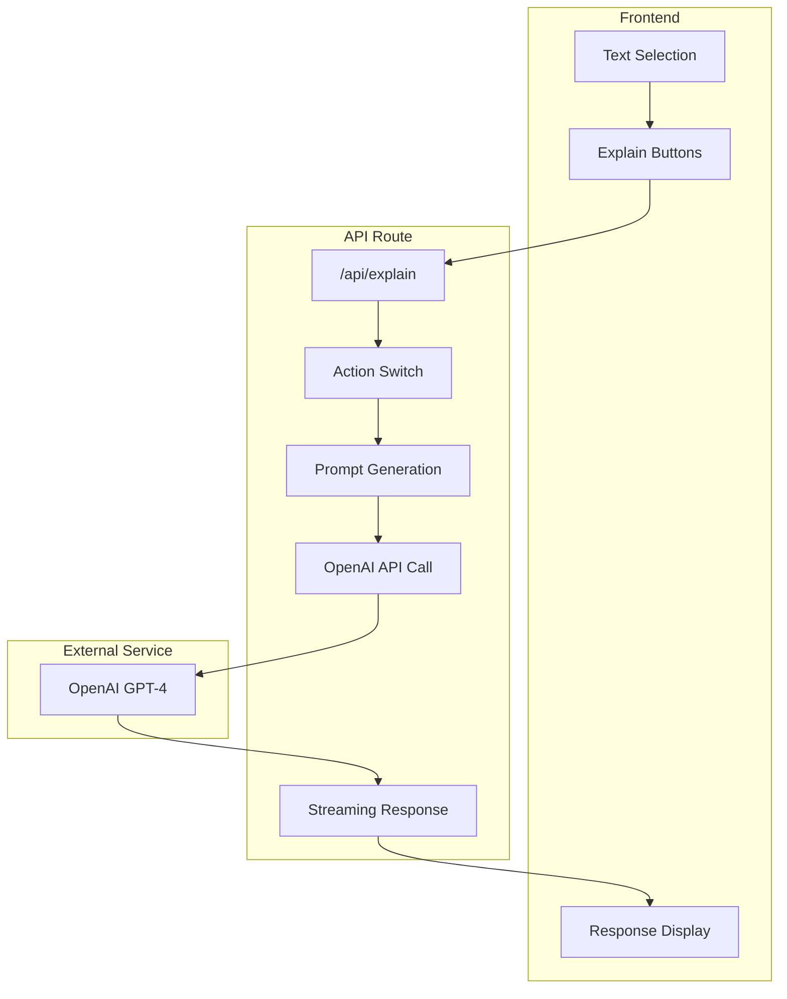
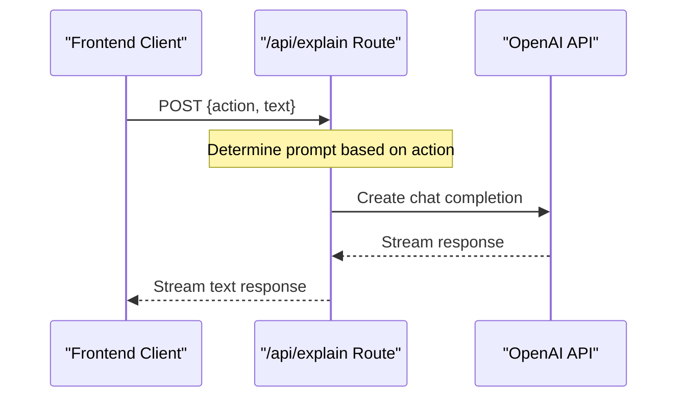
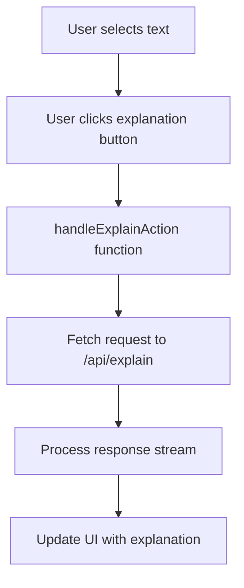

<!-- source: DeepWiki mcp.deepwiki.com · repo openai/interactive-textbook-demo · page 3.1 Text Explanation API · fetched 2026-10-26 -->

# Text Explanation API

<details>
<summary>Relevant source files</summary>

The following files were used as context for generating this wiki page:

- [app/api/explain/route.ts](app/api/explain/route.ts)
- [app/page.tsx](app/page.tsx)

</details>


This document details the Text Explanation API, which provides AI-powered explanations of textbook content in various formats. The API is implemented as a Next.js API route that leverages OpenAI's GPT-4 model to generate explanations tailored to different learning needs.

For information about other API routes in the system, see [API Routes](#3).

## Overview

The Text Explanation API allows users to select text from the interactive textbook and receive explanations in three different formats:

1. **ELI5 (Explain Like I'm Five)**: Simplifies complex concepts for easier understanding
2. **Summary**: Creates concise summaries of selected text
3. **Poem**: Transforms the content into a poetic format for creative learning



Sources: [app/api/explain/route.ts:1-31](), [app/page.tsx:171-199]()

## Implementation Details

The Text Explanation API is implemented as a Next.js API route that handles POST requests with selected text and the desired explanation type.

### API Route Structure

The API route is defined in `app/api/explain/route.ts` and exports a single `POST` function that processes incoming requests.



Sources: [app/api/explain/route.ts:4-31]()

### Request Processing

1. The route receives a POST request containing:
   - `action`: The type of explanation requested ("eli5", "summary", or "poem")
   - `text`: The selected textbook content to explain

2. Based on the action, the appropriate prompt is selected:
   - For "eli5": "Explain this to me like I'm five:"
   - For "summary": "Create a very short and concise summary of the following text:"
   - For "poem": "Make a short poem with proper formatting summarizing the following text:"

3. The prompt and text are combined and sent to OpenAI's GPT-4 model

Sources: [app/api/explain/route.ts:11-20]()

### OpenAI Integration

The API route creates an OpenAI client using the API key from environment variables and makes a request to the chat completions endpoint:

```
const chatCompletion = await openai.chat.completions.create({
  messages: [{ role: "user", content: `${prompt}\n${req.text}` }],
  model: "gpt-4",
  stream: true,
});
```

Key aspects of the implementation:
- Uses the GPT-4 model for high-quality explanations
- Enables streaming for real-time response display
- Constructs a simple prompt with the selected action and user text

Sources: [app/api/explain/route.ts:22-26]()

### Response Streaming

The API implements streaming responses to provide a better user experience:

1. The OpenAI response is streamed using the `OpenAIStream` utility
2. A `StreamingTextResponse` is returned to the client
3. The frontend processes this stream to display the explanation as it's generated

This approach allows users to see the explanation being built in real-time rather than waiting for the complete response.

Sources: [app/api/explain/route.ts:28-30]()

## Frontend Integration

The Text Explanation API is integrated into the frontend through the `handleExplainAction` function in the main page component.

### User Interaction Flow



Sources: [app/page.tsx:171-199]()

### Frontend Implementation

The frontend handles the explanation process through these steps:

1. User selects text in the textbook, which is captured by the `setSelectedText` state
2. User clicks one of the explanation buttons (ELI5, Summarize, or Make a poem)
3. The `handleExplainAction` function is called with the appropriate action type
4. The function:
   - Sets loading state for the selected action
   - Updates the current action state
   - Clears any previous explanation
   - Makes a POST request to `/api/explain` with the action and selected text
   - Processes the streaming response using a chunk decoder
   - Updates the UI with the explanation as it's received

Sources: [app/page.tsx:171-199](), [app/page.tsx:484-497]()

## UI Components

The Text Explanation feature is presented to users through a card component in the main interface with three action buttons:

1. **ELI5 Button**: Requests a simplified explanation
2. **Summarize Button**: Requests a concise summary
3. **Make a poem Button**: Requests a poetic interpretation

Each button shows a loading indicator when active and is disabled when:
- No text is selected
- Another explanation action is in progress

The explanation is displayed in a pre-formatted area below the buttons, with proper whitespace preservation.

Sources: [app/page.tsx:484-501]()

## Error Handling

The API implementation includes basic error handling:

1. The frontend disables buttons when appropriate to prevent invalid requests
2. The streaming response pattern gracefully handles connection issues
3. The OpenAI client will throw errors for API issues, which will be caught by Next.js's error handling

For more robust production use, additional error handling could be implemented to:
- Handle specific OpenAI API errors
- Provide more detailed error messages to users
- Implement retry logic for transient failures

Sources: [app/api/explain/route.ts:4-31](), [app/page.tsx:171-199]()

## Related Features

The Text Explanation API is part of a suite of AI-powered features in the interactive textbook demo:

- **Translation API**: For translating content to other languages (see [Translation API](#3.2))
- **Text-to-Speech API**: For audio narration of content (see [Text-to-Speech API](#3.3))
- **Vision API**: For describing images in the textbook (see [Vision API](#3.4))

These features work together to create a comprehensive accessibility solution for textbook content.

---

