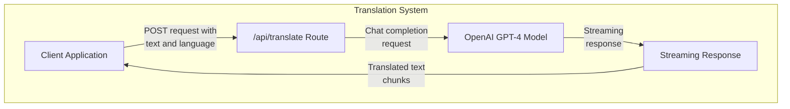
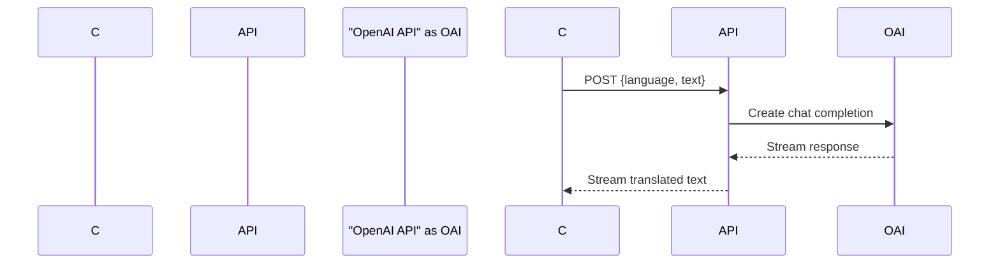
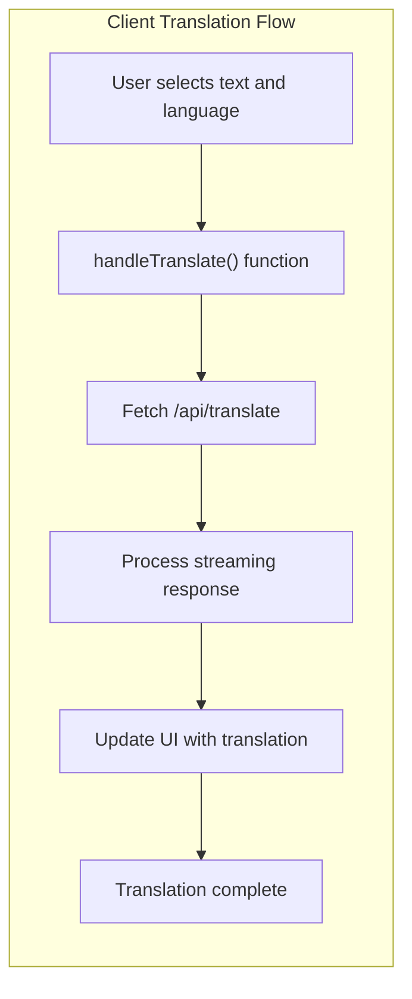

<!-- source: DeepWiki mcp.deepwiki.com · repo openai/interactive-textbook-demo · page 3.2 Translation API · fetched 2026-10-26 -->

# Translation API

<details>
<summary>Relevant source files</summary>

The following files were used as context for generating this wiki page:

- [app/api/translate/route.ts](app/api/translate/route.ts)
- [app/page.tsx](app/page.tsx)

</details>


This document describes the Translation API route in the Interactive Textbook Demo application. The Translation API provides functionality to translate selected text from the textbook into different languages, enhancing accessibility for users who may prefer or require content in languages other than English.

For information about other API routes in the application, see:
- [Text Explanation API](#3.1)
- [Text-to-Speech API](#3.3)
- [Vision API](#3.4)

## Overview

The Translation API is a server-side API route that accepts text content and a target language, then uses OpenAI's GPT-4 model to translate the text. The API returns a streaming response, allowing for real-time display of translation results in the user interface.



Sources: [app/api/translate/route.ts:1-23]()

## API Implementation

The Translation API is implemented as a Next.js API route that handles POST requests. The implementation is straightforward and consists of the following components:

1. An OpenAI client initialization
2. Request parsing to extract the text to translate and target language
3. A prompt construction for the translation task
4. A streaming response mechanism to return translated text in real-time

### Route Definition

The API is defined as a POST endpoint at `/api/translate` that processes JSON requests containing text to translate and the target language.



Sources: [app/api/translate/route.ts:4-23]()

### Request Processing

The API extracts two key parameters from the incoming request:

1. `language`: The target language for translation (e.g., "Japanese", "Spanish")
2. `text`: The source text to be translated

These parameters are used to construct a prompt for the OpenAI model in the format:
```
Translate the following text into [language]:
[text]
```

Sources: [app/api/translate/route.ts:9-13]()

### OpenAI Integration

The Translation API uses OpenAI's GPT-4 model to perform the translation. The API creates a chat completion request with the following configuration:

- **Model**: `gpt-4`
- **Messages**: A single user message containing the translation prompt and text
- **Stream**: Set to `true` to enable streaming responses

```javascript
const chatCompletion = await openai.chat.completions.create({
  messages: [{ role: "user", content: `${prompt}\n${text}` }],
  model: "gpt-4",
  stream: true,
});
```

Sources: [app/api/translate/route.ts:15-19]()

### Streaming Response

The API uses the `OpenAIStream` and `StreamingTextResponse` utilities from the `ai` package to handle streaming the translation results back to the client. This allows the UI to display translation results progressively as they are generated, providing a more responsive user experience.

```javascript
const stream = OpenAIStream(chatCompletion);
return new StreamingTextResponse(stream);
```

Sources: [app/api/translate/route.ts:21-22]()

## Client Integration

The frontend application interacts with the Translation API through the `handleTranslate` function in the main page component. This function:

1. Sets a loading state to indicate translation is in progress
2. Sends a POST request to the `/api/translate` endpoint with the selected text and target language
3. Processes the streaming response to update the UI in real-time
4. Returns the completed translation for potential further use (such as text-to-speech)



Sources: [app/page.tsx:201-232]()

### Translation UI Components

The translation functionality is presented to users through a card component in the main interface that includes:

1. An input field for specifying the target language
2. A "Translate" button to initiate translation
3. A "Read out loud" button to convert the translation to speech (using the [Text-to-Speech API](#3.3))
4. A display area for the translated text

The UI provides visual feedback during translation with loading indicators and disables buttons during processing to prevent multiple concurrent requests.

Sources: [app/page.tsx:504-526]()

## Usage Example

Here's a typical flow for using the Translation API:

1. User highlights text in the textbook
2. User enters a target language (e.g., "Japanese") in the language input field
3. User clicks the "Translate" button
4. The application shows a loading indicator and sends the request to the Translation API
5. As translation chunks are received, they are displayed in the translation area
6. Once complete, the user can read the translation or click "Read out loud" to hear it

## Error Handling

The Translation API implementation relies on the default error handling provided by Next.js API routes and the OpenAI client. If an error occurs during the translation process:

1. The error will be propagated to the client
2. The client-side loading state will be cleared
3. The user can retry the translation

## Integration with Other Features

The Translation API works in conjunction with other features in the application:

1. **Text Selection**: The translation feature operates on text selected by the user from the textbook content
2. **Text-to-Speech**: Translated text can be read aloud using the Text-to-Speech API
3. **TTS Mode**: In TTS mode, the application can automatically translate and read sections of the textbook

Sources: [app/page.tsx:201-232](), [app/page.tsx:280-289]()

## Technical Considerations

### Performance

The Translation API uses streaming responses to improve perceived performance. This allows the UI to display translation results as they are generated rather than waiting for the entire translation to complete.

### Security

The Translation API uses the OpenAI API key stored in environment variables, following security best practices for credential management. The API key is never exposed to the client.

Sources: [app/api/translate/route.ts:5-7]()

### Limitations

- The quality of translation depends on the capabilities of the underlying GPT-4 model
- Very long texts may be truncated due to token limits in the OpenAI API
- Some languages may have better translation quality than others

## Summary

The Translation API provides a streamlined way to translate textbook content into different languages, enhancing accessibility for non-native English speakers. The implementation leverages OpenAI's GPT-4 model and streaming responses to provide a responsive user experience.

---

