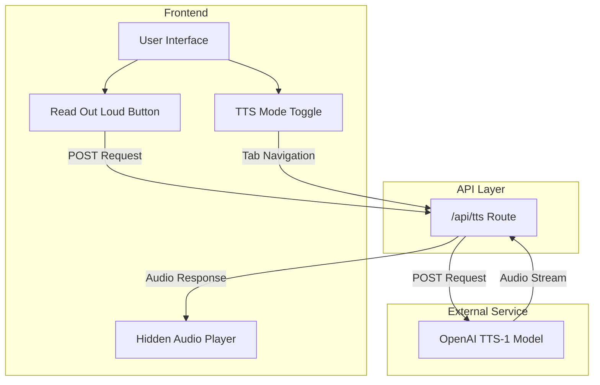
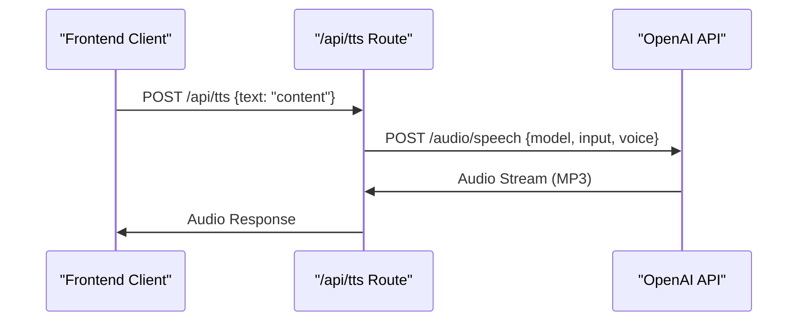
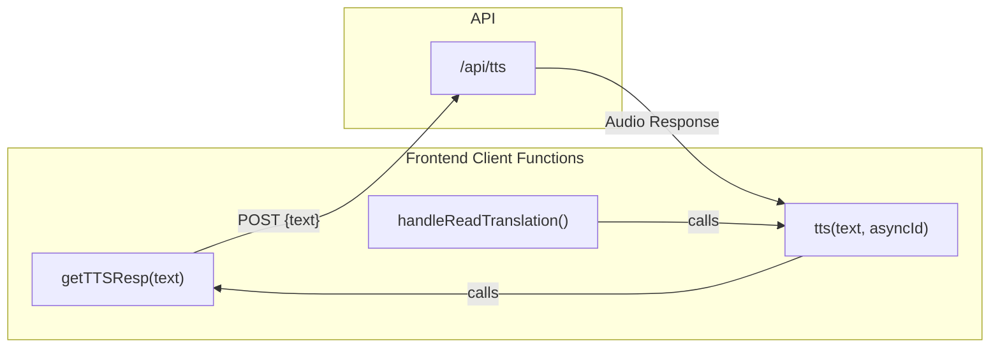
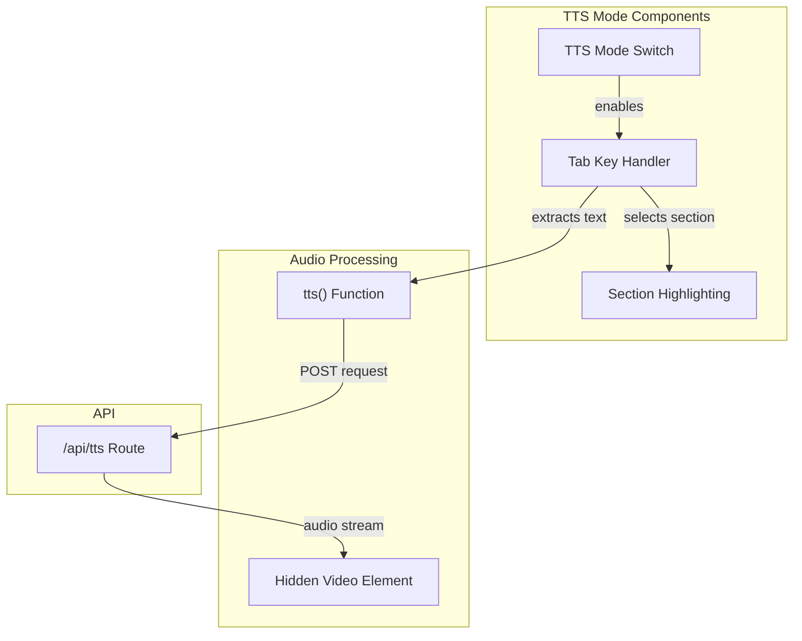

<!-- source: DeepWiki mcp.deepwiki.com · repo openai/interactive-textbook-demo · page 3.3 Text-to-Speech API · fetched 2026-10-26 -->

# Text-to-Speech API

Relevant source files

The following files were used as context for generating this wiki page:

- [app/api/tts/route.ts](app/api/tts/route.ts)
- [app/page.tsx](app/page.tsx)

This document provides technical documentation for the Text-to-Speech (TTS) API in the interactive textbook demo application. The TTS API enables the conversion of text to spoken audio, enhancing accessibility for users with visual impairments or those who prefer auditory learning.

For information about the Vision API that works alongside TTS for image descriptions, see [Vision API](#3.4).

## Overview

The Text-to-Speech API is a server-side endpoint that processes text input and returns audio output using OpenAI's TTS-1 model. This API serves as a bridge between the frontend application and OpenAI's speech synthesis capabilities.

Sources: [app/api/tts/route.ts:1-21](), [app/page.tsx:235-246]()

## API Implementation

The TTS API is implemented as a Next.js API route that handles POST requests containing text to be converted to speech.

### Route Definition

The API route is defined in the file `app/api/tts/route.ts` and consists of a single POST handler function:

Sources: [app/api/tts/route.ts:1-21]()

### Request Processing

The TTS API route:
1. Receives a POST request with JSON body containing a `text` field
2. Forwards the request to OpenAI's `/v1/audio/speech` endpoint
3. Returns the audio stream to the client with appropriate content type headers

The implementation uses the following parameters:
- Model: `tts-1` (OpenAI's text-to-speech model)
- Voice: `alloy` (one of OpenAI's available voice options)
- Input: The text provided in the request body

Sources: [app/api/tts/route.ts:6-17]()

## Frontend Integration

The frontend application integrates with the TTS API through several functions and components.

### API Client Function

The frontend includes a utility function `getTTSResp` that handles communication with the TTS API:

Sources: [app/page.tsx:235-246](), [app/page.tsx:248-278](), [app/page.tsx:280-289]()

### Audio Playback Implementation

The frontend handles the audio response from the TTS API using the MediaSource API:

1. Creates a MediaSource object
2. Connects it to a hidden video element (used for audio playback)
3. Reads the audio stream from the API response
4. Appends audio chunks to the MediaSource buffer
5. Plays the audio through the video element

Sources: [app/page.tsx:248-278]()

## Usage Scenarios

The TTS API is used in three main scenarios within the application:

### 1. Reading Selected Text

Users can select text from the textbook and click the "Read out loud" button to have it read aloud.

| Step | Action | Component/Function |
|------|--------|-------------------|
| 1 | User selects text | `handleMouseUp` event handler |
| 2 | User clicks "Read out loud" | `handleReadTranslation` function |
| 3 | Text is sent to TTS API | `tts` function |
| 4 | Audio is played back | MediaSource API |

Sources: [app/page.tsx:280-289](), [app/page.tsx:516-519]()

### 2. Reading Translations

Users can translate selected text and have the translation read aloud:

| Step | Action | Component/Function |
|------|--------|-------------------|
| 1 | User selects text | `handleMouseUp` event handler |
| 2 | User clicks "Translate" | `handleTranslate` function |
| 3 | User clicks "Read out loud" | `handleReadTranslation` function |
| 4 | Translation is sent to TTS API | `tts` function |
| 5 | Audio is played back | MediaSource API |

Sources: [app/page.tsx:201-232](), [app/page.tsx:280-289](), [app/page.tsx:516-519]()

### 3. TTS Mode for Navigation

The application includes a "TTS Mode" that allows users to navigate through the textbook using the Tab key, with each section automatically read aloud:

Sources: [app/page.tsx:380-430](), [app/page.tsx:534-539]()

## Image Description Integration

The TTS API is also used in conjunction with the Vision API to describe images and read those descriptions aloud:

1. User clicks "Describe Image" button or navigates to an image in TTS Mode
2. The application sends the image to the Vision API
3. The resulting description is sent to the TTS API
4. The audio description is played back

Sources: [app/page.tsx:310-358](), [app/page.tsx:360-378](), [app/page.tsx:399-407]()

## User Interface Components

The TTS functionality is exposed through several UI components:

1. **Read Out Loud Button**: For reading translations
2. **TTS Mode Toggle**: For enabling navigation-based TTS
3. **Describe Image Buttons**: For describing and reading image content
4. **Hidden Video Element**: For playing audio (not visible to users)

Sources: [app/page.tsx:516-519](), [app/page.tsx:534-539](), [app/page.tsx:544-557](), [app/page.tsx:455]()

## Error Handling

The TTS implementation includes basic error handling:

1. Asynchronous ID tracking to prevent overlapping audio playback
2. Try-catch blocks around buffer operations to handle potential errors
3. Cleanup of resources when components unmount or when audio playback is stopped

Sources: [app/page.tsx:248-250](), [app/page.tsx:270-274](), [app/page.tsx:444-450]()

## Toast Notifications

The application displays toast notifications during TTS playback to inform users that audio is being played and to provide a way to stop playback:

| Event | Action | UI Effect |
|-------|--------|-----------|
| Audio starts playing | `handlePlay` event handler | Toast notification with "Reading out loud..." |
| Audio stops playing | `handlePause` event handler | Toast notification is dismissed |
| User clicks "Stop" | `clearDocument` function | Audio playback is stopped |

Sources: [app/page.tsx:432-451](), [app/page.tsx:47-59]()

## Technical Limitations

The current implementation has some limitations:

1. Uses a fixed voice (`alloy`) for all TTS operations
2. Does not support voice customization or speed adjustment
3. Relies on the browser's MediaSource API for audio playback
4. Uses a video element for audio playback (a common workaround for streaming audio)

Sources: [app/api/tts/route.ts:13-16](), [app/page.tsx:256-258]()

---

