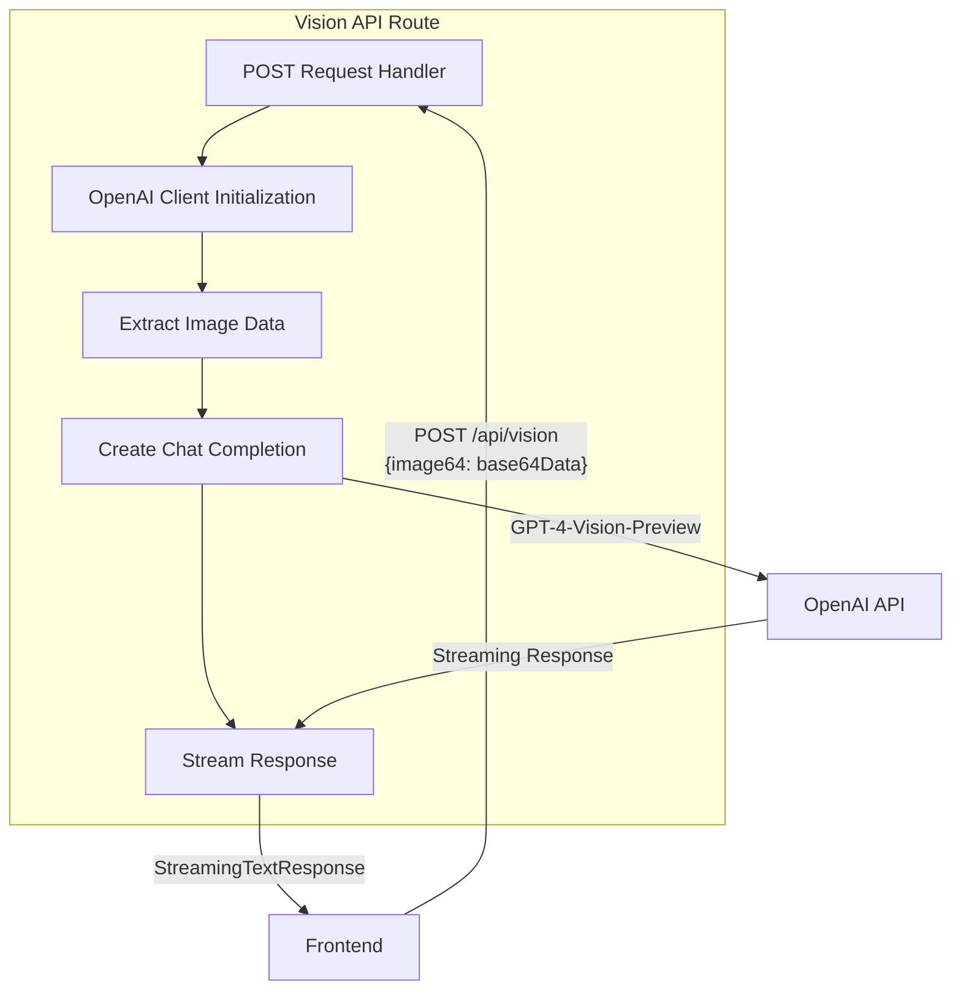
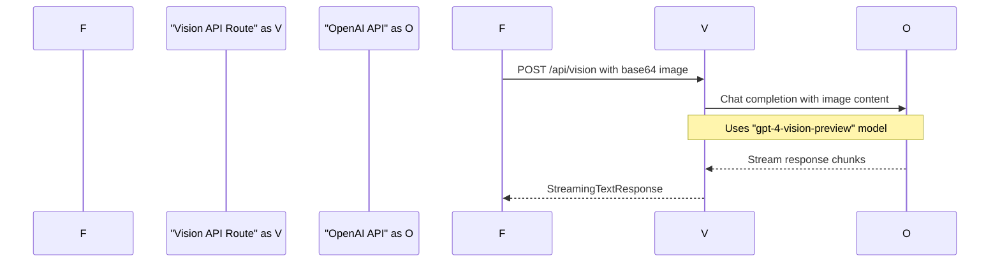
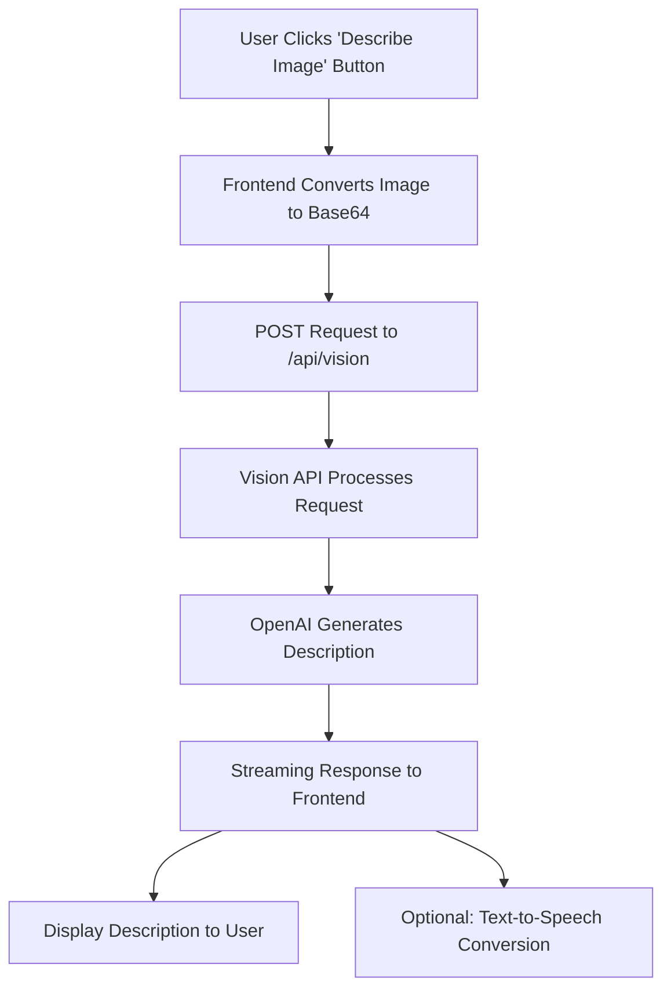
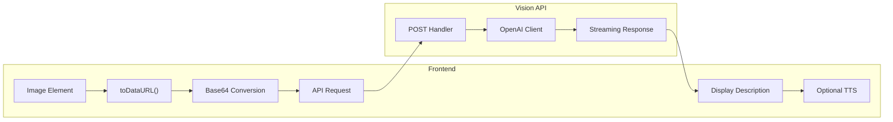
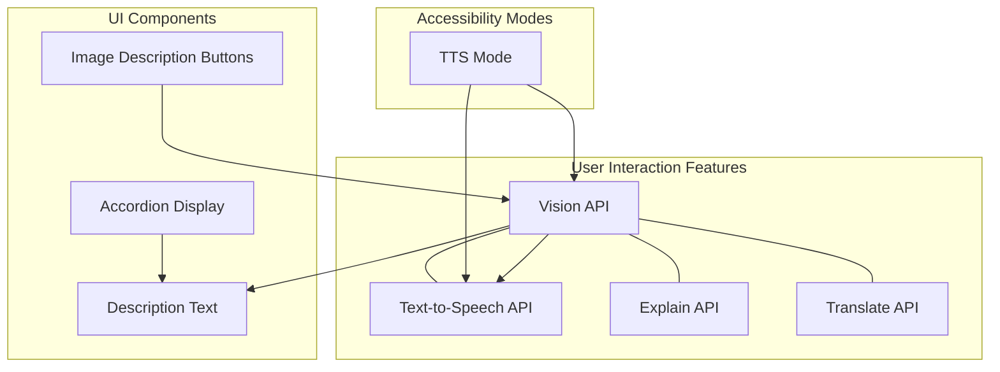

<!-- source: DeepWiki mcp.deepwiki.com · repo openai/interactive-textbook-demo · page 3.4 Vision API · fetched 2026-10-26 -->

# Vision API

<details>
<summary>Relevant source files</summary>

The following files were used as context for generating this wiki page:

- [app/api/vision/route.ts](app/api/vision/route.ts)
- [app/page.tsx](app/page.tsx)

</details>


This document details the Vision API route in the Interactive Textbook Demo application, which enables image description capabilities using OpenAI's GPT-4 Vision model. The API allows the application to analyze images and generate descriptive text, making visual content accessible to users with visual impairments.

## Purpose and Scope

The Vision API serves as the backend endpoint for processing image data and generating descriptive text. It accepts base64-encoded images from the frontend, sends them to OpenAI's GPT-4 Vision model, and returns a streaming text response containing a detailed description of the image content.

## API Route Implementation

The Vision API is implemented as a Next.js API route that handles POST requests containing base64-encoded image data.



Sources: [app/api/vision/route.ts:1-27]()

### Request Handling

The Vision API route is defined in `route.ts` and exports a `POST` function that processes incoming requests:

1. It initializes an OpenAI client with the API key from environment variables
2. Extracts the base64-encoded image data from the request body
3. Creates a chat completion request to the GPT-4 Vision model
4. Returns a streaming text response

Sources: [app/api/vision/route.ts:4-27]()

### OpenAI Integration

The API uses the OpenAI client to send requests to the GPT-4 Vision model:



Key configuration parameters for the OpenAI request:

| Parameter | Value | Purpose |
|-----------|-------|---------|
| model | "gpt-4-vision-preview" | Specifies the vision-capable model |
| stream | true | Enables streaming response |
| max_tokens | 500 | Limits response length |
| content | Array with text prompt and image | Provides the image and instruction |

Sources: [app/api/vision/route.ts:11-23]()

## Frontend Integration

The Vision API is called from the frontend to describe images in the textbook content.

### Image Description Flow



Sources: [app/page.tsx:310-358]()

### Implementation Details

The frontend implements two main ways to interact with the Vision API:

1. **Manual image description**: Users can click buttons to describe specific images in the textbook
2. **TTS Mode image description**: When in Text-to-Speech mode, the application automatically describes images when navigating through content

#### Manual Image Description

The frontend provides buttons for users to request descriptions of specific images:

```
handleDescribeImageFromIdx(index) → describeImage(src, asyncId) → fetch("/api/vision")
```

Sources: [app/page.tsx:360-378](), [app/page.tsx:545-556]()

#### TTS Mode Image Description

When in TTS mode, pressing the Tab key navigates through content sections, automatically describing images when encountered:

```
handleTabPress() → describeImage(src, asyncId) → fetch("/api/vision") → tts(description)
```

Sources: [app/page.tsx:380-430]()

### Image Processing

Before sending to the API, images are converted from URLs to base64 format:

1. The frontend fetches the image from its source URL
2. Converts it to a blob
3. Uses FileReader to convert the blob to a base64 data URL
4. Extracts the base64 data portion to send to the API

Sources: [app/page.tsx:315-324]()

## Data Flow



Sources: [app/page.tsx:310-358](), [app/api/vision/route.ts:1-27]()

## Response Handling

The Vision API returns a streaming text response that is processed by the frontend:

1. The frontend reads the response stream chunk by chunk
2. Decodes each chunk using a chunk decoder
3. Appends the decoded text to the description state
4. Optionally sends the complete description to the TTS API for audio playback

Sources: [app/page.tsx:336-355]()

## Error Handling

The Vision API implementation includes basic error handling:

1. The frontend tracks asynchronous operations with an ID to prevent race conditions
2. If a new request is made before a previous one completes, the previous operation is abandoned
3. The frontend checks the async ID before processing each chunk of the response

Sources: [app/page.tsx:340-343]()

## Integration with Other Features

The Vision API works in conjunction with other features in the application:



Sources: [app/page.tsx:558-565](), [app/page.tsx:402-407]()

## Usage Examples

### Manual Image Description

Users can click on buttons to describe specific images in the textbook:

1. User clicks "Describe Image X" button
2. The application converts the image to base64
3. The base64 data is sent to the Vision API
4. The API returns a description that is displayed in an accordion component

Sources: [app/page.tsx:545-565]()

### Automatic Image Description in TTS Mode

When in TTS mode:

1. User presses Tab to navigate through content
2. When an image is encountered, it's automatically sent to the Vision API
3. The resulting description is read aloud using the TTS API

Sources: [app/page.tsx:398-407]()

## Security Considerations

The Vision API handles potentially large image data:

1. Images are resized to 768 pixels before processing by OpenAI
2. The API key is stored in environment variables and not exposed to the client
3. The application uses server-side processing to avoid exposing the OpenAI API key

Sources: [app/api/vision/route.ts:17](), [app/api/vision/route.ts:5-7]()

## Related APIs

The Vision API is part of a suite of APIs that enhance the interactive textbook experience:

- For text explanations, see [Text Explanation API](#3.1)
- For text translation, see [Translation API](#3.2)
- For text-to-speech conversion, see [Text-to-Speech API](#3.3)

Together, these APIs provide a comprehensive set of accessibility features for the interactive textbook.

---

