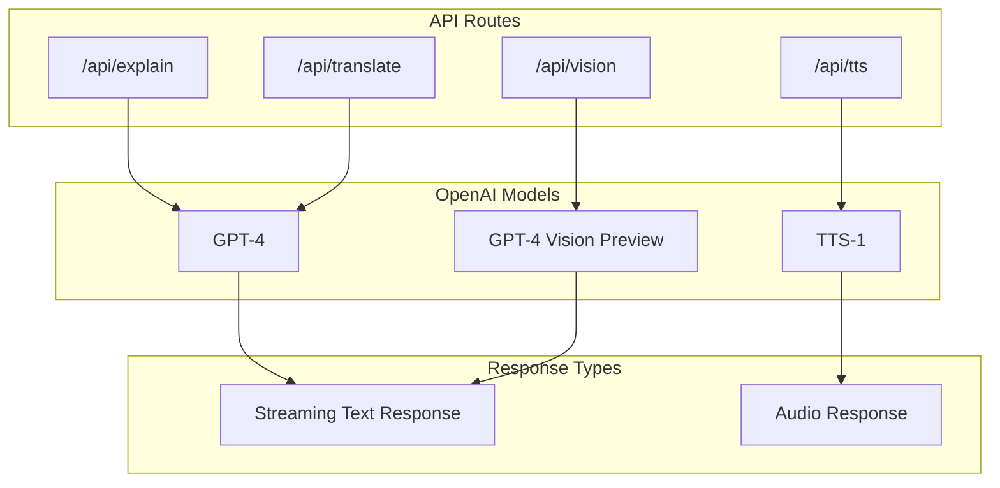
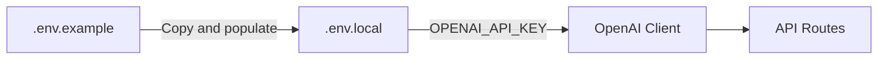
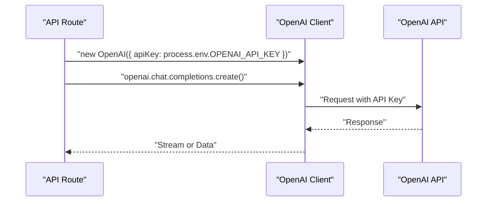
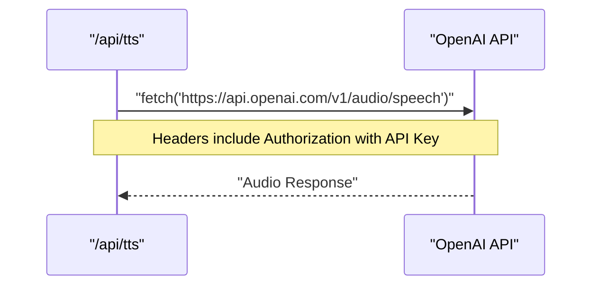
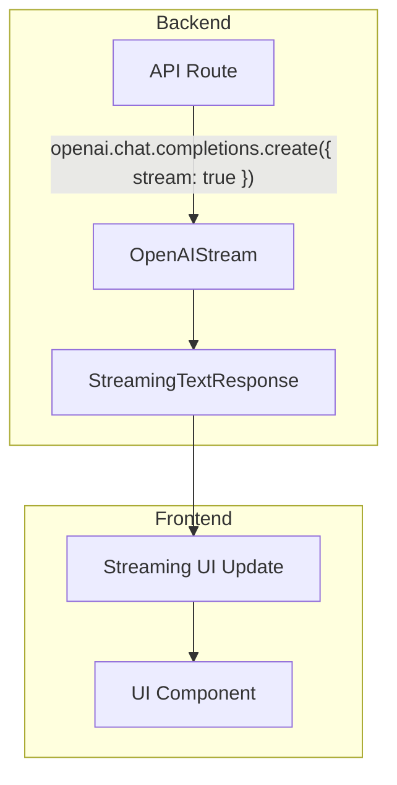
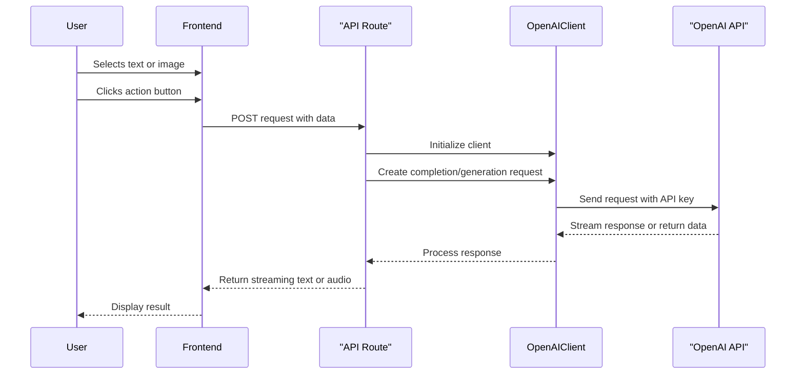

<!-- source: DeepWiki mcp.deepwiki.com · repo openai/interactive-textbook-demo · page 4 OpenAI Integration · fetched 2026-10-26 -->

# OpenAI Integration

Relevant source files

The following files were used as context for generating this wiki page:

- [.env.example](.env.example)
- [app/api/explain/route.ts](app/api/explain/route.ts)
- [app/api/translate/route.ts](app/api/translate/route.ts)
- [app/api/tts/route.ts](app/api/tts/route.ts)
- [app/api/vision/route.ts](app/api/vision/route.ts)

This document provides a comprehensive overview of how the Interactive Textbook Demo integrates with OpenAI's services. It covers the configuration of OpenAI API keys, the implementation of API routes that leverage OpenAI models, and the specific OpenAI models used throughout the application.

For information about the individual API routes and their specific implementations, see [API Routes](#3).

## 1. OpenAI Integration Architecture

The Interactive Textbook Demo integrates with OpenAI services through four distinct API routes, each utilizing different OpenAI models to provide specific functionality.

Sources: [app/api/explain/route.ts](), [app/api/translate/route.ts](), [app/api/tts/route.ts](), [app/api/vision/route.ts]()

## 2. API Key Configuration

The application requires an OpenAI API key to authenticate requests to the OpenAI services. This key is stored as an environment variable.

### 2.1 Environment Variable Setup

The OpenAI API key is configured through the `OPENAI_API_KEY` environment variable:

1. The repository includes an `.env.example` file that serves as a template
2. Developers must create a `.env.local` file with their actual OpenAI API key
3. The API key is accessed in the code via `process.env.OPENAI_API_KEY`

Sources: [.env.example]()

## 3. OpenAI Client Initialization

The application initializes the OpenAI client in each API route that requires it. Two different initialization patterns are used:

### 3.1 Standard Client Initialization

For the explain, translate, and vision API routes, the OpenAI client is initialized using the OpenAI SDK:

Sources: [app/api/explain/route.ts:5-7](), [app/api/translate/route.ts:5-7](), [app/api/vision/route.ts:5-7]()

### 3.2 Direct API Call

For the text-to-speech API route, a direct fetch to the OpenAI API is used instead of the SDK:

Sources: [app/api/tts/route.ts:6-17]()

## 4. OpenAI Models and Features

The application leverages several OpenAI models to provide different features:

| API Route | OpenAI Model | Feature | Response Type |
|-----------|--------------|---------|---------------|
| `/api/explain` | GPT-4 | Text explanations, summaries, and poems | Streaming text |
| `/api/translate` | GPT-4 | Text translation to different languages | Streaming text |
| `/api/tts` | TTS-1 | Text-to-speech conversion | Audio (MP3) |
| `/api/vision` | GPT-4 Vision Preview | Image description | Streaming text |

Sources: [app/api/explain/route.ts:22-26](), [app/api/translate/route.ts:15-19](), [app/api/tts/route.ts:12-16](), [app/api/vision/route.ts:11-23]()

## 5. Streaming Responses

For text-based responses, the application uses streaming to improve user experience:

The application uses the `ai` package's `OpenAIStream` and `StreamingTextResponse` utilities to handle streaming responses from OpenAI:

1. API routes set `stream: true` in the OpenAI request options
2. The response is processed through `OpenAIStream`
3. A `StreamingTextResponse` is returned to the client
4. The frontend progressively displays the response as it arrives

Sources: [app/api/explain/route.ts:22-30](), [app/api/translate/route.ts:15-22](), [app/api/vision/route.ts:11-26]()

## 6. Model-Specific Parameters

Each OpenAI model integration includes specific parameters:

### 6.1 GPT-4 (Explain and Translate)

- **Model**: `gpt-4`
- **Stream**: `true`
- **Messages**: Array with a single user message containing the prompt and text

Sources: [app/api/explain/route.ts:22-26](), [app/api/translate/route.ts:15-19]()

### 6.2 GPT-4 Vision Preview

- **Model**: `gpt-4-vision-preview`
- **Stream**: `true`
- **Max Tokens**: `500`
- **Messages**: Array with a user message containing text and image content
- **Image Resize**: `768` (pixels)

Sources: [app/api/vision/route.ts:11-23]()

### 6.3 TTS-1

- **Model**: `tts-1`
- **Voice**: `alloy`
- **Input**: Text to convert to speech

Sources: [app/api/tts/route.ts:12-16]()

## 7. Error Handling

The application does not implement explicit error handling for OpenAI API calls. In a production environment, it would be advisable to add proper error handling to manage:

- API key validation errors
- Rate limiting issues
- Model-specific errors
- Network failures

## 8. Integration Flow

The following diagram illustrates the complete flow from user interaction to OpenAI integration:

Sources: [app/api/explain/route.ts](), [app/api/translate/route.ts](), [app/api/tts/route.ts](), [app/api/vision/route.ts]()

## Summary

The Interactive Textbook Demo integrates with OpenAI services through four API routes, each utilizing different OpenAI models to provide specific functionality. The integration is configured through an environment variable for the API key and uses both the OpenAI SDK and direct API calls. The application leverages streaming responses for text-based features to improve user experience.

---

