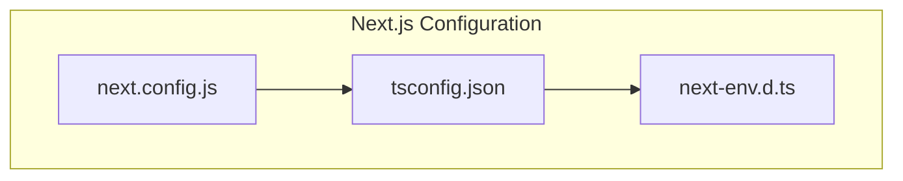
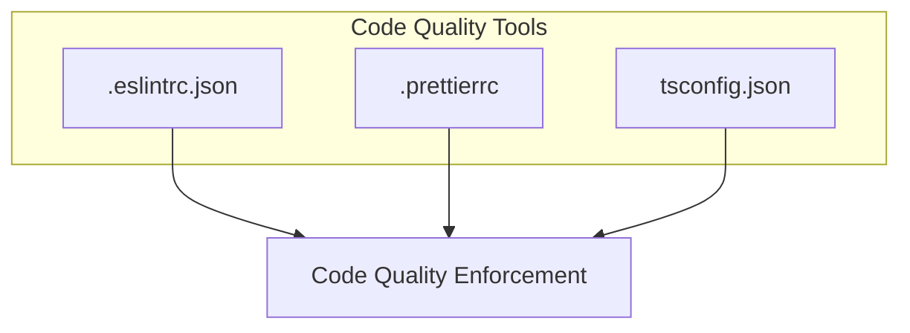
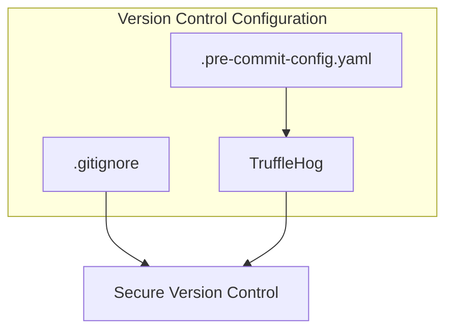
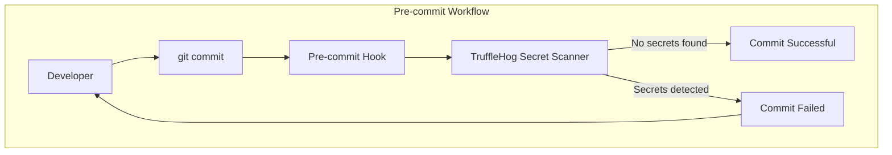
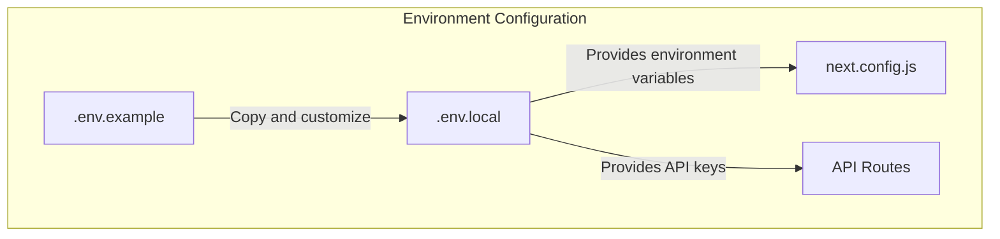
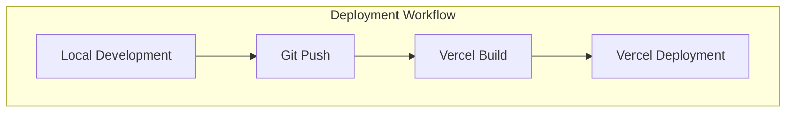
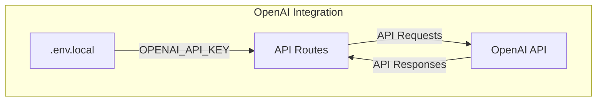

<!-- source: DeepWiki mcp.deepwiki.com · repo openai/interactive-textbook-demo · page 5 Development Workflow · fetched 2026-10-26 -->

# Development Workflow

Relevant source files

The following files were used as context for generating this wiki page:

- [.eslintrc.json](.eslintrc.json)
- [.gitignore](.gitignore)
- [.pre-commit-config.yaml](.pre-commit-config.yaml)
- [next.config.js](next.config.js)

This document outlines the development workflow for the Interactive Textbook Demo project. It covers the configuration files, development tools, and best practices used in the project to ensure a smooth and secure development process.

For information about security configuration specifically, see [Security Configuration](#1.2).

## Project Configuration Files

The Interactive Textbook Demo uses several configuration files to manage the development environment and ensure consistent behavior across different development setups.

### Next.js Configuration

The project uses Next.js as its framework, with a minimal configuration defined in the root directory.

The `next.config.js` file contains the basic configuration for the Next.js application. Currently, it uses a minimal setup with no custom configuration options.

Sources: [next.config.js]()

### Code Quality Tools

The project employs several tools to maintain code quality and consistency:

ESLint is configured to extend Next.js core web vitals rules, ensuring that the code follows best practices for Next.js applications.

Sources: [.eslintrc.json]()

## Version Control and Security

The project uses Git for version control with additional security measures to prevent accidental exposure of sensitive information.

### Git Configuration

#### .gitignore

The `.gitignore` file is comprehensive and includes patterns for:

1. Node.js specific files (node_modules, npm logs)
2. Next.js build artifacts (.next, out directories)
3. Environment files (.env*.local)
4. Python-related files (for any Python scripts that might be used)
5. System files (.DS_Store)
6. TypeScript build info files

This ensures that sensitive or unnecessary files are not committed to the repository.

Sources: [.gitignore]()

#### Pre-commit Hooks

The project uses pre-commit hooks to enforce security checks before code is committed:

TruffleHog is configured to scan for secrets in the codebase during the commit and push stages. If any secrets are detected, the commit will fail, preventing accidental exposure of sensitive information.

Sources: [.pre-commit-config.yaml]()

## Environment Configuration

The project uses environment variables for configuration, particularly for API keys and other sensitive information.

Developers should copy the `.env.example` file to `.env.local` and fill in the required values, particularly the OpenAI API key. The `.env.local` file is excluded from version control via the `.gitignore` file to prevent accidental exposure of sensitive information.

Sources: [.gitignore:154-155]()

## Development Server

To run the development server, the project uses npm scripts defined in the `package.json` file:

| Command | Description |
|---------|-------------|
| `npm run dev` | Starts the development server |
| `npm run build` | Builds the application for production |
| `npm start` | Starts the production server |
| `npm run lint` | Runs ESLint to check for code quality issues |

The development server provides hot reloading, allowing developers to see changes immediately without manually refreshing the browser.

## Deployment Workflow

The project is designed to be deployed to Vercel, with configuration files to ensure smooth deployment:

The `.vercel` directory is excluded from version control via the `.gitignore` file, as it contains deployment-specific information that should not be shared across development environments.

Sources: [.gitignore:157-158]()

## Development Best Practices

To ensure a smooth development experience and maintain code quality, developers should follow these best practices:

1. **Environment Variables**: Always use the `.env.local` file for local development and never commit it to the repository.
2. **Pre-commit Hooks**: Ensure that pre-commit hooks are installed and running to prevent accidental exposure of sensitive information.
3. **Code Quality**: Follow the ESLint rules and use the provided npm scripts to check for code quality issues.
4. **TypeScript**: Use TypeScript for type safety and better developer experience.
5. **Security**: Be mindful of security concerns, particularly when handling API keys and other sensitive information.

## Integration with OpenAI Services

The project integrates with OpenAI services through API routes. Developers need to ensure they have a valid OpenAI API key configured in their `.env.local` file.

For more detailed information about the OpenAI integration, see [OpenAI Integration](#4).

Sources: [.gitignore:154-155]()

## Conclusion

The development workflow for the Interactive Textbook Demo is designed to be secure, efficient, and maintainable. By following the configuration guidelines and best practices outlined in this document, developers can contribute to the project effectively while maintaining high standards of code quality and security.