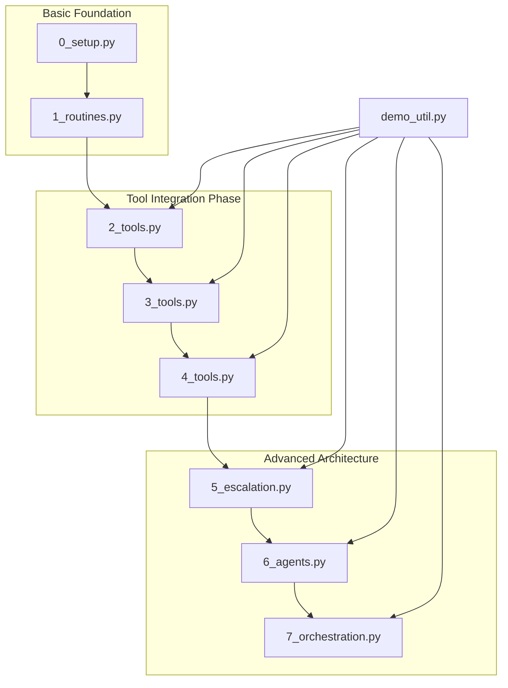
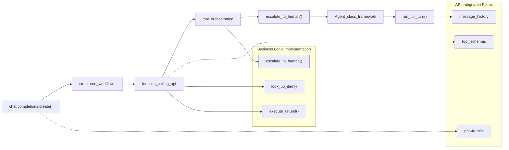
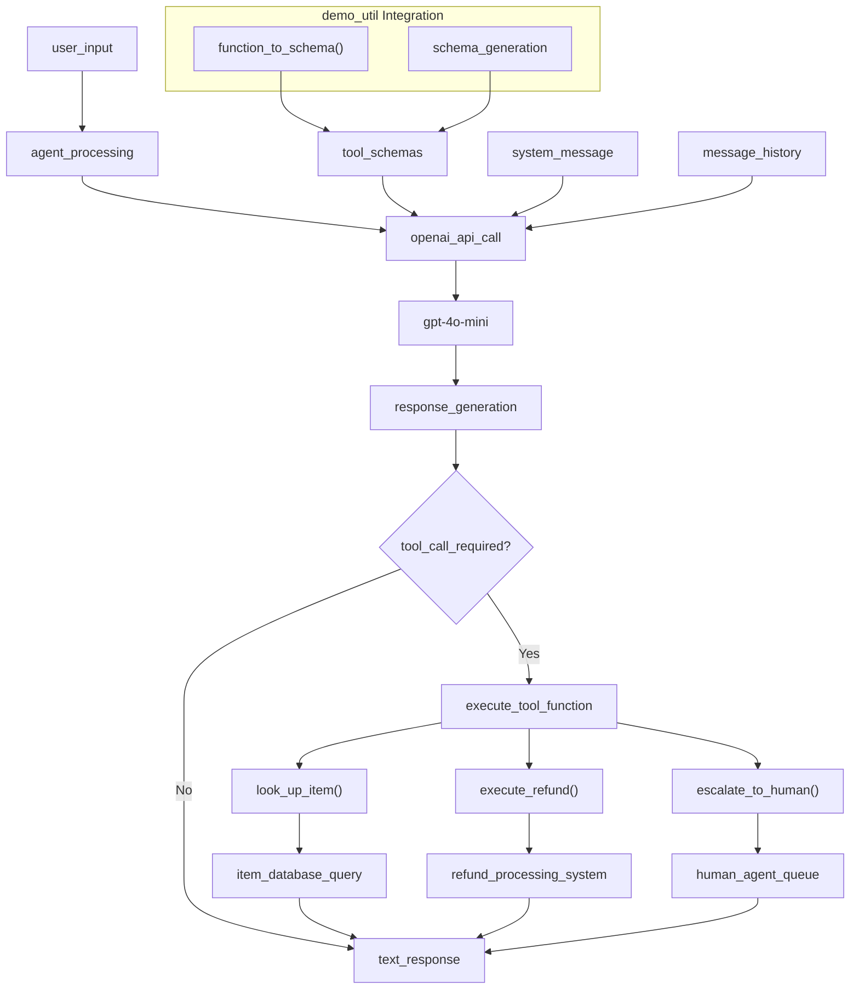
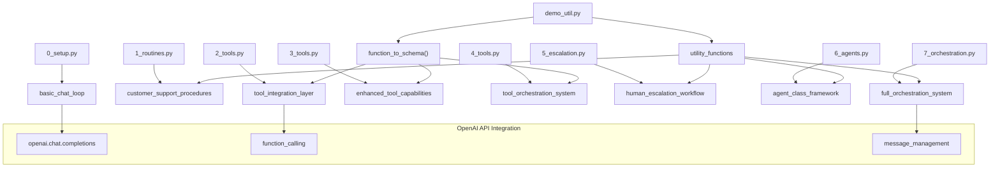

<!-- source: DeepWiki mcp.deepwiki.com · repo openai/learning-lab · page 1 Learning Lab Overview · fetched 2026-10-26 -->

# Learning Lab Overview

Relevant source files

The following files were used as context for generating this wiki page:

- [README.md](README.md)

## Purpose and Scope

This document provides an overview of the Learning Lab repository, a comprehensive webinar series designed specifically for developers in Japan to learn practical implementations of OpenAI's API and models. The repository contains a progressive tutorial series that demonstrates building sophisticated AI agents, from basic chatbots to advanced customer support systems with full orchestration capabilities.

For detailed setup instructions and initial environment configuration, see [Getting Started](#2). For the complete customer support agent tutorial progression, see [Customer Support Agent Tutorial](#3).

**Sources:** [README.md:1-6]()

## Repository Architecture and Learning Progression

The Learning Lab follows a carefully structured progression from foundational concepts to advanced agent architectures. The repository is organized as a series of executable Python modules that build upon each other, demonstrating increasingly sophisticated OpenAI API usage patterns.

### Tutorial File Structure

**Sources:** Repository structure analysis from provided diagrams

## Technical Learning Path

The tutorial progression demonstrates the evolution from simple API calls to complex agent orchestration systems. Each module introduces specific OpenAI API capabilities and integration patterns.

### Core Capability Development Timeline

**Sources:** Analysis of tutorial progression from provided architectural diagrams

## ACME Inc. Customer Support System

The tutorials center around building a comprehensive customer support system for ACME Inc., providing practical context for OpenAI API integration patterns. This system serves as the primary use case throughout the learning progression.

### System Components and Data Flow

**Sources:** Customer support ecosystem analysis from provided system diagrams

## Target Audience and Implementation Goals

The Learning Lab specifically targets Japanese developers seeking practical guidance on OpenAI API integration. The webinar format provides structured learning with hands-on code examples that can be directly adapted for production use cases.

### Developer Learning Objectives

| Learning Phase | Technical Focus | Key Code Entities |
|----------------|----------------|-------------------|
| Foundation | Basic API integration | `chat.completions.create()`, `gpt-4o-mini` |
| Tool Integration | Function calling | `function_to_schema()`, tool schemas |
| Advanced Features | Agent orchestration | `Agent` class, `run_full_turn()` |
| Production Readiness | Error handling & escalation | `escalate_to_human()`, message management |

**Sources:** [README.md:3-5](), learning objectives from tutorial structure analysis

## Repository Components Overview

The codebase is structured to support both educational delivery and practical implementation. The modular design allows developers to understand each concept in isolation while building toward comprehensive agent systems.

### Core Module Dependencies

**Sources:** Component dependency analysis from repository structure and provided architectural diagrams

The Learning Lab repository provides a complete educational framework for implementing production-ready OpenAI-powered agents, with particular emphasis on practical patterns that Japanese developers can immediately apply in their own projects. Each tutorial module builds systematically toward sophisticated agent architectures while maintaining clear separation of concerns and reusable code patterns.

---

