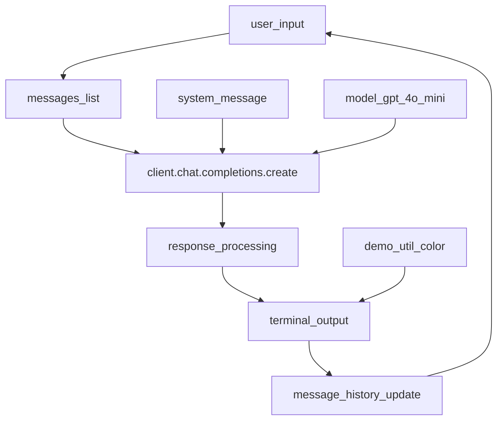
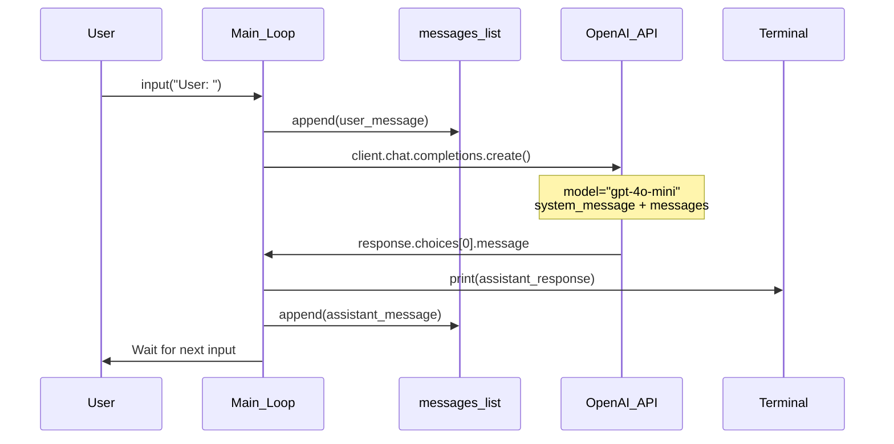
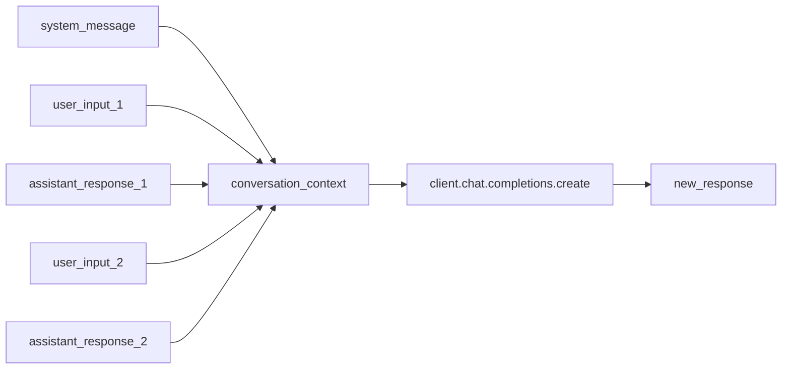

<!-- source: DeepWiki mcp.deepwiki.com · repo openai/learning-lab · page 2 Getting Started · fetched 2026-10-26 -->

# Getting Started

<details>
<summary>Relevant source files</summary>

The following files were used as context for generating this wiki page:

- [01-agents/0_setup.py](01-agents/0_setup.py)
- [01-agents/README.md](01-agents/README.md)

</details>


This page guides you through the initial setup and configuration required to run your first OpenAI-powered agent. It covers environment setup, API configuration, and implementation of a basic chat loop using the `gpt-4o-mini` model. 

For information about advanced customer support workflows and tool integration, see [Customer Support Agent Tutorial](#3). For utility functions and schema generation, see [Utility Functions and Schema Generation](#4.1).

## Environment Setup

Before running any examples, you need to configure your OpenAI API credentials and ensure proper environment setup.

### API Key Configuration

Set your OpenAI API key as an environment variable:

```bash
export OPENAI_API_KEY="sk_XXX..."
```

This credential will be automatically detected by the `OpenAI` client initialization in [01-agents/0_setup.py:1-5]().

### Dependencies

The codebase requires the OpenAI Python library and includes utility functions for colored terminal output:

| Dependency | Purpose | Used In |
|------------|---------|---------|
| `openai` | OpenAI API client library | All agent implementations |
| `demo_util` | Color formatting for terminal output | Interactive demos |

**Sources:** [01-agents/README.md:8-13](), [01-agents/0_setup.py:1-2]()

## Basic Chat Loop Architecture

The initial implementation demonstrates a fundamental chat loop pattern that forms the foundation for all subsequent agent examples.

### System Components Overview



**Sources:** [01-agents/0_setup.py:10-37]()

### Core Components

The basic chat implementation consists of several key components defined in [01-agents/0_setup.py]():

| Component | Variable/Function | Purpose |
|-----------|-------------------|---------|
| OpenAI Client | `client` | API communication interface |
| Model Selection | `model = "gpt-4o-mini"` | Specifies the language model |
| System Instructions | `system_message` | Defines assistant behavior |
| Message History | `messages` | Maintains conversation context |
| Main Loop | `while True` | Handles continuous user interaction |

### Implementation Flow

The chat loop follows this sequence:



**Sources:** [01-agents/0_setup.py:19-37]()

## Running Your First Agent

Execute the basic chat agent using:

```bash
python 01-agents/0_setup.py
```

The agent will initialize with these default configurations:
- **Model:** `gpt-4o-mini` as defined in [01-agents/0_setup.py:10]()
- **System Message:** `"You are a helpful Assistant."` from [01-agents/0_setup.py:13]()
- **Message History:** Empty list initialized in [01-agents/0_setup.py:16]()

### Interactive Session Flow

When running, the agent processes inputs through this message structure:



Each request to the OpenAI API includes the complete conversation history as defined in [01-agents/0_setup.py:27]().

**Sources:** [01-agents/0_setup.py:25-28](), [01-agents/README.md:16-19]()

## Understanding the Message Flow

### Message Structure and Processing

The implementation uses OpenAI's chat completion format where each message contains a `role` and `content`:

| Message Type | Role | Content Source | Code Reference |
|--------------|------|----------------|----------------|
| System | `"system"` | `system_message` variable | [01-agents/0_setup.py:13]() |
| User | `"user"` | Terminal input | [01-agents/0_setup.py:21-22]() |
| Assistant | `"assistant"` | API response | [01-agents/0_setup.py:31]() |

### Response Processing

The agent extracts and displays responses using this pattern:

```mermaid
graph TD
    A[response_object] --> B[response.choices]
    B --> C[choices[0].message]
    C --> D[message.content]
    D --> E[color_formatted_output]
    C --> F[messages.append]
    
    G[demo_util.color] --> E
```

The `color` function from `demo_util` provides terminal formatting as seen in [01-agents/0_setup.py:21]() and [01-agents/0_setup.py:34]().

**Sources:** [01-agents/0_setup.py:30-37]()

## Next Steps

After successfully running the basic chat loop, you can progress to more advanced implementations:

1. **Structured Customer Support:** Learn about procedural workflows in [Basic Customer Support Procedures](#3.1)
2. **Tool Integration:** Add external capabilities in [Tool Integration and Function Calling](#3.2)  
3. **Advanced Features:** Implement orchestration patterns in [Advanced Agent Features](#3.3)

The basic chat loop established here serves as the foundation for all subsequent agent implementations in the tutorial series.

**Sources:** [01-agents/0_setup.py](), [01-agents/README.md]()

---

