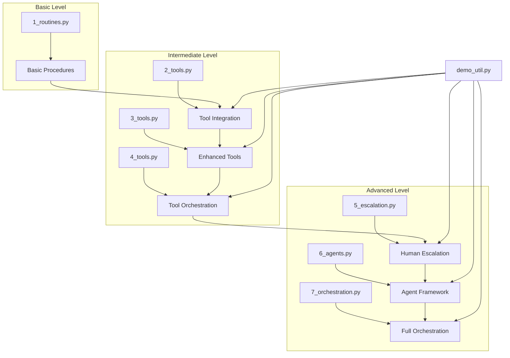
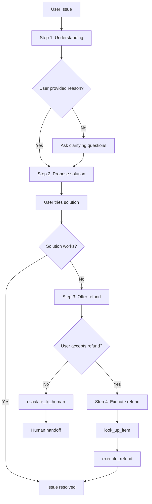
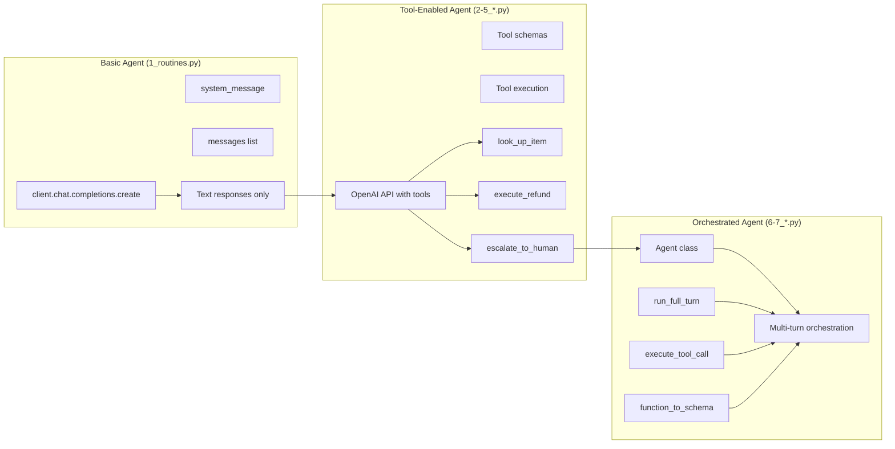
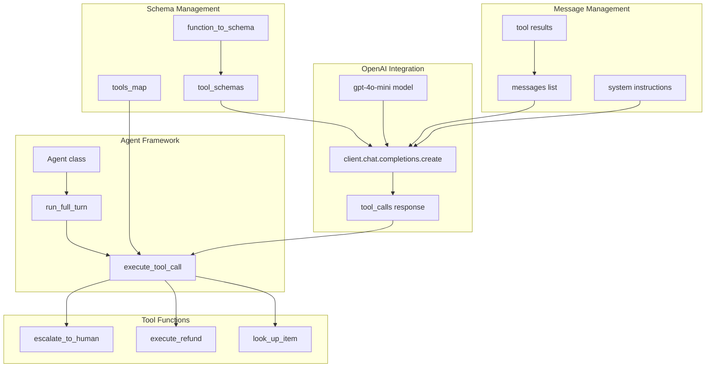

<!-- source: DeepWiki mcp.deepwiki.com · repo openai/learning-lab · page 3 Customer Support Agent Tutorial · fetched 2026-10-26 -->

# Customer Support Agent Tutorial

Relevant source files

The following files were used as context for generating this wiki page:

- [01-agents/1_routines.py](01-agents/1_routines.py)
- [01-agents/7_orchestration.py](01-agents/7_orchestration.py)

## Purpose and Scope

This tutorial series demonstrates how to build sophisticated customer support agents using OpenAI's API, progressing from basic conversational agents to fully orchestrated systems with tool-calling capabilities. The tutorials use ACME Inc. as a fictional company scenario, teaching developers how to implement structured customer service workflows that can handle issue resolution, refund processing, and human escalation.

The tutorial covers the complete evolution from simple chat interactions to complex agent orchestration systems. For initial setup and basic chatbot implementation, see [Getting Started](#2). For technical details about utility functions and schemas, see [Utility Functions and Schema Generation](#4.1).

## Tutorial Progression Overview

The customer support agent tutorial follows a progressive learning path, with each stage building upon the previous one's capabilities.

**Tutorial Progression Architecture**

Sources: [01-agents/1_routines.py:1-47](), [01-agents/7_orchestration.py:1-171]()

## ACME Inc Customer Support Scenario

All tutorials use ACME Inc. as the customer service context, implementing a standardized 4-step support procedure that guides agents through issue resolution.

**ACME Support Workflow**

The system message in `1_routines.py` defines this workflow: "1. 最初に質問をして、ユーザーの問題を深く理解してください" (First, ask questions to deeply understand the user's problem), followed by solution proposals, refund offers, and ID lookup for refund execution.

Sources: [01-agents/1_routines.py:13-23](), [01-agents/7_orchestration.py:146-155]()

## Agent Capabilities Evolution

The tutorial demonstrates how agent capabilities evolve from basic conversation to sophisticated tool orchestration.

**Agent Architecture Evolution**

The progression moves from simple `chat.completions.create` calls in `1_routines.py` to the sophisticated `Agent` class with `run_full_turn` orchestration in `7_orchestration.py`.

Sources: [01-agents/1_routines.py:35-38](), [01-agents/7_orchestration.py:8-17](), [01-agents/7_orchestration.py:28-77]()

## Technical Architecture Overview

The customer support system architecture demonstrates the integration between OpenAI's API, tool execution, and conversation management.

**System Component Architecture**

The `Agent` class encapsulates the core orchestration logic, while `run_full_turn` manages the complete interaction cycle from user input through tool execution to response generation.

Sources: [01-agents/7_orchestration.py:8-17](), [01-agents/7_orchestration.py:28-77](), [01-agents/7_orchestration.py:80-95]()

## Key Technical Components

| Component | File Location | Purpose |
|-----------|---------------|---------|
| `Agent` class | `7_orchestration.py:8-17` | Defines agent configuration with name, model, instructions, and tools |
| `run_full_turn` | `7_orchestration.py:28-77` | Orchestrates complete conversation turns with tool calling |
| `execute_tool_call` | `7_orchestration.py:80-95` | Executes individual tool functions and handles results |
| `look_up_item` | `7_orchestration.py:99-110` | Searches for product IDs using search queries |
| `execute_refund` | `7_orchestration.py:112-126` | Processes refund requests with item ID and reason |
| `escalate_to_human` | `7_orchestration.py:128-140` | Handles escalation to human representatives |
| System message | `1_routines.py:13-23` | Defines ACME Inc. support procedures and constraints |

## Learning Path Recommendations

1. **Start with Basic Procedures** ([Basic Customer Support Procedures](#3.1)): Understand the fundamental ACME Inc. workflow using `1_routines.py`
2. **Add Tool Integration** ([Tool Integration and Function Calling](#3.2)): Learn how tools like `look_up_item` and `execute_refund` extend agent capabilities  
3. **Implement Advanced Features** ([Advanced Agent Features](#3.3)): Master the `Agent` class and `run_full_turn` orchestration patterns

Each tutorial builds upon the previous one's concepts, with the Japanese system messages providing consistent context for the ACME Inc. customer service scenario throughout the progression.

Sources: [01-agents/1_routines.py:1-47](), [01-agents/7_orchestration.py:1-171]()

---

