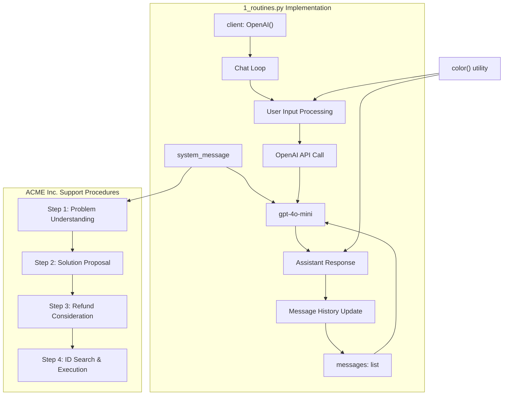
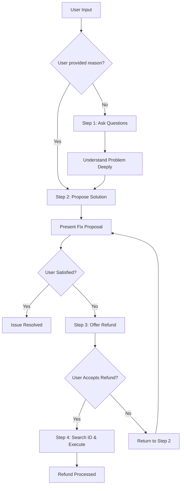
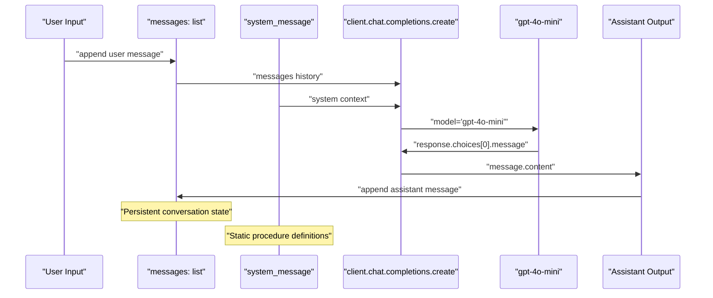

<!-- source: DeepWiki mcp.deepwiki.com · repo openai/learning-lab · page 3.1 Basic Customer Support Procedures · fetched 2026-10-26 -->

# Basic Customer Support Procedures

Relevant source files

The following files were used as context for generating this wiki page:

- [01-agents/1_routines.py](01-agents/1_routines.py)

## Purpose and Scope

This document covers the implementation of basic customer support procedures using structured workflows and predefined protocols. The system demonstrates how to build a customer support agent that follows consistent, step-by-step procedures for issue resolution using OpenAI's chat completion API.

This implementation represents the first evolution beyond basic chat functionality, introducing structured workflows for customer service scenarios. For information about tool integration and function calling capabilities, see [Tool Integration and Function Calling](#3.2). For advanced orchestration features, see [Advanced Agent Features](#3.3).

## System Architecture

The basic customer support system implements a procedural approach to customer service using a structured system message and conversation loop. The architecture centers around predefined workflows that guide the agent through consistent support procedures.

### Core System Components

**Sources**: [01-agents/1_routines.py:1-47]()

## Customer Support Workflow

The system implements a structured 4-step customer support procedure embedded within the `system_message`. This procedure ensures consistent handling of customer issues across all interactions.

### Procedural Framework

**Sources**: [01-agents/1_routines.py:13-23]()

### Implementation Details

The customer support procedures are encoded in the `system_message` which provides specific instructions for each step:

| Step | Procedure | Implementation |
|------|-----------|----------------|
| 1 | Problem Understanding | "最初に質問をして、ユーザーの問題を深く理解してください" |
| 2 | Solution Proposal | "修正案を提案してください（適当なものを考え出してください）" |
| 3 | Refund Consideration | "ユーザーが満足しない場合のみ、返金を提案してください" |
| 4 | ID Search & Execution | "ユーザーが受け入れた場合、IDを検索して返金を実行してください" |

**Sources**: [01-agents/1_routines.py:17-21]()

## Message Flow Architecture

The system maintains conversation state through a `messages` list that accumulates the dialogue history, enabling contextual responses throughout the support interaction.

### Conversation State Management

**Sources**: [01-agents/1_routines.py:25-47]()

## Code Entity Mapping

The following table maps the natural language concepts to specific code implementations:

| Concept | Code Entity | Location |
|---------|-------------|----------|
| OpenAI Integration | `client = OpenAI()` | [01-agents/1_routines.py:5]() |
| Model Selection | `model = "gpt-4o-mini"` | [01-agents/1_routines.py:10]() |
| Support Procedures | `system_message` | [01-agents/1_routines.py:13-23]() |
| Conversation History | `messages = []` | [01-agents/1_routines.py:26]() |
| User Interaction Loop | `while True:` | [01-agents/1_routines.py:29]() |
| API Request | `client.chat.completions.create()` | [01-agents/1_routines.py:35-38]() |
| Response Processing | `response.choices[0].message` | [01-agents/1_routines.py:41]() |
| Output Formatting | `color()` utility | [01-agents/1_routines.py:31,44]() |

**Sources**: [01-agents/1_routines.py:1-47]()

## Implementation Constraints

The system implements several key constraints that shape the customer support behavior:

- **Response Length**: "常に1文以内で回答してください" - Responses limited to one sentence
- **Role Definition**: "あなたはACME Inc.のカスタマーサポート担当者です" - Establishes ACME Inc. context
- **Sequential Processing**: Procedures must be followed in order (1→2→3→4)
- **Conditional Logic**: Step 3 (refund) only triggered if user remains unsatisfied
- **Japanese Language**: All system instructions provided in Japanese

**Sources**: [01-agents/1_routines.py:14-22]()

---

