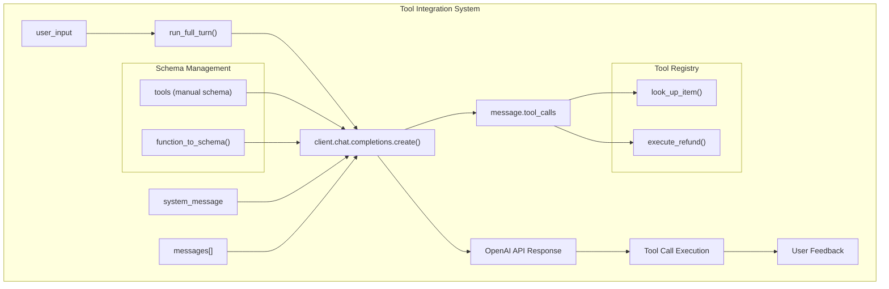
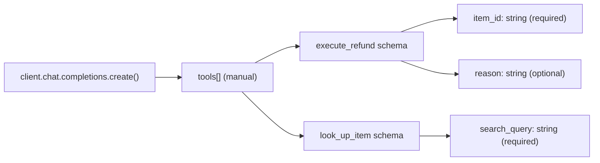
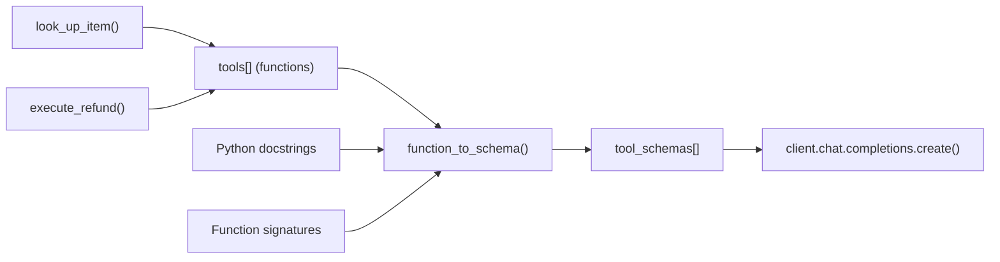
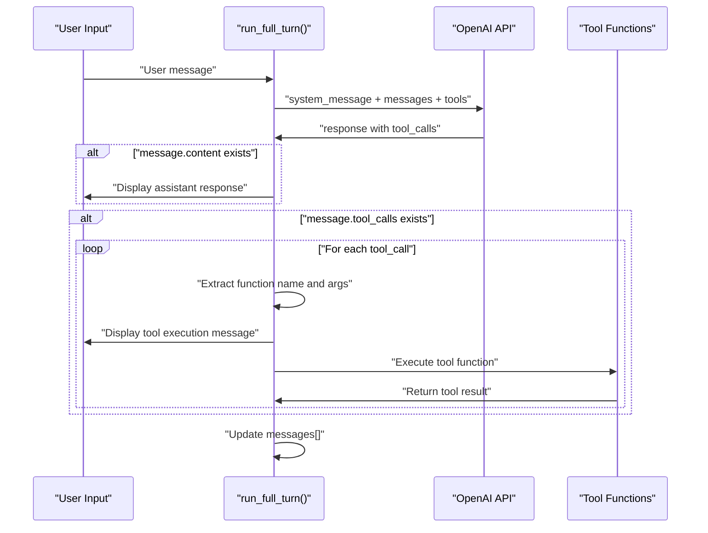
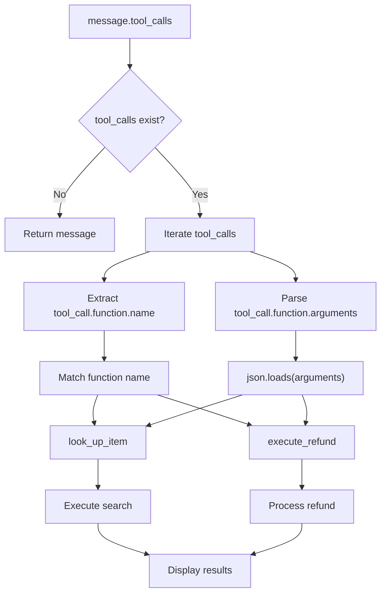

<!-- source: DeepWiki mcp.deepwiki.com · repo openai/learning-lab · page 3.2 Tool Integration and Function Calling · fetched 2026-10-26 -->

# Tool Integration and Function Calling

Relevant source files

The following files were used as context for generating this wiki page:

- [01-agents/2_tools.py](01-agents/2_tools.py)
- [01-agents/3_tools.py](01-agents/3_tools.py)
- [01-agents/4_tools.py](01-agents/4_tools.py)

This document covers the implementation of tool integration and function calling capabilities in the ACME Inc. customer support agent. It demonstrates how to extend a basic conversational agent with external tool capabilities, enabling it to perform actions like item lookups and refund processing through OpenAI's function calling API.

The material progresses from manual tool schema definitions to automated schema generation, showing three evolutionary stages of tool implementation. For basic customer support procedures without tools, see [Basic Customer Support Procedures](#3.1). For advanced orchestration features, see [Advanced Agent Features](#3.3).

## Tool Integration Architecture

The tool integration system transforms a basic conversational agent into an action-capable assistant by adding external function calling capabilities. The architecture centers around the `run_full_turn` function and integrates with OpenAI's tools parameter.

Sources: [01-agents/2_tools.py:28-56](), [01-agents/3_tools.py:44-56](), [01-agents/4_tools.py:46-59]()

## Schema Definition Evolution

The repository demonstrates two approaches to defining tool schemas for OpenAI's function calling API: manual schema definition and automated schema generation.

| Approach | File | Schema Source | Maintenance |
|----------|------|---------------|-------------|
| Manual | `2_tools.py` | Hand-coded JSON schema | High maintenance |
| Automated | `3_tools.py`, `4_tools.py` | `function_to_schema()` utility | Low maintenance |

### Manual Schema Definition

The initial implementation in `2_tools.py` uses manually defined tool schemas with explicit parameter specifications:

Sources: [01-agents/2_tools.py:28-56]()

### Automated Schema Generation

The improved implementations in `3_tools.py` and `4_tools.py` use the `function_to_schema` utility to automatically generate schemas from Python function signatures:

Sources: [01-agents/3_tools.py:44-56](), [01-agents/4_tools.py:46-59]()

## Tool Implementation Details

The customer support agent implements two core tools for handling customer service workflows:

### look_up_item Function

The `look_up_item` function simulates product database searches and returns item identifiers:

| Parameter | Type | Required | Description |
|-----------|------|----------|-------------|
| `search_query` | string | Yes | Product description or keywords |

**Return Value**: Fixed item ID `"item_132612938"` (demonstration purposes)

**Implementation Location**: [01-agents/3_tools.py:27-32](), [01-agents/4_tools.py:27-33]()

### execute_refund Function

The `execute_refund` function processes refund requests with detailed logging:

| Parameter | Type | Required | Default | Description |
|-----------|------|----------|---------|-------------|
| `item_id` | string | Yes | N/A | Product identifier |
| `reason` | string | No | `"not provided"` | Refund justification |

**Return Value**: `"success"` status string

**Implementation Location**: [01-agents/3_tools.py:35-41](), [01-agents/4_tools.py:36-43]()

Sources: [01-agents/3_tools.py:27-41](), [01-agents/4_tools.py:27-43]()

## Function Calling Workflow

The function calling workflow integrates tool execution into the conversational flow through a systematic process:

Sources: [01-agents/2_tools.py:59-88](), [01-agents/3_tools.py:47-78](), [01-agents/4_tools.py:49-81]()

## Tool Call Processing

The tool call processing mechanism handles the extraction and execution of function calls from OpenAI responses:

**Key Processing Steps**:
1. Check for `message.tool_calls` presence
2. Extract `tool_call.function.name` and `tool_call.function.arguments`
3. Parse JSON arguments using `json.loads()`
4. Match function name to available tools
5. Execute corresponding Python function
6. Display execution results

Sources: [01-agents/2_tools.py:75-88](), [01-agents/3_tools.py:65-78](), [01-agents/4_tools.py:68-81]()

## System Message Integration

The `system_message` defines the customer support workflow that guides tool usage:

**Workflow Steps**:
1. **Understanding Phase**: Ask questions to understand user problems
2. **Solution Phase**: Propose fixes (generate reasonable suggestions)
3. **Escalation Phase**: Offer refunds only when users remain unsatisfied
4. **Execution Phase**: Search item IDs and execute refunds when accepted

**Constraint**: All responses must be limited to one sentence to maintain conversational efficiency.

The system message remains consistent across all tool implementations, ensuring behavioral consistency while tool capabilities evolve.

Sources: [01-agents/2_tools.py:14-24](), [01-agents/3_tools.py:14-24](), [01-agents/4_tools.py:14-24]()

---

