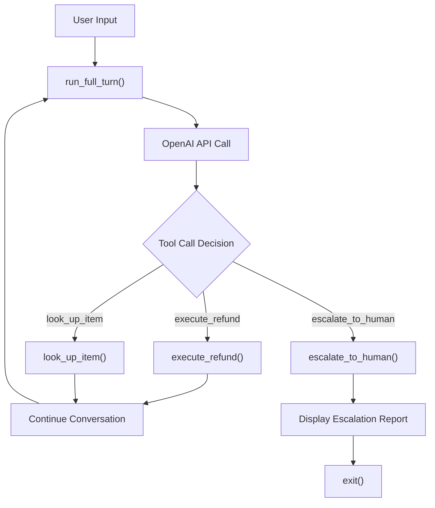
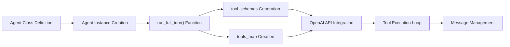
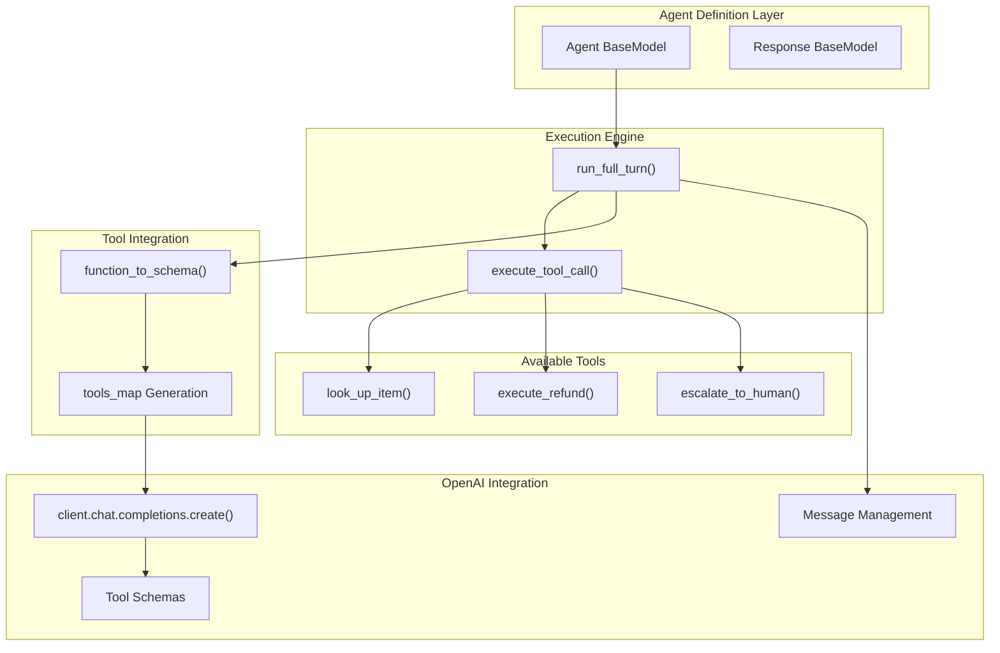
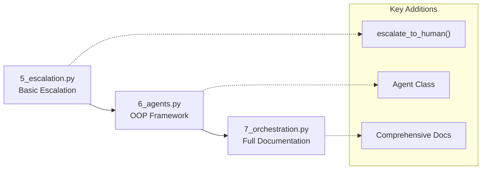

<!-- source: DeepWiki mcp.deepwiki.com · repo openai/learning-lab · page 3.3 Advanced Agent Features · fetched 2026-10-26 -->

# Advanced Agent Features

<details>
<summary>Relevant source files</summary>

The following files were used as context for generating this wiki page:

- [01-agents/5_escalation.py](01-agents/5_escalation.py)
- [01-agents/6_agents.py](01-agents/6_agents.py)
- [01-agents/7_orchestration.py](01-agents/7_orchestration.py)

</details>


This document covers the advanced capabilities of the ACME Inc. customer support agent system, including human escalation mechanisms, object-oriented agent frameworks, and full orchestration systems. These features represent the final evolution of the tutorial series, transforming basic tool-enabled agents into sophisticated, production-ready systems.

For basic tool integration and function calling, see [Tool Integration and Function Calling](#3.2). For foundational customer support procedures, see [Basic Customer Support Procedures](#3.1).

## Human Escalation System

The escalation system provides a critical safety mechanism that allows agents to transfer complex or unresolvable issues to human operators. This capability is implemented through the `escalate_to_human` function, which immediately terminates the agent session and provides a comprehensive handoff report.

### Escalation Function Implementation

The escalation mechanism is implemented as a callable tool that agents can invoke when they determine that human intervention is required:

```python
def escalate_to_human(summary):
    """明示的にリクエストされた場合のみ、この関数を呼び出します。"""
```

The function accepts a summary parameter that captures the context of the issue requiring escalation. When invoked, it displays escalation information and terminates the program execution using `exit()`, ensuring a clean handoff to human operators.

### Escalation Flow Architecture



Sources: [01-agents/5_escalation.py:45-53]()

## Agent Framework Architecture

The agent framework introduces object-oriented design patterns that encapsulate agent behavior, configuration, and capabilities into reusable components. This architecture uses Pydantic models to ensure type safety and validation.

### Agent Class Structure

The `Agent` class serves as the foundation for all agent implementations, providing a standardized interface for agent configuration:

| Field | Type | Default | Purpose |
|-------|------|---------|---------|
| `name` | str | "Agent" | Agent identifier |
| `model` | str | "gpt-4o" | OpenAI model specification |
| `instructions` | str | "You are a helpful Agent" | System message content |
| `tools` | list | [] | Available tool functions |

The framework also includes a `Response` class for managing message collections, though this is primarily used for type structure rather than active functionality.

### Agent Instantiation Pattern



The agent framework transforms the previous procedural approach into an object-oriented system where agent behavior is encapsulated within the `Agent` instance and processed through the `run_full_turn` function.

Sources: [01-agents/6_agents.py:8-18](), [01-agents/6_agents.py:24-65]()

## Full Orchestration System

The orchestration system represents the most sophisticated implementation, providing comprehensive documentation, error handling, and production-ready architecture. This system maintains the same core functionality while adding enterprise-grade features.

### Orchestration Architecture Components



### Enhanced Documentation and Type Safety

The orchestration implementation includes comprehensive docstrings and type hints for all major functions:

- `run_full_turn()` includes detailed parameter and return value documentation
- `execute_tool_call()` provides clear argument descriptions
- All tool functions include parameter specifications and return type documentation

This documentation pattern makes the system suitable for production deployment and team collaboration.

Sources: [01-agents/7_orchestration.py:28-77](), [01-agents/7_orchestration.py:80-95]()

## Implementation Evolution

The advanced agent features demonstrate a clear progression from basic functionality to enterprise-grade systems:

### Evolution Timeline



### Core Function Consistency

Throughout this evolution, the `run_full_turn` function maintains consistent behavior while adapting to new architectural patterns:

- **Escalation version**: Accepts `system_message`, `tools`, and `messages` parameters
- **Agent framework version**: Accepts `agent` object and `messages`, extracting configuration from the agent
- **Orchestration version**: Identical interface to agent framework but with enhanced documentation

This consistency ensures that the learning progression remains smooth while introducing increasingly sophisticated concepts.

### Tool Integration Patterns

All three implementations use identical tool integration patterns:

1. `function_to_schema()` conversion from [demo_util.py]()
2. `tools_map` generation for function lookup
3. `execute_tool_call()` delegation pattern
4. Message history management

This consistency reinforces best practices while allowing focus on the architectural improvements introduced at each stage.

Sources: [01-agents/5_escalation.py:58-101](), [01-agents/6_agents.py:24-76](), [01-agents/7_orchestration.py:28-95]()

---

