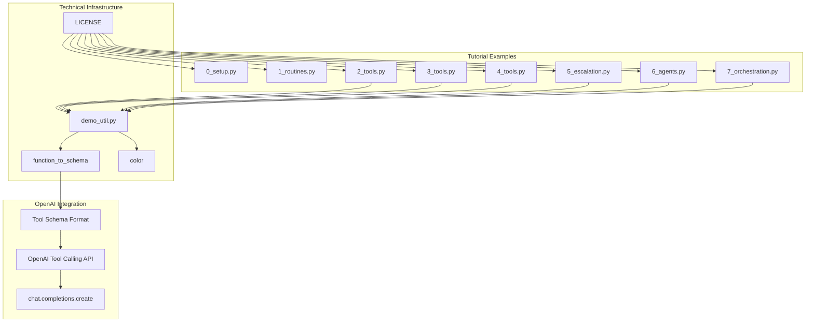
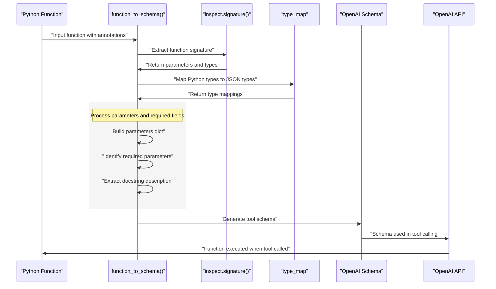

<!-- source: DeepWiki mcp.deepwiki.com · repo openai/learning-lab · page 4 Technical Reference · fetched 2026-10-26 -->

# Technical Reference

<details>
<summary>Relevant source files</summary>

The following files were used as context for generating this wiki page:

- [01-agents/demo_util.py](01-agents/demo_util.py)
- [LICENSE](LICENSE)

</details>


This document provides technical reference material for the Learning Lab repository's utility functions, schema generation systems, and legal information. It covers the supporting infrastructure that enables the progressive tutorial examples for building OpenAI-powered agents.

For detailed tutorial implementations and agent building techniques, see [Customer Support Agent Tutorial](#3). For initial setup and basic examples, see [Getting Started](#2).

## Overview

The Learning Lab repository includes several technical components that support the tutorial progression:

| Component | Purpose | Implementation |
|-----------|---------|----------------|
| Utility Functions | Text formatting and schema generation | `demo_util.py` |
| Schema Generation | Convert Python functions to OpenAI tool schemas | `function_to_schema()` |
| License | Legal terms for repository usage | MIT License |

## Technical Architecture

The technical reference components integrate with the tutorial system to provide essential supporting functionality:



Sources: [01-agents/demo_util.py:1-96](), [LICENSE:1-8]()

## Schema Generation Workflow

The `function_to_schema()` system converts Python functions into OpenAI-compatible tool schemas:



Sources: [01-agents/demo_util.py:19-64]()

## Core Technical Components

### Schema Generation System

The `function_to_schema()` function in [01-agents/demo_util.py:19-64]() provides automatic conversion of Python functions to OpenAI tool schemas. Key features:

- **Type Mapping**: Maps Python types (`str`, `int`, `float`, `bool`, `list`, `dict`) to JSON Schema types
- **Parameter Extraction**: Uses `inspect.signature()` to analyze function parameters
- **Required Parameter Detection**: Identifies parameters without default values
- **Docstring Integration**: Extracts function docstrings for schema descriptions

### Text Formatting Utilities  

The `color()` function in [01-agents/demo_util.py:4-16]() provides ANSI color formatting for console output:

```python
# Available colors: red, green, yellow, blue, magenta, cyan, white, grey
color("Status message", "green")
```

### Example Schema Output

For a function like `sample_function(param_1, param_2, the_third_one: int)`, the schema generator produces:

```json
{
    "type": "function",
    "function": {
        "name": "sample_function", 
        "description": "This is my docstring. Call this function when you want.",
        "parameters": {
            "type": "object",
            "properties": {
                "param_1": {"type": "string"},
                "param_2": {"type": "string"}, 
                "the_third_one": {"type": "integer"}
            },
            "required": ["param_1", "param_2", "the_third_one"]
        }
    }
}
```

Sources: [01-agents/demo_util.py:70-95]()

## Usage in Tutorial Examples

The technical reference components are utilized throughout the tutorial progression:

| Tutorial Stage | Usage |
|----------------|-------|
| Tool Integration (2-5_tools.py) | `function_to_schema()` for tool definitions |
| Agent Framework (6-7_orchestration.py) | Schema generation for agent capabilities |
| Console Output | `color()` for formatted status messages |

For detailed information about specific components:
- [Utility Functions and Schema Generation](#4.1)
- [License and Legal Information](#4.2)

Sources: [01-agents/demo_util.py:1-96](), [LICENSE:1-8]()

---

