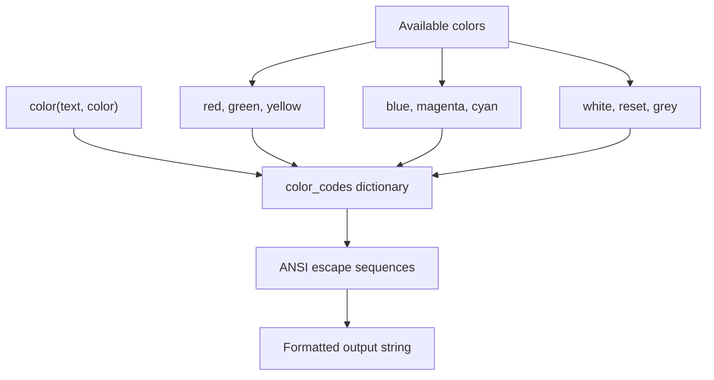
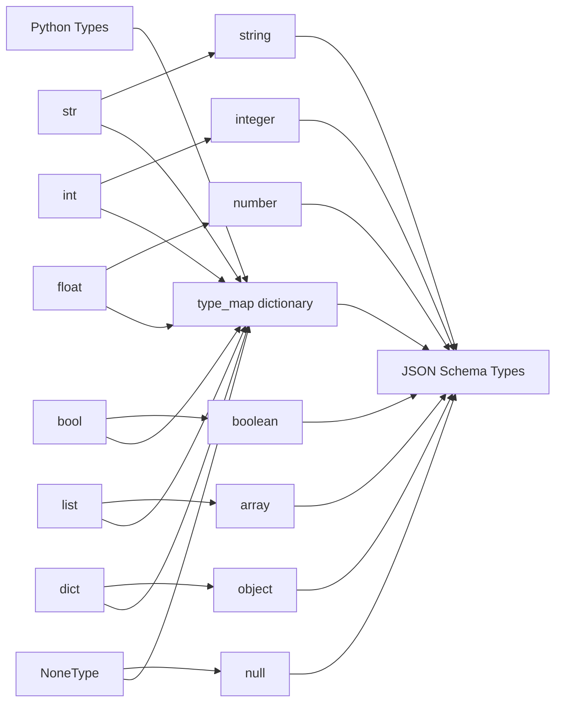
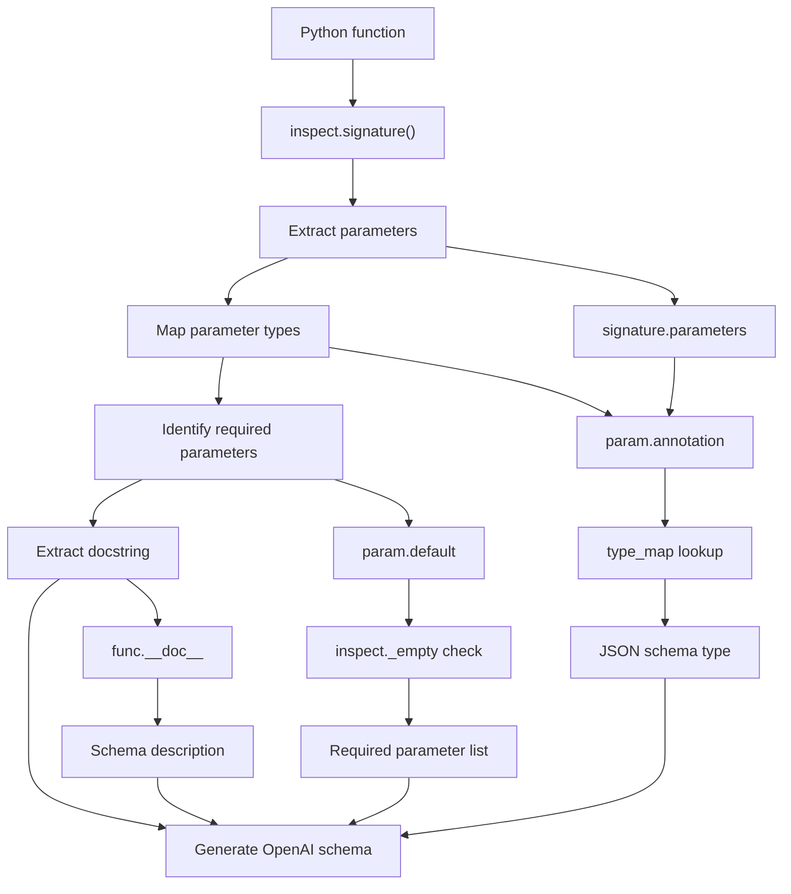
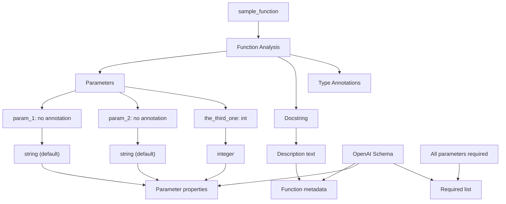
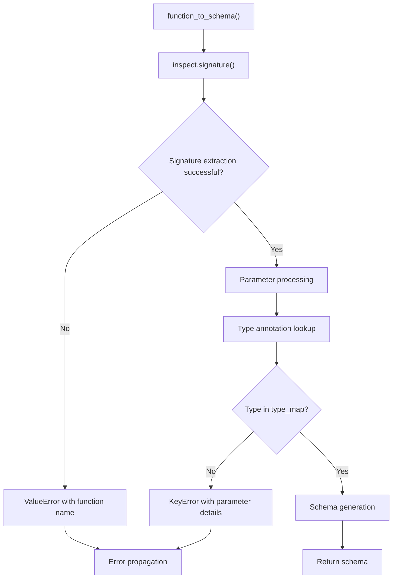
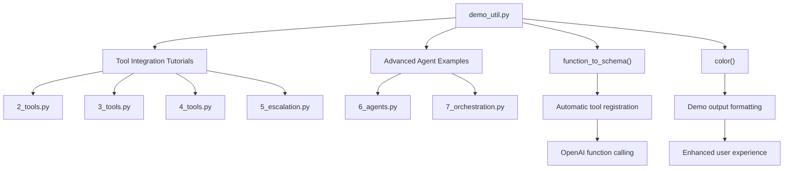

<!-- source: DeepWiki mcp.deepwiki.com · repo openai/learning-lab · page 4.1 Utility Functions and Schema Generation · fetched 2026-10-26 -->

# Utility Functions and Schema Generation

Relevant source files

The following files were used as context for generating this wiki page:

- [01-agents/demo_util.py](01-agents/demo_util.py)

This document covers the utility functions provided in `demo_util.py`, with particular focus on the `function_to_schema` system that enables automatic conversion of Python functions into OpenAI tool schemas. These utilities support the Learning Lab tutorial progression by simplifying the integration between Python functions and OpenAI's function calling API.

For information about how these utilities are used in the customer support tutorials, see [Customer Support Agent Tutorial](#3). For the overall Learning Lab structure, see [Learning Lab Overview](#1).

## Overview

The `demo_util.py` module provides two primary utility functions that support the Learning Lab tutorial series:

| Function | Purpose | Primary Use Case |
|----------|---------|------------------|
| `color()` | Terminal text colorization | Demo output formatting |
| `function_to_schema()` | Python function to OpenAI schema conversion | Tool integration automation |

The `function_to_schema()` function serves as the core utility that bridges Python function definitions with OpenAI's tool calling requirements, eliminating manual schema creation for tutorial participants.

Sources: [01-agents/demo_util.py:1-96]()

## Terminal Color Utility

The `color()` function provides simple terminal text colorization for enhanced demo output readability. It supports standard ANSI color codes and automatically handles color reset sequences.

### Color Implementation

The function maps color names to ANSI escape codes and wraps the input text with appropriate formatting sequences [01-agents/demo_util.py:4-16]().

Sources: [01-agents/demo_util.py:4-16]()

## Function to Schema Conversion System

The `function_to_schema()` function automatically generates OpenAI-compatible tool schemas from Python function definitions. This eliminates the need for manual schema creation and ensures consistency between function implementations and their API descriptions.

### Type Mapping Architecture

The type mapping system converts Python type annotations to JSON Schema types using a predefined dictionary [01-agents/demo_util.py:20-28]().

Sources: [01-agents/demo_util.py:20-28]()

### Schema Generation Process

The schema generation process follows a systematic approach to extract function metadata and convert it to OpenAI's expected format [01-agents/demo_util.py:30-64]().

Sources: [01-agents/demo_util.py:30-64]()

### Schema Structure and Output Format

The generated schema follows OpenAI's function calling specification with the following structure:

| Schema Component | Source | Purpose |
|------------------|--------|---------|
| `type` | Fixed as "function" | OpenAI schema identifier |
| `function.name` | `func.__name__` | Function identifier |
| `function.description` | `func.__doc__` | AI understanding context |
| `function.parameters.type` | Fixed as "object" | Parameter container type |
| `function.parameters.properties` | Parameter analysis | Individual parameter schemas |
| `function.parameters.required` | Default value analysis | Required parameter list |

### Example Schema Transformation

The provided example demonstrates the complete transformation process:

The example function `sample_function(param_1, param_2, the_third_one: int)` generates a complete OpenAI tool schema with proper type mapping and required parameter identification [01-agents/demo_util.py:70-95]().

Sources: [01-agents/demo_util.py:70-95]()

## Error Handling and Validation

The `function_to_schema()` implementation includes comprehensive error handling for common failure scenarios:

### Error Handling Flow

Error handling covers signature extraction failures and unknown type annotations, providing detailed error messages for debugging [01-agents/demo_util.py:32-44]().

Sources: [01-agents/demo_util.py:32-44]()

## Integration with Tutorial System

The utility functions integrate throughout the Learning Lab tutorial progression, particularly in tool-enabled examples where automatic schema generation simplifies the development process.

### Tutorial Integration Points

The schema generation utility enables seamless integration between Python business logic functions and OpenAI's tool calling API across multiple tutorial modules.

Sources: [01-agents/demo_util.py:1-96]()

---

