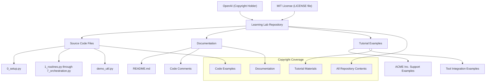
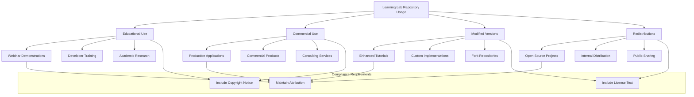

<!-- source: DeepWiki mcp.deepwiki.com · repo openai/learning-lab · page 4.2 License and Legal Information · fetched 2026-10-26 -->

# License and Legal Information

Relevant source files

The following files were used as context for generating this wiki page:

- [LICENSE](LICENSE)

This document covers the legal terms, copyright information, and licensing conditions that govern the use, modification, and distribution of the Learning Lab repository. This page addresses the legal framework under which the tutorial materials, code examples, and documentation are made available.

For technical documentation about utility functions and schemas, see [4.1](#4.1). For information about the overall Learning Lab tutorial structure, see [1](#1).

## License Overview

The Learning Lab repository is distributed under the MIT License, a permissive open-source license that allows broad usage rights while maintaining copyright attribution requirements. The license text is contained in the repository root and applies to all source code, documentation, and associated materials.

**License Type**: MIT License  
**Copyright Holder**: OpenAI  
**Copyright Year**: 2024  

Sources: [LICENSE:1-8]()

## License Terms and Permissions

The MIT License grants the following permissions to users of the repository:

| Permission | Description | Requirements |
|------------|-------------|--------------|
| **Use** | Run and execute the software for any purpose | Include copyright notice |
| **Modify** | Make changes and create derivative works | Include copyright notice |
| **Distribute** | Share copies with others | Include copyright notice and license |
| **Sublicense** | Grant additional rights to others | Include copyright notice and license |
| **Commercial Use** | Use in commercial products and services | Include copyright notice and license |

### Attribution Requirements

All usage must include the copyright notice and permission notice as specified in the license terms. This requirement applies to all copies or substantial portions of the software.

Sources: [LICENSE:1-6]()

## Copyright and Ownership

The copyright notice specifies OpenAI as the copyright holder for the year 2024, covering all materials within the repository including tutorial code, documentation, and examples.

Sources: [LICENSE:1]()

## Warranty Disclaimers and Limitations

The MIT License includes important disclaimers that limit liability and warranty coverage:

### No Warranty Provision

The software is provided "AS IS" without warranty of any kind, including:
- **Express warranties**: No explicit guarantees about functionality
- **Implied warranties**: No implied warranties of merchantability or fitness for purpose
- **Non-infringement**: No guarantee that use won't infringe other rights

### Liability Limitations

The license limits the liability of OpenAI and contributors for:
- Claims arising from software use
- Damages resulting from software operation
- Issues in contract, tort, or other legal theories

Sources: [LICENSE:7]()

## Usage Scenarios and Compliance

### Common Use Cases

**Tutorial and Educational Use**: The repository is designed for educational purposes, particularly for Japanese developers learning OpenAI integration patterns. Educational use requires maintaining copyright attribution.

**Commercial Applications**: Organizations can incorporate the code examples and patterns into commercial products and services, provided they include the required copyright notice and license text.

**Derivative Works**: Developers can create modified versions, enhanced tutorials, or custom implementations based on the repository contents while maintaining attribution requirements.

Sources: [LICENSE:3-6]()

## Practical Implementation Guidelines

### For Individual Developers

When using Learning Lab materials in personal projects:
1. Retain the copyright notice from [LICENSE:1]()
2. Include the full license text when distributing code
3. Maintain attribution in derivative works

### For Organizations

When incorporating repository materials into organizational workflows:
1. Ensure internal distribution includes license compliance
2. Maintain attribution in commercial applications
3. Include license terms in product documentation when applicable

### For Open Source Projects

When using materials in other open source projects:
1. Include the original MIT license alongside project license
2. Maintain clear attribution to OpenAI as copyright holder
3. Document the source of incorporated materials

Sources: [LICENSE:1-8]()

## License File Location and Structure

The license information is maintained in the repository root as `LICENSE` file without extension, following standard open source conventions. This file contains the complete MIT License text with OpenAI-specific copyright information.

**File Structure**:
- Line 1: Copyright notice with holder and year
- Lines 3-5: Permission grant and conditions
- Line 7: Warranty disclaimer and liability limitation

Sources: [LICENSE:1-8]()