# Page: Learning Lab Overview

# Learning Lab Overview

<details>
<summary>Relevant source files</summary>

The following files were used as context for generating this wiki page:

- [README.md](README.md)

</details>


## Purpose and Scope

This document provides an overview of the Learning Lab repository, a comprehensive webinar series designed specifically for developers in Japan to learn practical implementations of OpenAI's API and models. The repository contains a progressive tutorial series that demonstrates building sophisticated AI agents, from basic chatbots to advanced customer support systems with full orchestration capabilities.

For detailed setup instructions and initial environment configuration, see [Getting Started](#2). For the complete customer support agent tutorial progression, see [Customer Support Agent Tutorial](#3).

**Sources:** [README.md:1-6]()

## Repository Architecture and Learning Progression

The Learning Lab follows a carefully structured progression from foundational concepts to advanced agent architectures. The repository is organized as a series of executable Python modules that build upon each other, demonstrating increasingly sophisticated OpenAI API usage patterns.

### Tutorial File Structure

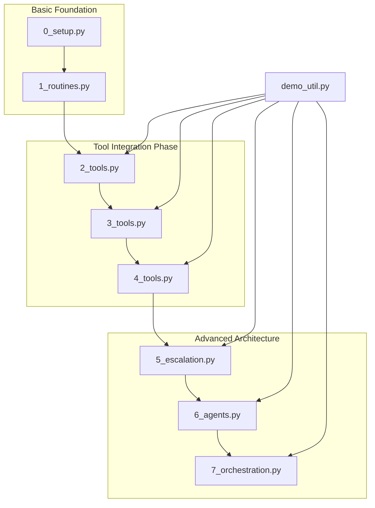

**Sources:** Repository structure analysis from provided diagrams

## Technical Learning Path

The tutorial progression demonstrates the evolution from simple API calls to complex agent orchestration systems. Each module introduces specific OpenAI API capabilities and integration patterns.

### Core Capability Development Timeline

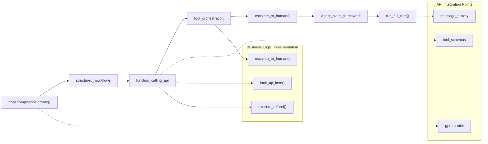

**Sources:** Analysis of tutorial progression from provided architectural diagrams

## ACME Inc. Customer Support System

The tutorials center around building a comprehensive customer support system for ACME Inc., providing practical context for OpenAI API integration patterns. This system serves as the primary use case throughout the learning progression.

### System Components and Data Flow

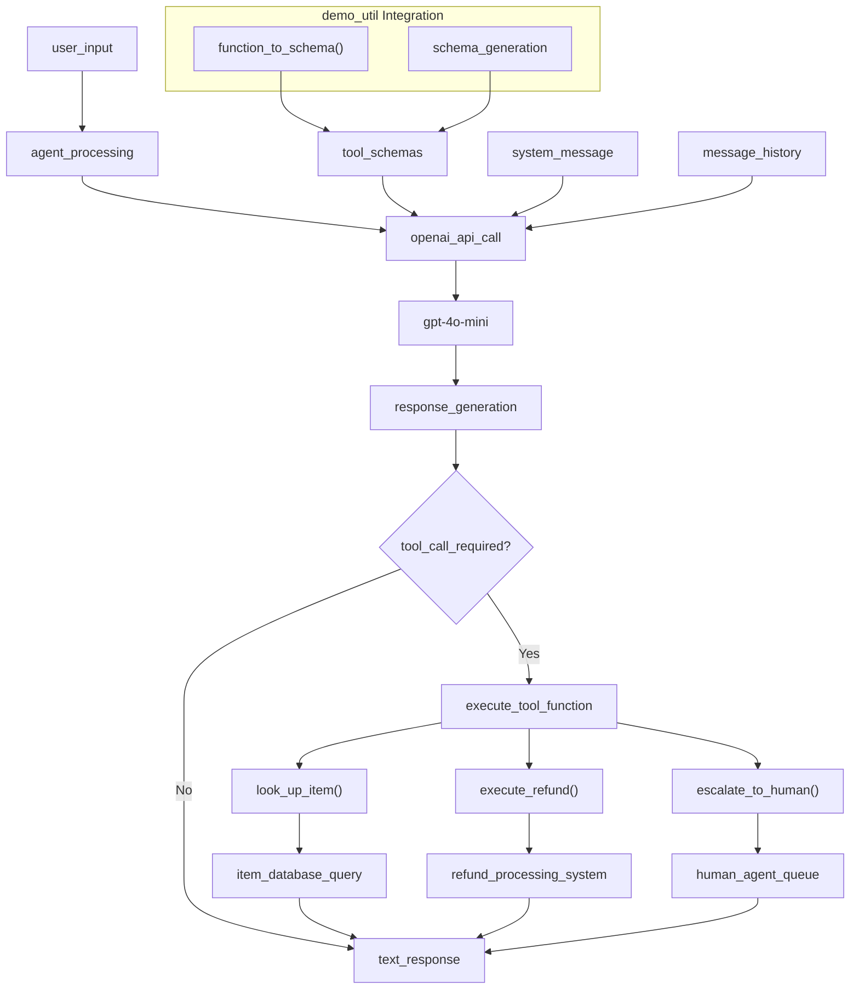

**Sources:** Customer support ecosystem analysis from provided system diagrams

## Target Audience and Implementation Goals

The Learning Lab specifically targets Japanese developers seeking practical guidance on OpenAI API integration. The webinar format provides structured learning with hands-on code examples that can be directly adapted for production use cases.

### Developer Learning Objectives

| Learning Phase | Technical Focus | Key Code Entities |
|----------------|----------------|-------------------|
| Foundation | Basic API integration | `chat.completions.create()`, `gpt-4o-mini` |
| Tool Integration | Function calling | `function_to_schema()`, tool schemas |
| Advanced Features | Agent orchestration | `Agent` class, `run_full_turn()` |
| Production Readiness | Error handling & escalation | `escalate_to_human()`, message management |

**Sources:** [README.md:3-5](), learning objectives from tutorial structure analysis

## Repository Components Overview

The codebase is structured to support both educational delivery and practical implementation. The modular design allows developers to understand each concept in isolation while building toward comprehensive agent systems.

### Core Module Dependencies

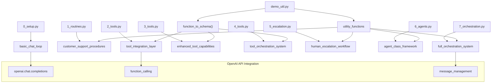

**Sources:** Component dependency analysis from repository structure and provided architectural diagrams

The Learning Lab repository provides a complete educational framework for implementing production-ready OpenAI-powered agents, with particular emphasis on practical patterns that Japanese developers can immediately apply in their own projects. Each tutorial module builds systematically toward sophisticated agent architectures while maintaining clear separation of concerns and reusable code patterns.

---

# Page: Getting Started

# Getting Started

<details>
<summary>Relevant source files</summary>

The following files were used as context for generating this wiki page:

- [01-agents/0_setup.py](01-agents/0_setup.py)
- [01-agents/README.md](01-agents/README.md)

</details>


This page guides you through the initial setup and configuration required to run your first OpenAI-powered agent. It covers environment setup, API configuration, and implementation of a basic chat loop using the `gpt-4o-mini` model. 

For information about advanced customer support workflows and tool integration, see [Customer Support Agent Tutorial](#3). For utility functions and schema generation, see [Utility Functions and Schema Generation](#4.1).

## Environment Setup

Before running any examples, you need to configure your OpenAI API credentials and ensure proper environment setup.

### API Key Configuration

Set your OpenAI API key as an environment variable:

```bash
export OPENAI_API_KEY="sk_XXX..."
```

This credential will be automatically detected by the `OpenAI` client initialization in [01-agents/0_setup.py:1-5]().

### Dependencies

The codebase requires the OpenAI Python library and includes utility functions for colored terminal output:

| Dependency | Purpose | Used In |
|------------|---------|---------|
| `openai` | OpenAI API client library | All agent implementations |
| `demo_util` | Color formatting for terminal output | Interactive demos |

**Sources:** [01-agents/README.md:8-13](), [01-agents/0_setup.py:1-2]()

## Basic Chat Loop Architecture

The initial implementation demonstrates a fundamental chat loop pattern that forms the foundation for all subsequent agent examples.

### System Components Overview

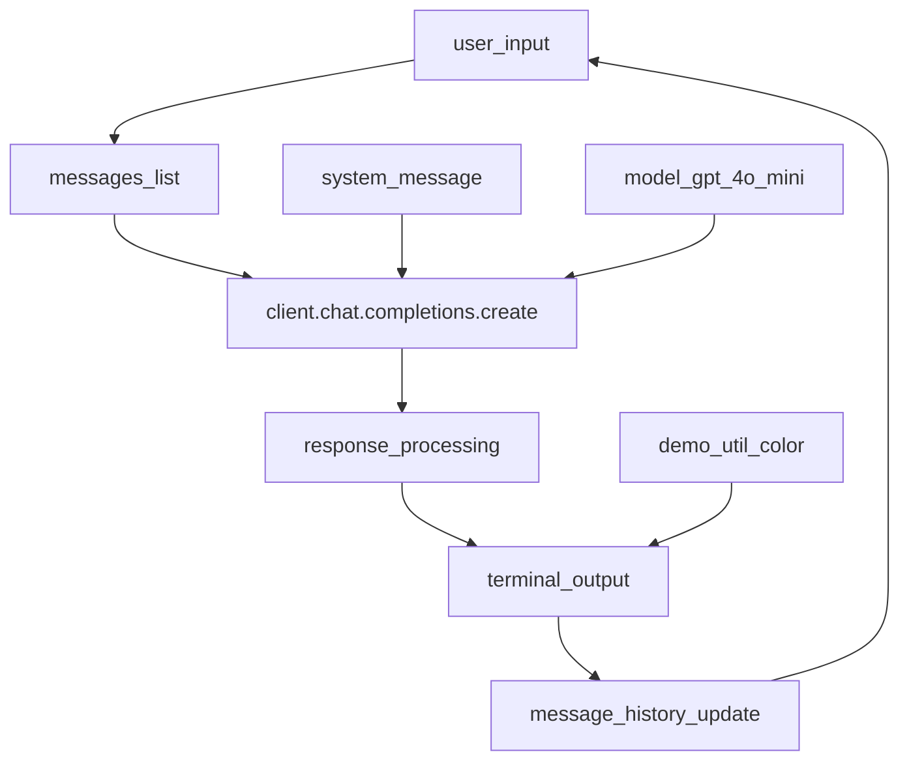

**Sources:** [01-agents/0_setup.py:10-37]()

### Core Components

The basic chat implementation consists of several key components defined in [01-agents/0_setup.py]():

| Component | Variable/Function | Purpose |
|-----------|-------------------|---------|
| OpenAI Client | `client` | API communication interface |
| Model Selection | `model = "gpt-4o-mini"` | Specifies the language model |
| System Instructions | `system_message` | Defines assistant behavior |
| Message History | `messages` | Maintains conversation context |
| Main Loop | `while True` | Handles continuous user interaction |

### Implementation Flow

The chat loop follows this sequence:

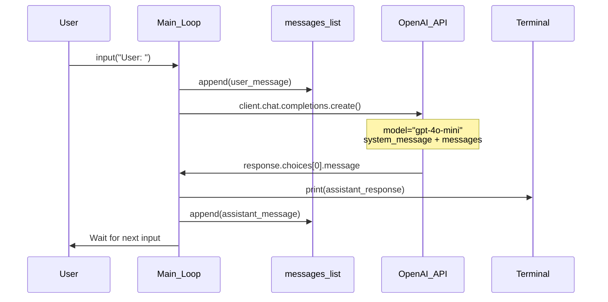

**Sources:** [01-agents/0_setup.py:19-37]()

## Running Your First Agent

Execute the basic chat agent using:

```bash
python 01-agents/0_setup.py
```

The agent will initialize with these default configurations:
- **Model:** `gpt-4o-mini` as defined in [01-agents/0_setup.py:10]()
- **System Message:** `"You are a helpful Assistant."` from [01-agents/0_setup.py:13]()
- **Message History:** Empty list initialized in [01-agents/0_setup.py:16]()

### Interactive Session Flow

When running, the agent processes inputs through this message structure:

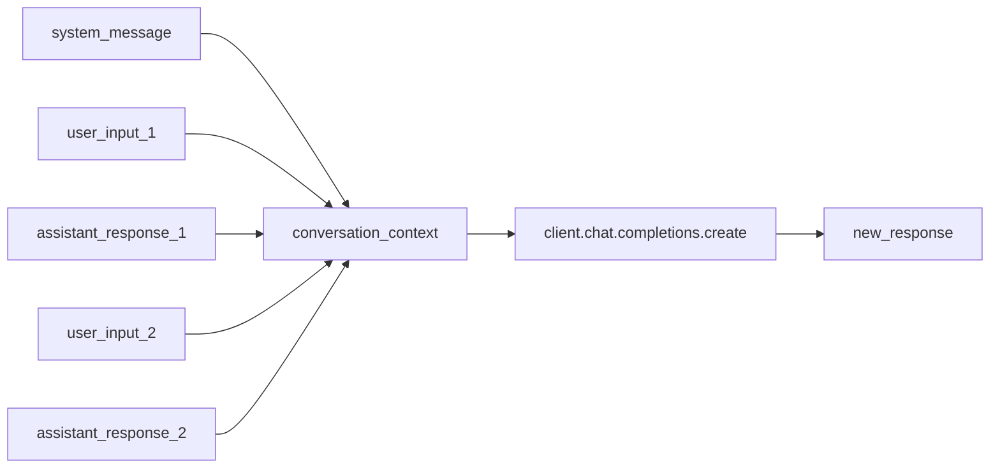

Each request to the OpenAI API includes the complete conversation history as defined in [01-agents/0_setup.py:27]().

**Sources:** [01-agents/0_setup.py:25-28](), [01-agents/README.md:16-19]()

## Understanding the Message Flow

### Message Structure and Processing

The implementation uses OpenAI's chat completion format where each message contains a `role` and `content`:

| Message Type | Role | Content Source | Code Reference |
|--------------|------|----------------|----------------|
| System | `"system"` | `system_message` variable | [01-agents/0_setup.py:13]() |
| User | `"user"` | Terminal input | [01-agents/0_setup.py:21-22]() |
| Assistant | `"assistant"` | API response | [01-agents/0_setup.py:31]() |

### Response Processing

The agent extracts and displays responses using this pattern:

```mermaid
graph TD
    A[response_object] --> B[response.choices]
    B --> C[choices[0].message]
    C --> D[message.content]
    D --> E[color_formatted_output]
    C --> F[messages.append]
    
    G[demo_util.color] --> E
```

The `color` function from `demo_util` provides terminal formatting as seen in [01-agents/0_setup.py:21]() and [01-agents/0_setup.py:34]().

**Sources:** [01-agents/0_setup.py:30-37]()

## Next Steps

After successfully running the basic chat loop, you can progress to more advanced implementations:

1. **Structured Customer Support:** Learn about procedural workflows in [Basic Customer Support Procedures](#3.1)
2. **Tool Integration:** Add external capabilities in [Tool Integration and Function Calling](#3.2)  
3. **Advanced Features:** Implement orchestration patterns in [Advanced Agent Features](#3.3)

The basic chat loop established here serves as the foundation for all subsequent agent implementations in the tutorial series.

**Sources:** [01-agents/0_setup.py](), [01-agents/README.md]()

---

# Page: Customer Support Agent Tutorial

# Customer Support Agent Tutorial

<details>
<summary>Relevant source files</summary>

The following files were used as context for generating this wiki page:

- [01-agents/1_routines.py](01-agents/1_routines.py)
- [01-agents/7_orchestration.py](01-agents/7_orchestration.py)

</details>


## Purpose and Scope

This tutorial series demonstrates how to build sophisticated customer support agents using OpenAI's API, progressing from basic conversational agents to fully orchestrated systems with tool-calling capabilities. The tutorials use ACME Inc. as a fictional company scenario, teaching developers how to implement structured customer service workflows that can handle issue resolution, refund processing, and human escalation.

The tutorial covers the complete evolution from simple chat interactions to complex agent orchestration systems. For initial setup and basic chatbot implementation, see [Getting Started](#2). For technical details about utility functions and schemas, see [Utility Functions and Schema Generation](#4.1).

## Tutorial Progression Overview

The customer support agent tutorial follows a progressive learning path, with each stage building upon the previous one's capabilities.

**Tutorial Progression Architecture**
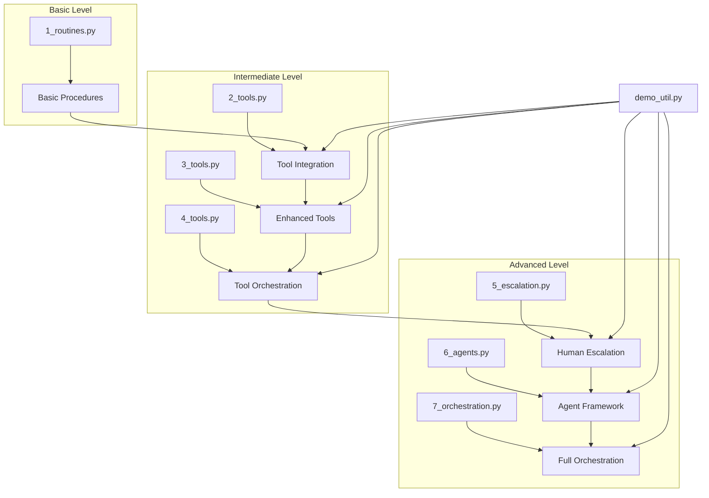

Sources: [01-agents/1_routines.py:1-47](), [01-agents/7_orchestration.py:1-171]()

## ACME Inc Customer Support Scenario

All tutorials use ACME Inc. as the customer service context, implementing a standardized 4-step support procedure that guides agents through issue resolution.

**ACME Support Workflow**
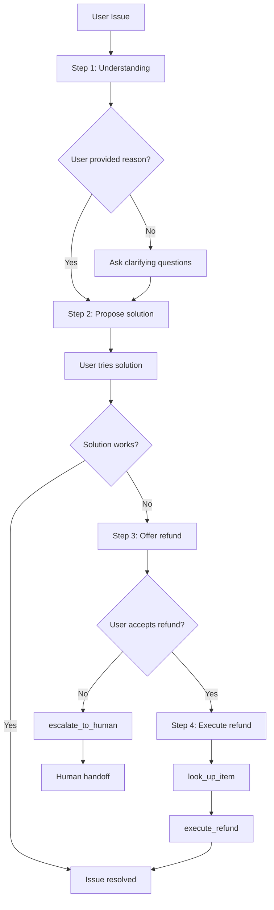

The system message in `1_routines.py` defines this workflow: "1. 最初に質問をして、ユーザーの問題を深く理解してください" (First, ask questions to deeply understand the user's problem), followed by solution proposals, refund offers, and ID lookup for refund execution.

Sources: [01-agents/1_routines.py:13-23](), [01-agents/7_orchestration.py:146-155]()

## Agent Capabilities Evolution

The tutorial demonstrates how agent capabilities evolve from basic conversation to sophisticated tool orchestration.

**Agent Architecture Evolution**
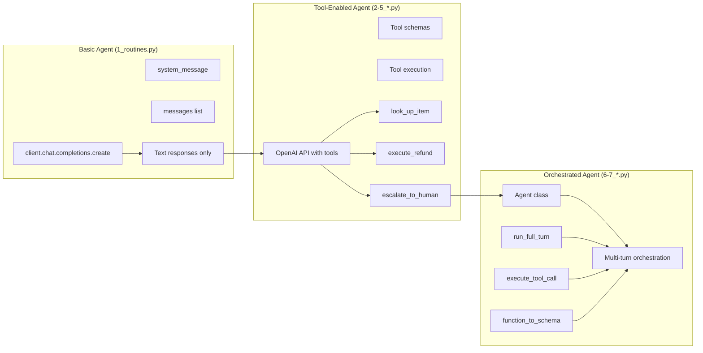

The progression moves from simple `chat.completions.create` calls in `1_routines.py` to the sophisticated `Agent` class with `run_full_turn` orchestration in `7_orchestration.py`.

Sources: [01-agents/1_routines.py:35-38](), [01-agents/7_orchestration.py:8-17](), [01-agents/7_orchestration.py:28-77]()

## Technical Architecture Overview

The customer support system architecture demonstrates the integration between OpenAI's API, tool execution, and conversation management.

**System Component Architecture**
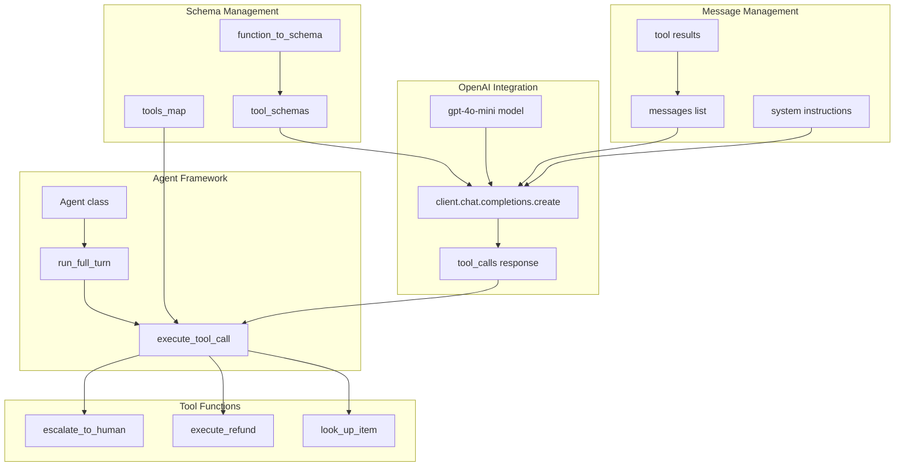

The `Agent` class encapsulates the core orchestration logic, while `run_full_turn` manages the complete interaction cycle from user input through tool execution to response generation.

Sources: [01-agents/7_orchestration.py:8-17](), [01-agents/7_orchestration.py:28-77](), [01-agents/7_orchestration.py:80-95]()

## Key Technical Components

| Component | File Location | Purpose |
|-----------|---------------|---------|
| `Agent` class | `7_orchestration.py:8-17` | Defines agent configuration with name, model, instructions, and tools |
| `run_full_turn` | `7_orchestration.py:28-77` | Orchestrates complete conversation turns with tool calling |
| `execute_tool_call` | `7_orchestration.py:80-95` | Executes individual tool functions and handles results |
| `look_up_item` | `7_orchestration.py:99-110` | Searches for product IDs using search queries |
| `execute_refund` | `7_orchestration.py:112-126` | Processes refund requests with item ID and reason |
| `escalate_to_human` | `7_orchestration.py:128-140` | Handles escalation to human representatives |
| System message | `1_routines.py:13-23` | Defines ACME Inc. support procedures and constraints |

## Learning Path Recommendations

1. **Start with Basic Procedures** ([Basic Customer Support Procedures](#3.1)): Understand the fundamental ACME Inc. workflow using `1_routines.py`
2. **Add Tool Integration** ([Tool Integration and Function Calling](#3.2)): Learn how tools like `look_up_item` and `execute_refund` extend agent capabilities  
3. **Implement Advanced Features** ([Advanced Agent Features](#3.3)): Master the `Agent` class and `run_full_turn` orchestration patterns

Each tutorial builds upon the previous one's concepts, with the Japanese system messages providing consistent context for the ACME Inc. customer service scenario throughout the progression.

Sources: [01-agents/1_routines.py:1-47](), [01-agents/7_orchestration.py:1-171]()

---

# Page: Basic Customer Support Procedures

# Basic Customer Support Procedures

<details>
<summary>Relevant source files</summary>

The following files were used as context for generating this wiki page:

- [01-agents/1_routines.py](01-agents/1_routines.py)

</details>


## Purpose and Scope

This document covers the implementation of basic customer support procedures using structured workflows and predefined protocols. The system demonstrates how to build a customer support agent that follows consistent, step-by-step procedures for issue resolution using OpenAI's chat completion API.

This implementation represents the first evolution beyond basic chat functionality, introducing structured workflows for customer service scenarios. For information about tool integration and function calling capabilities, see [Tool Integration and Function Calling](#3.2). For advanced orchestration features, see [Advanced Agent Features](#3.3).

## System Architecture

The basic customer support system implements a procedural approach to customer service using a structured system message and conversation loop. The architecture centers around predefined workflows that guide the agent through consistent support procedures.

### Core System Components

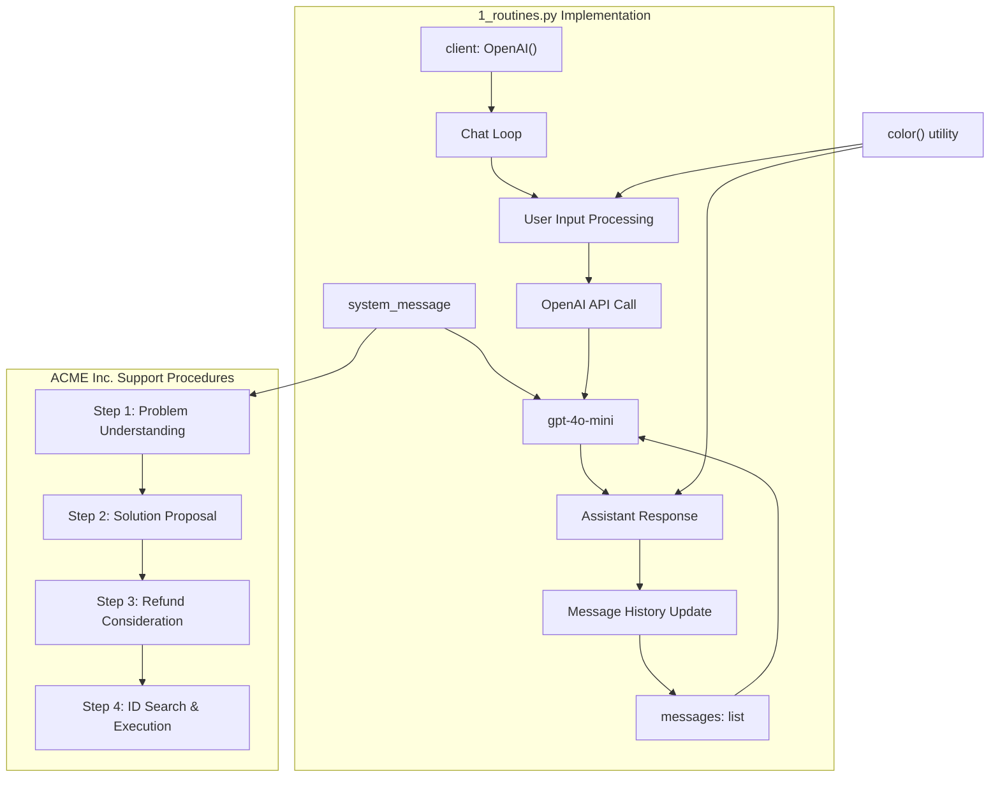

**Sources**: [01-agents/1_routines.py:1-47]()

## Customer Support Workflow

The system implements a structured 4-step customer support procedure embedded within the `system_message`. This procedure ensures consistent handling of customer issues across all interactions.

### Procedural Framework

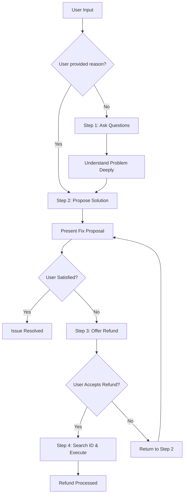

**Sources**: [01-agents/1_routines.py:13-23]()

### Implementation Details

The customer support procedures are encoded in the `system_message` which provides specific instructions for each step:

| Step | Procedure | Implementation |
|------|-----------|----------------|
| 1 | Problem Understanding | "最初に質問をして、ユーザーの問題を深く理解してください" |
| 2 | Solution Proposal | "修正案を提案してください（適当なものを考え出してください）" |
| 3 | Refund Consideration | "ユーザーが満足しない場合のみ、返金を提案してください" |
| 4 | ID Search & Execution | "ユーザーが受け入れた場合、IDを検索して返金を実行してください" |

**Sources**: [01-agents/1_routines.py:17-21]()

## Message Flow Architecture

The system maintains conversation state through a `messages` list that accumulates the dialogue history, enabling contextual responses throughout the support interaction.

### Conversation State Management

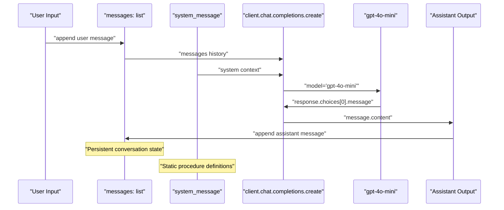

**Sources**: [01-agents/1_routines.py:25-47]()

## Code Entity Mapping

The following table maps the natural language concepts to specific code implementations:

| Concept | Code Entity | Location |
|---------|-------------|----------|
| OpenAI Integration | `client = OpenAI()` | [01-agents/1_routines.py:5]() |
| Model Selection | `model = "gpt-4o-mini"` | [01-agents/1_routines.py:10]() |
| Support Procedures | `system_message` | [01-agents/1_routines.py:13-23]() |
| Conversation History | `messages = []` | [01-agents/1_routines.py:26]() |
| User Interaction Loop | `while True:` | [01-agents/1_routines.py:29]() |
| API Request | `client.chat.completions.create()` | [01-agents/1_routines.py:35-38]() |
| Response Processing | `response.choices[0].message` | [01-agents/1_routines.py:41]() |
| Output Formatting | `color()` utility | [01-agents/1_routines.py:31,44]() |

**Sources**: [01-agents/1_routines.py:1-47]()

## Implementation Constraints

The system implements several key constraints that shape the customer support behavior:

- **Response Length**: "常に1文以内で回答してください" - Responses limited to one sentence
- **Role Definition**: "あなたはACME Inc.のカスタマーサポート担当者です" - Establishes ACME Inc. context
- **Sequential Processing**: Procedures must be followed in order (1→2→3→4)
- **Conditional Logic**: Step 3 (refund) only triggered if user remains unsatisfied
- **Japanese Language**: All system instructions provided in Japanese

**Sources**: [01-agents/1_routines.py:14-22]()

---

# Page: Tool Integration and Function Calling

# Tool Integration and Function Calling

<details>
<summary>Relevant source files</summary>

The following files were used as context for generating this wiki page:

- [01-agents/2_tools.py](01-agents/2_tools.py)
- [01-agents/3_tools.py](01-agents/3_tools.py)
- [01-agents/4_tools.py](01-agents/4_tools.py)

</details>


This document covers the implementation of tool integration and function calling capabilities in the ACME Inc. customer support agent. It demonstrates how to extend a basic conversational agent with external tool capabilities, enabling it to perform actions like item lookups and refund processing through OpenAI's function calling API.

The material progresses from manual tool schema definitions to automated schema generation, showing three evolutionary stages of tool implementation. For basic customer support procedures without tools, see [Basic Customer Support Procedures](#3.1). For advanced orchestration features, see [Advanced Agent Features](#3.3).

## Tool Integration Architecture

The tool integration system transforms a basic conversational agent into an action-capable assistant by adding external function calling capabilities. The architecture centers around the `run_full_turn` function and integrates with OpenAI's tools parameter.

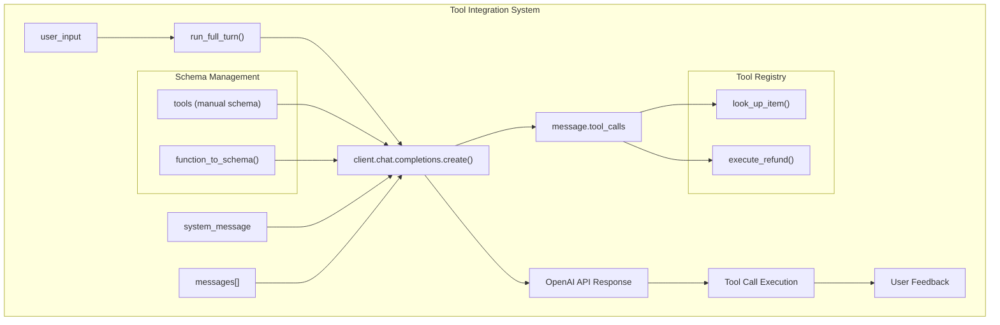

Sources: [01-agents/2_tools.py:28-56](), [01-agents/3_tools.py:44-56](), [01-agents/4_tools.py:46-59]()

## Schema Definition Evolution

The repository demonstrates two approaches to defining tool schemas for OpenAI's function calling API: manual schema definition and automated schema generation.

| Approach | File | Schema Source | Maintenance |
|----------|------|---------------|-------------|
| Manual | `2_tools.py` | Hand-coded JSON schema | High maintenance |
| Automated | `3_tools.py`, `4_tools.py` | `function_to_schema()` utility | Low maintenance |

### Manual Schema Definition

The initial implementation in `2_tools.py` uses manually defined tool schemas with explicit parameter specifications:

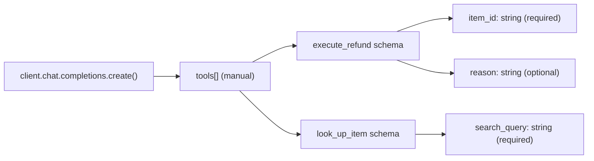

Sources: [01-agents/2_tools.py:28-56]()

### Automated Schema Generation

The improved implementations in `3_tools.py` and `4_tools.py` use the `function_to_schema` utility to automatically generate schemas from Python function signatures:

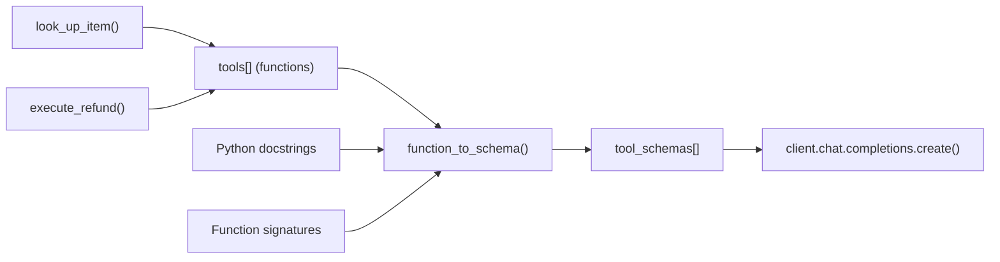

Sources: [01-agents/3_tools.py:44-56](), [01-agents/4_tools.py:46-59]()

## Tool Implementation Details

The customer support agent implements two core tools for handling customer service workflows:

### look_up_item Function

The `look_up_item` function simulates product database searches and returns item identifiers:

| Parameter | Type | Required | Description |
|-----------|------|----------|-------------|
| `search_query` | string | Yes | Product description or keywords |

**Return Value**: Fixed item ID `"item_132612938"` (demonstration purposes)

**Implementation Location**: [01-agents/3_tools.py:27-32](), [01-agents/4_tools.py:27-33]()

### execute_refund Function

The `execute_refund` function processes refund requests with detailed logging:

| Parameter | Type | Required | Default | Description |
|-----------|------|----------|---------|-------------|
| `item_id` | string | Yes | N/A | Product identifier |
| `reason` | string | No | `"not provided"` | Refund justification |

**Return Value**: `"success"` status string

**Implementation Location**: [01-agents/3_tools.py:35-41](), [01-agents/4_tools.py:36-43]()

Sources: [01-agents/3_tools.py:27-41](), [01-agents/4_tools.py:27-43]()

## Function Calling Workflow

The function calling workflow integrates tool execution into the conversational flow through a systematic process:

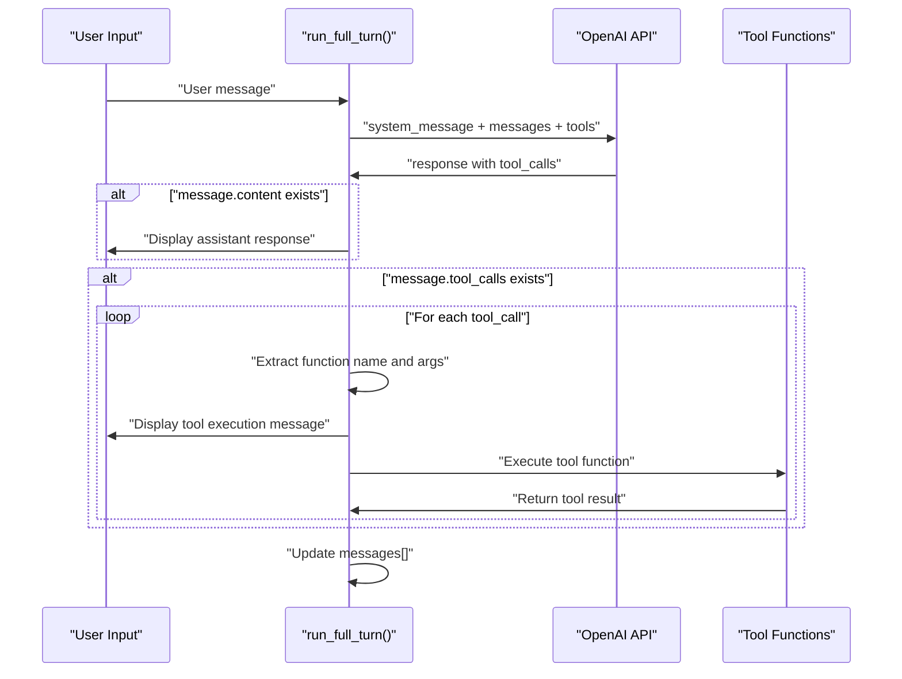

Sources: [01-agents/2_tools.py:59-88](), [01-agents/3_tools.py:47-78](), [01-agents/4_tools.py:49-81]()

## Tool Call Processing

The tool call processing mechanism handles the extraction and execution of function calls from OpenAI responses:

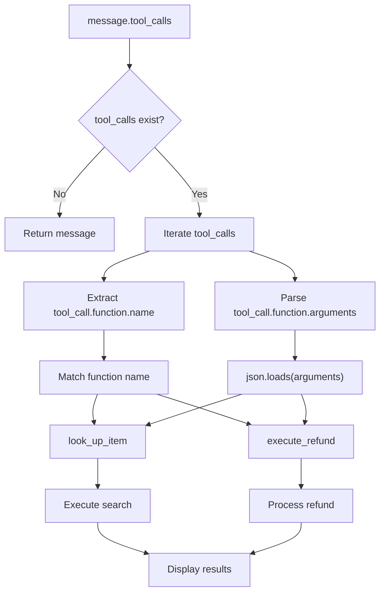

**Key Processing Steps**:
1. Check for `message.tool_calls` presence
2. Extract `tool_call.function.name` and `tool_call.function.arguments`
3. Parse JSON arguments using `json.loads()`
4. Match function name to available tools
5. Execute corresponding Python function
6. Display execution results

Sources: [01-agents/2_tools.py:75-88](), [01-agents/3_tools.py:65-78](), [01-agents/4_tools.py:68-81]()

## System Message Integration

The `system_message` defines the customer support workflow that guides tool usage:

**Workflow Steps**:
1. **Understanding Phase**: Ask questions to understand user problems
2. **Solution Phase**: Propose fixes (generate reasonable suggestions)
3. **Escalation Phase**: Offer refunds only when users remain unsatisfied
4. **Execution Phase**: Search item IDs and execute refunds when accepted

**Constraint**: All responses must be limited to one sentence to maintain conversational efficiency.

The system message remains consistent across all tool implementations, ensuring behavioral consistency while tool capabilities evolve.

Sources: [01-agents/2_tools.py:14-24](), [01-agents/3_tools.py:14-24](), [01-agents/4_tools.py:14-24]()

---

# Page: Advanced Agent Features

# Advanced Agent Features

<details>
<summary>Relevant source files</summary>

The following files were used as context for generating this wiki page:

- [01-agents/5_escalation.py](01-agents/5_escalation.py)
- [01-agents/6_agents.py](01-agents/6_agents.py)
- [01-agents/7_orchestration.py](01-agents/7_orchestration.py)

</details>


This document covers the advanced capabilities of the ACME Inc. customer support agent system, including human escalation mechanisms, object-oriented agent frameworks, and full orchestration systems. These features represent the final evolution of the tutorial series, transforming basic tool-enabled agents into sophisticated, production-ready systems.

For basic tool integration and function calling, see [Tool Integration and Function Calling](#3.2). For foundational customer support procedures, see [Basic Customer Support Procedures](#3.1).

## Human Escalation System

The escalation system provides a critical safety mechanism that allows agents to transfer complex or unresolvable issues to human operators. This capability is implemented through the `escalate_to_human` function, which immediately terminates the agent session and provides a comprehensive handoff report.

### Escalation Function Implementation

The escalation mechanism is implemented as a callable tool that agents can invoke when they determine that human intervention is required:

```python
def escalate_to_human(summary):
    """明示的にリクエストされた場合のみ、この関数を呼び出します。"""
```

The function accepts a summary parameter that captures the context of the issue requiring escalation. When invoked, it displays escalation information and terminates the program execution using `exit()`, ensuring a clean handoff to human operators.

### Escalation Flow Architecture

```mermaid
graph TD
    A["User Input"] --> B["run_full_turn()"]
    B --> C["OpenAI API Call"]
    C --> D{"Tool Call Decision"}
    D -->|"execute_refund"| E["execute_refund()"]
    D -->|"look_up_item"| F["look_up_item()"]
    D -->|"escalate_to_human"| G["escalate_to_human()"]
    E --> H["Continue Conversation"]
    F --> H
    G --> I["Display Escalation Report"]
    I --> J["exit()"]
    H --> B
```

Sources: [01-agents/5_escalation.py:45-53]()

## Agent Framework Architecture

The agent framework introduces object-oriented design patterns that encapsulate agent behavior, configuration, and capabilities into reusable components. This architecture uses Pydantic models to ensure type safety and validation.

### Agent Class Structure

The `Agent` class serves as the foundation for all agent implementations, providing a standardized interface for agent configuration:

| Field | Type | Default | Purpose |
|-------|------|---------|---------|
| `name` | str | "Agent" | Agent identifier |
| `model` | str | "gpt-4o" | OpenAI model specification |
| `instructions` | str | "You are a helpful Agent" | System message content |
| `tools` | list | [] | Available tool functions |

The framework also includes a `Response` class for managing message collections, though this is primarily used for type structure rather than active functionality.

### Agent Instantiation Pattern

```mermaid
graph LR
    A["Agent Class Definition"] --> B["Agent Instance Creation"]
    B --> C["run_full_turn() Function"]
    C --> D["tool_schemas Generation"]
    C --> E["tools_map Creation"]
    D --> F["OpenAI API Integration"]
    E --> F
    F --> G["Tool Execution Loop"]
    G --> H["Message Management"]
```

The agent framework transforms the previous procedural approach into an object-oriented system where agent behavior is encapsulated within the `Agent` instance and processed through the `run_full_turn` function.

Sources: [01-agents/6_agents.py:8-18](), [01-agents/6_agents.py:24-65]()

## Full Orchestration System

The orchestration system represents the most sophisticated implementation, providing comprehensive documentation, error handling, and production-ready architecture. This system maintains the same core functionality while adding enterprise-grade features.

### Orchestration Architecture Components

```mermaid
graph TB
    subgraph "Agent Definition Layer"
        A["Agent BaseModel"]
        B["Response BaseModel"]
    end
    
    subgraph "Execution Engine"
        C["run_full_turn()"]
        D["execute_tool_call()"]
    end
    
    subgraph "Tool Integration"
        E["function_to_schema()"]
        F["tools_map Generation"]
    end
    
    subgraph "OpenAI Integration"
        G["client.chat.completions.create()"]
        H["Tool Schemas"]
        I["Message Management"]
    end
    
    subgraph "Available Tools"
        J["look_up_item()"]
        K["execute_refund()"]
        L["escalate_to_human()"]
    end
    
    A --> C
    C --> D
    C --> E
    E --> F
    F --> G
    G --> H
    C --> I
    D --> J
    D --> K
    D --> L
```

### Enhanced Documentation and Type Safety

The orchestration implementation includes comprehensive docstrings and type hints for all major functions:

- `run_full_turn()` includes detailed parameter and return value documentation
- `execute_tool_call()` provides clear argument descriptions
- All tool functions include parameter specifications and return type documentation

This documentation pattern makes the system suitable for production deployment and team collaboration.

Sources: [01-agents/7_orchestration.py:28-77](), [01-agents/7_orchestration.py:80-95]()

## Implementation Evolution

The advanced agent features demonstrate a clear progression from basic functionality to enterprise-grade systems:

### Evolution Timeline

```mermaid
graph LR
    A["5_escalation.py<br/>Basic Escalation"] --> B["6_agents.py<br/>OOP Framework"]
    B --> C["7_orchestration.py<br/>Full Documentation"]
    
    subgraph "Key Additions"
        D["escalate_to_human()"]
        E["Agent Class"]
        F["Comprehensive Docs"]
    end
    
    A -.-> D
    B -.-> E
    C -.-> F
```

### Core Function Consistency

Throughout this evolution, the `run_full_turn` function maintains consistent behavior while adapting to new architectural patterns:

- **Escalation version**: Accepts `system_message`, `tools`, and `messages` parameters
- **Agent framework version**: Accepts `agent` object and `messages`, extracting configuration from the agent
- **Orchestration version**: Identical interface to agent framework but with enhanced documentation

This consistency ensures that the learning progression remains smooth while introducing increasingly sophisticated concepts.

### Tool Integration Patterns

All three implementations use identical tool integration patterns:

1. `function_to_schema()` conversion from [demo_util.py]()
2. `tools_map` generation for function lookup
3. `execute_tool_call()` delegation pattern
4. Message history management

This consistency reinforces best practices while allowing focus on the architectural improvements introduced at each stage.

Sources: [01-agents/5_escalation.py:58-101](), [01-agents/6_agents.py:24-76](), [01-agents/7_orchestration.py:28-95]()

---

# Page: Technical Reference

# Technical Reference

<details>
<summary>Relevant source files</summary>

The following files were used as context for generating this wiki page:

- [01-agents/demo_util.py](01-agents/demo_util.py)
- [LICENSE](LICENSE)

</details>


This document provides technical reference material for the Learning Lab repository's utility functions, schema generation systems, and legal information. It covers the supporting infrastructure that enables the progressive tutorial examples for building OpenAI-powered agents.

For detailed tutorial implementations and agent building techniques, see [Customer Support Agent Tutorial](#3). For initial setup and basic examples, see [Getting Started](#2).

## Overview

The Learning Lab repository includes several technical components that support the tutorial progression:

| Component | Purpose | Implementation |
|-----------|---------|----------------|
| Utility Functions | Text formatting and schema generation | `demo_util.py` |
| Schema Generation | Convert Python functions to OpenAI tool schemas | `function_to_schema()` |
| License | Legal terms for repository usage | MIT License |

## Technical Architecture

The technical reference components integrate with the tutorial system to provide essential supporting functionality:

```mermaid
graph TB
    subgraph "Tutorial Examples"
        A[0_setup.py] 
        B[1_routines.py]
        C[2_tools.py]
        D[3_tools.py] 
        E[4_tools.py]
        F[5_escalation.py]
        G[6_agents.py]
        H[7_orchestration.py]
    end
    
    subgraph "Technical Infrastructure"
        I[demo_util.py]
        J[function_to_schema]
        K[color]
        L[LICENSE]
    end
    
    subgraph "OpenAI Integration"
        M["OpenAI Tool Calling API"]
        N["chat.completions.create"]
        O["Tool Schema Format"]
    end
    
    C --> I
    D --> I
    E --> I 
    F --> I
    G --> I
    H --> I
    
    I --> J
    I --> K
    
    J --> O
    O --> M
    M --> N
    
    L --> A
    L --> B
    L --> C
    L --> D
    L --> E
    L --> F
    L --> G
    L --> H
```

Sources: [01-agents/demo_util.py:1-96](), [LICENSE:1-8]()

## Schema Generation Workflow

The `function_to_schema()` system converts Python functions into OpenAI-compatible tool schemas:

```mermaid
sequenceDiagram
    participant PF as "Python Function"
    participant FTS as "function_to_schema()"
    participant IS as "inspect.signature()"
    participant TM as "type_map"
    participant OS as "OpenAI Schema"
    participant API as "OpenAI API"
    
    PF->>FTS: "Input function with annotations"
    FTS->>IS: "Extract function signature"
    IS->>FTS: "Return parameters and types"
    FTS->>TM: "Map Python types to JSON types"
    TM->>FTS: "Return type mappings"
    
    rect rgb(245, 245, 245)
        Note over FTS: Process parameters and required fields
        FTS->>FTS: "Build parameters dict"
        FTS->>FTS: "Identify required parameters"
        FTS->>FTS: "Extract docstring description"
    end
    
    FTS->>OS: "Generate tool schema"
    OS->>API: "Schema used in tool calling"
    API->>PF: "Function executed when tool called"
```

Sources: [01-agents/demo_util.py:19-64]()

## Core Technical Components

### Schema Generation System

The `function_to_schema()` function in [01-agents/demo_util.py:19-64]() provides automatic conversion of Python functions to OpenAI tool schemas. Key features:

- **Type Mapping**: Maps Python types (`str`, `int`, `float`, `bool`, `list`, `dict`) to JSON Schema types
- **Parameter Extraction**: Uses `inspect.signature()` to analyze function parameters
- **Required Parameter Detection**: Identifies parameters without default values
- **Docstring Integration**: Extracts function docstrings for schema descriptions

### Text Formatting Utilities  

The `color()` function in [01-agents/demo_util.py:4-16]() provides ANSI color formatting for console output:

```python
# Available colors: red, green, yellow, blue, magenta, cyan, white, grey
color("Status message", "green")
```

### Example Schema Output

For a function like `sample_function(param_1, param_2, the_third_one: int)`, the schema generator produces:

```json
{
    "type": "function",
    "function": {
        "name": "sample_function", 
        "description": "This is my docstring. Call this function when you want.",
        "parameters": {
            "type": "object",
            "properties": {
                "param_1": {"type": "string"},
                "param_2": {"type": "string"}, 
                "the_third_one": {"type": "integer"}
            },
            "required": ["param_1", "param_2", "the_third_one"]
        }
    }
}
```

Sources: [01-agents/demo_util.py:70-95]()

## Usage in Tutorial Examples

The technical reference components are utilized throughout the tutorial progression:

| Tutorial Stage | Usage |
|----------------|-------|
| Tool Integration (2-5_tools.py) | `function_to_schema()` for tool definitions |
| Agent Framework (6-7_orchestration.py) | Schema generation for agent capabilities |
| Console Output | `color()` for formatted status messages |

For detailed information about specific components:
- [Utility Functions and Schema Generation](#4.1)
- [License and Legal Information](#4.2)

Sources: [01-agents/demo_util.py:1-96](), [LICENSE:1-8]()

---

# Page: Utility Functions and Schema Generation

# Utility Functions and Schema Generation

<details>
<summary>Relevant source files</summary>

The following files were used as context for generating this wiki page:

- [01-agents/demo_util.py](01-agents/demo_util.py)

</details>


This document covers the utility functions provided in `demo_util.py`, with particular focus on the `function_to_schema` system that enables automatic conversion of Python functions into OpenAI tool schemas. These utilities support the Learning Lab tutorial progression by simplifying the integration between Python functions and OpenAI's function calling API.

For information about how these utilities are used in the customer support tutorials, see [Customer Support Agent Tutorial](#3). For the overall Learning Lab structure, see [Learning Lab Overview](#1).

## Overview

The `demo_util.py` module provides two primary utility functions that support the Learning Lab tutorial series:

| Function | Purpose | Primary Use Case |
|----------|---------|------------------|
| `color()` | Terminal text colorization | Demo output formatting |
| `function_to_schema()` | Python function to OpenAI schema conversion | Tool integration automation |

The `function_to_schema()` function serves as the core utility that bridges Python function definitions with OpenAI's tool calling requirements, eliminating manual schema creation for tutorial participants.

Sources: [01-agents/demo_util.py:1-96]()

## Terminal Color Utility

The `color()` function provides simple terminal text colorization for enhanced demo output readability. It supports standard ANSI color codes and automatically handles color reset sequences.

### Color Implementation

```mermaid
graph TD
    A["color(text, color)"] --> B["color_codes dictionary"]
    B --> C["ANSI escape sequences"]
    C --> D["Formatted output string"]
    
    E["Available colors"] --> F["red, green, yellow"]
    E --> G["blue, magenta, cyan"]
    E --> H["white, reset, grey"]
    
    F --> B
    G --> B
    H --> B
```

The function maps color names to ANSI escape codes and wraps the input text with appropriate formatting sequences [01-agents/demo_util.py:4-16]().

Sources: [01-agents/demo_util.py:4-16]()

## Function to Schema Conversion System

The `function_to_schema()` function automatically generates OpenAI-compatible tool schemas from Python function definitions. This eliminates the need for manual schema creation and ensures consistency between function implementations and their API descriptions.

### Type Mapping Architecture

```mermaid
graph LR
    A["Python Types"] --> B["type_map dictionary"]
    B --> C["JSON Schema Types"]
    
    D["str"] --> E["string"]
    F["int"] --> G["integer"]  
    H["float"] --> I["number"]
    J["bool"] --> K["boolean"]
    L["list"] --> M["array"]
    N["dict"] --> O["object"]
    P["NoneType"] --> Q["null"]
    
    D --> B
    F --> B
    H --> B
    J --> B
    L --> B
    N --> B
    P --> B
    
    E --> C
    G --> C
    I --> C
    K --> C
    M --> C
    O --> C
    Q --> C
```

The type mapping system converts Python type annotations to JSON Schema types using a predefined dictionary [01-agents/demo_util.py:20-28]().

Sources: [01-agents/demo_util.py:20-28]()

### Schema Generation Process

```mermaid
flowchart TD
    A["Python function"] --> B["inspect.signature()"]
    B --> C["Extract parameters"]
    C --> D["Map parameter types"]
    D --> E["Identify required parameters"]
    E --> F["Extract docstring"]
    F --> G["Generate OpenAI schema"]
    
    H["signature.parameters"] --> I["param.annotation"]
    I --> J["type_map lookup"]
    J --> K["JSON schema type"]
    
    L["param.default"] --> M["inspect._empty check"]
    M --> N["Required parameter list"]
    
    O["func.__doc__"] --> P["Schema description"]
    
    C --> H
    D --> I
    E --> L
    F --> O
    
    K --> G
    N --> G
    P --> G
```

The schema generation process follows a systematic approach to extract function metadata and convert it to OpenAI's expected format [01-agents/demo_util.py:30-64]().

Sources: [01-agents/demo_util.py:30-64]()

### Schema Structure and Output Format

The generated schema follows OpenAI's function calling specification with the following structure:

| Schema Component | Source | Purpose |
|------------------|--------|---------|
| `type` | Fixed as "function" | OpenAI schema identifier |
| `function.name` | `func.__name__` | Function identifier |
| `function.description` | `func.__doc__` | AI understanding context |
| `function.parameters.type` | Fixed as "object" | Parameter container type |
| `function.parameters.properties` | Parameter analysis | Individual parameter schemas |
| `function.parameters.required` | Default value analysis | Required parameter list |

### Example Schema Transformation

The provided example demonstrates the complete transformation process:

```mermaid
graph TD
    A["sample_function"] --> B["Function Analysis"]
    B --> C["Parameters"]
    B --> D["Docstring"]
    B --> E["Type Annotations"]
    
    C --> F["param_1: no annotation"]
    C --> G["param_2: no annotation"] 
    C --> H["the_third_one: int"]
    
    F --> I["string (default)"]
    G --> J["string (default)"]
    H --> K["integer"]
    
    D --> L["Description text"]
    
    M["OpenAI Schema"] --> N["Function metadata"]
    M --> O["Parameter properties"]
    M --> P["Required list"]
    
    I --> O
    J --> O
    K --> O
    L --> N
    
    Q["All parameters required"] --> P
```

The example function `sample_function(param_1, param_2, the_third_one: int)` generates a complete OpenAI tool schema with proper type mapping and required parameter identification [01-agents/demo_util.py:70-95]().

Sources: [01-agents/demo_util.py:70-95]()

## Error Handling and Validation

The `function_to_schema()` implementation includes comprehensive error handling for common failure scenarios:

### Error Handling Flow

```mermaid
graph TD
    A["function_to_schema()"] --> B["inspect.signature()"]
    B --> C{"Signature extraction successful?"}
    C -->|No| D["ValueError with function name"]
    C -->|Yes| E["Parameter processing"]
    
    E --> F["Type annotation lookup"]
    F --> G{"Type in type_map?"}
    G -->|No| H["KeyError with parameter details"]
    G -->|Yes| I["Schema generation"]
    
    D --> J["Error propagation"]
    H --> J
    I --> K["Return schema"]
```

Error handling covers signature extraction failures and unknown type annotations, providing detailed error messages for debugging [01-agents/demo_util.py:32-44]().

Sources: [01-agents/demo_util.py:32-44]()

## Integration with Tutorial System

The utility functions integrate throughout the Learning Lab tutorial progression, particularly in tool-enabled examples where automatic schema generation simplifies the development process.

### Tutorial Integration Points

```mermaid
graph TB
    A["demo_util.py"] --> B["Tool Integration Tutorials"]
    A --> C["Advanced Agent Examples"]
    
    B --> D["2_tools.py"]
    B --> E["3_tools.py"]
    B --> F["4_tools.py"]
    B --> G["5_escalation.py"]
    
    C --> H["6_agents.py"]
    C --> I["7_orchestration.py"]
    
    J["function_to_schema()"] --> K["Automatic tool registration"]
    K --> L["OpenAI function calling"]
    
    M["color()"] --> N["Demo output formatting"]
    N --> O["Enhanced user experience"]
    
    A --> J
    A --> M
```

The schema generation utility enables seamless integration between Python business logic functions and OpenAI's tool calling API across multiple tutorial modules.

Sources: [01-agents/demo_util.py:1-96]()

---

# Page: License and Legal Information

# License and Legal Information

<details>
<summary>Relevant source files</summary>

The following files were used as context for generating this wiki page:

- [LICENSE](LICENSE)

</details>


This document covers the legal terms, copyright information, and licensing conditions that govern the use, modification, and distribution of the Learning Lab repository. This page addresses the legal framework under which the tutorial materials, code examples, and documentation are made available.

For technical documentation about utility functions and schemas, see [4.1](#4.1). For information about the overall Learning Lab tutorial structure, see [1](#1).

## License Overview

The Learning Lab repository is distributed under the MIT License, a permissive open-source license that allows broad usage rights while maintaining copyright attribution requirements. The license text is contained in the repository root and applies to all source code, documentation, and associated materials.

**License Type**: MIT License  
**Copyright Holder**: OpenAI  
**Copyright Year**: 2024  

Sources: [LICENSE:1-8]()

## License Terms and Permissions

The MIT License grants the following permissions to users of the repository:

| Permission | Description | Requirements |
|------------|-------------|--------------|
| **Use** | Run and execute the software for any purpose | Include copyright notice |
| **Modify** | Make changes and create derivative works | Include copyright notice |
| **Distribute** | Share copies with others | Include copyright notice and license |
| **Sublicense** | Grant additional rights to others | Include copyright notice and license |
| **Commercial Use** | Use in commercial products and services | Include copyright notice and license |

### Attribution Requirements

All usage must include the copyright notice and permission notice as specified in the license terms. This requirement applies to all copies or substantial portions of the software.

Sources: [LICENSE:1-6]()

## Copyright and Ownership

```mermaid
graph TB
    A["OpenAI (Copyright Holder)"] --> B["Learning Lab Repository"]
    
    B --> C["Source Code Files"]
    B --> D["Documentation"]
    B --> E["Tutorial Examples"]
    
    C --> F["0_setup.py"]
    C --> G["1_routines.py through 7_orchestration.py"]
    C --> H["demo_util.py"]
    
    D --> I["README.md"]
    D --> J["Code Comments"]
    
    E --> K["ACME Inc. Support Examples"]
    E --> L["Tool Integration Examples"]
    
    M["MIT License (LICENSE file)"] --> B
    
    subgraph "Copyright Coverage"
        N["All Repository Contents"]
        O["Code Examples"]
        P["Documentation"]
        Q["Tutorial Materials"]
    end
    
    B --> N
    C --> O
    D --> P
    E --> Q
```

The copyright notice specifies OpenAI as the copyright holder for the year 2024, covering all materials within the repository including tutorial code, documentation, and examples.

Sources: [LICENSE:1]()

## Warranty Disclaimers and Limitations

The MIT License includes important disclaimers that limit liability and warranty coverage:

### No Warranty Provision

The software is provided "AS IS" without warranty of any kind, including:
- **Express warranties**: No explicit guarantees about functionality
- **Implied warranties**: No implied warranties of merchantability or fitness for purpose
- **Non-infringement**: No guarantee that use won't infringe other rights

### Liability Limitations

The license limits the liability of OpenAI and contributors for:
- Claims arising from software use
- Damages resulting from software operation
- Issues in contract, tort, or other legal theories

Sources: [LICENSE:7]()

## Usage Scenarios and Compliance

```mermaid
graph TD
    A["Learning Lab Repository Usage"] --> B["Educational Use"]
    A --> C["Commercial Use"]
    A --> D["Modified Versions"]
    A --> E["Redistributions"]
    
    B --> F["Webinar Demonstrations"]
    B --> G["Developer Training"]
    B --> H["Academic Research"]
    
    C --> I["Production Applications"]
    C --> J["Commercial Products"]
    C --> K["Consulting Services"]
    
    D --> L["Enhanced Tutorials"]
    D --> M["Custom Implementations"]
    D --> N["Fork Repositories"]
    
    E --> O["Open Source Projects"]
    E --> P["Internal Distribution"]
    E --> Q["Public Sharing"]
    
    subgraph "Compliance Requirements"
        R["Include Copyright Notice"]
        S["Include License Text"]
        T["Maintain Attribution"]
    end
    
    B --> R
    C --> R
    D --> S
    E --> S
    F --> T
    I --> T
    L --> T
    O --> T
```

### Common Use Cases

**Tutorial and Educational Use**: The repository is designed for educational purposes, particularly for Japanese developers learning OpenAI integration patterns. Educational use requires maintaining copyright attribution.

**Commercial Applications**: Organizations can incorporate the code examples and patterns into commercial products and services, provided they include the required copyright notice and license text.

**Derivative Works**: Developers can create modified versions, enhanced tutorials, or custom implementations based on the repository contents while maintaining attribution requirements.

Sources: [LICENSE:3-6]()

## Practical Implementation Guidelines

### For Individual Developers

When using Learning Lab materials in personal projects:
1. Retain the copyright notice from [LICENSE:1]()
2. Include the full license text when distributing code
3. Maintain attribution in derivative works

### For Organizations

When incorporating repository materials into organizational workflows:
1. Ensure internal distribution includes license compliance
2. Maintain attribution in commercial applications
3. Include license terms in product documentation when applicable

### For Open Source Projects

When using materials in other open source projects:
1. Include the original MIT license alongside project license
2. Maintain clear attribution to OpenAI as copyright holder
3. Document the source of incorporated materials

Sources: [LICENSE:1-8]()

## License File Location and Structure

The license information is maintained in the repository root as `LICENSE` file without extension, following standard open source conventions. This file contains the complete MIT License text with OpenAI-specific copyright information.

**File Structure**:
- Line 1: Copyright notice with holder and year
- Lines 3-5: Permission grant and conditions
- Line 7: Warranty disclaimer and liability limitation

Sources: [LICENSE:1-8]()