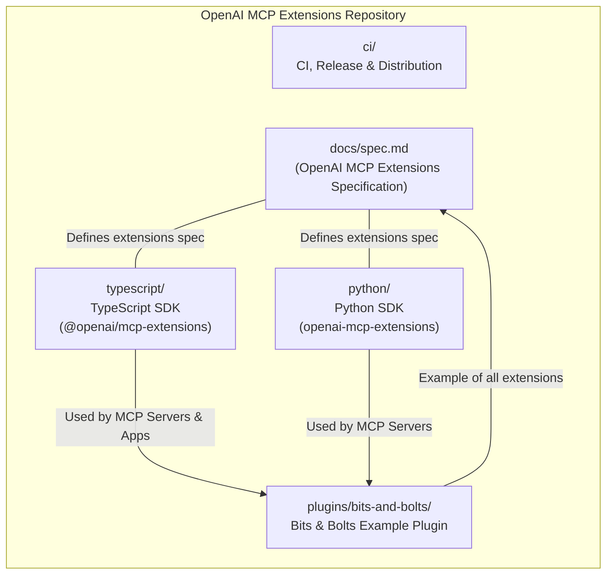
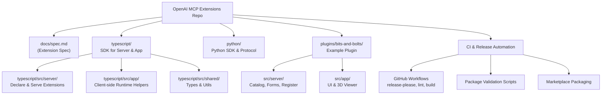

<!-- source: DeepWiki mcp.deepwiki.com · repo openai/mcp-extensions · page 1 Overview · fetched 2026-10-26 -->

# 1 Overview

<details>
<summary>Relevant source files</summary>

The following files were used as context for generating this wiki page:

- [AGENTS.md](AGENTS.md)
- [README.md](README.md)
- [docs/spec.md](docs/spec.md)

</details>


This page provides a high-level introduction to **OpenAI MCP Extensions**, an open-source project that builds ChatGPT-specific extensions on top of the Model Context Protocol (MCP) and MCP Apps. The extensions enable developers to build richer, first-class plugins for ChatGPT by layering additional capabilities on the MCP foundation, allowing native-like integration with ChatGPT interfaces.

---

## What is OpenAI MCP Extensions?

OpenAI MCP Extensions augment the MCP ecosystem to enable deeper integration for ChatGPT and its related platforms (ChatGPT Work, Desktop, Mobile). MCP specifies how plugins ("MCP Apps") interact with host environments and share context. These extensions add functionality such as:

- Sidebar, thread, and file entrypoints for MCP Apps
- Composer mentions to link plugin resources into chat
- Custom file viewers for plugin-defined file types
- Advanced form elicitation with UI extensions like thumbnail pickers
- Structured settings support
- Deep linking, onboarding, and model context updates for richer plugin UX

The emphasis is providing granular, ChatGPT-native UX elements while maintaining compatibility with the MCP specification.

For an in-depth explanation of these extensions and their design rationale, see [The Extensions Specification](#2).

Sources: `README.md:1-33`, `docs/spec.md:1-131`


---

## Repository Layout and Components Overview

The codebase is organized as a monorepo with distinct packages and directories serving different roles in extensions development:



- **`docs/spec.md`**: The formal specification of MCP extensions, detailing each extension type and its interaction with MCP and ChatGPT platforms.
- **TypeScript SDK (`typescript/`)**: SDK for MCP servers and apps, providing server-side helpers, app-side runtime clients, and shared utilities.
- **Python SDK (`python/`)**: Python API mirroring the spec, mainly targeting MCP server implementations.
- **Bits & Bolts Example Plugin (`plugins/bits-and-bolts/`)**: A fully featured demo plugin showcasing usage of all MCP extensions (e.g., file viewers, resource pickers).
- **CI and Release Tooling**: GitHub workflows, release automation, package validation, and marketplace packaging.

Each component is designed to interoperate smoothly, with the SDKs following the specification and the demo plugin serving as a reference implementation.

For details, see [Repository Layout & Conventions](#1.2).

Sources: `README.md:1-33`, `docs/spec.md:1-131`


---

## Key System Entities and Their Relationships to Code Artifacts

Below we map the conceptual spaces from natural language ChatGPT features to concrete codebase entities, illustrating how users experience plugin extensions and what code elements implement them.

### Diagram 1: MCP Extensions Feature Space to SDK and Spec Artifacts

```mermaid
graph LR
  NL["Natural Language Feature Space"]
  CE["Code Entity Space"]

  NL -->|Defines Extensions| CE_1["docs/spec.md\n(openai/ui entrypoints, forms, mentions, settings)"]
  CE_1 -->|Implemented By| CE_2["typescript/src/server/extensions.ts\nmentions.ts\nforms/\nsettings.ts\nui.ts"]
  CE_1 -->|Mirrored By| CE_3["python/openai_mcp_extensions/\nextensions.py\nmentions.py\nforms.py\nsettings.py\nui.py"]
  CE_2 -->|Consumed By| CE_4["plugins/bits-and-bolts/src/server/"]
  CE_4 -->|Demonstrated In| NL

  NL --> "ChatGPT UI & UX"
  CE --> "SDKs & Plugin Code"
```

This shows how the specification (`docs/spec.md`) defines interfaces used in the TypeScript and Python SDKs to declare extension behaviors, which are exemplified by the Bits & Bolts plugin.

### Diagram 2: MCP Extensions Repository Layout to Main Roles & Artifacts



This diagram clarifies how directories map to roles in development and deployment.

Sources: `README.md:1-33`, `docs/spec.md:1-131`


---

## How It All Fits Together

1. **Extensions Specification** (`docs/spec.md`) defines the new capabilities layered on MCP and MCP Apps, specifying JSON schemas, metadata fields (like `_meta["openai/ui"]`), and supported UI components such as entrypoints, mentions, and forms.

2. **TypeScript SDK** implements helpers to declare extension metadata on servers and support app-side runtime APIs in the iframe environment that MCP Apps run in. It focuses on MCP Servers and App frontends running JavaScript.

3. **Python SDK** provides a mirror of the extensions specification for Python-based MCP Servers, supporting plugin backend implementations that prefer Python.

4. **Bits & Bolts Plugin** uses both SDKs culminating in a real-world plugin that exercises all extensions: custom sidebar entries, thread tabs, file viewers, composer mentions, forms with thumbnails, and others. It serves as both a testbed and example.

5. **CI and Release Tooling** automation ensures code quality, versioning, packaging, and publishing both to public registries (npm, PyPI) and the OpenAI Agent Marketplace with manifests.

---

## Child Pages for In-Depth Information

This overview is purposefully high-level. For detailed guides and technical walkthroughs, visit:

| Section | Topic | Description |
|---------|-------|-------------|
| [Getting Started](#1.1) | Getting Started | Installation of SDKs, running the Bits & Bolts demo plugin, and repository tooling (pnpm workspace, linting, dev commands) |
| [Repository Layout & Conventions](#1.2) | Repository Layout & Conventions | Directory structure, contribution guidelines (AGENTS.md), security policy, licensing |
| [The Extensions Specification](#2) | Extensions Spec Overview | Core design and specification of how OpenAI extensions layer on MCP |
| [TypeScript SDK (@openai/mcp-extensions)](#3) | TypeScript SDK Details | Server-side and app-side APIs, shared types |
| [Python SDK (openai-mcp-extensions)](#4) | Python SDK Details | Python API mirroring the spec, form elicitation protocol |
| [Bits & Bolts Example Plugin](#5) | Example Plugin | Full demo plugin with server and app UI code |
| [CI, Release & Distribution](#6) | Automation and Release | GitHub Actions workflows, release automation and packages |
| [Glossary](#7) | Glossary | Terminology and file pointers |

---

This page sets the stage for navigating the OpenAI MCP Extensions project, explaining its scope as a ChatGPT-centric layering atop MCP, the codespace organization, and how main components relate. Developers can then dive into targeted child pages to explore specific subsystems or get started building MCP extensions with provided SDKs and examples.

---

Sources:
- `README.md:1-62`  
- `docs/spec.md:1-131`  
- `AGENTS.md:1-2`

---

