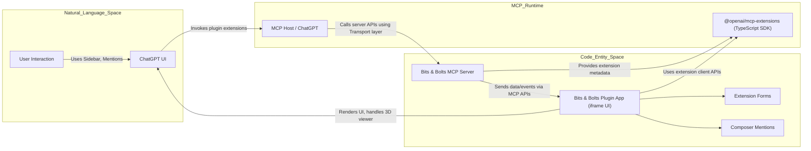

<!-- source: DeepWiki mcp.deepwiki.com · repo openai/mcp-extensions · page 1.1 Getting Started · fetched 2026-10-26 -->

# Getting Started

<details>
<summary>Relevant source files</summary>

The following files were used as context for generating this wiki page:

- [.gitignore](.gitignore)
- [.prettierignore](.prettierignore)
- [README.md](README.md)
- [eslint.config.mjs](eslint.config.mjs)
- [package.json](package.json)

</details>


This page guides you through the initial steps for working with the OpenAI MCP Extensions codebase. It covers installing the SDKs, running the Bits & Bolts example plugin, understanding the repo's tooling setup including pnpm workspace configuration, package.json scripts, linting and formatting tools, and local development commands.

---

## 1. Installing the SDKs

OpenAI MCP Extensions provides two main SDKs to build MCP Servers and Apps:

- **TypeScript SDK**: Available under the `typescript/` directory as the package `@openai/mcp-extensions`. This package supports both the server-side and app-side (iframe) integration for MCP plugins.  
- **Python SDK**: Available under the `python/` directory as the package `openai-mcp-extensions`. This is for server implementations written in Python.

To add the SDKs to your MCP server or app project, follow these:

- For TypeScript, install the SDK package with your preferred package manager (using `pnpm` recommended to stay consistent).  
- For Python, install the `openai-mcp-extensions` package via PyPI or from source, depending on your environment.

The README.md file provides direct links and references to SDK installation instructions under sections "1. Create a plugin" and "2. Add the SDKs to your MCP server" which elaborate on setup steps. See lines 33-54 in README.md for details.

---

## 2. Trying the Bits & Bolts Plugin

The "Bits & Bolts" plugin serves as a showcase of MCP Extensions capabilities. It demonstrates:

- Sidebar entrypoints allowing access from the ChatGPT sidebar.  
- File extension handlers to render custom file viewers (e.g., 3D CAD parts).  
- Composer mentions to search and reference plugin resources in messages.  
- Extended forms supporting thumbnail selectors.

### How to try it out:

1. Install the **Bits & Bolts Remote** plugin in ChatGPT via the provided plugin directory link (see README.md lines 35-41).  
2. Open the plugin using the sidebar to explore its Parts Library UI as shown in the provided screenshots.  

This example plugin includes both server and app components to demonstrate the full stack usage of MCP Extensions, detailed further in section 5 of the documentation.

---

## 3. Repository Tooling Overview

This repository is structured as a **pnpm workspace** managing several interconnected packages including the core SDKs, example plugin, and tooling scripts.

### 3.1. pnpm Workspace

- The root `package.json` (lines 1-30) defines the workspace with `"private": true` and manages overall dev dependencies and scripts.
- The package manager is pinned to `"pnpm@11.19.0"` with Node engine version set to `>=22`.
- The workspace enables running commands across all packages or filtering by specific package names.

### 3.2. package.json Scripts

Key scripts defined in the root `package.json` include:  

| Script          | Description                                                                               |
|-----------------|-------------------------------------------------------------------------------------------|
| `build`         | Runs build commands in all packages recursively.                                         |
| `format`        | Checks code formatting using Prettier.                                                  |
| `format:fix`    | Auto-fixes formatting issues with Prettier.                                             |
| `lint`          | Runs ESLint on the workspace, disallowing warnings (max 0).                             |
| `types`         | Typescript type-check only for the core `@openai/mcp-extensions` package.                |
| `plugins:types` | Type-check for the "bits-and-bolts" plugin package.                                     |
| `plugins:build` | Build the "bits-and-bolts" plugin package.                                              |
| `check`         | Runs formatting, linting, typing, building and plugin package checks as a full validation.|

These scripts automate code quality and build processes to streamline local development and CI.

### 3.3. Linting with ESLint

The ESLint configuration is defined in `eslint.config.mjs` using TypeScript ESLint with rules customized:

- Consistent type imports enforced.
- Unused variables throw errors with exceptions for those prefixed with `_`.
- Console output disallowed to maintain clean logs.

Ignores common directories such as `.venv`, `coverage`, and `node_modules` to speed processing.

### 3.4. Formatting with Prettier

Prettier configuration is supplemented by `.prettierignore` which excludes common folders and generated files like:

- `node_modules/`  
- `.venv/`  
- `__pycache__/`  
- Build artifacts like `dist/` and `build/`  
- Lock files and changelogs managed automatically

### 3.5. .gitignore

The `.gitignore` file excludes typical development-generated files and folders:

```text
node_modules/
.venv/
__pycache__/
*.pyc
*.egg-info/
dist/
build/
/.local/
*.tgz
.env
.env.*
.DS_Store
python/uv.lock
```

This helps keep the repository free from environment-specific or build artifacts.

---

## 4. Local Development Commands

To facilitate local development, use the root `package.json` scripts with `pnpm`. Useful commands include:

- **Build all packages**:  
  ```bash
  pnpm build
  ```
- **Check code formatting without changes**:  
  ```bash
  pnpm format
  ```
- **Auto-fix formatting issues**:  
  ```bash
  pnpm format:fix
  ```
- **Run linting (errors only)**:  
  ```bash
  pnpm lint
  ```
- **Type-check core SDK**:  
  ```bash
  pnpm types
  ```
- **Build and type-check the bits-and-bolts plugin**:  
  ```bash
  pnpm plugins:build
  pnpm plugins:types
  ```
- **Full validation including packaging checks**:  
  ```bash
  pnpm check
  ```

These scripts are designed to maintain high code quality and consistency.

---

## 5. Data Flow and Implementation Highlights

The MCP Extensions framework is composed of several intersecting layers:

- **SDKs** provide the type-safe APIs for building MCP servers and apps.
- The **Bits & Bolts plugin** is a full example that integrates server APIs, IPC with the MCP host, file viewers, and UI components.
- The **package scripts and tooling** ensure build, lint, format, and type enforcement across the repo.

### High-level data flow with Bits & Bolts context:



This diagram illustrates how user interactions in ChatGPT UI reach the Bits & Bolts plugin via MCP hosting and extension SDKs.

---

## 6. Repo Structure & Development Flow

- Root manages the workspace and scripts (`package.json`).
- SDK codebases reside under `typescript/` and `python/`.
- The Bits & Bolts example plugin lives in `plugins/bits-and-bolts/`, showing usage of every major extension type.
- Development uses pnpm to build, lint, format, and test packages.
- ESLint and Prettier configurations enforce code style conventions.
- .gitignore ensures environment and build artifacts are kept out of version control.

This integrated tooling setup yields a streamlined and consistent development experience.

---

# Summary

This "Getting Started" page covered the essential initial steps to work with OpenAI MCP Extensions:

- Installing the TypeScript and Python SDKs.  
- Exploring the Bits & Bolts example plugin functionality.  
- Repository tooling including pnpm workspace, scripts, ESLint and Prettier usage.  
- Local development commands for build, lint, type-check, and packaging validation.  
- High-level implementation data flow tying natural language user interactions to code-level MCP extension entities.

You are now prepared to dive deeper into the extensions specification, SDK usage, or plugin development.

---

### Sources:

- `README.md:1-62`  
- `package.json:1-30`  
- `eslint.config.mjs:1-33`  
- `.prettierignore:1-15`  
- `.gitignore:1-15`

---

