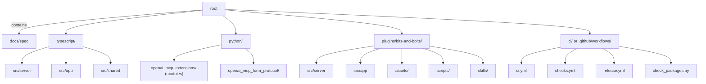

<!-- source: DeepWiki mcp.deepwiki.com · repo openai/mcp-extensions · page 1.2 Repository Layout & Conventions · fetched 2026-10-26 -->

# Repository Layout & Conventions

<details>
<summary>Relevant source files</summary>

The following files were used as context for generating this wiki page:

- [AGENTS.md](AGENTS.md)
- [LICENSE](LICENSE)
- [SECURITY.md](SECURITY.md)

</details>


This page provides a detailed directory-by-directory overview of the repository structure of **openai/mcp-extensions**, important contribution and agent conventions, the security policy, and licensing information. The intent is to familiarize contributors and maintainers with the organization of the codebase, key conventions to follow when contributing, and how governance is structured regarding security and licensing. This is a LEAF page without child pages.

---

## 1. Repository Directory Structure

The repository is organized to separate documentation/specifications, SDK implementations, example plugins, and CI/release automation scripts into well-defined directories and files.

### Key Top-Level Directories

- **`docs/spec`**  
  Contains specification documents defining the extension mechanisms layered on top of MCP via `_meta` namespaces.  
  (Referenced in overview, Doc pages)

- **`typescript/`**  
  TypeScript SDK implementation split between server helpers, app-side client helpers (in-iframe), and shared utilities/types. Provides the client and server extension APIs.  
  Main folders:  
  - `src/server` — Server extensions (e.g., `extensions.ts`, `mentions.ts`)  
  - `src/app` — App runtime helpers (e.g., `transport.ts`, `deep-link.ts`)  
  - `src/shared` — Shared types and utilities

- **`python/`**  
  Python SDK packages mirroring the TypeScript SDK API surface for extensions and form elicitation protocol.  
  Packages include `openai_mcp_extensions` and `openai_mcp_form_protocol`.  
  Key modules: `extensions.py`, `mentions.py`, `resources.py`, `settings.py`, and form-related `_elicitation.py`.

- **`plugins/bits-and-bolts/`**  
  A comprehensive example plugin demonstrating all extension features, built as a CAD parts plugin.  
  Subfolders include:  
  - `src/server` — Plugin MCP server with catalog, stores, forms, test fixtures  
  - `src/app` — Plugin app UI and 3D viewer including Three.js usage  
  - `assets/` — Icons, keycap legends, JSON meshes  
  - `scripts/` — Build and model generation scripts  
  - `skills/` — Sub-plugins for onboarding and bits-and-bolts domain logic

- **`ci/` or `.github/workflows/`**  
  CI pipelines and release automation configuration, including workflows for linting, building, testing, and publishing. Key files:  
  - `ci.yml` and `checks.yml` — GitHub Actions workflow definitions  
  - `release.yml`, `release-please` config, and scripts for PyPI/npm trusted publishing  
  - `check_packages.py` — Package validation scripts  
  - Marketplace packaging manifests and builders

---

### Directory Layout Diagram



Sources: License, Security.md, AGENTS.md

---

## 2. Contribution and Agent Conventions

### Markdown Link Conventions

- Contributors must **use only relative Markdown links** when referring to files or sections within this repository. This ensures stable and consistent linking regardless of merge state or fork location.  
- This rule is stipulated explicitly in `AGENTS.md`.  
- Relative Markdown linking supports intra-repo navigation and automated documentation processing.  

### Agent and Extension Conventions

- Agent definitions and extensions should follow the internal conventions documented in `AGENTS.md`, which currently emphasizes link usage and submission norms consistent with the repository’s collaborative workflows.

### Security Policy Reference

For security-related contributions, vulnerabilities, or responsible disclosures:

- Refer to the **Security Policy** found in the `SECURITY.md` file, which provides instructions and references OpenAI's coordinated vulnerability disclosure policy.  
- The repository directs reporters to OpenAI’s official vulnerability disclosure guidelines at https://openai.com/security/disclosure/ and provides its PGP key via `security.txt`.  

---

## 3. License

This repository is licensed under the **Apache License Version 2.0**, dated January 2004, which is a permissive open-source license.

### Highlights of the License

- Grants a worldwide, royalty-free, non-exclusive license to use, reproduce, prepare derivative works, distribute, and publicly perform or display the work.  
- Contributions submitted to this repository are covered under the same license terms.  
- Requires redistribution of the license text and prominent notices on modifications.  
- Contains patent licensing provisions with termination clauses for patent litigation against contributors.  

### License File

- The full license text is included verbatim in the `LICENSE` file at the root of the repository.  
- This license governs the usage, distribution, and contribution to all code and documentation within the repo.

---

## 4. Bridging Natural Language Concepts to Code Entities

The repository centers around MCP Extensions, which are mechanism specifications layered on MCP/MCP Apps via the `_meta` namespace. This bridging diagram maps conceptual features of the extensions framework to actual code entities located in the TypeScript SDK and Python SDK.

### Natural Language to TypeScript Server API Mapping

```mermaid
flowchart TD
  NL["Natural Language Features"] --> NSM["_meta Namespaces"]
  NSM --> EXT["Extensions Metadata"]
  EXT --> ETS["typescript/src/server/extensions.ts"]
  EXT --> MTS["typescript/src/server/mentions.ts"]
  EXT --> RTS["typescript/src/server/resources.ts"]
  EXT --> STS["typescript/src/server/settings.ts"]
  EXT --> UTS["typescript/src/server/ui.ts"]
  EXT --> FMS["typescript/src/server/forms/"]

  classDef code fill:#f9f,stroke:#333,stroke-width:1px
  ETS, MTS, RTS, STS, UTS, FMS class code
```

### Natural Language to Python SDK Mapping

```mermaid
flowchart TD
  NL2["Natural Language Features"] --> NSM2["_meta Namespaces"]
  NSM2 --> EXT2["Extensions Metadata Layer"]
  EXT2 --> EPY["openai_mcp_extensions/extensions.py"]
  EXT2 --> MPY["openai_mcp_extensions/mentions.py"]
  EXT2 --> RPY["openai_mcp_extensions/resources.py"]
  EXT2 --> SPY["openai_mcp_extensions/settings.py"]
  EXT2 --> UIPY["openai_mcp_extensions/ui.py"]
  EXT2 --> FPPY["openai_mcp_form_protocol/_elicitation.py"]

  classDef code fill:#f9f,stroke:#333,stroke-width:1px
  EPY, MPY, RPY, SPY, UIPY, FPPY class code
```

These conceptual diagrams assist developers in locating the relevant entry points and modules when implementing or debugging particular MCP extension features.

Sources: typescript/src/server/extensions.ts, python/openai_mcp_extensions/extensions.py, AGENTS.md, SECURITY.md, LICENSE

---

# Summary

This section disclosed:

- The high-level repository layout spanning specification docs, SDKs (TypeScript & Python), a rich example plugin, and CI/release tooling.  
- Conventions for contributions and agent development focusing on Markdown linking and security considerations.  
- The Apache 2.0 License terms governing use and contribution.  
- Bridging diagrams tying natural language feature abstractions of MCP Extensions to precise code modules in the SDKs.

By following these directory and code conventions, contributors can efficiently navigate, develop, and maintain the repository with clear governance and security alignment.

---

Sources:  
* `AGENTS.md`  
* `LICENSE` (lines 1-125)  
* `SECURITY.md`

---

