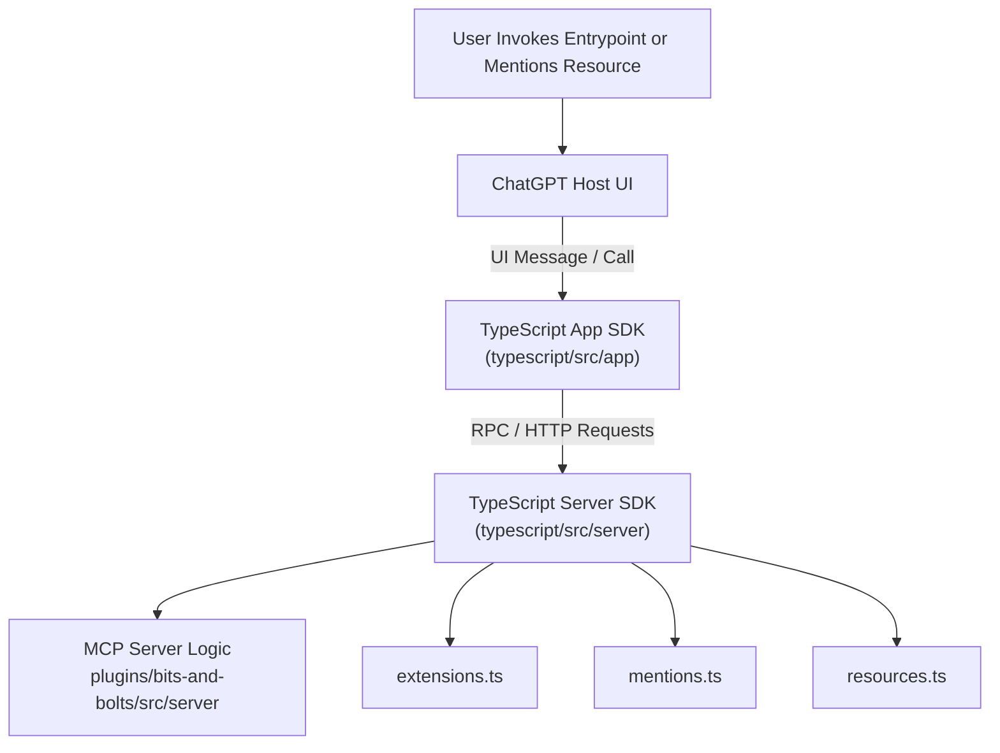

<!-- source: DeepWiki mcp.deepwiki.com · repo openai/mcp-extensions · page 2 The Extensions Specification · fetched 2026-10-26 -->

# The Extensions Specification

<details>
<summary>Relevant source files</summary>

The following files were used as context for generating this wiki page:

- [docs/spec.md](docs/spec.md)

</details>


The Extensions Specification defines the set of extensions built atop the foundational Model Context Protocol (MCP) and MCP Apps specifications. These extensions enable deeper integration with ChatGPT platforms, including ChatGPT Work, Desktop, and mobile clients, allowing developers to create richer, more interactive plugins and features that extend beyond the baseline MCP capabilities.

This specification is captured primarily in the repository’s `docs/spec.md` file and details how extensions leverage the `_meta` namespaces within MCP data structures to layer new functionality. Most users and developers will find it easier to engage with these extensions through the provided TypeScript and Python SDKs, which encapsulate and simplify adherence to the specification.

## What Are MCP Extensions?

The Model Context Protocol (MCP) is a foundational protocol defining data structures and interface contracts for interoperable applications integrated with AI models. MCP Apps are applications implemented according to the MCP spec.

Extensions to MCP presented here extend MCP by defining specialized metadata within `_meta` namespaces of MCP data types to enable capabilities tightly coupled to ChatGPT and the OpenAI ecosystem. These extensions influence UI behaviors, app entrypoints, resource management, form elicitation, settings schemas, and others.

In essence:

- MCP Apps define the standard interface and state for apps integrated with MCP-compatible hosts.
- MCP Extensions extend MCP Apps by using `_meta` namespaces as "extension points."
- These extension points signal to ChatGPT host clients how to render UI elements, invoke entrypoints, manage resources, collect structured user input, and more.

This _meta-based layering maintains backward compatibility with MCP hosts while enabling a richer, ChatGPT-specific feature set.

## High-Level Architecture Diagram

```mermaid
graph LR
  subgraph "ChatGPT Host Environment"
    ChatUI["ChatGPT UI"]
    ModelLayer["OpenAI Model API"]
    MCPHost["MCP Host Runtime"]
  end

  subgraph "Extensions Layer (via _meta namespaces)"
    MetaUI["_meta[\"openai/ui\"]"]
    MetaResource["_meta[\"openai/resources\"]"]
    MetaForms["_meta[\"openai/forms\"]"]
    MetaSettings["_meta[\"openai/settings\"]"]
  end

  subgraph "MCP Apps & MCP Base"
    MCPApps["MCP Apps"]
    MCPSpec["MCP Base Spec"]
  end

  ModelLayer --> MCPHost
  MCPHost --> MCPApps
  MCPApps --> MCPSpec

  MCPApps --> MetaUI
  MCPApps --> MetaResource
  MCPApps --> MetaForms
  MCPApps --> MetaSettings

  MetaUI --> ChatUI
```

This diagram illustrates the layering: extensions live inside `_meta` keys in MCP Apps data structures, and are interpreted by the ChatGPT host UI to enable enhanced interactions beyond vanilla MCP capabilities.

---

## Core Extension Areas & Links to Child Pages

The extensions specification encompasses several feature families, each described in detail on dedicated child pages. Below is a high-level overview with links pointing to these more granular documents:

### 1. App Entrypoints & Display Modes

Extensions allow MCP servers to register specific static entrypoints that users can access directly from ChatGPT’s navigation and UI, rather than invoking apps solely via AI model calls.

- Entry points include:
  - **Global Entrypoint:** A full-screen app accessible from primary sidebar navigation.
  - **Thread Entrypoint:** A tab within an existing conversation thread.
  - **File Entrypoint:** A handler that can render files referenced inside threads.

Entry points contain associated metadata such as icons and titles to integrate seamlessly into the ChatGPT UI’s navigation model.

Display modes configure how resources and UI components are shown to the user within ChatGPT.

For detailed descriptions of entrypoints, icon guidelines, display modes, deep links, platform support and plugin onboarding flows, see [App Entrypoints & Display Modes](#2.1).

---

### 2. Resources, Mentions & Model Context

This domain covers how MCP extensions support rich interactions with resources, such as:

- At-mentions within the composer, enabling users to invoke or reference applications and data entities.
- Resource search and display modes that enrich UI rendering.
- Access to local filesystem resources or file opening requests.
- Extensions that update model context dynamically to optimize AI model input for current UI or user focus.
- Support for rich thumbnails and media rendering.

Refer to [Resources, Mentions & Model Context](#2.2) for the comprehensive protocol and integration details.

---

### 3. Forms & Elicitation

OpenAI’s form elicitation protocol defines a standardized schema and messaging protocol within the extensions framework to collect structured user inputs seamlessly.

- It includes schema definitions for forms.
- Resource pickers allow users to select resources in context.
- Thumbnail selectors and suggested value lists facilitate advanced UI components and assistive completions.

The protocol aligns with MCP UI extensions and can prompt users naturally to fill required fields during interactions.

See [Forms & Elicitation](#2.3) for further technical details.

---

### 4. Structured Settings

Structured Settings extensions define how plugins expose configurable settings via structured schemas.

- The MCP extensions framework specifies entrypoints for settings management.
- Schema allows for rich data types and validation.
- Enables user-friendly settings integration within ChatGPT plugins.

Settings data and UI hints are conveyed through the `_meta` namespaces for consistent client-side rendering.

More on the schema and settings entrypoint are available at [Structured Settings](#2.4).

---

## Relationship Between Extension Areas

| Extension Area              | Role in MCP Extensions                           | Related Extensions                                  |
|----------------------------|-------------------------------------------------|----------------------------------------------------|
| App Entrypoints & Display Modes | Define how apps surface in UI & provide entry points | Deep links, icons, plugin onboarding                |
| Resources, Mentions & Context    | Manage resources referenced or selected by users | Model context updates, resource display & search    |
| Forms & Elicitation              | Collect structured multi-field user input via UI | Resource pickers, suggested values                   |
| Structured Settings              | Provide user-configurable plugin options         | Settings transport, UI rendering                      |

These extensions build on each other: entrypoints expose apps, which may leverage rich resource interactions and forms, all configurable through structured settings, creating a cohesive plugin experience fully integrated with ChatGPT.

---

## Platform Support Summary

Platform support varies for each extension feature depending on the client environment (Desktop, Web/Work, iOS, Android). For example, file entrypoints and certain resource operations are supported only on Desktop clients, while others, like global entrypoints and structured settings, have broader support.

The specification includes a comprehensive platform support matrix, describing expected support at launch with notes on limitations.

---

## Summary

- This specification layers MCP extensions via `_meta` namespaces to unlock rich ChatGPT integrations.
- Key extension areas are App Entrypoints & Display Modes, Resources & Mentions, Forms & Elicitation, and Structured Settings.
- These are implemented and surfaced via metadata conventions interpreted by ChatGPT hosts.
- Child pages provide comprehensive technical details and usage guides per functional area.
- TypeScript and Python SDKs ease implementation by wrapping these protocols.

For detailed exploration of each feature family, follow the links to the child documents:

- [App Entrypoints & Display Modes](#2.1)
- [Resources, Mentions & Model Context](#2.2)
- [Forms & Elicitation](#2.3)
- [Structured Settings](#2.4)

---

# Bridging Natural Language Descriptions to Code Entities

Two diagrams follow, illustrating how natural language concepts map to code artifacts within the MCP extensions codebase.

### Diagram 1: From User Actions to MCP Server Side Code Entities



- User triggers entrypoint or mentions in the ChatGPT UI.
- The app-side SDK (`typescript/src/app`) sends requests to server-side SDK (`typescript/src/server`).
- Server SDK modules handle the metadata and extensions: `extensions.ts` for general extensions logic, `mentions.ts` for at-mention handling, `resources.ts` for resource queries.
- Actual app logic resides in MCP Servers, e.g. `plugins/bits-and-bolts/src/server`.

Sources: `docs/spec.md:30-131`, `typescript/src/server/extensions.ts`, `typescript/src/server/mentions.ts`, `typescript/src/server/resources.ts`.

---

### Diagram 2: Metadata Namespaces to Extension Feature and Code Mapping

```mermaid
graph LR
  MetaMeta["_meta Namespace"]
  UIExt["openai/ui"]
  ResExt["openai/resources"]
  FormsExt["openai/forms"]
  SettingsExt["openai/settings"]

  UIExt --> EntryPoints["Entry Points\n(e.g. _meta[\"openai/ui\"][\"entrypoints\"])\nTools & Icons Metadata"]
  ResExt --> Mentions["Mentions & Resource Display\nAt-mentions, Thumbnails, Filesystem"]
  FormsExt --> Forms["Form Protocol\nSchemas, Pickers, Suggested Values"]
  SettingsExt --> Settings["Structured Settings\nSchemas and UI"]

  EntryPoints --> UIClient["ChatGPT UI"]
  Mentions --> UIClient
  Forms --> UIClient
  Settings --> UIClient
```

This figure maps core `_meta` namespaces in MCP extensions to their respective functional feature sets and how they affect ChatGPT UI rendering and behavior.

Sources: `docs/spec.md:18-132`.

---

# References

- `docs/spec.md` (full specification overview and platform support matrix)
- `typescript/src/server/extensions.ts` (server extension APIs)
- `typescript/src/server/mentions.ts` (at-mention server logic)
- `typescript/src/server/resources.ts` (resource and file handling)
- `plugins/bits-and-bolts/src/server` (example MCP Server implementation)

---

**Sources:**  
`docs/spec.md:1-131`(), `typescript/src/server/extensions.ts:1-100`(), `typescript/src/server/mentions.ts:1-100`(), `typescript/src/server/resources.ts:1-100`()

---

