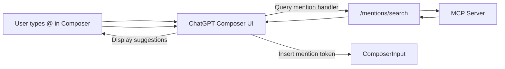
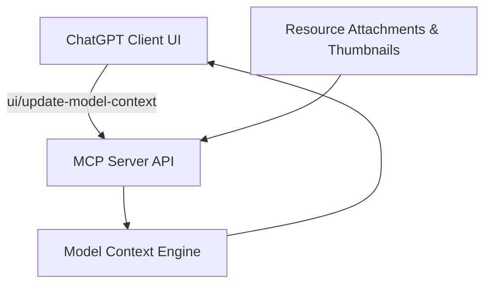
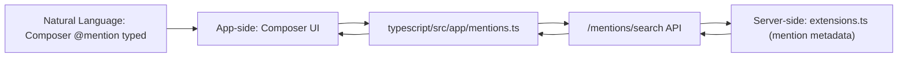
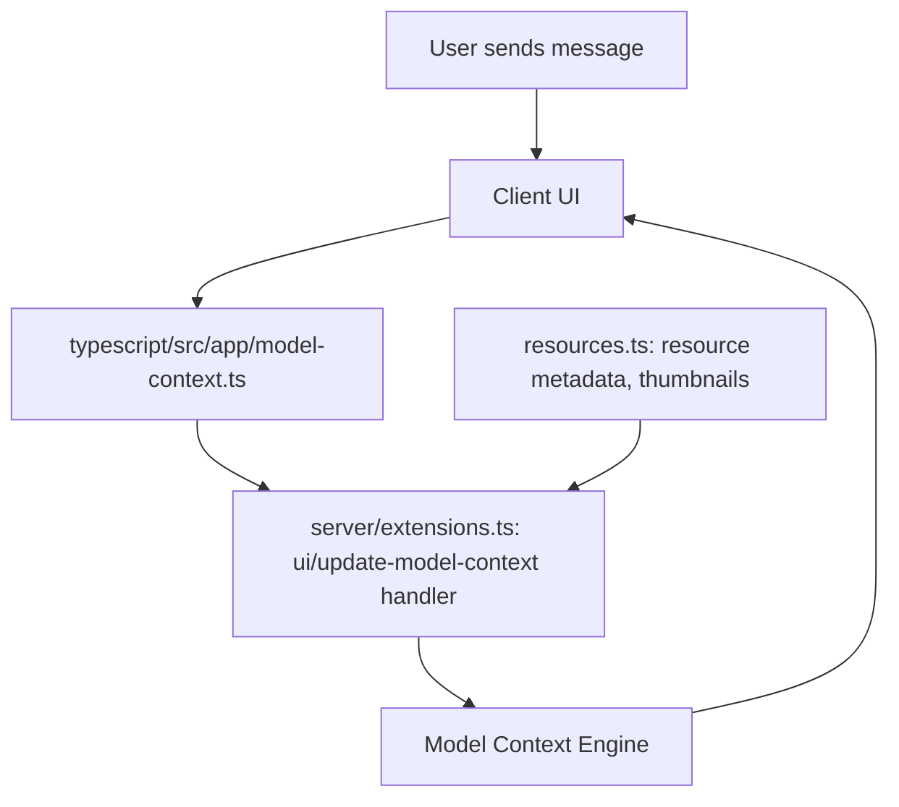

<!-- source: DeepWiki mcp.deepwiki.com · repo openai/mcp-extensions · page 2.2 Resources, Mentions & Model Context · fetched 2026-10-26 -->

# Resources, Mentions & Model Context

Relevant source files

The following files were used as context for generating this wiki page:

- [docs/resources/05-composer-mention.png](docs/resources/05-composer-mention.png)
- [docs/resources/08-model-context-attachments.png](docs/resources/08-model-context-attachments.png)
- [docs/spec.md](docs/spec.md)

This page covers the technical details of several integral ChatGPT MCP Extensions related to resource management, at-mentions in the composer, filesystem access, UI updates, model context, and thumbnail handling. These extensions enhance the user experience by enabling richer integration in ChatGPT desktop and related platforms, permitting resource search/display, local file opening, dynamic model context updates, and visual thumbnails. The implementations leverage _meta namespaces layered on top of the MCP protocol, utilizing server and app APIs defined in the specification and SDKs.

---

## 1. Overview

The "Resources, Mentions & Model Context" extension family provides functionality around:  

- At-mentions in the composer for resources (user, thread, or other entities)  
- Searching and displaying resource metadata and thumbnails  
- Accessing local files and performing safe file opening  
- UI-triggered model context updates for improved conversation flow and tool orchestration  
- Packaging resource attachments and thumbnails for model context enrichment

The specification defines these extension capabilities primarily under the `_meta["openai/ui"]` namespace and related sub-namespaces. They are implemented via server-side metadata declarations and app-side APIs that facilitate resource fetching, UI state updates, and file handling.

---

## 2. Composer At-Mentions

Composer at-mentions enable the user to trigger suggestions by typing a special character (generally `@`) in the chat composer input. These mentions can reference various resource types such as users, threads, or plugin-specific objects.

### Implementation

- **Declaration**: The server advertises mention capabilities by listing mention descriptors in the tool’s `_meta["openai/ui"]["mentions"]` array.

- **Mention Descriptor**: Each mention type includes filters and query parameters for searching resources.

- **Usage in Composer**: When the user types `@` followed by characters, the client app calls the mention search provider endpoint declared by the server to fetch and display resource suggestions.

- **Activation**: On selection of a resource from the mentions dropdown, a structured mention token is inserted into the composer.

**Key Elements**:

- Mention metadata: `_meta["openai/ui"]["mentions"]`  
- Mention search endpoint: Typically `/mentions/search` under the server  
- Client-handling of input events and mention dropdown UI

**Data Flow**:

Sources: [docs/spec.md:1-131]()

---

## 3. Resource Search & Display

Resources are structured entities such as users, documents, or plugin-provided objects that can be searched for and displayed within ChatGPT.

### Resource Descriptors

- Each resource has metadata exposed by the server, e.g., name, type, description, and unique identifiers.

- Resources may include thumbnails or icons, enhancing the UI representation.

- Servers provide resource lists and detail lookup APIs.

### Resource Search

- Implemented as part of the "resources" extension family via dedicated endpoints.

- Supports query filters to refine results.

- The Composer and other UI areas can use this API to display rich resource pickers.

### Thumbnails and Attachments

- Resources often have associated image thumbnails.

- These thumbnail URLs are embedded in resource metadata, enabling UIs to preload and display visuals.

- Thumbnail generation and caching are managed server-side, ensuring performance.

Sources: [docs/spec.md:1-131]()

---

## 4. Filesystem Access and Local File Opening

File system related extensions mainly support local file browsing and opening within desktop ChatGPT.

### Local File Opening

- On desktop, extensions can open local files referenced by threads or from the composer context.

- Servers provide explicit metadata and handler info for permitted file types.

- Clients invoke file opening via the `ui/open-local-file` extension message.

### Filesystem Access

- Some plugins expose a virtual or remote filesystem accessible via resource APIs.

- Browsing and file manipulation commands are routed through plugin endpoints.

### Security Considerations

- Local file open operations are gated and only allowed on desktop platforms due to sandboxing.

- The spec and implementation ensure authorization and safe operation to avoid arbitrary file access.

Sources: [docs/spec.md:1-131]()

---

## 5. UI and Update Model Context Extensions

Model context is critical for guiding ChatGPT's reasoning. This set of extensions allows the client UI to update context dynamically and enrich it with additional data, such as resource attachments or metadata.

### UI Extensions

- The server declares UI update capabilities under `_meta["openai/ui/update-model-context"]`.

- Clients call `ui/update-model-context` messages to push supplementary context during a thread or composer session.

- Context updates may include resource attachments, file references, or external plugin data.

### Model Context Attachments

- Attachments like resource metadata and thumbnails can be sent along with updates.

- This enriches the model's understanding for better response generation.

- The protocol allows structured packaging of these attachments, facilitating efficient context injection.

**Data Flow**:

Sources: [docs/spec.md:1-131]()

---

## 6. Architectural Summary: Bridging Natural Language to Code Entity Space

The system’s design bridges “natural language space” (user input, mentions, and UI context) to “code entity space” (server API endpoints, metadata descriptors, and extension messages). Below are two diagrams illustrating these connections with code identifiers.

### Diagram 1: Mentions Extension Architecture

- `composer.ts` and `mentions.ts` at app-side handle user input and dropdown UI.  
- `extensions.ts` on the server declares mention metadata and handles search queries.

Sources: [typescript/src/app/mentions.ts:1-50](), [typescript/src/server/extensions.ts:10-21](), [docs/spec.md:10-80]()

### Diagram 2: Model Context Update Pipeline

- The `model-context.ts` app-side layer manages sending context update messages.  
- The server handles update-model-context requests to integrate resource info.  
- Resource descriptors and thumbnails come from resources endpoint implementations.

Sources: [typescript/src/app/model-context.ts:1-62](), [typescript/src/server/extensions.ts:21](), [typescript/src/server/resources.ts:20-25]()

---

## 7. Key Classes and Functions

| Symbol                                   | File                             | Description                                                                                      |
|------------------------------------------|---------------------------------|--------------------------------------------------------------------------------------------------|
| `extensions.ts`                          | `typescript/src/server/extensions.ts` | Registers extension metadata including mentions, ui/update-model-context, and resource descriptors |
| `mentions.ts`                            | `typescript/src/app/mentions.ts`       | Client-side mention dropdown logic and query handling                                            |
| `resources.ts`                          | `typescript/src/server/resources.ts`   | Server implementations for resource search and metadata fetching                                 |
| `model-context.ts`                      | `typescript/src/app/model-context.ts`  | App-side API for updating model context and handling UI-triggered context messages                |
| `/mentions/search` API Handler          | Server endpoint                  | Processes mention queries and returns resource suggestions                                      |
| `ui/open-local-file` extension handler  | Server and app                  | Opens local files securely on supported platforms (desktop)                                    |

---

## 8. Summary

The "Resources, Mentions & Model Context" extensions robustly connect user intent in natural language (during composition) to precise server-side resource entities and enhanced model context. They provide critical bridges enabling at-mentions of resources, rich thumbnail displays, safe local file automation, and powerful dynamic context updates to improve ChatGPT’s responsiveness and integration with plugins and local filesystems.

The described APIs, metadata declarations, and extension messages implement these features within the MCP Extensions framework, enabling seamless, extensible, and secure user experiences for ChatGPT desktop and beyond.

---

Sources:  
- `docs/spec.md:1-131`  
- `docs/resources/05-composer-mention.png`  
- `docs/resources/08-model-context-attachments.png`  
- `typescript/src/server/extensions.ts:1-140`  
- `typescript/src/app/mentions.ts:1-50`  
- `typescript/src/server/resources.ts:20-80`  
- `typescript/src/app/model-context.ts:1-70`

---

