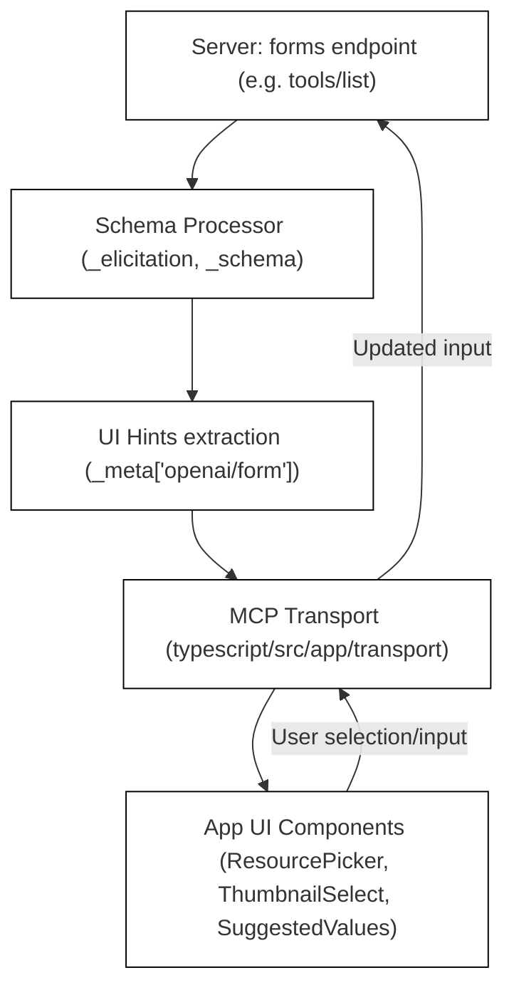

<!-- source: DeepWiki mcp.deepwiki.com · repo openai/mcp-extensions · page 2.3 Forms & Elicitation · fetched 2026-10-26 -->

# Forms & Elicitation

<details>
<summary>Relevant source files</summary>

The following files were used as context for generating this wiki page:

- [docs/resources/13-form-resource-picker.png](docs/resources/13-form-resource-picker.png)
- [docs/resources/14-form-select-thumbnails.png](docs/resources/14-form-select-thumbnails.png)
- [docs/resources/15-form-suggested-values.png](docs/resources/15-form-suggested-values.png)
- [docs/spec.md](docs/spec.md)

</details>


This section details the OpenAI form elicitation protocol implemented in the MCP Extensions codebase. It covers the schema definitions, resource pickers, thumbnail selects, and suggested values features, explaining their design, implementation, and how they fit into the overall data flow within extensions. This document serves as a technical reference to understand and work with the form elicitation capabilities that allow MCP apps to collect structured user inputs in a rich and extensible way.

---

## Purpose & Scope

OpenAI form elicitation enables MCP apps to solicit structured input from users using declarative schemas enriched with UI hints such as resource pickers, thumbnail selects, and suggested values. These forms are fully integrated with the MCP extension metadata and UI handling protocols, allowing seamless interaction between natural language, UI rendering, and data validation within ChatGPT and other MCP hosts.

This page explains:

- The schemas governing the elicitation forms.
- How resource pickers are integrated into form fields to select external resources.
- The thumbnail selection UI component for visual choices.
- Suggested values infrastructure for pre-populating fields or offering options.
- The main classes and functions that drive form processing and rendering.
- Data flow and interaction between MCP servers, clients (apps), and ChatGPT host environments.

---

## 1. Elicitation Schema

Elicitation forms rely on a rich schema definition layered on top of standard MCP input schemas. Each form corresponds to a `tool` with an `inputSchema` describing required fields. The extensions metadata `_meta["openai/form"]` defines UI hints, including resource pickers and thumbnails.

Key attributes include:

- **Field Types**: Primarily JSON Schema types (`string`, `number`, `object`, `array`), augmented with custom UI annotations.
- **Resource Picker**: A UI widget bound to a field enabling users to select from server-defined resources.
- **Thumbnail Select**: Offers a UI with selectable thumbnail images mapped to values.
- **Suggested Values**: A list of predefined options for a field, often shown as suggestions or dropdowns.

The schema metadata guides the rendering logic and user input validation at runtime.

### Data Model Highlights

- Extension servers declare their form metadata in tools via `_meta["openai/form"]`.
- Fields may specify `"resourcePicker": true` with parameters dictating filters and categories.
- Thumbnail selects are specified with image URLs mapped to option values.
- Suggested values are declared as arrays of option objects with `label` and `value` keys.

---

## 2. Resource Pickers

Resource pickers present a widget allowing users to browse and select server-defined resources.

### Implementation Detail

- Resource pickers are declared by setting `"resourcePicker": true` within the form field schema.
- The picker UI displays resources filtered by criteria from the schema, such as resource type.
- Resources are rendered with thumbnails or icons for quick recognition.
- On selection, the picker returns the resource ID or URI to populate the form field.

### Integration with MCP

- The protocol leverages MCP resource APIs to list and fetch resource metadata.
- Resource picker UI is embedded in MCP App iframes with transport communication to server.
- Selected resources update the form input state and trigger validation/updates.

---

## 3. Thumbnail Select

Thumbnail selects provide a compact, visual selection UI within forms for picking from a set of predefined images mapped to values.

### Characteristics

- Defined as a property of a form field in the schema with a list of `{label, value, thumbnailUrl}` objects.
- The UI displays small images representing each option.
- Upon user selection, the related value is set on the form field.
- Enhances UX by allowing image-based choices instead of textual lists.

Visual examples of the thumbnail select UI are captured in screenshots (e.g., see `docs/resources/14-form-select-thumbnails.png`).

---

## 4. Suggested Values

Suggested values enhance form fields with optional predefined value choices to assist or expedite input.

- Declared in form schemas as arrays of `{label, value}` allowing quick picking.
- Can be static or dynamically generated by the server prior to form render.
- The UI displays these as dropdown options, chips, or inline suggestions.
- Overrides or complements free-text user input.

Suggested value lists harmonize with resource pickers and thumbnail selects for flexible input modalities.

---

## 5. Key Classes and Files

The core functionality for forms and elicitation resides primarily in the following code areas:

- **`_elicitation` Python package**: Contains classes defining the schema, form field handling, and resource picker protocols.
- **TypeScript SDK `typescript/src/server/forms` and `forms/` subfolder**: Provides server-side APIs to serve form metadata and validate input.
- **App-side UI components** (referenced indirectly): Handle UI rendering of pickers, thumbnails, and suggestions.
- **MCP transport layer**: Coordinates message passing for form state updates and picker selections.

These modules work in concert to maintain form state, handle user interactions, validate inputs against schema, and communicate with the MCP server backend.

---

## 6. Data Flow & Interaction Diagram

### Diagram 1: Natural Language Space to Code Entity Space for Forms & Elicitation

```mermaid
flowchart TD
  NL["Natural Language: User Input & Prompts"] -->|Triggers| ChatGPT["ChatGPT Host Environment"]
  ChatGPT -->|Loads| MCPApp["MCP App (iframe)"]
  MCPApp -->|Requests form schema| Server["MCP Server"]
  Server -->|Returns form schema with _meta metadata| MCPApp
  MCPApp -->|Renders form UI (resource picker, thumbnail select, suggested values)| UI["User Interface Components"]
  UI -->|User selects resource or value| MCPApp
  MCPApp -->|Sends form input with resource ID or value| Server
  Server -->|Validates input and updates state| Server
  Server -->|Sends updates or prompts| MCPApp

  style NL fill:#fff,stroke:#000,stroke-width:1px
  style ChatGPT fill:#fff,stroke:#000,stroke-width:1px
  style MCPApp fill:#fff,stroke:#000,stroke-width:1px
  style Server fill:#fff,stroke:#000,stroke-width:1px
  style UI fill:#fff,stroke:#000,stroke-width:1px
```

---

## 7. Detailed Form Schema Example

The form metadata is embedded within tools' metadata in MCP server definitions. An exemplary snippet defines a resource picker field and suggested values:

```json
{
  "name": "exampleTool",
  "inputSchema": {
    "type": "object",
    "properties": {
      "cadResource": {
        "type": "string",
        "description": "Select a CAD part resource",
        "resourcePicker": true
      },
      "material": {
        "type": "string",
        "suggestedValues": [
          { "label": "Steel", "value": "steel" },
          { "label": "Aluminum", "value": "aluminum" }
        ],
        "description": "Select material"
      }
    },
    "required": ["cadResource", "material"]
  },
  "_meta": {
    "openai": {
      "form": {
        "fields": {
          "cadResource": {
            "resourcePicker": {
              "category": "cadParts"
            }
          },
          "material": {
            "suggestedValues": true,
            "ui": {
              "widget": "select",
              "thumbnailSelect": false
            }
          }
        }
      }
    }
  }
}
```

---

## 8. Resource Picker & Thumbnail Select UI Examples

Visual examples available in the repo's docs/resources:

| Screenshot                            | Description                                  | File                    |
|-------------------------------------|----------------------------------------------|-------------------------|
| Form Resource Picker UI              | UI showing a resource picker widget           | `docs/resources/13-form-resource-picker.png` |
| Form Thumbnail Select UI             | Selection using thumbnail images               | `docs/resources/14-form-select-thumbnails.png` |
| Suggested Values UI Example          | Suggested values appearing as suggestions      | `docs/resources/15-form-suggested-values.png` |

These images showcase the user-facing interface elements generated from the extension metadata.

---

## 9. Component Relations and Workflow

### Diagram 2: MCP Server to MCP App Form Interaction Internals



The server-side components prepare the schema and UI metadata, which the client-side app transports and renders. User interactions flow back to update the server state, completing the interaction loop.

---

## Summary

The OpenAI MCP Extensions' Forms & Elicitation protocol defines a flexible and extensible methodology to request structured user inputs. By leveraging enhanced JSON schema annotations, resource picker widgets, thumbnail selects, and suggested values lists, MCP apps can provide rich UI forms integrated tightly into the chat experience and backed by server-side validation and resource APIs.

This forms foundation enables consistent and advanced elicitation patterns across ChatGPT and MCP Apps.

---

## Sources

- `docs/spec.md:1-131`  
- `docs/resources/13-form-resource-picker.png`  
- `docs/resources/14-form-select-thumbnails.png`  
- `docs/resources/15-form-suggested-values.png`

---

