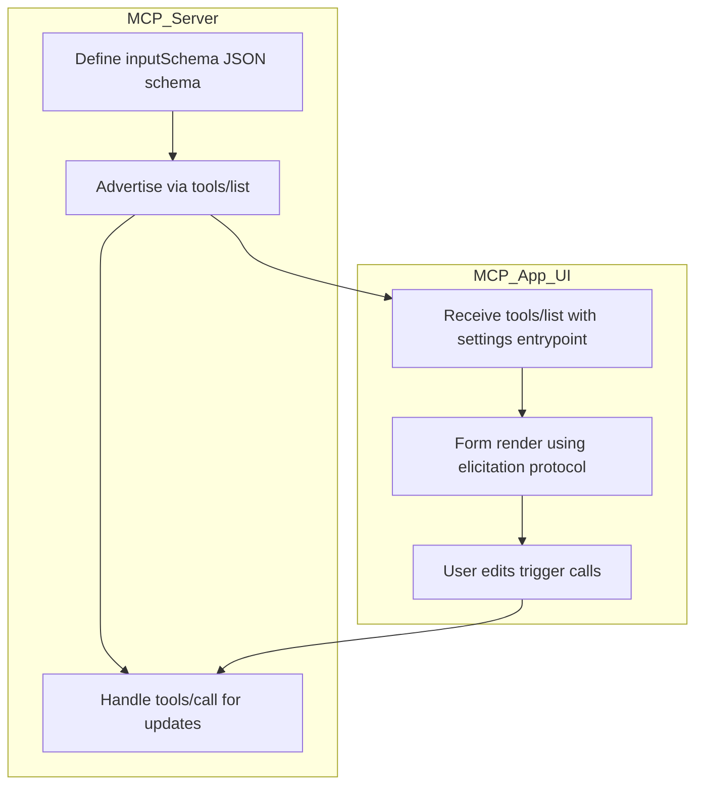

<!-- source: DeepWiki mcp.deepwiki.com · repo openai/mcp-extensions · page 2.4 Structured Settings · fetched 2026-10-26 -->

# Structured Settings

<details>
<summary>Relevant source files</summary>

The following files were used as context for generating this wiki page:

- [docs/resources/07-settings-entrypoint.png](docs/resources/07-settings-entrypoint.png)
- [docs/scheduled-icon.svg](docs/scheduled-icon.svg)
- [docs/spec.md](docs/spec.md)

</details>


This page documents the **Structured Settings** extension in the OpenAI MCP Extensions specification. It covers the entrypoint for settings in MCP Apps, the structured settings schema, and how these settings integrate technically within the system. This leaf page goes into full depth on the implementation, data flow, and relevant classes/functions, including visual diagrams linking specification concepts to concrete code entities.

---

## Purpose and Scope

Structured Settings is a capability defined in the MCP Extensions specification that enables MCP Apps to expose settings in a typed, schema-driven manner. These settings appear as a first-class user interface entrypoint in the ChatGPT UI, allowing end users to configure app-specific options using a structured form.

The extensions spec defines how MCP Servers publish a structured JSON Schema for their settings, and how MCP Apps declare a *settings* entrypoint. This approach standardizes settings discovery, editing, and persistence across hosted plugins in ChatGPT and MCP Apps.

This page explains:

- The *settings* entrypoint declaration as part of MCP App metadata.
- The structured settings schema format as derived from the OpenAI form elicitation protocol.
- How settings data flows from MCP Server to MCP App, and how user edits are communicated back.
- The critical code components implementing these extension points.
- Visual diagrams illustrating key concepts and interactions.

---

## 1. Settings Entrypoint Declaration

Structured Settings appear in the UI as a dedicated entrypoint under the MCP App's namespace. According to the MCP Extensions spec:

- Entrypoints are registered via the MCP App's `_meta["openai/ui"]["entrypoints"]` array.
- To make the app's settings available, an entrypoint with `"type": "settings"` is added.
- This informs the UI to show a "Settings" navigation entry for the MCP App.

### Schema for the Settings Entrypoint

```ts
interface SettingsEntrypoint {
  type: "settings";
}
```

This is a minimal declarative object describing the availability of structured settings. It is located inside `_meta["openai/ui"]["entrypoints"]` of the MCP App's `tools/list` entry.

### Example

The MCP server advertises this in its response describing the app's tools:

```json
{
  "name": "myplugin.settings",
  "inputSchema": {
    "type": "object"
  },
  "_meta": {
    "openai/ui": {
      "entrypoints": [
        {
          "type": "settings"
        }
      ]
    }
  }
}
```

This tells the client (ChatGPT UI) that this tool represents the app settings and that it expects an object input schema (the settings structure).

---

## 2. Structured Settings Schema Specification

The structured settings extension leverages the OpenAI form elicitation protocol for schema definition. The MCP App server provides a JSON Schema describing the shape and type of settings, including:

- Properties (setting keys)
- Value types (string, number, boolean, enums)
- Nested structure support (objects, arrays)
- Validation rules (`required`, `minLength`, `enum`)

This schema enables the UI to render corresponding controls, allowing users to modify settings inline via forms automatically generated from the schema.

The MCP Server's `tools/list` entry defines an `inputSchema` with this structured schema for settings.

### Example input schema snippet (JSON Schema):

```json
{
  "type": "object",
  "properties": {
    "enableFeatureX": { "type": "boolean", "default": true },
    "maxItems": { "type": "integer", "minimum": 1, "maximum": 100, "default": 10 },
    "theme": { "type": "string", "enum": ["light", "dark", "system"], "default": "system" }
  },
  "required": ["enableFeatureX", "maxItems"]
}
```

---

## 3. Data Flow and Interaction

The structured settings extension enables a continuous data interaction path between the MCP Server and the MCP App UI client:

### Diagram: Settings Data Flow in MCP Extensions

```mermaid
flowchart LR
  A[MCP Server: Tools List Response]
    -->|Declares "settings" entrypoint & JSON Schema| B[MCP App UI Client]
  B -->|Renders Settings Form based on schema| C[User changes values]
  C -->|Emits form data changes as MCP Tool calls| D[MCP Server]
  D -->|Handles updates, persists config| A
```

1. The MCP Server declares the settings entrypoint and associated input schema via `tools/list`.
2. The MCP App UI reads this metadata, generating a form UI dynamically from the schema.
3. The user interacts with this form, changing settings values.
4. Each change triggers MCP tool calls updating the settings state on the MCP Server.
5. The MCP Server persists and applies the updated settings, reflected back in state and UI.

This is all compliant with the MCP spec's extensions for *tools/list* and *tools/call* messages.

---

## 4. Key Implementation Components

The extension is implemented both server-side and client-side, orchestrating schema config and value changes.

### 4.1 Server Side

- **`tools/list` response**: The MCP Server advertises the settings entrypoint in the `tools/list` result.
- **Settings Schema**: Provided in the `inputSchema` field.
- **Settings Update Handlers**: Server listens for `tools/call` messages updating settings and persists accordingly.

Typical server components involved:

- In TypeScript SDK: `typescript/src/server/settings.ts` handles registration and validation of the structured settings schema, and processes update calls.
- In Python SDK: `openai_mcp_extensions/settings.py` defines helpers to implement structured settings entrypoints and validation.

### 4.2 Client Side (MCP App UI)

- MCP Apps read the `tools/list` data.
- They detect the `"settings"` entrypoint type and use it to show an app settings UI entry.
- Form rendering occurs via OpenAI form elicitation components, using the schema passed.
- Each input change triggers a call to the server with updated data.

Key client files:

- TypeScript app-side components in `typescript/src/app/settings.ts` and `typescript/src/app/forms/` handle rendering and data binding.
- The UI uses form elicitation protocol components from `typescript/src/shared/_elicitation.ts`.

---

## 5. Visual Concept-to-Code Mappings

To bridge the documentation concepts ("Settings Entrypoint", "Input Schema") to concrete code modules, the diagrams below outline main code entities involved in the structured settings extension.

### Diagram 1: Settings Entrypoint - MCP Server to MCP App Bridge

```mermaid
graph LR
  "MCPServer_tools/list_response"["tools/list response"]
    -->|Entry with type:\"settings\"|
  "_meta[\"openai/ui\"][\"entrypoints\"]"["_meta['openai/ui']['entrypoints']"]
    -->|Includes settings entrypoint|
  "MCPApp_UI_SettingsEntrypoint"["MCP App UI detects settings entrypoint"]
    --> "RenderSettingsForm"["Render settings form from inputSchema"]
    --> "UserInputEvents"["User input triggers update calls"]
    -->|Calls| "MCPServer_ToolCall_Handler"["Server handles tools/call updating settings"]
```

This mapping illustrates how the MCP Server tool list response informs the App UI which entrypoints to enable, leading finally to update calls modifying persisted settings.

### Diagram 2: Structured Settings Schema Pipeline



This diagram details the life cycle of the settings schema from server definition, advertisement, to client rendering and back to server update processing.

---

## 6. Additional Notes

- **Platform Support:** Structured settings are supported on Desktop, Web, iOS, and Android ChatGPT clients as of the current spec [docs/spec.md:15-33]().
- **Iconography and Titles:** Although not required for settings, MCP Servers can supply icons and titles in `tools/list` metadata to improve UI representation [docs/spec.md:52-87]().
- **Multiple Entrypoints:** Besides settings, MCP Apps may expose other entrypoints like `global` or `thread`. Structured settings entrypoint is unique for app configuration [docs/spec.md:40-130]().

---

## Summary

Structured Settings provide a standardized, schema-driven mechanism for MCP Apps to expose rich user-configurable options integrated deeply within ChatGPT UI. The extension integrates MCP Server metadata declaration, structured JSON Schema input for settings, dynamic client-side form rendering, and live update call handling.

This architecture supports uniformity and extensibility for app settings across platforms and hosts, leveraging core MCP and OpenAI form elicitation protocols.

---

## Image: Settings Entrypoint UI Illustration

Below is the official UI diagram showing the user experience of accessing structured settings as an entrypoint in the ChatGPT side navigation:


---

## Sources

- `docs/spec.md:18-33,34-130`  
- `docs/resources/07-settings-entrypoint.png`  
- TypeScript server & app SDK snippets: `typescript/src/server/settings.ts`, `typescript/src/app/settings.ts`  
- Python SDK helpers: `python/openai_mcp_extensions/settings.py` (not shown here but part of repo)

---

