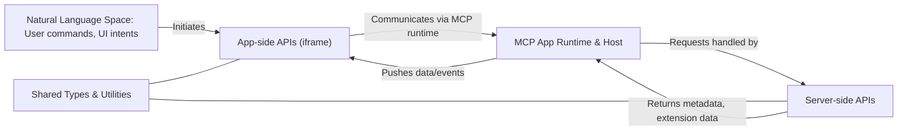

<!-- source: DeepWiki mcp.deepwiki.com · repo openai/mcp-extensions · page 3 TypeScript SDK (@openai/mcp-extensions) · fetched 2026-10-26 -->

# TypeScript SDK (@openai/mcp-extensions)

Relevant source files

The following files were used as context for generating this wiki page:

- [docs/spec.md](docs/spec.md)
- [package.json](package.json)

This section provides a high-level overview of the TypeScript SDK available in the `typescript/` package of the **mcp-extensions** repository. This SDK facilitates building MCP Servers and MCP App clients by providing utilities and type-safe helpers that implement the OpenAI MCP Extensions specification. It broadly covers three main areas:

- **Server-side helpers** for declaring extension metadata and implementing extension logic.
- **App-side client helpers** that run within MCP Apps or iframes to communicate with the MCP runtime.
- **Shared types and utilities** for consistent typing, resource management, and tooling configuration.

Detailed technical explanations and examples for each sub-area are provided in dedicated child pages linked below.

---

## Overview of the TypeScript SDK

The TypeScript SDK builds on top of the core MCP and MCP Apps specs, adding ChatGPT-specific extension capabilities such as entrypoints, mentions, resources, UI messages, forms, and settings. It aims to streamline development by encoding extension protocols, schemas, and patterns as reusable functions, classes, and types that can be imported directly into your TypeScript projects.

The SDK itself is organized into three conceptual areas that map cleanly to different usage contexts and code organization:

### 1. Server-side APIs (`typescript/src/server`)

This sub-package contains tools aimed at MCP Server developers. It supports defining extension metadata, declarations, and handlers that control how the server exposes extensions to clients and the model.

Key components include:

- `extensions.ts` — Helpers for declaring extension metadata and entrypoints.
- `mentions.ts` — Support for composer at-mentions extensions.
- `resources.ts` — Resource search and display extensions, filesystem access helpers.
- `settings.ts` — Structured settings schema and validation.
- `ui.ts` — UI message extensions and model context updates.
- `forms/` — Full support for OpenAI form elicitation protocols and related helpers.

Server-side extensions metadata typically reside in the `_meta` namespace of MCP App manifests and tools lists, registering how the extensions behave and appear in clients.

For detailed usage and API references, see [Server-side APIs](#3.1).

### 2. App-side (iframe) APIs (`typescript/src/app`)

These APIs are designed to run inside MCP Apps or iframe environments embedded in ChatGPT. They provide communication bridges to the MCP App container runtime and handle runtime behaviors like deep linking, file management, messaging, model context updates, and resource handling.

Notable modules:

- `transport` — Messaging and communication layer with MCP host.
- `deep-link` — APIs to work with deep linking within ChatGPT.
- `files` — Helpers to manage file resources and opening.
- `message` — Extensions for UI messaging.
- `model-context` — Handling of model context updates.
- `resources` — Display and interaction with resource data.

These helpers abstract the complexity of interacting with the MCP runtime securely and consistently within the iframe context.

For details on app-side runtime integration, refer to [App-side (iframe) APIs](#3.2).

### 3. Shared Types & Utilities (`typescript/src/shared`)

This area includes common shared code used by both server and app sides:

- `file-entrypoint` — Types and helpers related to file entrypoints.
- `resources` — Shared resource type definitions and utilities.
- `strings` — String manipulation utilities.
- Build and type-check configurations for ensuring consistent typings across the SDK.

These shared utilities enforce consistent data shapes and behaviors, easing type safety and developer experience.

See [Shared Types & Utilities](#3.3) for more information.

---

## Relation and Architecture

The TypeScript SDK reflects the natural layering of the MCP Extensions ecosystem, bridging from server declaration to client consumption, and unifying shared logic in between.

This diagram shows:

- How user interactions and ChatGPT interface events are handled by the app-side helpers.
- The app communicates with the MCP runtime bridge.
- The server-side APIs declare and implement the extension metadata, responding to client/runtime requests.
- Shared utilities support common models and data structures throughout.

---

## Summary and Useful Links

The TypeScript SDK (`@openai/mcp-extensions`) is the primary technical foundation for implementing MCP Extensions in TypeScript, supporting both the server and client sides with shared types.

- Server extensions setup and metadata declaration is described in detail in [Server-side APIs](#3.1).
- Client-side (app iframe) communication and runtime bridging is covered in [App-side (iframe) APIs](#3.2).
- Types, utilities, and tooling configuration common to both are explained in [Shared Types & Utilities](#3.3).

Refer to these child pages for full API references, examples, and usage guidance.

---

## Sources

- [docs/spec.md:1-131]()
- [package.json:1-30]()

---

