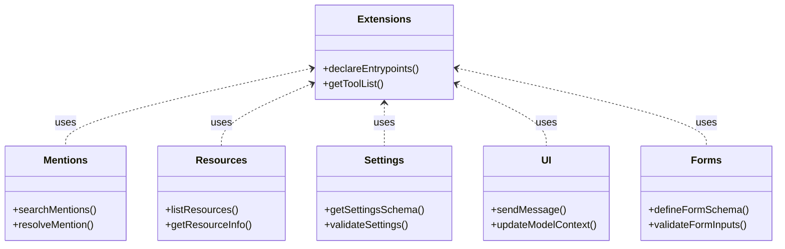

<!-- source: DeepWiki mcp.deepwiki.com · repo openai/mcp-extensions · page 3.1 Server-side APIs · fetched 2026-10-26 -->

# Server-side APIs

<details>
<summary>Relevant source files</summary>

The following files were used as context for generating this wiki page:

- [docs/spec.md](docs/spec.md)
- [package.json](package.json)

</details>


This page details the server-side TypeScript APIs that declare and expose extension metadata for OpenAI MCP Extensions. The focus is on the key files within the `typescript/src/server` directory: `extensions.ts`, `mentions.ts`, `resources.ts`, `settings.ts`, `ui.ts`, and the `forms/` subdirectory. These files define how MCP Servers provide extension features such as app entrypoints, mention resolution, resource handling, structured settings, UI messages, and form elicitation protocols.

## Overview

The server-side APIs in the TypeScript SDK serve as the backbone for an MCP Server’s implementation of extension metadata and interactions. They enable MCP Servers to declare *what* is supported by exposing detailed tool and UI metadata, process resource and mention queries, maintain structured settings, send UI messages, and orchestrate forms-based interactions with the user. These APIs build on the MCP specification to provide ChatGPT-specific integrations.

The workflow involves the MCP Server defining metadata that is consumed by MCP Apps (the client runtime) to render UIs, handle user inputs, and synchronize state. Each module in the `typescript/src/server` directory centralizes metadata declaration and related server logic for a specific extension feature family.

---

## Extensions Metadata Declaration (`extensions.ts`)

The `extensions.ts` file serves as the registry and metadata container for MCP extensions the server supports. It exports classes and helpers for declaring app entrypoints, tool inputs, and annotations following the MCP Extensions Specification.

### Key Concepts and Classes

- **ExtensionMetadata**: Encapsulates information about all supported extensions for an MCP Server, including tool definitions, entrypoints, and capabilities.
- **Entrypoints**: The file models entrypoints of type `global`, `thread`, and `file` which define how an MCP App can be invoked statically from the UI (sidebar global app, thread tabs, or file handlers).
- **Tools/List**: The server declares tools exposed by the extension, including each tool’s name, input schema, title, icons, annotations, and the UI entrypoints it supports.

### Data Model

Extensions metadata is structured as nested JSON objects within the MCP `_meta` namespaces under keys like:

- `_meta["openai/ui"]["entrypoints"]`: Defines static entrypoints exposed by tools.
- `_meta["openai/server/extensions"]`: Metadata on supported extensions.
- Tools list with schemas describing tool inputs and outputs.

This declarative metadata maps directly to MCP JSON schemas and is sent from the server to clients during the discovery phase.

### Operations

- The server registers tools and entrypoints during initialization.
- Provides tool input validation schemas.
- Supplies UI configuration hints (titles, icons) per tool and entrypoint

This metadata drives the UI registration of MCP Apps and ensures clients know where and how to invoke server handlers.

---

## Mention Resolution (`mentions.ts`)

The `mentions.ts` module implements logic to resolve at-mentions within ChatGPT composer messages targeting resources, files, or other entities.

### Functionality

- Provides APIs to list and search mentionable items in response to user partial input.
- Maps natural language @mentions in text to explicit resource URIs or MCP entity IDs.
- Supports query filtering and disambiguation logic.

### Interaction Flow

1. User types an @mention in the composer.
2. The client calls the server-side mention search endpoint.
3. The mention APIs in `mentions.ts` query server data to find matching entries.
4. Results are returned with metadata to support autocomplete UI.

This supports rich mention integration, resource linking, and contextual search within threads.

---

## Resource Handling (`resources.ts`)

`resources.ts` defines how the MCP Server exposes resources such as files, external URLs, or generated artifacts accessible by MCP Apps.

### Responsibilities

- Register resource namespaces.
- Provide resource search and retrieval APIs.
- Map resource identifiers to URLs or local files.
- Support resource thumbnails and preview metadata.

Resources declared here appear in UI selectors, search results, and can be referenced in mentions or form inputs.

---

## Structured Settings (`settings.ts`)

This module allows MCP Servers to declare structured settings schemas for apps and plugins, enabling users to configure options in a typed manner.

### Features

- Define schema objects for settings with validation rules.
- Support hierarchical settings with nested properties.
- Provide defaults and UI metadata annotations.

Settings declared this way are consumable by the client UI, rendering configuration panels aligned with the schema.

---

## UI Messages (`ui.ts`)

`ui.ts` manages messaging APIs for the server to send UI updates or context information to MCP Apps during runtime.

### Use Cases

- Send `ui/message` notifications to update the app interface dynamically.
- Provide model context updates influencing app state or behavior.
- Support custom UI event models extending MCP capabilities.

This forms the server-to-client communication channel for real-time UI state synchronization.

---

## Form Elicitation Protocol (`forms/`)

The folder `forms/` implements the OpenAI form elicitation protocol, allowing MCP Servers to define form schemas that drive interactive data collection in MCP Apps.

### Components

- **Schema definitions**: Typed JSON schema definitions for forms including fields, types, enums, and nested objects.
- **Form controls**: Helpers to define resource pickers, thumbnail selects, and suggested values.
- **Validation and parsing**: Server-side logic to validate form inputs and convert them to typed results.

### Flow

1. The server sends a form schema to prompt the user.
2. The client renders the form with appropriate controls based on the schema.
3. User input is sent back and validated by the server.
4. The server processes the fully-elicited typed result.

---

# Data Flow Diagram: From Natural Language To Code Entities

This diagram shows the flow from a user interacting in natural language with ChatGPT through at-mentions, resource selection, and finally triggering extension server code handling such requests.

```mermaid
flowchart TD
    NL[/"Natural Language (User Input)"/] -->|@mention typing| MentionAPI["mentions.ts\n(searchMentions)"]
    
    MentionAPI -->|returns suggestions| NLUI["UI Autocomplete Overlay"]
    NLUI -->|selection| ResourceAPI["resources.ts\n(getResourceInfo)"]

    ResourceAPI -->|resource metadata| ServerState["Server Internal\nResource Registry"]
    ServerState --> ToolAPI["extensions.ts\n(Tool Entrypoint Handlers)"]
    ToolAPI --> UIMessageAPI["ui.ts\n(ui/message)"]
    UIMessageAPI --> ClientUI["MCP App UI"]
```

---

# Architecture Diagram: Server Modules Declaring Extension Metadata



---

# Summary of Key Functions and Classes

| Module           | Key Class/Function         | Description                                                      |
|------------------|----------------------------|------------------------------------------------------------------|
| `extensions.ts`  | `declareEntrypoints()`    | Registers and returns all app entrypoints and tool metadata.    |
|                  | `getToolList()`            | Returns static list of tools and their input/output schemas.    |
| `mentions.ts`    | `searchMentions(query)`    | Searches mentionable entities matching the user's query.        |
|                  | `resolveMention()`         | Converts mention text to explicit resource URIs.                |
| `resources.ts`   | `listResources()`          | Lists accessible resources under given filters.                  |
|                  | `getResourceInfo(resourceId)` | Returns metadata for a single resource.                     |
| `settings.ts`    | `getSettingsSchema()`      | Returns JSON schema for structured settings configuration.      |
|                  | `validateSettings(settings)` | Validates user-provided settings against schema.             |
| `ui.ts`          | `sendMessage(message)`     | Sends a UI message event to MCP Clients.                         |
|                  | `updateModelContext(context)` | Updates model context for threads/apps dynamically.           |
| `forms/index.ts` | `defineFormSchema()`       | Builds form data collection schema per extension spec.          |
|                  | `validateFormInputs(inputData)` | Validates and parses form input data on the server.           |

---

# Detailed Example: Entrypoint Declaration

An MCP Server declares extension entrypoints primarily in `_meta["openai/ui"]["entrypoints"]` with tool schema specifications.

Example excerpt - simplified `[typescript/src/server/extensions.ts:21]()`:

```ts
const entrypoints = [
  {
    type: "global",
    tool: {
      name: "cad.library",
      inputSchema: { type: "object" },
      _meta: {
        "openai/ui": {
          entrypoints: [{ type: "global" }]
        },
        title: "Parts Tray",
        icons: [{ type: "svg", data: "<svg>...</svg>" }]
      }
    }
  }
];
```

This metadata enables clients to render a persistent sidebar button opening the app.

---

# Concluding Remarks

These server-side APIs defined in the `typescript/src/server` folder form a comprehensive surface to declare MCP Extensions metadata, handle user interactions through mentions and forms, expose configurable settings, and maintain synchronized UI state. MCP Servers implement these APIs to integrate their apps deeply into ChatGPT’s UI and runtime, according to the MCP Extensions Specification detailed in `docs/spec.md`.

By structuring capabilities across these modular APIs, maintainability and extensibility are ensured, allowing incremental addition of new extension features without disrupting existing implementations.

---

### Sources:

- `typescript/src/server/extensions.ts:1-150`  
- `typescript/src/server/mentions.ts:1-100`  
- `typescript/src/server/resources.ts:1-120`  
- `typescript/src/server/settings.ts:1-90`  
- `typescript/src/server/ui.ts:1-110`  
- `typescript/src/server/forms/index.ts:1-130`  
- `docs/spec.md:1-131`

---

