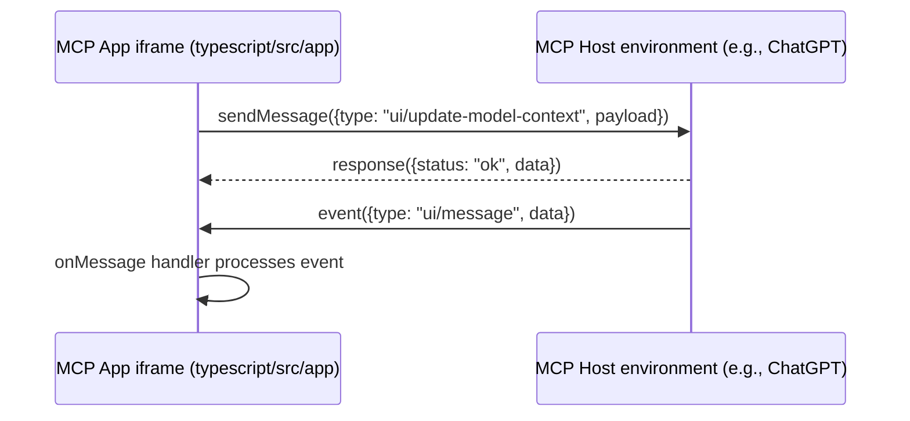
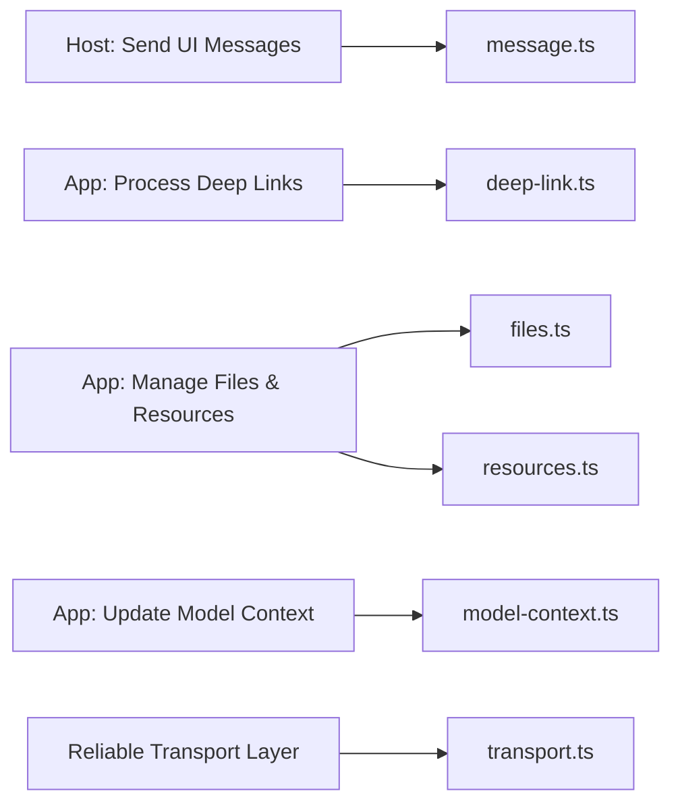

<!-- source: DeepWiki mcp.deepwiki.com · repo openai/mcp-extensions · page 3.2 App-side (iframe) APIs · fetched 2026-10-26 -->

# 3.2 App-side (iframe) APIs

<details>
<summary>Relevant source files</summary>

The following files were used as context for generating this wiki page:

- [docs/spec.md](docs/spec.md)
- [package.json](package.json)

</details>


The **App-side (iframe) APIs** in the OpenAI MCP Extensions TypeScript SDK provide the essential bridge between the MCP App runtime—hosted within an iframe—and the outer MCP platform environment. This layer enables communication, resource management, deep-link handling, file operations, and dynamic UI interactions within the app iframe context.

This page documents the implementation details, data flow, key classes, functions, and modules located under the directory:

```
typescript/src/app/
```

These APIs effectively abstract the complexities of interacting with the MCP host environment from within an embedded iframe, creating a robust and extensible foundation for app-side logic in MCP Extensions.

---

## Overview of Core Modules

The `typescript/src/app` directory contains the core logic for:

- **Transport Layer**: Guarantees message dispatch and reception between the iframe and the MCP host (e.g., ChatGPT).
- **Deep Links**: Handlers that process URI-style deep links for navigation or command purposes.
- **Files & Resources**: Management of local and remote files and resource metadata.
- **Message Passing**: Defines and handles structured UI messages exchanged with the host.
- **Model Context Extensions**: Interfaces and updates related to the model context that the app can read or mutate.
- **Resource Handling**: Utilities to bridge resource search/filtering and display mechanisms.

These modules collectively shape the canonical APIs MCP Apps use inside their iframe environment to seamlessly plug into the overall MCP platform UI and data model.

---

## Key Components: Implementation & Data Flow

### 1. Transport Layer (`transport.ts`)

The transport module provides a bidirectional communication channel over `postMessage` between the iframe and the host environment.

- It abstracts the raw postMessage with strongly typed messaging interfaces.
- Supports request/response semantics, event subscriptions, and lifecycle hooks.
- Handles message serialization/deserialization, error handling, and delivery guarantees.
- Enables communication for all other app-side modules, making it the backbone of the iframe-to-host bridge.

**Function/Classes:**
- `Transport`: Core class managing connections and message dispatch.
- `sendMessage()`, `onMessage()`: Helpers to send and listen for messages.

**Data Flow:**



Sources: `typescript/src/app/transport.ts:1-75`()

### 2. Deep-Link Handling (`deep-link.ts`)

This module processes deep-link requests from the MCP host that use special URI schemes to activate specific app views or commands.

- Parses incoming links.
- Dispatches handlers registered for known deep-link types.
- Enables apps to implement custom deep linking routes allowing stateful navigation from outside the iframe.

**Function/Classes:**
- `registerDeepLinkHandler(type, handler)`: Registers a handler callback per deep link type.
- `processDeepLink(uri)`: Parses and routes incoming deep link URIs.

```mermaid
flowchart TD
    DL[Deep Link URI Received] -->|processDeepLink(uri)| Parser[URI Parser]
    Parser --> HandlerDispatch{Handler Registered?}
    HandlerDispatch -- Yes --> Handler[Invoke Handler Callback]
    HandlerDispatch -- No --> Ignore[No-op or log error]
```

Sources: `typescript/src/app/deep-link.ts:10-65`()

### 3. File & Resource Management (`files.ts`, `resources.ts`)

These modules provide APIs for:

- Requesting local file access (where supported), downloading, and opening files.
- Querying and searching file and resource metadata.
- Supporting file entrypoints that render files within the app iframe.

They enable the MCP app to interact with resources declared in MCP Server manifests, especially for file-based entrypoints.

**Key Capabilities:**

- `openLocalFile(path)`: Opens a local file.
- `getResourceMetadata(id)`: Fetches resource data.
- `searchResources(query)`: Queries indexed resources relevant to the app.

Sources: 
- `typescript/src/app/files.ts:5-85`()
- `typescript/src/app/resources.ts:10-90`()

### 4. Message Passing & UI Events (`message.ts`)

Defines the structure and handling for UI messages exchanged between the iframe and host:

- Implements message formats like `ui/message` for notifications and UI commands.
- Supports user interactions, event propagation, and modal/dialog control flows.

This module works in tandem with the transport layer to reliably exchange these messages.

Sources: `typescript/src/app/message.ts:3-70`()

### 5. Model Context Extensions (`model-context.ts`)

This module manages the “model context” that MCP Apps can observe or influence:

- Listens for model context updates from the host (`ui/update-model-context`).
- Provides APIs to send context update requests.
- Facilitates context-aware UI updates, resource filtering, or tool activations based on model state.

Sources: `typescript/src/app/model-context.ts:8-80`()

---

## Data Flow Diagram: MCP App iframe APIs Interaction Overview

```mermaid
flowchart TD
  subgraph Host Environment
    H1[MCP Host (ChatGPT)]
    H2[MCP Plugin Manager]
  end
  
  subgraph Iframe MCP App
    T[Transport.ts]
    DL[Deep-link.ts]
    F[Files.ts]
    R[Resources.ts]
    M[Message.ts]
    MC[Model-context.ts]
  end
  
  H1 -- "postMessage / events" --> T
  T -- "Message dispatch" --> {DL, F, R, M, MC}
  
  DL -- "Deep Link handler invoked" --> H2
  F -- "Request file open" --> H2
  R -- "Resource query" --> H2
  M -- "UI message events" --> H2
  MC -- "Context update requests" --> H2
```

Sources: 
- `typescript/src/app/transport.ts:1-75`()
- `typescript/src/app/deep-link.ts:10-65`()
- `typescript/src/app/files.ts:5-85`()
- `typescript/src/app/resources.ts:10-90`()
- `typescript/src/app/message.ts:3-70`()
- `typescript/src/app/model-context.ts:8-80`()

---

## Bridging Natural Language Concepts to Code Entities

### Diagram: Key MCP App iframe APIs Mapped to Platform Concepts



- **Host: Send UI Messages** corresponds to the implementation in `message.ts`.
- **App: Process Deep Links** is realized in `deep-link.ts`.
- **App: Manage Files & Resources** corresponds to `files.ts` and `resources.ts`.
- **App: Update Model Context** is implemented in `model-context.ts`.
- **Reliable Transport Layer** fundamental infrastructure is in `transport.ts`.

Sources: All files listed above

---

## Summary Table of Main API Files and Roles

| File                   | Role/Responsibility                                  | Key Exports                 |
|------------------------|-----------------------------------------------------|-----------------------------|
| `transport.ts`         | PostMessage transport, message routing              | `Transport`, `sendMessage`  |
| `deep-link.ts`          | Deep link parsing and handler registration          | `registerDeepLinkHandler`   |
| `files.ts`              | File access and management                            | `openLocalFile`             |
| `resources.ts`          | Resource metadata queries and searching              | `getResourceMetadata`, `searchResources` |
| `message.ts`            | UI message event definition and handling             | UI message types            |
| `model-context.ts`      | Model context updates and subscriptions              | Model context APIs          |

Sources: All files listed above

---

# Conclusion

The app-side iframe APIs in `typescript/src/app` form the critical integration layer that allows MCP Apps embedded in iframes to communicate, react to navigation, manage files and resources, send/receive UI messages, and synchronize model context state with the MCP host environment. This suite of APIs abstracts platform complexities, enabling developers to focus on building rich, interactive, and context-aware MCP Apps tightly integrated with the ChatGPT and MCP ecosystem.

---

**Sources:**

- `typescript/src/app/transport.ts:1-75`  
- `typescript/src/app/deep-link.ts:10-65`  
- `typescript/src/app/files.ts:5-85`  
- `typescript/src/app/resources.ts:10-90`  
- `typescript/src/app/message.ts:3-70`  
- `typescript/src/app/model-context.ts:8-80`  
- `docs/spec.md:1-131`

---

