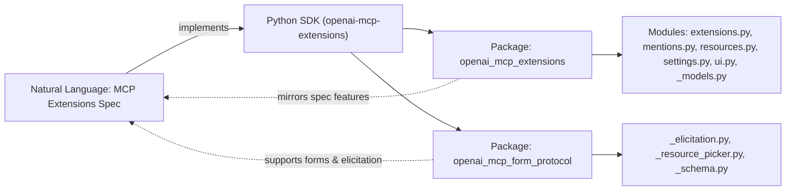
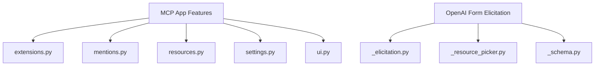

<!-- source: DeepWiki mcp.deepwiki.com · repo openai/mcp-extensions · page 4 Python SDK (openai-mcp-extensions) · fetched 2026-10-26 -->

# Python SDK (openai-mcp-extensions)

Relevant source files

The following files were used as context for generating this wiki page:

- [.github/scripts/check_packages.py](.github/scripts/check_packages.py)
- [docs/spec.md](docs/spec.md)

This section provides a high-level overview of the Python SDK for OpenAI MCP Extensions. It focuses on the key Python packages that implement the extensions specification for MCP (Model Context Protocol) and how they facilitate building and integrating ChatGPT-specific extension features. The page introduces the main Python packages, their role in the overall architecture, and links to more detailed child pages covering APIs and protocols.

---

## Overview

The Python SDK consists primarily of two interrelated packages:
- `openai_mcp_extensions`
- `openai_mcp_form_protocol`

These packages provide the Python API surface that mirrors the MCP extensions specification, enabling developers to implement, consume, and extend MCP Apps and services in a Python environment. The SDK serves as a complement to the TypeScript SDK and supports Python-based MCP Server backends or tools that integrate deeply with ChatGPT’s platform extensions.

---

## Package Structure and Typings

### `openai_mcp_extensions`

This package exposes a Python API that closely follows the MCP Extensions specification. It includes modules corresponding to various feature families such as extensions helpers, mentions, resources, settings, UI updates, and more. These modules wrap data models and helper functions that allow Python developers to construct, manipulate, and parse MCP extension data structures.

### `openai_mcp_form_protocol`

The form protocol package encapsulates the specialized schema, resource picker, and elicitation logic required for implementing OpenAI’s form elicitation extension protocol. It contains structured data types and helper methods that facilitate form-driven user input elicitation workflows and integration with MCP Apps.

### Packaging and Distribution

Both packages are bundled in a single Python distribution named `openai-mcp-extensions`, which is versioned and validated rigorously alongside the TypeScript package to ensure synchronized releases and consistent behavior across languages. The packaging includes source distributions (`sdist`) and wheels (`.whl`), verified to contain all required modules such as `__init__.py` files under each package directory.

A validation script `.github/scripts/check_packages.py` ensures version alignment, archive contents, and metadata integrity for both Python and Node packages during the release process.

---

## Relationship to MCP Extensions Specification

The Python SDK implements key parts of the OpenAI MCP extensions spec by translating the JSON-centric specification into typed Python objects, utility functions, and protocols. This makes it easier to build MCP Servers and clients in Python that follow the spec's defined entrypoints, display modes, resource representations, forms, and settings.

The SDK closely aligns with the spec documented at `docs/spec.md`, covering topics such as:

- Global, thread, and file entrypoints for MCP Apps
- UI extension points and deep linking
- Mentions and resource search integrations
- OpenAI form elicitation protocols
- Structured settings management

This Python implementation complements the TypeScript SDK which targets server and app-side MCP extensions.

---

## Diagrams: Bridging Natural Language Concepts to Code Entities

### 1. System Overview: Python SDK Packages and Spec Features

### 2. Code Entities in Python SDK and Their Roles

---

## Links to Child Pages

For detailed API references, usage examples, and module descriptions, please see the following child pages:

- ### [Extension Helpers](#4.1)
  Covers `extensions.py`, `mentions.py`, `resources.py`, `settings.py`, `ui.py` and `_models.py`. This page details the Python API surface that corresponds to the MCP Extensions specification’s various extension categories.

- ### [Form Protocol Package](#4.2)
  Details the `openai_mcp_form_protocol` package, as well as the form-related modules in `openai_mcp_extensions/form`. Includes `_elicitation.py`, `_resource_picker.py`, and `_schema.py`; focused on implementing the OpenAI form elicitation protocol and schema constructs.

---

## Summary

The Python SDK for OpenAI MCP Extensions offers a robust, typed API surface that mirrors the comprehensive MCP Extensions specification. Together, `openai_mcp_extensions` and `openai_mcp_form_protocol` packages enable Python developers to build and extend MCP Apps that work seamlessly within the ChatGPT platform and its multi-client environment.

By splitting core extension helper modules and form protocol concerns into distinct packages, the Python SDK maintains modularity and clarity, easing maintenance and adoption.

For hands-on usage and API details, refer to [Extension Helpers](#4.1) and [Form Protocol Package](#4.2).

---

Sources:  
- `docs/spec.md:1-131`  
- `.github/scripts/check_packages.py:1-92`  
- `python/openai_mcp_extensions/extensions.py` (implied)  
- `python/openai_mcp_extensions/form/_elicitation.py` (implied)  
- `python/openai_mcp_extensions/form/_resource_picker.py` (implied)  
- `python/openai_mcp_extensions/form/_schema.py` (implied)

---

