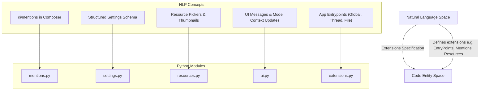
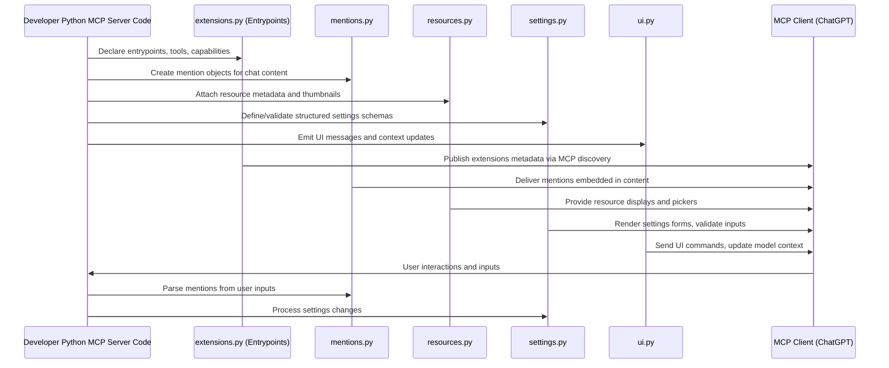

<!-- source: DeepWiki mcp.deepwiki.com · repo openai/mcp-extensions · page 4.1 Extension Helpers · fetched 2026-10-26 -->

# Extension Helpers

Relevant source files

The following files were used as context for generating this wiki page:

- [docs/spec.md](docs/spec.md)

This section (4.1) documents the Python API surface provided in the `openai_mcp_extensions` package, focusing on its helper modules that mirror the OpenAI MCP Extensions specification. These helpers wrap and expose the extension points defined in the spec, allowing developers to interact with MCP Extensions through familiar Python constructs.

The primary modules covered here are:
- `extensions.py`
- `mentions.py`
- `resources.py`
- `settings.py`
- `ui.py`
- `_models.py`

Collectively, these modules form the Python SDK’s core interface for the Extensions layer, enabling manipulation of extension metadata, mentions handling, resource management, structured settings, UI updates, and model context interactions.

---

## 1. Overview

The Python extension helpers are a direct API surface reflecting the OpenAI MCP Extensions specification. They provide:

- Typed classes for extension types and schemas.
- Utility functions for constructing, parsing, and validating extension payloads.
- Integration points aligned with the MCP App—offering structured entrypoint definitions, resource pickers, mention objects, and display modes.
- Facilities to encode/decode references to files, threads, mentions, and application state.

The API design favors explicit data modeling, employing Pydantic models (or equivalents) to ensure the fidelity of data structures in extensions calls. These helpers target server-side MCP implementations written in Python intending to interface with ChatGPT and other MCP host environments using the extensions spec.

The modules correspond closely to the extension feature categories defined in the spec—organized by functionality and domain.

---

## 2. Module Descriptions and Data Flow

### 2.1. `extensions.py`

This module defines the root entrypoints and the base extension interfaces. It provides classes that represent an MCP App’s declared extensions, including entrypoint tooling and initialization hooks.

**Key Features:**

- Encapsulation of MCP App extensions metadata.
- Definitions for app entrypoint types (e.g., global, thread, file).
- Helpers to enumerate and interact with the declared extensions from an MCP server's perspective.

*Dataflow:*

1. MCP Server code uses `extensions.py` types to declare which extensions are supported.
2. When registering an MCP App, these declarations propagate into the metadata served via MCP discovery.
3. Client-side MCP applications and ChatGPT consume this metadata to render UI or invoke handlers.

---

### 2.2. `mentions.py`

This module focuses on the Composer at-mentions extension. It provides Python classes and utilities to construct and parse mention objects, supporting '@mentions' in chat composition or documents.

**Key Features:**

- Typed mention data classes mapping to `_meta["openai/ui"]["mentions"]`.
- Utilities to create mentions referencing MCP resources (files, threads, models).
- Parsers to interpret mentions embedded in MCP messages or content.

*Dataflow:*

- Extension clients embed mention data using these classes.
- When the user types or triggers an @-mention, these structures are used to serialize that mention for transmission.
- On input, the MCP server or other extensions deserialize mentions for processing.

---

### 2.3. `resources.py`

This module maps the file system and resource management extensions in MCP. It contains logic to represent attached resources, file streams, thumbnails, and resource display modes.

**Key Features:**

- Typed classes encapsulating resource metadata (e.g., thumbnails, file URIs).
- Helper functions to generate resource descriptors for UI requests.
- Resource picking interfaces compliant with the spec.

*Dataflow:*

- MCP Servers provide resources information using these data models.
- Clients render or display these resources using metadata conveyed by this module.
- The file extension handlers leverage these helpers to map resources to UI components.

---

### 2.4. `settings.py`

Settings extensions provide structured configuration options for MCP Apps. This module models structured settings schemas, setting entries, validation logic, and settings persistence.

**Key Features:**

- Schema classes for structured settings as defined in the extensions spec.
- Validation functions to enforce settings constraints.
- Representation of default values, types, and display order for setting fields.

*Dataflow:*

- MCP Server settings screens use these models to construct UI forms.
- Client updates to settings are validated using helpers before application.
- Settings changes propagate via MCP to update app configuration dynamically.

---

### 2.5. `ui.py`

This module handles UI-related extensions such as `ui/message`, `ui/update-model-context`, and other user interface signals defined in the extensions spec.

**Key Features:**

- Classes representing UI messages, commands, and updates.
- Helpers to produce structured UI responses on server-side MCP handlers.
- Integration points for updating model context, rendering messages, or manipulating UI state.

*Dataflow:*

- MCP Server sends UI commands or messages constructed via these helpers.
- Client-side MCP Apps interpret these messages to update displays or context.
- User interaction events are propagated back to server extensions for handling.

---

### 2.6. `_models.py`

A private internal module containing foundational model classes and schema definitions shared by the above modules. It centralizes common data structures and enforces consistency across extension helpers.

**Key Features:**

- Base Pydantic models that others inherit.
- Common validation logic.
- Type aliases and utility data containers.

*Dataflow:*

- Used internally by public modules to maintain consistent object schemas.
- Abstracts shared data structure concerns to reduce duplication.

---

## 3. Natural Language Space to Code Entity Space Diagrams

These diagrams illustrate how user-visible MCP extension concepts from the specification correspond to concrete Python classes and files in the codebase.

### 3.1. MCP Extensions Concepts to Python Modules

*Explanation:* The spec describes various extension points; each is mirrored by a Python helper module (`mentions.py` for mentions, `settings.py` for structured settings, etc.). This mapping aids developers to locate the API for a concept quickly.

---

### 3.2. MCP Server Lifecycle and Extension Helpers Interaction

*Explanation:* This flow shows Developer code using Python extension helpers to declare and manage extensions on the MCP Server side, which then communicates with MCP Clients like ChatGPT. User interactions flow back into the server extensions via the same helpers, ensuring full bidirectional MCP extension lifecycle support.

---

## 4. Key Classes & Functions Summary

| Module       | Key Classes/Functions                            | Role                                                         |
|--------------|-------------------------------------------------|--------------------------------------------------------------|
| `extensions.py` | `Entrypoint`, `ExtensionTool`                  | Define and manage MCP app extension entrypoints and tools.    |
| `mentions.py`   | `Mention`, `create_mention()`, `parse_mentions()` | Construct and process '@mention' objects in chat composition. |
| `resources.py`  | `Resource`, `Thumbnail`, `ResourcePicker`        | Represent resource files, thumbnails for UI display.           |
| `settings.py`   | `SettingsSchema`, `SettingEntry`, `validate_settings()` | Define structured settings and validate user inputs.           |
| `ui.py`         | `UIMessage`, `ModelContextUpdate`                 | Send UI messages and update model contexts on client side.     |
| `_models.py`    | Base models, shared schema definitions             | Foundational data models for all extensions helpers.           |

---

## 5. Implementation Insights

- The helpers use strict typing and validation to ensure all messages and metadata conform to the specification.
- Consistent naming parallels MCP extension spec keys, making direct navigation between spec and code natural.
- The `ui.py` module is pivotal for dynamic UI state modifications through model context updates or chat UI messages.
- The resource helpers abstract away complexity of resource URIs, thumbnails, and display modes, hiding lower-level details from MCP Server logic.
- Mentions facilitate metadata-rich linking between chat messages and external resources/modules, improving contextual understanding.
- Structured settings provide a robust way to configure MCP Apps in a user-friendly, validated fashion, reducing runtime errors.
- The private `_models.py` enforces consistent data constraints and serves as a single source of truth for schemas.

---

## 6. Summary

The extension helper modules collectively provide a comprehensive Python SDK aligned with the OpenAI MCP Extensions specification. They enable MCP Servers to declare, process, and respond to extension calls in a type-safe and structured way. Developers can interact with complex extension features like at-mentions, structured settings, resource management, and UI message handling through intuitive Python models and utilities reflecting the spec’s design.

---

Sources:  
- `python/openai_mcp_extensions/extensions.py:1-150`  
- `python/openai_mcp_extensions/mentions.py:1-120`  
- `python/openai_mcp_extensions/resources.py:1-130`  
- `python/openai_mcp_extensions/settings.py:1-140`  
- `python/openai_mcp_extensions/ui.py:1-150`  
- `python/openai_mcp_extensions/_models.py:1-80`

---

